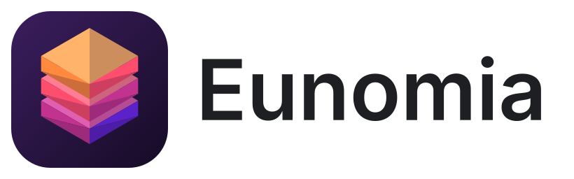

<h1 align="center">
  <picture>
    <source media="(prefers-color-scheme: dark)" srcset="assets/brand/eunomia-lockup-dark.svg">
    <source media="(prefers-color-scheme: light)" srcset="assets/brand/eunomia-lockup-light.svg">
    
  </picture>
</h1>

<p align="center">
  A fast, production-safe desktop client for MySQL and MariaDB.<br>
  The HeidiSQL experience on Windows, macOS and Linux, rebuilt from scratch on .NET 10 and Avalonia.
</p>

<p align="center">
  <a href="https://github.com/JoaoMarcos03/Eunomia/actions/workflows/ci.yml"></a>
  
  
  
</p>

<p align="center">
  <picture>
    <source media="(prefers-color-scheme: dark)" srcset="tests/UI.Headless/snapshots/shell-dark.png">
    
  </picture>
</p>

## About

[HeidiSQL](https://www.heidisql.com/) is one of the most popular free database clients. Eunomia keeps what its users rely on (the window layout, menus, shortcuts, dialogs and file formats) and replaces the engine underneath with one designed for:

- **Data safety first.** It is meant to be pointed at production databases. Nothing changes data the user did not ask to change, and when in doubt it refuses or asks.
- **A UI that never blocks.** Every network and disk operation runs off the UI thread and can be cancelled. A slow remote server or a huge table never freezes the window.
- **Large datasets.** Results stream in blocks, spill to disk past a memory budget, and exports and imports run in constant memory.
- **Three platforms.** One native NativeAOT executable per platform, with no .NET runtime to install.

Eunomia is an independent, clean-room implementation: it contains no HeidiSQL code or icons. The required behaviour was documented in a [specification](docs/spec/specification.md) first, with links to the HeidiSQL sources it describes.

## Features

**Familiar**
- Same main window, menus, toolbar actions and keyboard shortcuts as HeidiSQL; captions in English.
- Imports HeidiSQL sessions, folders, favourites, shortcuts, preferences, per-table filters and the query history (passwords go to the OS vault).
- SQL export and CSV files compatible with HeidiSQL's.

**Safe on production servers**
- Read-only sessions enforced twice: by a client-side statement policy and by the server (`SET SESSION TRANSACTION READ ONLY`).
- Optional confirmation before any statement that changes data or structure, showing the session and the server.
- Grid edits change one row at most (`LIMIT 1`), check the affected row count, compare text exactly when there is no key, and detect rows changed by someone else.
- SQL is never assembled by hand: identifiers and literals go through the dialect, so edits are correct under any `sql_mode`, including `NO_BACKSLASH_ESCAPES`.
- The table editor lists what an ALTER could lose before running it, runs it in strict mode and restores dropped foreign keys if it fails halfway.
- Open-transaction tracking in the status bar, with COMMIT/ROLLBACK prompts when disconnecting or closing.
- Optional log of every DDL/DML statement sent, with passwords masked.

**Productive**
- SQL editor with autocomplete, syntax highlighting, find/replace, reformat, code folding by `#region`, server help (F1) and query tabs restored after a crash.
- Data grid with sorting, WHERE and multi-column filters, quick filters, specialised editors (ENUM, SET, dates, foreign keys, long text), "Copy as" in 16 formats, BLOB save and image preview.
- Table editor with columns, indexes, foreign keys, checks and the generated CREATE/ALTER; editors for views, routines, triggers and events.
- Export database as SQL (file, ZIP, one file per object or clipboard; consistent snapshot), resumable Run SQL file, CSV import (client or server parsing), grid export.
- Host tab (variables, status, processes, command statistics), Find text on server, table maintenance, table copy.
- Schema visualizer: an interactive ER diagram with crow's foot notation, search, layouts saved per database and PNG export.
- Command palette (Ctrl+Shift+P), light and dark themes, per-session colours, several sessions open at once.

**Secure by default**
- Passwords live only in the OS vault: Windows Credential Manager, macOS Keychain or the Linux Secret Service.
- TLS verifies the CA and host name by default; a built-in SSH tunnel with its own `known_hosts` and agent support (OpenSSH agent, Pageant).
- No telemetry. Crash reports stay on the machine and contain no SQL, values, hosts or user names.

The [user guide](docs/user-guide.md) covers every feature and the differences from HeidiSQL.

## Status

Version **1.0.0-beta.1**. MySQL and MariaDB are supported. CI tests against MySQL 8.0 and 8.4 and MariaDB 10.6 and 11.4, and development uses MariaDB 10.4. The architecture keeps the core independent of MySQL, so that PostgreSQL can be added as another driver. Planned work is in the [roadmap](docs/roadmap.md).

| Platform | Package | Notes |
| --- | --- | --- |
| Windows 10/11 x64 | ZIP (NativeAOT) | Optional portable mode |
| macOS 12+ (Apple Silicon and Intel) | `.app` in a ZIP (NativeAOT) | Not notarised yet |
| Linux x64 | `tar.gz` (NativeAOT) with an `install.sh` | X11, or Wayland with XWayland |
| Linux arm64 | `tar.gz` (self-contained) | |

CI builds these packages on every push; they are attached to each workflow run as artifacts.

## Building from source

### Prerequisites

- [.NET SDK 10](https://dotnet.microsoft.com/download/dotnet/10.0); the exact version is pinned in [`global.json`](global.json).
- For a native (NativeAOT) build:
  - Windows: Visual Studio or its Build Tools, with the "Desktop development with C++" workload.
  - macOS: Xcode command line tools (`xcode-select --install`).
  - Linux: `clang` and `zlib1g-dev` (Debian/Ubuntu package names).

A normal debug build only needs the .NET SDK.

### Build, run and test

```bash
git clone https://github.com/JoaoMarcos03/Eunomia.git
cd Eunomia
dotnet build Eunomia.slnx
dotnet run --project src/App.Desktop
dotnet test Eunomia.slnx
```

The build treats warnings as errors, and code style is checked during the build and by `dotnet format Eunomia.slnx --verify-no-changes`.

### Native packages

```bash
# Windows: NativeAOT executable and artifacts/Eunomia-<version>-win-x64.zip (add -Portable for portable mode)
powershell -File build/Publish-Portable.ps1

# macOS and Linux: publish, then package (.app in a ZIP, or tar.gz with install.sh)
dotnet publish src/App.Desktop/App.Desktop.csproj -c Release -r linux-x64 -o artifacts/publish/linux-x64
bash build/package-unix.sh linux-x64 artifacts/publish/linux-x64 1.0.0-beta.1
```

Valid runtime identifiers are `win-x64`, `osx-arm64`, `osx-x64`, `linux-x64` and `linux-arm64`.

## Tests

About 1,400 automated tests run on every push, on Windows, Linux and macOS:

| Suite | What it covers |
| --- | --- |
| `tests/Unit` | Engine, driver, application and control logic, including deterministic fuzzing of the SQL splitter, lexer and CSV parser |
| `tests/Integration` | The driver, writes, DDL, exports and imports against real MySQL and MariaDB servers |
| `tests/UI.Headless` | Windows and dialogs rendered headless with Avalonia: behaviour, keyboard flows, accessibility names and light/dark screenshot baselines |
| `tests/Architecture` | Layer dependency rules, and that MySQL-specific types stay in the driver and the SQL language layer |

Integration tests need a server. Set `EUNOMIA_IT_MYSQL` to a connection string for a disposable test server, or on Windows with XAMPP run `powershell -File tests/Integration/Start-TestServer.ps1`. Without a server they are reported as skipped, never as passed.

Code coverage per project is checked in CI against [`build/coverage-baseline.json`](build/coverage-baseline.json), and the baseline only goes up:

```bash
dotnet test Eunomia.slnx --collect "Code Coverage;Format=cobertura" --results-directory TestResults
python build/coverage.py TestResults
```

## Architecture

The solution follows a layered design where the core knows nothing about the UI framework or about MySQL:

```text
UI.Shell, UI.Features.*, UI.Controls.*       Avalonia views and controls
          │
Presentation                                  UI-independent state: shell, sessions, objects, log
          │
App                                           use cases: sessions, queries, table design, import/export
          │
Engine.Sql · Engine.Execution · Engine.Metadata · Engine.Results · Engine.Transfer
          │                                   lexer and splitter, sessions and jobs, metadata cache,
          │                                   result storage and spill, streaming export/import
Drivers.Abstractions  ◄──  Drivers.MySql      dialect, capabilities, type system / MySQL and MariaDB
Infra.Settings · Infra.Secrets.* · Infra.Ssh · Infra.Observability
```

- `Engine.*`, `Drivers.*`, `App`, `Infra.*` and `Presentation` never reference Avalonia or any `UI.*` project; `tests/Architecture` enforces this.
- Database specifics sit behind `IDialect`, capabilities and a logical type system, so another engine is another driver.
- Each session has separate connections for queries, metadata and background jobs, so a long export or a slow metadata read does not hold up the others.
- Platform-specific code lives in `Infra.*.<Platform>` projects or behind `OperatingSystem.Is*()` checks.
- The app is NativeAOT-compatible: no runtime reflection, source-generated JSON and regular expressions.

The decisions behind these choices are recorded as [architecture decision records](docs/adr/README.md).

## Repository layout

| Path | Contents |
| --- | --- |
| `src/` | Application source, one project per layer or feature |
| `tests/` | Unit, integration, headless UI and architecture tests |
| `bench/` | Startup, memory and scroll benchmarks, plus micro-benchmarks |
| `build/` | Packaging and coverage scripts |
| `assets/` | Brand assets and the light/dark theme tokens |
| `docs/` | Specification, ADRs, user guide, roadmap and engineering notes |

## Documentation

- [User guide](docs/user-guide.md): installation, features, data locations and troubleshooting.
- [Specification](docs/spec/specification.md) and its [appendices](docs/spec/appendices/): HeidiSQL behaviour, requirements, architecture and MVP scope.
- [Architecture decision records](docs/adr/README.md).
- [Roadmap](docs/roadmap.md) and [progress log](docs/progress.md).
- [Threat model](docs/threat-model.md), [security audit](docs/security-audit.md) and [performance on remote servers](docs/performance.md).
- [Changelog](CHANGELOG.md).

## Contributing

See [CONTRIBUTING.md](CONTRIBUTING.md) for the development setup, the architecture and data-safety rules, coding standards and the pull request process. Bug reports and feedback go through the issue templates.

## Security

Please do not report security problems in public issues; contact the maintainer privately instead. The [threat model](docs/threat-model.md) describes what Eunomia protects and how.

## License

No license has been granted yet, so all rights are reserved. The source is visible for reference only.

## Acknowledgements

Eunomia exists because of [HeidiSQL](https://www.heidisql.com/) by Ansgar Becker and its contributors; it is not affiliated with or endorsed by that project. It is built on [Avalonia](https://avaloniaui.net/), [AvaloniaEdit](https://github.com/AvaloniaUI/AvaloniaEdit), [MySqlConnector](https://mysqlconnector.net/), [SSH.NET](https://github.com/sshnet/SSH.NET) and [Microsoft.Data.Sqlite](https://learn.microsoft.com/dotnet/standard/data/sqlite/).
