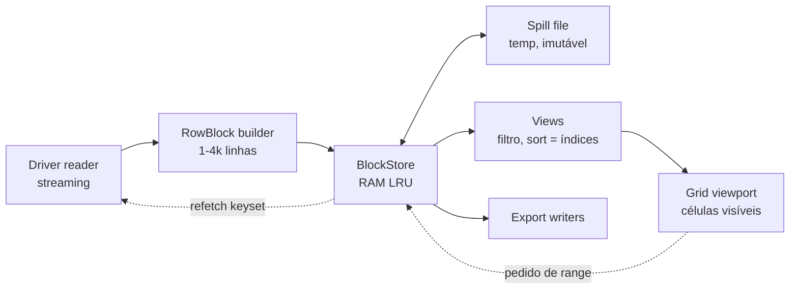
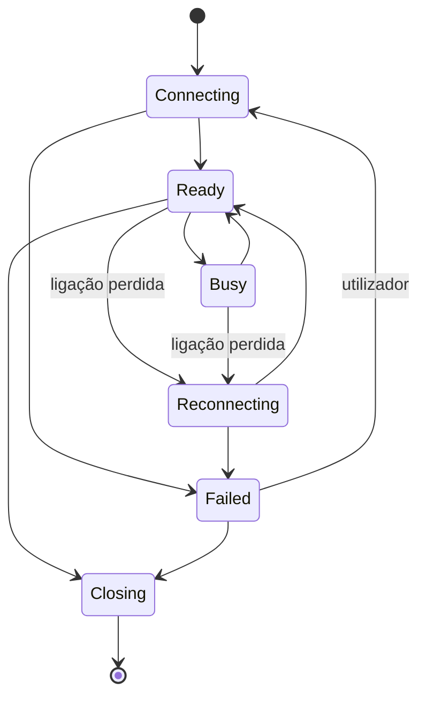
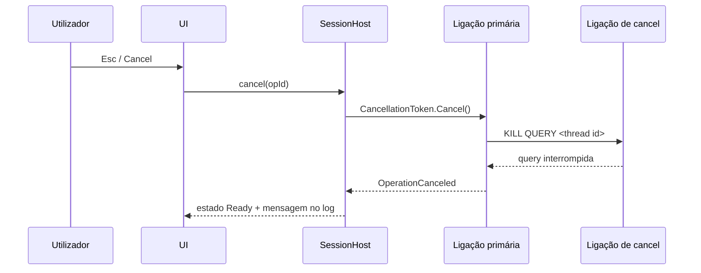
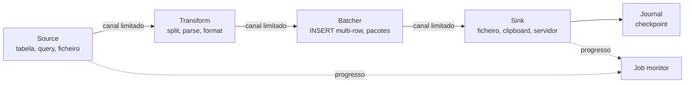
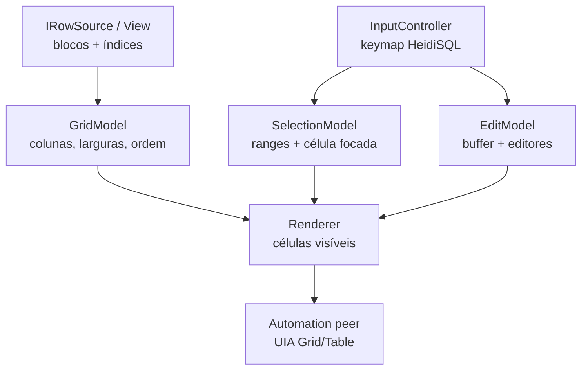
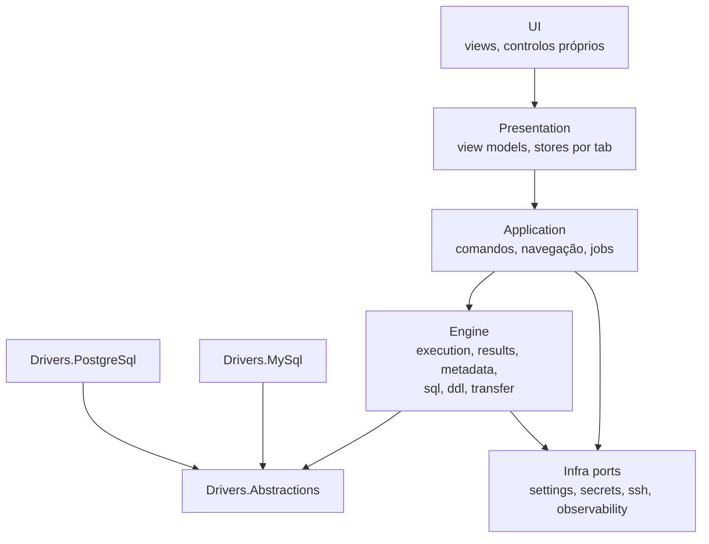
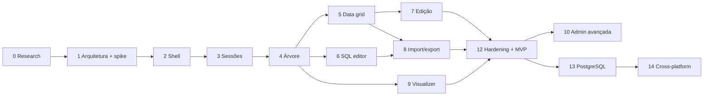

# Sucessor do HeidiSQL — Especificação técnica (Fase 0)

Sep 25, 2026 · @Marcos

## 1. Executive Summary

Os problemas de performance e estabilidade do HeidiSQL 12.21 são arquiteturais e não pontuais: quase todo o I/O corre na UI thread, cada sessão tem uma única ligação que bloqueia tudo o resto, e os resultados são materializados inteiros em memória. Um sucessor pode manter a UX praticamente igual e resolver isto com um motor novo. Recomendo C# em .NET 10 LTS com Avalonia 12, grid e árvore próprios, MySqlConnector e Npgsql, condicionado a um spike de duas semanas.

### O que a investigação confirmou

- **Filtros da árvore.** São regex case-insensitive com correspondência parcial. `;` é só sinónimo de `|`, e `*` é um quantificador, não um wildcard (secção 4.3, `main.pas#L13178`). O screenshot com `b2b;prd_products|ecm_*product` confirma esta leitura.
- **Data tab.** Corre na UI thread, busca 1.000 linhas de cada vez e corta TEXT/BLOB/JSON a 256 caracteres. "Show all" para em 100.000 linhas e só avisa no log.
- **Clipboard.** Ctrl+C copia uma célula, e Copy as tem 16 formatos com as regras de escaping documentadas.
- **Crashes.** O maintainer tem [#1694](https://github.com/HeidiSQL/HeidiSQL/issues/1694) aberto e aceite, fechou [#547](https://github.com/HeidiSQL/HeidiSQL/issues/547) como wontfix e escreveu em [#935](https://github.com/HeidiSQL/HeidiSQL/issues/935) que muitos crashes sem receita de reprodução não serão corrigidos.
- **Segurança.** As passwords usam ofuscação reversível. O plink.exe recebe a password SSH na linha de comandos, e `LOCAL INFILE` está sempre ligado.
- **Estado do projeto.** O HeidiSQL é GPL-2.0 e mantido praticamente por uma pessoa. Os ícones Icons8 só podem ser usados no HeidiSQL. A v13 vai compilar o Windows a partir do branch Lazarus.

### O que propomos

| Área | Proposta | Secção |
| --- | --- | --- |
| Familiaridade | 67 requisitos FAM verificáveis e 12 divergências deliberadas, todas justificadas | 6 |
| Concorrência | Ator por sessão com ligação primária, de metadata e de jobs; cancel dirigido; nenhum I/O na UI thread | 12 |
| Grandes datasets | Blocos colúnares com orçamento de memória, spill para disco e paginação por keyset | 11 |
| Import/export | Pipelines em streaming com backpressure e journal, com targets de pelo menos 90% do `mysqldump` e do `mysql` CLI | 13 |
| Base de dados | Contrato de provider com capabilities declarativas; PostgreSQL no desenho desde o dia 1 | 14 |
| Schema Visualizer | Nativo, sincronizado com a árvore e com a mesma sintaxe de filtro | 17 |
| MVP | Fases 0 a 9 mais hardening, com critério de saída mensurável | 27, 28 |

### Riscos principais

- **Grid próprio (R02).** Tem de atingir 60 fps com 1M linhas × 60 colunas.
- **Fidelidade de texto e menus com Skia (R11).** Tem plano B em WinForms sobre o mesmo core.
- **Âmbito (R17).** São cerca de 180 comandos, e o MVP mostra os que faltam como desativados.
- **Enquadramento legal (R15).** Clean-room face à GPL, ícones próprios e um nome próprio.

### Decisões que dependem de ti

1. **Licença.** Por decidir. O objetivo é gerar receita (doações ou uma edição Enterprise paga); até à decisão valem as regras provisórias da ADR-16.
2. **Equipa.** Tem experiência em C# ou em C++? Com C++ forte, a recomendação passa a Qt 6.
3. **Orçamento.** Há verba para code signing e crash reporting?

As divergências D9 e D10 ficaram decididas a 30 set 2026 (ADR-19).

### Por investigar (Fase 0)

Validação em runtime do comportamento lido no código (secção 4.13), baseline de performance do HeidiSQL (secção 26), golden files dos formatos, pesquisa no fórum (não feita), compatibilidade do AvaloniaEdit com Avalonia 12, qualidade de texto Skia vs ClearType, e revisão jurídica.

## 2. Product Vision

O produto é um cliente de bases de dados para Windows que um utilizador experiente de HeidiSQL abre e usa sem reaprender nada, mas com um motor interno novo, desenhado para não bloquear, não cair e não carregar datasets inteiros para memória.

### O que preservamos e o que substituímos

| Camada | Definição | Política |
| --- | --- | --- |
| A. User Experience | Layout, menus, atalhos, context menus, ícones, cores de sessão, comportamento do grid e da árvore | Preservar com fidelidade alta. Mudança só com ganho claro e justificado |
| B. Functional Behaviour | O que cada comando faz: SQL gerado, formatos de cópia, opções de export, sintaxe dos filtros, persistência | Preservar. Divergências documentadas como decisão |
| C. Internal Implementation | Threads, buffers, fetch de dados, drivers, formato de settings | Estudar para perceber bottlenecks. Nunca é requisito |

### Não-objetivos

- Não é um fork do HeidiSQL nem reutiliza o seu código. O código fonte serve para perceber comportamento, a implementação é nova (ver licenciamento na secção 3 e no Risk Register).
- Não é um cliente "de todas as bases de dados" no primeiro release: MySQL e MariaDB primeiro, PostgreSQL desenhado desde o início.
- Não é uma ferramenta de modelação (ERD forward engineering). O Schema Visualizer lê e navega o schema, não o desenha.
- Não há redesign de UX por gosto. O utilizador alvo tem anos de memória muscular no HeidiSQL.

### Product Principles

Ordem de precedência proposta para quando dois princípios entram em conflito (Recommendation, a confirmar):

1. **Data safety.** Nenhuma operação altera dados que o utilizador não pediu explicitamente. Um UPDATE sem chave única nunca é gerado em silêncio.
2. **Stability.** Um erro numa ligação, query ou export fica confinado a essa ligação, query ou export. A aplicação não cai.
3. **Non-blocking UI.** Nenhum I/O (rede, disco, driver) corre na UI thread. A UI responde a input em menos de 100 ms em qualquer estado.
4. **HeidiSQL familiarity.** Onde o utilizador procura um comando no HeidiSQL, encontra-o no mesmo sítio, com o mesmo atalho e o mesmo resultado.
5. **Large dataset support.** O custo de memória e de UI de uma operação depende do que está visível ou em trânsito, não do tamanho da tabela ou do ficheiro.
6. **Low memory pressure.** Todos os buffers têm limite. Streaming por omissão, materialização só quando o utilizador a pede.
7. **Performance.** Medida contra o HeidiSQL com benchmarks reprodutíveis (secção 26). Sem número, não há afirmação de melhoria.
8. **Predictable behaviour.** O mesmo comando produz o mesmo SQL e o mesmo output. O SQL gerado é sempre visível no log.
9. **Fast interaction.** Atalhos, navegação por teclado e resposta imediata ao scroll e à seleção.
10. **Keyboard-first workflows.** Tudo o que se faz com rato faz-se com teclado.
11. **Database abstraction.** O core não conhece MySQL. Conhece capabilities, dialects e um type system.
12. **Extensibility e maintainability.** Fronteiras de módulo estáveis, testes em cada fronteira, plugins só quando a API interna estabilizar (secção 21).

A precedência coloca familiaridade abaixo de estabilidade e UI não bloqueante. Exemplo concreto: se o HeidiSQL mostra um diálogo modal enquanto carrega metadata, nós mantemos o mesmo resultado final mas mostramos progresso não modal com cancelamento.

## 3. Research Methodology

A análise assenta no código fonte do HeidiSQL no commit [`c123ccdb`](https://github.com/HeidiSQL/HeidiSQL/tree/c123ccdb9e3f58d4390a05deb31f6e6effa33875) (master, 22 set 2026), que corresponde à versão dos screenshots: o título "HeidiSQL 12.21.0.7344" é o build oficial da [v12.21](https://github.com/HeidiSQL/HeidiSQL/releases), lançada a 3 ago 2026 (a revisão 7344 bate com o commit de bump de versão `effb8549` pela fórmula do `build.php`).

### Fontes, por ordem de prioridade

| Prioridade | Fonte | Uso | Cobertura |
| --- | --- | --- | --- |
| 1 | Código Pascal em `source/*.pas` (70k linhas; `main.pas` 16k, `dbconnection.pas` 11,6k) | Comportamento funcional exato: SQL gerado, formatos, filtros, threading | Alta. Cerca de 1.100 permalinks nos anexos |
| 1 | Form definitions `source/*.dfm` (37k linhas, texto) | Layout, captions, atalhos (decodificados de `ShortCut`), defaults | Alta |
| 2 | [help.php](https://www.heidisql.com/help.php), [download.php](https://www.heidisql.com/download.php), README dos branches `master` e [`lazarus`](https://github.com/HeidiSQL/HeidiSQL/tree/lazarus) | Comportamento documentado, estado do projeto | A ajuda oficial é curta. Não documenta filtros da árvore, snippets, autocomplete, cores de sessão nem formatos de export |
| 3 | [GitHub issues](https://github.com/HeidiSQL/HeidiSQL/issues) (54 via API + 12 referenciados em commits; 10 lidos na íntegra) | Problemas de performance e estabilidade, explicações do maintainer | Média |
| 4 | Histórico git (tags, commits de fix, branch `lazarus`) | Cadência, regressões, ligação issue → fix | Alta |
| 5 | 11 screenshots desta conversa (10 vistas distintas; duas imagens do separador Indexes são iguais) | Evidência visual de UI, tema, cores de sessão, SQL no log | Complementar |
| 6 | Documentação de frameworks, drivers e bibliotecas (sites oficiais, repositórios, NuGet, crates.io, npm) | Secções 14 a 25 | Média a alta |

### Legenda de evidência

| Etiqueta | Significado |
| --- | --- |
| **Confirmado** | Lido no código, num DFM, numa página oficial ou num issue aberto. Indicado com o ficheiro e a linha quando relevante (ex.: `main.pas#L13178`) |
| **Observado** | Visível nos screenshots fornecidos |
| **Inferência** | Dedução a partir do código ou de várias fontes, sem confirmação direta |
| **Não verificado** | Plausível mas sem fonte. Fica na lista de investigação pendente |
| **Recommendation** | Proposta nossa para o produto novo |

Comportamento "Confirmado" por leitura de código não foi testado em runtime: não houve uma instância Windows do HeidiSQL disponível nesta fase. A Fase 0 do roadmap inclui a validação em runtime dos pontos marcados como críticos.

### Limitações desta investigação

- O WebSearch está desativado para a organização (HTTP 403). As fontes web foram lidas por URL direto, o que reduz a descoberta de discussões fora do GitHub.
- O [fórum](https://www.heidisql.com/forum.php) não foi pesquisado. Só aparecem threads citadas em commits.
- A API de pesquisa do GitHub limitou pedidos após cerca de 12 chamadas. A tabela de issues (secção 9) é uma amostra orientada a performance e estabilidade, não um censo.
- O branch `lazarus` (futura v13, Linux e macOS já lançados, preview Windows) foi analisado só ao nível de histórico e README. O comportamento de referência é o do build Delphi para Windows.

### Contradições encontradas entre fontes

| Tema | Fonte A | Fonte B | Mais fiável |
| --- | --- | --- | --- |
| Separador do Database filter | Hint do controlo: "separated by semicolon" | Código: `;` é substituído por `\|` e o texto é uma regex; `;` e `\|` são equivalentes | Código (`main.pas#L13178`) |
| `*` nos filtros | Pressuposto habitual de wildcard | Regex: `ecm_*product` significa "ecm" seguido de zero ou mais `_` e "product" | Código, e o screenshot confirma: `ecm_stores_products` não aparece na árvore filtrada |
| Filtro do Data tab | help.php chama-lhe "simple client side filter" | Código: o painel de filtro envia uma cláusula WHERE ao servidor; só a caixa "Filter" inferior é local | Código |
| "Show all" | Caption sugere todas as linhas | Limite silencioso de 100.000 linhas (`DatagridMaximumRows`) | Código |
| "Query timeout" | Rótulo sugere timeout de query | MySQL: só timeout de ligação. PostgreSQL: `statement_timeout`. MSSQL: `CommandTimeout` | Código |
| Versões de Windows suportadas | help.php, "Requirements": 11, e 7/8/10 com problemas menores | help.php, "Compatibility": 11 x64, e 10 x64 com problemas menores | A secção Compatibility, mais recente |

### Enquadramento legal (não sou advogado; validar com jurídico)

- O HeidiSQL é GPL-2.0 ([LICENSE](https://github.com/HeidiSQL/HeidiSQL/blob/c123ccdb9e3f58d4390a05deb31f6e6effa33875/LICENSE)). Se o produto novo não for GPL, o código do HeidiSQL serve apenas para derivar esta especificação de comportamento. A equipa de implementação trabalha a partir da especificação, não do código (modelo clean-room).
- Os ícones Icons8 do HeidiSQL têm permissão exclusiva para o projeto ([readme](https://github.com/HeidiSQL/HeidiSQL/blob/c123ccdb9e3f58d4390a05deb31f6e6effa33875/readme.md)). Não podem ser reutilizados. A fidelidade visual faz-se com um icon set próprio ou licenciado com a mesma semântica.
- O nome "HeidiSQL" não deve aparecer no nome nem na marca do produto.

### Anexos de evidência

Os sete relatórios de investigação (em inglês, com permalinks para cada linha de código citada) acompanham este documento como ficheiros: A. Connections e Session Manager; B. Import, export e administração; C. Janela principal, menus, atalhos e editores; D. Árvore e data grid; E. Issues, estado do projeto e documentação; F. Frameworks de UI e linguagens; G. Drivers, parsing SQL, grafos, crash reporting e testes visuais.

## 4. HeidiSQL Feature Inventory

O HeidiSQL 12.21 tem cerca de 180 comandos (163 actions no `ActionList1` mais 16 "Copy as" criadas em runtime), 18 context menus e 5 ferramentas modais de tabela; quase tudo o que o utilizador faz passa pela árvore, pelo grid e pelo query editor. Coluna **Ev.**: C = Confirmado (código ou DFM), O = Observado nos screenshots, I = Inferência, N = Não verificado. As referências `ficheiro#Llinha` apontam para o commit `c123ccdb`; os permalinks completos estão nos anexos A a D.

### 4.1 Connection Management e Session Manager

| Funcionalidade | Comportamento | Ev. | Ref. |
| --- | --- | --- | --- |
| Session Manager | Diálogo modal (749×506, mínimo 640×470). Árvore de sessões à esquerda (largura 220, persistida), tabs à direita: Start, Settings, SSH tunnel, Advanced, SSL, Statistics. Aparece no arranque; Cancel no arranque fecha a aplicação | C, O | `connections.dfm#L5`, `main.pas#L2352` |
| Colunas da lista | Session name, Host, Port, User (oculta), Version (oculta), Last connect, Counter (oculta; = nº de ligações com sucesso), Comment. Resize, reorder, sort por clique, show/hide pelo menu do header, persistência de larguras e ordem | C, O | `connections.dfm#L992` |
| Folders | Aninhamento ilimitado (`Folder\Sub\Session`). "Folders at top" (on por omissão). Sem ordenação manual (auto-sort) | C | `apphelpers.pas#L4578` |
| Drag & drop | Mover sessões entre folders. Rejeita drop no próprio pai, em si mesmo ou em descendentes | C | `connections.pas#L952` |
| Rename | F2 ou edição in-place. `\` passa a `-`. Rename só de maiúsculas/minúsculas é recusado | C | `connections.pas#L1150` |
| New (split button) | Session in root folder, Session in selected folder, Folder in root folder, Folder in selected folder. Nome `Unnamed`, `Unnamed-1`; gravado logo e posto em rename | C | `connections.pas#L609` |
| Save / Delete / Duplicate | Save (Ctrl+S) só ativo com alterações. Delete (Del) com confirmação; apagar um folder apaga todas as sessões lá dentro. Duplicate / save as (F12) grava os valores do formulário como sessão nova | C | `connections.pas#L488`, `#L664`, `#L561` |
| Open / Cancel / More | Open (Enter) liga com os valores ainda não gravados. More: Preferences, Check for updates, Import settings file, Export settings file, General help, About | C, O | `connections.pas#L461`, `connections.dfm#L1153` |
| Filtro da lista | Caixa "Filter" no topo, Ctrl+F. Regex case-insensitive sobre todas as colunas (incluindo ocultas), debounce 500 ms, mantém os folders pais visíveis. Regex inválida = filtro vazio | C | `extra_controls.pas#L381` |
| Estado "dirty" | Prompt "Save modifications?" ao mudar de sessão. Exceção: se só a password mudou, não pergunta e a password é descartada depois do Open | C | `connections.pas#L1499` |
| Settings tab | Network type, Library, Hostname/IP, Prompt for credentials, Use Windows authentication, User, Password, Port, Compressed client/server protocol, Databases ("Separated by semicolon"), Comment. Os rótulos mudam por tipo de rede (SQLite: "Database filename(s)", PostgreSQL: "Database") | C, O | `connections.dfm#L148` |
| Network types | 18 tipos persistidos pelo ordinal: MySQL/MariaDB TCP, named pipe, SSH tunnel, MySQL on RDS, ProxySQL Admin; MSSQL (5 transportes); PostgreSQL TCP e SSH; SQLite e SQLite encrypted; Interbase e Firebird TCP/local | C | `dbstructures.pas#L15` |
| Library | Lista de DLLs na pasta da aplicação (`libmariadb.dll` por omissão, `libmysql*.dll`, `libpq.dll`, `sqlite3.dll`, `fbclient.dll`) | C, O | `dbconnection.pas#L2025` |
| Campo Databases | MySQL e MSSQL: whitelist separada por `;`, sem regex, que substitui `SHOW DATABASES`. PostgreSQL: a única base de dados a que liga (a árvore mostra schemas). Botão dropdown liga temporariamente e mostra checkboxes das bases | C | `dbconnection.pas#L2103`, `connections.pas#L1288` |
| SSH tunnel tab | SSH executable (plink.exe ou ssh.exe), host e porta (22), user, password, timeout (4 s), private key file, local port (porta da BD + 1 na criação) | C | `connections.dfm#L353` |
| SSL tab | Use SSL, private key, CA certificate, certificate, cipher, Certificate verification (0 nenhuma, 1 CA, 2 CA + hostname; omissão 2). Só MySQL e PostgreSQL | C | `connections.dfm#L738` |
| Advanced tab | Startup script, Query timeout (30 s), Ping every X seconds (20), Use own client time zone, Get full table status (on), Enable cleartext authentication, Force Unicode, Background color, Hide database pattern (regex), Log queries to file (DDL e/ou DML) | C | `connections.dfm#L529` |
| Cor de sessão | Pinta a linha na lista de sessões, todos os nós dessa ligação na árvore, o gutter do query editor, o tabset de resultados e a coluna `#` do grid | C, O | `main.pas#L14124` |
| Statistics tab | Created, Last connect ("há X" com tooltip exato), Successful connects, Unsuccessful connects. Atualiza a cada 60 s | C | `connections.pas#L1100` |
| Import/export de settings | Exporta toda a árvore de registo (sessões incluídas) para texto UTF-8. Import só acrescenta: valores existentes nunca são substituídos | C | `apphelpers.pas#L4644` |
| Múltiplas sessões | Cada sessão aberta é um nó raiz na árvore. A "sessão ativa" é a do nó focado; os query tabs executam contra a sessão ativa no momento do Run, sem ligação tab-sessão | C, I | `main.pas#L8562`, `#L3350` |
| Reconnect | Antes de cada query faz ping; se falhar, desliga e religa em silêncio (prompt de login, túnel SSH e startup script incluídos). Opção global "Automatically reconnect to previously opened sessions on startup" (off) | C | `dbconnection.pas#L3598` |
| Credenciais | Passwords guardadas no registo com ofuscação reversível (soma de 1 a 9 a cada código de carácter, sal guardado ao lado). Sem DPAPI nem Credential Manager | C | `apphelpers.pas#L626` |
| Persistência | `HKCU\Software\HeidiSQL`. Modo portable com `portable_settings.txt`, carregado para uma chave temporária do registo e escrito de volta só ao sair | C | `apphelpers.pas#L3831` |
| Linha de comandos | `-d` sessão gravada; `-h -P -u -p -S -db -l -n -W -cte`; opções SSL e SSH (`-sh -su -sp -sk -st`); `--psettings`; ficheiros `.sql` abertos em tabs | C | `apphelpers.pas#L2678` |
| Outros | Jump list do Windows com sessões dos últimos 30 dias; instância única opcional (reencaminha a linha de comandos) | C | `main.pas#L1759` |

### 4.2 Database Navigation e Database Tree

| Funcionalidade | Comportamento | Ev. | Ref. |
| --- | --- | --- | --- |
| Níveis | Sessão → database (schema em PostgreSQL) → grupo opcional (Tables, Views, Procedures, Functions, Triggers, Events) → objeto → coluna opcional (só base tables) | C | `main.pas#L9913` |
| Colunas | Name e Size (alinhado à direita, "192,0 KiB"). Header oculto | C, O | `main.dfm#L148` |
| Seleção | Só seleção simples. Multi-seleção de objetos faz-se na lista do Database tab | C | `main.dfm#L169` |
| Lazy loading | Nomes das bases via `SHOW DATABASES` na ligação. Objetos de cada base no primeiro expand ou seleção: `SHOW TABLE STATUS` (ou query leve a `information_schema.TABLES` se "Get full table status" estiver off) + `SHOW FUNCTION STATUS`, `SHOW PROCEDURE STATUS`, `SHOW TRIGGERS`, eventos. Cache por ligação | C | `dbconnection.pas#L7059`, `#L7165` |
| Size | Tabela: `Data_length + Index_length`. Database: soma, só se a lista estiver em cache. Sessão: soma de todas, só se todas estiverem em cache. Barra proporcional na célula. Formato 1 decimal, separador do locale, unidades KiB/MiB | C, O | `main.pas#L9790` |
| Ícones e estados | Ícone por tipo, overlays de engine (MEMORY, CSV, FEDERATED…). Database esbatida até estar em cache. Objeto esbatido até ter sido selecionado na sessão. Overlay na base de dados em `USE`. Nós de sessões não ativas em cinzento. Caminho até ao nó focado em **bold** | C, O | `main.pas#L9840`, `#L10372` |
| Favoritos | Clique nos \~16 px da esquerda de um objeto liga/desliga a estrela. Guardados por sessão (`FavoriteObjects`, caminho `db\|schema\|nome`). Estrela oca em hover. Botão ★ "Show only favorites" ao lado dos filtros, não persistido | C, O | `main.pas#L14079` |
| Tree style options | Group objects by type, Display size of objects, Auto expand on click, Doubleclick inserts node text, Show only favorites, Columns below tables in tree | C | `main.pas#L11505` |
| Ordenação | A árvore não ordena: bases pela ordem do servidor; objetos ordenados pelo nome com comparação natural (números como números), tipos misturados quando não há grupos | C | `apphelpers.pas#L2269` |
| Seleção → tab | Sessão → Host tab. Base → Database tab (faz `USE`). Objeto → carrega colunas, keys e FKs e abre o Table tab se o tab atual for Host ou Database; senão mantém Data ou Query. Antes disso grava alterações pendentes do grid. Sem debounce: navegar com setas carrega cada tabela | C | `main.pas#L9992` |
| Refresh (F5) | Na árvore: relê `SHOW DATABASES` e limpa caches, mantém bases expandidas e o objeto focado, reaplica filtros. No Database tab: só essa base. Shift+F5: full status refresh | C | `main.pas#L10398` |
| Expand/collapse | Expand all carrega todas as bases (caro). Collapse all só atua na primeira sessão | C | `main.pas#L10595`, `#L10660` |
| Drag & drop | Da árvore para o query editor: insere o nome citado; com Shift, qualificado com a base. Duplo clique faz o mesmo se "Doubleclick inserts node text" estiver on | C | `main.pas#L7707` |
| Teclado | Ctrl+D foca a árvore, Ctrl+E foca o Table filter, Alt+Enter edita o objeto, Shift+Del esvazia tabela(s), F5/Shift+F5, pesquisa incremental case-insensitive ao escrever | C | `main.pas#L1653` |
| Tooltip | Só o texto do nó quando cortado. Sem comentário, nº de linhas ou metadata | C | `main.pas#L9106` |
| Context menu | Ver secção 5.4 (`popupDB`) | C | `main.dfm#L3490` |
| Escala | Milhares de bases: só nomes. Milhares de tabelas: um `SHOW TABLE STATUS` por base no primeiro acesso (lento em InnoDB); merge de cache O(n²); cópias de listas em cada paint de nós de coluna | C | `dbconnection.pas#L7099` |

### 4.3 Database filter e Table filter (área prioritária)

Os dois filtros da árvore são expressões regulares case-insensitive, aplicadas como correspondência parcial ao nome do nó; `;` é apenas um sinónimo de `|`. A implementação completa tem 60 linhas ([`main.pas#L13165-L13228`](https://github.com/HeidiSQL/HeidiSQL/blob/c123ccdb9e3f58d4390a05deb31f6e6effa33875/source/main.pas#L13165-L13228)). Confirmado.

**Construção da expressão.** `Expression := '(' + StringReplace(Text, ';', '\|') + ')'`, com `ModifierI := True`, executada com `Exec(nome_do_nó)`. O motor é `TRegExpr` na cópia do SynEdit (`components/synedit/Source/SynRegExpr.pas`), com sintaxe estilo Perl.

| Aspeto | Comportamento | Ev. |
| --- | --- | --- |
| Controlos | Dois `TButtonedEdit` na toolbar acima da árvore, 50/50 da largura, com placeholders "Database filter" e "Table filter". Botão esquerdo abre o histórico, botão direito (visível só com texto) limpa. À direita, o botão ★ | C, O |
| Hints oficiais | Database filter: "A list of databases, separated by semicolon. Can contain regular expressions, e.g. `mydb;test.*;project\d+`". Table filter: "Can contain regular expressions, e.g. `phpbb_\d`" | C (`main.dfm#L294`) |
| Alvo do Database filter | Só nós de base de dados. Esconder uma base esconde os seus filhos | C |
| Alvo do Table filter | Nós de tabela, view, procedure, function, trigger e event. Grupos e colunas nunca são escondidos. Bases sem objetos que correspondam continuam visíveis | C |
| Texto comparado | O texto da coluna 0 do nó: o nome do objeto (em MSSQL `schema.nome`). Não inclui o nome da base | C |
| Matching | Parcial: a regex pode corresponder em qualquer posição. Para prefixo usa-se `^`, para sufixo `$` | C |
| Case sensitivity | Sempre insensível (`ModifierI`). O motor (TRegExpr 1.181) aceita modificadores inline `(?-i)`, pelo que `(?-i)Prd` força sensibilidade; não testado em runtime | C |
| `;` e `\|` | Equivalentes, ambos OR. `a;b\|c` = `(a\|b\|c)` | C |
| `*`, `?`, `+`, `.` | Quantificadores e metacaracteres de regex, não wildcards. `ecm_*product` = "ecm", zero ou mais `_`, "product" | C |
| Espaços | Significativos (sem trim). `b2b; prd` procura " prd" com espaço | C |
| Escaping | Regex normal: `\.`, `\d`, `\_`. Um `;` literal é impossível: `\;` vira `\\|` | C |
| AND | Não há operador. O motor suporta lookahead (`OP_LOOKAHEAD` em `SynRegExpr.pas#L1706`), logo `^(?=.*prd)(?=.*web)` funciona como AND; não testado em runtime | C |
| Negação | Não há operador. Lookahead negativo suportado pelo motor (`OP_LOOKAHEAD_NEG`): `^(?!tmp_)` esconde tabelas começadas por `tmp_`; não testado em runtime | C |
| Regex inválida | A exceção é apanhada, a mensagem vai uma vez para o SQL log e o nó fica visível. Enquanto se escreve `(`, a árvore mostra tudo | C |
| Quando aplica | A cada tecla (`OnChange`), sem debounce. Percorre só nós já inicializados; reaplica ao expandir, após refresh e após ligar. Bases nunca expandidas são filtradas quando se expandem | C |
| Favoritos | Com ★ ligado, um objeto só aparece se corresponder ao Table filter **e** for favorito | C |
| Histórico | 20 entradas por caixa, globais (não por sessão), gravadas quando a caixa perde o foco. Menu: entradas (a atual com check), "Clear", "Empty recent filters" | C |
| Teclado | Ctrl+E foca o Table filter. Esc limpa a caixa. Não há atalho para o Database filter | C |
| Visibilidade | Display › Tree filters esconde a toolbar (visível por omissão) | C |
| Scope | Todas as sessões abertas ao mesmo tempo | C |

**Exemplos concretos**

| Filtro | Corresponde a | Não corresponde a |
| --- | --- | --- |
| `b2b;prd_products\|ecm_*product` (screenshot) | `b2b_budgets`, `prd_products`, `prd_products_web_roles`, `ecm_products_discount` | `ecm_stores_products`, `ecm_orders` (confirmado no screenshot 1 e no 11) |
| `^prd_` | `prd_products`, `prd_categories` | `std_prd_x` |
| `_log$` | `app_log` | `log_app` |
| `phpbb_\d` | `phpbb_1users` | `phpbb_users` |
| `test.*` | tudo o que contenha "test" (equivale a `test`) |  |
| `ecm_order` | `ecm_orders`, `ecm_orders_status` |  |
| `^(?!sys)` | `users`, `orders` (tudo o que não começa por "sys") | `sys_config`, `SYSLOG` (case-insensitive) |

**Filtros relacionados, com semântica diferente**

| Filtro | Onde | Semântica | Ev. |
| --- | --- | --- | --- |
| Campo "Databases" da sessão | Session Manager, Settings | Lista literal separada por `;`, com trim, sem regex. Substitui a lista do servidor | C |
| "Hide database pattern" | Session Manager, Advanced | Regex. Remove bases da lista antes de chegarem à árvore | C |
| Filtros do diálogo Table tools | Export, Maintenance, Find text | Mesma regra `;` → `\|` sobre a árvore de checkboxes | C |
| Filtro do Session Manager | Lista de sessões | Regex sobre todas as colunas, debounce 500 ms | C |
| Filter panel inferior | Grid, listas do Host, colunas do table editor | Regex local, ver 4.4 | C |

### 4.4 Data tab e Table Data Grid

O grid é um `TVirtualStringTree` que mostra um `mysql_store_result` já totalmente em memória; o Data tab busca 1.000 linhas de cada vez, na UI thread, com texto longo cortado a 256 caracteres.

| Funcionalidade | Comportamento | Ev. | Ref. |
| --- | --- | --- | --- |
| Layout | Label de topo (`elmwood.prd_products: 272 rows total (exact)`), toolbar à direita: Next, Show all, Sorting (n), Columns (v/t), Filter. Painel de filtro (oculto até ser usado). Grid. Barra "Filter:" global em baixo | C, O | `main.dfm#L1031` |
| SELECT gerado | `SELECT <cols> FROM db.tabela [WHERE filtro] [ORDER BY …] LIMIT off, n`. Colunas TEXT/BLOB/JSON/VARCHAR >256 viram `LEFT(CAST(col AS CHAR), 256)`, mas só se a tabela tiver PK ou UNIQUE NOT NULL. Sem chave, tudo vem completo. Com todas as colunas intactas usa `*` | C, O | `main.pas#L6072`, screenshot 3 |
| Truncagem | Limite fixo `GRIDMAXDATA = 256`, não configurável. Sufixo `  [...] ` quando o texto tem exatamente 256. Binário em hex dos primeiros 256 bytes | C | `const.inc#L78` |
| Valor completo | Busca a linha inteira (`SELECT … WHERE <chave>`) ao editar, ao copiar célula, ao abrir o context menu (todas as linhas selecionadas), no find, ao gravar BLOB. Export e Copy as reexecutam o SELECT inteiro sem `LEFT()` | C | `main.pas#L11228`, `#L5823` |
| Paginação | 1.000 linhas por passo (`DatagridRowsPerStep`). Next (Ctrl+Alt+PgDn, ou PgDn na última linha) acrescenta `LIMIT RecordCount, 1000`. Show all (Ctrl+Alt+End, ou Ctrl+End) vai até `DatagridMaximumRows` = 100.000, sem aviso fora do SQL log | C | `main.pas#L5706`, `#L5799` |
| Contagem | Sem filtro nem limite: exata. Caso contrário, `SHOW TABLE STATUS LIKE` (aproximada) a cada carga. "Query exact row count" no menu da label faz `COUNT(*)`. Sufixos "(exact)" ou "(approximately)" só em InnoDB; ", limited to N" ou ", N rows match to filter" | C, O | `main.pas#L6283` |
| Ordenação | Clique no header: server-side, acumula colunas no ORDER BY (ASC → DESC → removida). Shift+clique acrescenta DESC. Indicador ▲/▼ com posição em superscript ¹²³. Diálogo "Sorting" com linhas coluna/direção. Reset sorting Alt+S. Persistido por tabela | C, O | `main.pas#L10987` |
| Colunas | Pop-up "Columns (29/29)": checklist, marcar todas, filtro, "Sort alphabetically", "Show static row id column". Colunas ocultas continuam no SELECT se forem chave ou se não houver chave. Reordenar por drag no header, não persistido. Persistido por tabela (`HiddenColumns`) | C, O | `column_selection.pas#L56` |
| Rendering | Coluna `#` fixa com nº de linha (fundo = cor de sessão). Header com número da coluna em cinzento + nome ("1 id", "2 reference"), ícone de chave (PK/UNIQUE/INDEX), hint = comentário da coluna. Cor de texto por categoria de tipo. `(NULL)` na cor da categoria clareada. PK a bold. Números alinhados à direita com separador de milhares | C, O | `main.pas#L5907`, `#L10945` |
| Largura de coluna | Auto: máximo entre header e até 100 linhas visíveis, limitada a 300 px (`MaxColWidth`). Duplo clique na margem do header ajusta | C | `main.pas#L11512` |
| Seleção | Por linhas (multi-select) mais uma célula focada. Não há seleção retangular de células. Ctrl+A, Ctrl+I (inverter). Status bar: `r12 : c3 (5 sel)` | C, O | `main.dfm#L1244` |
| Teclado | Home/End = primeira/última coluna; Ctrl+Home/End = primeira/última linha; Enter ou F2 edita; ↓ na última linha **insere linha nova**; Tab/Shift+Tab avançam de célula em edição; Esc cancela; Alt+roda muda de linha; Shift+roda faz scroll horizontal; pesquisa incremental ao escrever | C | `main.pas#L11204` |
| Edição | Editor por tipo: combobox de FK (até 10.000 valores, "texto (id)"), combobox de funções SQL (Ctrl+F2), ENUM dropdown, SET checklist, editor hex modal para binário, date/time com máscara e setas por segmento, texto in-place com botão "…" que abre editor popup (automático com ≥256 caracteres ou quebras de linha) | C | `main.pas#L11275`, `grideditlinks.pas` |
| Popup text editor | Highlighter por coluna, wrap, estilo de quebra de linha (Windows/UNIX/Mac), carregar ficheiro, formatar JSON/SQL/XML, contador de caracteres e linhas. Ctrl+Enter aplica | C | `texteditor.pas#L129` |
| Gravação | Alterações acumuladas por linha e gravadas ao mudar de linha, ao clicar em espaço vazio, ao mudar de nó na árvore, com Ctrl+Enter ou ao desligar. Mudar de coluna na mesma linha não grava | C | `main.pas#L11145` |
| WHERE das alterações | PK; senão UNIQUE com colunas NOT NULL; senão **todas as colunas** + `LIMIT 1` (MySQL; nada em PostgreSQL/SQLite). Sem transações. Erro só se afetar 0 linhas; mais de 1 não é detetado. Após gravar relê a linha | C | `dbconnection.pas#L10162`, `#L9781` |
| Insert / Duplicate / Delete | Ins insere linha virtual após a focada, com defaults. Ctrl+Ins duplica sem chaves; "Duplicate row with keys" sem atalho. Ctrl+Del apaga com confirmação "Delete N row(s)?", um `DELETE` por linha | C, O | `main.pas#L5481`, `#L4477` |
| Insert value ▸ | NULL (Ctrl+Shift+N), SQL function (Ctrl+F2), default, Edit value without foreign key lookup, datetime/date/time/year do servidor (`SELECT NOW()`), unix timestamp, versões UTC, GUID (4 variantes) | C, O | `main.pas#L8463` |
| BLOB | Insert files into TEXT/BLOB fields (diálogo com placeholders `%filecontent%` etc.), Save BLOB to file, Image preview (JPEG/GIF/BMP/PNG por magic bytes, painel sob a árvore), "View binary data as text" | C, O | `main.pas#L3812` |
| Colunas UNIX timestamp | Marcação por coluna ("This is a UNIX timestamp column"): mostra data local, edita com date/time, copia o inteiro | C | `main.pas#L10836` |
| Follow Foreign Key | Salta para a tabela referenciada com filtro `refcol = valor`. Só usa a coluna focada em FKs compostas. Nos screenshots aparece desativado (coluna sem FK) | C, O | `main.pas#L12205` |
| Open URL | Ativo se a célula corresponder a `^(https?://\S+\|www\.\w\S+)$` | C, O | `main.pas#L6693` |
| Destaque de texto igual | Com ≤100 linhas selecionadas, células com o mesmo texto da coluna focada ficam com fundo `clInfoBk` | C | `main.pas#L11627` |
| Persistência por tabela | Colunas ocultas, filtro, ordenação, colunas timestamp, 20 filtros recentes. Linha e coluna focadas só em memória | C | `main.pas#L11783` |
| Query tab result grids | Mesmo código de grid. Execução num `TQueryThread`. Sem paginação nem truncagem. Ordenação local numa coluna, com aviso acima de 10.000 linhas. Editável se todas as colunas vierem de uma tabela com chave. Máximo 10 result sets por execução | C | `main.pas#L8974`, `apphelpers.pas#L3301` |

### 4.5 Filtros do grid

O Data tab tem quatro mecanismos de filtro: três geram SQL executado no servidor e um é local.

| Mecanismo | Onde | Onde executa | Comportamento | Ev. |
| --- | --- | --- | --- | --- |
| Editor WHERE | Painel de filtro (SynMemo com highlight e autocomplete) | Servidor | Texto colado depois de `WHERE` (um `WHERE` inicial é removido). F9 ou "Apply filter" aplica; Ctrl+W limpa. "Recent filters": 20 por tabela, combobox e submenu; escolher não aplica. Submenu "Insert function" | C, O |
| Create multi column filter | Caixa à direita do painel (F7) | Servidor | Reescreve o WHERE a cada tecla: `CAST(col) LIKE '%texto%' OR …` para todas as colunas da tabela, incluindo ocultas. PostgreSQL usa `ILIKE`; colunas int/bool/uuid só entram com `=` se o texto for válido. Enter aplica. Sem REGEXP | C, O |
| Quick Filter ▸ | Context menu do grid, só no Data tab | Servidor | Captions reescritas com o SQL real (screenshot 10). Shift ao escolher faz AND com o filtro atual. Aplica logo | C, O |
| Filter: (Regular expression) | Barra inferior global, Ctrl+Alt+F | Local | Regex case-insensitive sobre o texto visível de todas as colunas das linhas **carregadas** (inclui a coluna `#` e colunas ocultas; valores cortados comparam cortados). Debounce 500 ms. Label "2 out of 3 matching. 1 hidden." Limpo a cada recarga. Texto guardado por tab. 20 entradas de histórico | C, O |

**Quick Filter, itens e SQL gerado** (`col` = coluna focada; valores = da coluna focada em todas as linhas selecionadas, deduplicados, até 1 KB)

| Bloco | Item | Atalho | SQL | Ev. |
| --- | --- | --- | --- | --- |
| Valores | = focado | Ctrl+Shift+1 | `col IN ('v1', 'v2')` (+ `OR col IS NULL` se houver NULL) | C, O |
| Valores | != focado | Ctrl+Shift+2 | `col NOT IN (…)` (+ `AND col IS NOT NULL`) | C, O |
| Valores | LIKE prefixo / sufixo / contém | — | `col LIKE 'v%'`, `col LIKE '%v'`, `col LIKE '%v%'` (OR entre valores) | C, O |
| Valores | > / < | — | `col > 'v'`, `col < 'v'` | C |
| Valores | More values ▸ | — | `SELECT col, COUNT(*) … GROUP BY col ORDER BY c DESC, col LIMIT 50`; recusado em tabelas > 2 GB (10 GB com índice); itens `col='v' (contagem)` | C, O |
| Prompt | = / != | Ctrl+Shift+3 / Ctrl+Shift+4 | `col = <valor escrito>` / `!=` (InputQuery pré-preenchido) | C, O |
| Prompt | > / < / LIKE / IS NULL / IS NOT NULL | — | `col > …`, `col LIKE '%…%'`, `col IS NULL` | C, O |
| Clipboard | = / != | Ctrl+Shift+5 / Ctrl+Shift+6 | `col = <clipboard>` / `!=`; desativado com clipboard ≥ 1 KB | C, O |
| Clipboard | > / < / LIKE / IN | — | `col IN (<clipboard sem escape>)` | C |
| — | Remove filter | — | Limpa filtro e recarrega | C, O |

Escaping dos valores: números sem aspas, BIT como `b'…'`, binário em hex, texto com aspas e backslash. Em MSSQL acrescenta `  ESCAPE '\' ` aos LIKE. Confirmado (`main.pas#L8176`, `dbconnection.pas#L5257`).

### 4.6 Copy, paste e export do grid

Ctrl+C copia **só a célula focada** e Ctrl+V cola todo o clipboard **só na célula focada**; cópia de várias linhas faz-se por "Copy as", que corre o diálogo de export em modo oculto com as linhas selecionadas. Confirmado (`main.pas#L12397`, `#L12513`).

| Operação | Comportamento | Ev. |
| --- | --- | --- |
| Ctrl+C | Célula focada, valor completo (busca a linha). NULL copia vazio e marca internamente "clipboard é NULL". Inteiros sem separador de milhares. Remove caracteres NUL | C |
| Ctrl+X | Copia e põe a célula a `''` | C |
| Ctrl+V | Texto inteiro na célula focada. Sem split por TAB, sem colar em várias células, sem criar linhas. Se a última cópia foi NULL e o clipboard está vazio, grava NULL | C |
| Copy column names | Captions visíveis, uma por linha | C |
| Copy all lines … in CSV format | Qualquer lista ou árvore como TSV do texto visível, sem aspas | C |
| Copy as ▸ | 16 formatos. Sempre clipboard em UTF-8, sempre linhas selecionadas, opções próprias `GridExportClp*` (com nomes de coluna, `;`, NULL `\N`), não as últimas usadas no diálogo. HTML e SQL (<100 KB) vão também como fragmento HTML com highlight | C, O |
| Export grid rows | Diálogo com: Copy to clipboard / File (placeholders `%session %db %date…`, 10 recentes), Encoding (ANSI, ASCII, UTF-16LE, UTF-16BE, UTF-8, UTF-7, UTF-8-BOM; omissão UTF-8), formato, Selected rows / All loaded rows (com tamanho estimado pelas primeiras 1.000 linhas), Include column names, Include auto increment column, Only focused column, Include SQL query (HTML, XML, Markdown, JSON), Remove linebreaks from contents, Open file after creation, separador/encloser/terminador/NULL (só Delimited text) | C |
| Fonte dos dados | Só linhas já carregadas e visíveis (o filtro local conta), na ordem atual do grid. Colunas visíveis na ordem visual. Se houver valores truncados, reexecuta a query completa antes | C |
| Execução | UI thread, sem cancel. Output inteiro num `TStringStream` em memória e só depois gravado | C |

**Formatos** (tabela `t`: `id INT PK`, `name VARCHAR`, `note TEXT NULL`; linha `(1, 'a"b', NULL)`)

| # | Formato | Estrutura | NULL | Escaping e notas | Ev. |
| --- | --- | --- | --- | --- | --- |
| 0 | Excel CSV | `"id","name","note"` / `"1","a""b",\N`. Separador fixo: TAB no clipboard, `;` se o separador decimal do locale for `,`, senão `,` | texto NULL literal (`\N`) | Todos os valores entre aspas, aspas duplicadas. BOM só com UTF-8-BOM em ficheiro. Datas perdem frações de segundo | C |
| 1 | Delimited text | `id;name;note` / `1;a"b;\N` | `\N` configurável | Separador, encloser (vazio por omissão) e terminador configuráveis com `\t \n \r`. Com encloser vazio não há escaping: valor com `;` gera ficheiro ambíguo | C |
| 2 | HTML table | XHTML 1.0 com `<style>`, `<table caption="t (1 rows)">`, `<thead>`, `<tbody>`, rodapé "generated … by HeidiSQL" | célula vazia | Escapa só `& < >`. Query incluída sem escaping. `color-scheme: light dark`. Charset vazio com UTF-8 sem BOM (bug) | C |
| 3 | XML | `<table_data name="t"><row><field name="id">1</field>…` (estilo mysqldump) | `xsi:nil="true"` | Binário com `format="hex"`. Namespace `xsi` não declarado em modo tabela | C |
| 4–8 | SQL INSERTs, INSERT IGNOREs, REPLACEs, DELETEs/INSERTs, UPDATEs | Uma instrução por linha. `INSERT INTO \`t\` (\`id\`, …) VALUES (1, 'a"b', NULL);`/`UPDATE \`t\` SET \`id\`=1, … WHERE \`id\`=1;\` | `NULL` | Tabela sem base de dados. Colunas geradas omitidas. WHERE por PK, UNIQUE NOT NULL ou todas as colunas. UPDATE inclui a chave no SET. Binário `0x…` sem `_binary`. Falha em joins ("More than one table involved") | C |
| 9 | LaTeX | `\begin{tabular}{ c c c }` … `\\` | vazio | Escapa só `_ $ % &`. Números em `$…$` | C |
| 10 | Textile | `\|_. id \|_. name \|` / `\| 1 \| a"b \|` | vazio | Sem escaping de `\|` | C |
| 11 | Jira Textile | `\|\| id \|\| name \|\|` / `\| 1 \| a"b \|` | vazio | Sem escaping de `\|` | C |
| 12 | PHP Array | `<?php $t = [ [ 'id' => 1, 'name' => 'a"b', 'note' => null, ], ];` | `null` | Aspas simples, ou duplas com controlo. Backslash não escapado em aspas simples (bug). `<?php` só em ficheiro | C |
| 13 | Markdown Here | Título setext com o nome, `\| id \| name \|`, `\| ---: \| --- \|` (numéricas à direita) | `\N` | Sem escaping de `\|` | C |
| 14 | JSON | `{"table": "t", "rows": [ {"id": 1, "name": "a\"b", "note": null} ]}` (objeto por linha; array sem nomes) | `null` | Escapa só `\ CR LF TAB "`. Números sem aspas. JSON inválido com 0 linhas ou UTF-16 (bug) | C |
| 15 | JSON Lines | `{"id": 1, "name": "a\"b", "note": null}` por linha, terminador LF | `null` | Igual a JSON | C |

Não existe formato "Wiki" nem "TSV" próprio (TSV = Excel CSV no clipboard). Nenhum formato faz streaming. Confirmado (`exportgrid.pas#L11-L28`).

### 4.7 Query Editor

| Funcionalidade | Comportamento | Ev. | Ref. |
| --- | --- | --- | --- |
| Editor | SynEdit (`TSynMemo`). Consolas 9 pt (ou Courier New), tab width 3, auto-indent, sem linha de margem. Gutter com números de linha, na cor da sessão | C | `main.dfm#L1313` |
| Highlighting | Um `TSynSQLSyn` partilhado; dialeto muda ao entrar noutra sessão (MySQL, MSSQL2K, Postgres, Standard, Interbase6). Lista de funções da ligação; nomes de tabelas e routines da base atual realçados como TableName/ProcName | C | `main.pas#L10108` |
| Bracket matching e palavra igual | Par de parênteses sob o cursor a preto sobre aqua. Selecionar uma palavra realça as outras ocorrências visíveis | C | `main.pas#L7900`, `#L7938` |
| Linha de erro | Após erro, a linha indicada em "near … at line N" fica a rosa (#FFB7D2) até à próxima edição | C | `main.pas#L3503` |
| Code folding | Só por marcadores `#region` / `#endregion`. Mutuamente exclusivo com word wrap | C | `main.pas#L7167` |
| Auto-uppercase | Keywords, funções e tipos em maiúsculas ao terminar o token; nomes de tabela corrigidos para a grafia do catálogo | C | `main.pas#L7776` |
| Token hints | Hover: função com assinatura e descrição; tabela com tipo, linhas, tamanho e colunas (da cache); procedure com parâmetros e corpo; tipo com descrição | C | `main.pas#L7280` |
| Autocomplete | `TSynCompletionProposal`. Ctrl+Space ou 500 ms após `.`. Resolve aliases de FROM/JOIN, `db.tabela.`, `db.`, `@@SESSION.`/`@@GLOBAL.` (com valores). Sem qualificador: colunas da tabela selecionada, bases, tabelas/views/routines, funções, keywords. "Find matches in the middle" on. Cita identificadores quando preciso. Metadata pedida na UI thread | C | `main.pas#L6896` |
| Query tabs | Tab "Query" fixa (fechar só limpa) + "Query #N". Ctrl+T nova, Ctrl+F4 fecha, botão "+", duplo clique em espaço vazio abre, duplo clique ou middle-click fecha, rename, "Close query tabs to the right", tabs em várias linhas. `*` quando modificada | C | `main.pas#L12779` |
| Restauro de tabs | `tabs.ini` + `Backups\query-tab-<uid>.sql` a cada 10 s e ao sair (até 10 MB). Ao arrancar reabre ficheiros e conteúdo não gravado | C | `main.pas#L2381` |
| Ficheiros | Load (Ctrl+O, multi-seleção, escolha de encoding), Save (Ctrl+S), Save as (F12), Save selection (Ctrl+Shift+S), 20 recentes. Pasta vigiada: alteração externa pergunta "Reload file?". Ficheiros > 5 MiB oferecem "Run directly" | C | `main.pas#L4002`, `#L15526` |
| Execução | Run (F9) tudo, Run Selection (Ctrl+F9), Run current query (Ctrl+Shift+F9). "Send queries one by one" (omissão) ou "Send batch in one go" (junta até `max_allowed_packet`). Stop on errors (on). Aviso "Run unsafe queries without a WHERE clause?" para UPDATE/DELETE sem WHERE | C | `main.pas#L3253` |
| Split de instruções | Scanner próprio: strings `'` `"` (+ backtick em MySQL, `$$` em PostgreSQL), comentários `--`, `#`, `/* */`, `DELIMITER xyz` no início de linha. Delimitador configurável | C | `apphelpers.pas#L3456` |
| Threading | Execução num `TQueryThread`; grids construídos via `Synchronize` na UI thread. Status bar: "\<tempo>: Executing query #n of m ..." a cada segundo | C | `apphelpers.pas#L3301` |
| Cancel | Esc ou botão: abre ligação auxiliar e envia `KILL QUERY <id>` (RDS: `mysql.rds_kill_query`, PostgreSQL: `pg_cancel_backend`). O id vem da sessão **ativa**, não da sessão do tab | C | `main.pas#L14330` |
| Resultados | Um tab por result set, até 10 (`MaxQueryResults`). Caption "nome (Nr × Mc)"; comentários `-- name:` / `-- names:` nomeiam tabs. Alt+←/→ navega. Hover mostra o SQL | C | `main.pas#L3366` |
| Mensagens | No SQL log: "Affected rows: n Found rows: n Warnings: n Duration for k queries: x sec. (+ y sec. network)", `SHOW WARNINGS` e `mysql_info`. Não há tab "Messages" | C | `main.pas#L3520` |
| Explain | "Explain current query" (`EXPLAIN`, `EXPLAIN FORMAT=TRADITIONAL` em MySQL ≥ 8.4). Não há Explain analyzer nesta versão | C | `dbstructures.mysql.pas#L3358` |
| Query helpers (painel direito) | Columns in \<tabela> (com Generate SELECT/INSERT/UPDATE/DELETE), SQL functions, SQL keywords, Snippets, Query history, Query profile, Bind parameters. Filtro no topo. Duplo clique ou drag insere | C, O | `main.pas#L14662` |
| Histórico | Por sessão no registo. Só batches com sucesso de ≤ 5 instruções e ≤ 1 MB, 30 dias, 1 MB total. Agrupado por dia com duração | C | `main.pas#L3563` |
| Snippets | Ficheiros `.sql` em `Documents\HeidiSQL\Snippets\`. Save as snippet, Load, Rename, Delete, Explore folder | C | `apphelpers.pas#L4763` |
| Bind parameters | Checkbox ativa deteção de `:nome`; valores substituídos no texto antes de enviar; persistidos por tab | C | `main.pas#L15795` |
| Query profile | Checkbox: envolve o batch em `SET profiling=1` … `SHOW PROFILE` (MySQL ≥ 5.0.37) | C | `main.pas#L3339` |
| Reformat SQL (Ctrl+F8) | Interno (tokenizer simples), online em heidisql.com ou sqlformat.org. Seleção ou tudo, num só undo | C | `reformatter.pas#L45` |
| Find/Replace | Ctrl+F, Ctrl+R, F3. Case, whole words, regex, prompt on replace, direção, origem, scope (global/seleção). Só no editor atual ou no grid atual, nunca em todos os tabs. Replace no grid escreve células | C | `searchreplace.pas#L67` |
| Outros comandos | Un/comment (` --  `), Move line up/down (Alt+↑/↓), Ctrl+U/Ctrl+L maiúsculas/minúsculas, Ctrl+roda zoom persistido, arrastar ficheiros abre tabs, bookmarks SynEdit (Ctrl+Shift+0…9, alguns colidem com atalhos globais) | C, I | `main.pas#L15265` |
| Redo | Sem atalho por omissão no query editor (ambos os bindings de Redo removidos no DFM) | C | `main.dfm#L1364` |

### 4.8 Structure Editor e editores de objetos

| Funcionalidade | Comportamento | Ev. | Ref. |
| --- | --- | --- | --- |
| Layout | Frame no Table tab: tabs em cima (150 px), splitter, toolbar "Columns:" Add/Remove/Up/Down, grid de colunas, botões Help, Discard, Save | C, O | `table_editor.dfm#L1`, screenshots 5–6 |
| Tabs | Basic (nome, comentário), Options (auto increment, collation + "Convert data", avg row length, engine, max rows, union tables, checksum, row format, insert method), Indexes (n), Foreign keys (n), Check constraints (n), Partitions, CREATE code, ALTER code | C, O | `table_editor.pas#L285` |
| Grid de colunas | #, Name, Datatype (dropdown em árvore por categoria com descrição), Length/Set, Unsigned, Allow NULL (bloqueado em PK), Zerofill, Default, Comment, Collation, Expression, Virtuality, SRID, Invisible, Compressed (últimos três conforme capability) | C, O | `table_editor.pas#L226` |
| Default | Painel: No default, Custom text (ENUM/SET com lista), NULL, Expression (lista do servidor), On update, AUTO\_INCREMENT. Célula mostra "No default", texto citado, NULL, expressão | C, O | `grideditlinks.pas#L1282` |
| Operações | Add column (Ctrl+Ins, depois da focada, copia tipo), Remove (Ctrl+Del), Move up/down (Ctrl+U/Ctrl+D) e drag, Copy selected columns / Paste columns, Create new index ▸ (PRIMARY, KEY, UNIQUE, FULLTEXT, SPATIAL), Add to index ▸ | C | `table_editor.dfm#L1045` |
| Indexes | Árvore índice → colunas. Name, Type/Length, Algorithm (BTREE/HASH/RTREE), Comment, Direction, Visibility, Size (12.21). Drag de colunas para o índice (texto/blob com subpart 100) | C, O | `table_editor.pas#L2544` |
| Foreign keys | Key name, Columns, Reference table, Foreign columns, On UPDATE, On DELETE. Botão "Reverse" mostra FKs que apontam para esta tabela, com salto por duplo clique | C | `table_editor.pas#L3005` |
| Check constraints | Name, Check clause | C | `table_editor.dfm` |
| Partitions | Memo com o `PARTITION BY` lido do CREATE. Aplicação na gravação: Não verificado | C / N |  |
| ALTER gerado | FKs alteradas dropadas antes; opções de tabela; em MySQL `CHANGE COLUMN … FIRST\|AFTER` para cada coluna tocada e `ADD COLUMN`; `DROP COLUMN`; diff de índices (drop + add); FKs; checks; rename no fim. PostgreSQL gera instruções separadas por atributo | C | `table_editor.pas#L638` |
| View editor | Select statement, Name, Definer, SQL security, Algorithm (UNDEFINED/MERGE/TEMPTABLE), Check option, CREATE code | C | `view.dfm#L1` |
| Routine editor | Name, Type (procedure/function), Returns, Data access, SQL security, Comment, Definer, Deterministic, Parameters (Name, Datatype, Context IN/OUT/INOUT), corpo, CREATE code, "Run routine(s)" | C | `routine_editor.dfm#L135` |
| Trigger editor | Definer, Name, On table, Timing (BEFORE/AFTER), Event (INSERT/UPDATE/DELETE), corpo com autocomplete, CREATE code | C | `trigger_editor.dfm#L30` |
| Event editor | Name, Definer, Comment, Drop after expiration, State (Enable/Disable/Disable on slave), Once at / Every N intervalo, Starts/Ends, CREATE e ALTER code | C | `event_editor.dfm#L101` |
| Database create/alter | Name, Collation, preview do CREATE. Rename emulado: `RENAME TABLE` de todas as tabelas para a base nova e `DROP DATABASE` da antiga; recusado se houver routines | C | `createdatabase.pas#L50` |

### 4.9 Host tab e Database tab

| Lista | Conteúdo | Ev. |
| --- | --- | --- |
| Databases | Database, Size, Items, Last modification, Tables, Views, Functions, Procedures, Triggers, Events, Default collation, com barras. "Fetch database items" calcula contagens | C |
| Variables | Variable, Session, Global; Session diferente de Global com fundo destacado; Enter edita (se suportado) | C |
| Status | Variable, Value, Avg per hour, Avg per second (MySQL) | C |
| Processes | id, User, Host, DB, Command, Time, State, Info + colunas extra; painel "Process SQL" com link EXPLAIN; Del mata processo(s), exceto o próprio | C |
| Command-Statistics | Command-type, Total count, médias, Percentage com barras (MySQL) | C |
| Database tab | Name, Rows, Size, Created, Updated, Engine, Comment, Type visíveis; mais 11 colunas ocultas (Version, Row format, Avg row length, Index length, Data free, Auto increment, Collation, …). Multi-seleção, rename in-place (F2), Enter abre editor | C |
| Auto refresh | Dropdown do Refresh: Auto refresh (Ctrl+F5) com intervalo configurável | C |

### 4.10 Import e export

Todas estas operações correm na UI thread; a responsividade vem de `Application.ProcessMessages` chamado por linha de resultado (SQL export) ou de nenhuma forma (grid export, CSV import). Confirmado (anexo B, P1–P3).

| Operação | Opções e comportamento | Performance e memória | Ev. |
| --- | --- | --- | --- |
| **SQL export** (Tools › Export database as SQL) | Árvore de checkboxes com filtros regex. Database(s): Drop / Create. Table(s): Drop / Create. Data: No data, Delete + insert, Insert, Insert ignore, Replace (não há UPDATE). Max INSERT size em KB (1024; 0 = INSERTs simples). Output: Single .sql file, ZIP compressed .sql file, Directory (um ficheiro por objeto), Clipboard, outra Database, outro Server (sessão gravada). Opções: Add comments (on), Wrap data DML in transactions, Remove AUTO\_INCREMENT clauses, Remove DEFINER clauses (on), Copy mysqldump command. Sem escolha de charset: UTF-8 sem BOM | Pagina com `LIMIT offset, n` e `ORDER BY PK`, n ≈ 100 MB / AvgRowLen (10.486 linhas sem estatísticas). Cada página toda em memória. OFFSET profundo degrada em tabelas grandes. Escrita não bufferizada fragmento a fragmento. ZIP comprime só no fim, numa segunda passagem | C |
| Cabeçalho SQL export | Comentários Host/Server version/OS/HeidiSQL version; `SET NAMES utf8mb4`, `TIME_ZONE='+00:00'` (TIMESTAMP exportado em UTC), `FOREIGN_KEY_CHECKS=0`, `SQL_MODE='NO_AUTO_VALUE_ON_ZERO'`, `SQL_NOTES=0`; rodapé que repõe tudo | — | C |
| Ordem dos objetos | Por base: tabelas, views como tabelas temporárias, routines e events alfabeticamente misturados; depois triggers; depois views finais. `DELIMITER //` para routines, triggers e events | — | C |
| Multi-row INSERT | `INSERT INTO \`t\` (…) VALUES`+ tuplos, fecha ao atingir 90% do Max INSERT size ou 10.000 linhas (1.000 em MSSQL). Binário`\_binary 0x…\` | Construção por concatenação de strings | C |
| Progresso e cancel | Linha por tabela (Rows "N / P%", Duration), atualizada a cada INSERT. Cancel verificado entre páginas e linhas; tabela fica parcial; rodapé escrito na mesma | — | C |
| **Export grid rows** | Ver 4.6 | Output inteiro em memória; sem cancel | C |
| **Import CSV** (Tools › Import CSV file) | Ficheiro + encoding (inclui "Auto detect (may fail)"), Ignore first N lines (1), Low priority, números em formato local, Truncate antes, separador `;`, encloser `"` (optionally), escape `"`, terminador `\r\n`. Duplicados: INSERT, INSERT IGNORE, REPLACE (omissão REPLACE). Método: servidor (`LOAD DATA LOCAL INFILE`) ou cliente. Mapeamento **posicional** de colunas, sem matching por header. "\<New table>" abre o CSV detector (infere tipos dos primeiros 20 MiB e propõe CREATE TABLE) | Servidor: uma query síncrona, sem progresso nem cancel. Cliente: lê o ficheiro inteiro para uma string UTF-16 ("TODO: read chunks!"), parser carácter a carácter com concatenação, INSERTs de 0,5 MiB ou 10.000 linhas, sem transação; o primeiro erro aborta com lotes anteriores já gravados | C |
| Bugs CSV cliente | `""` não é desduplicado; `\N` não é NULL (só a palavra `NULL`); reordenar colunas desalinha os tipos | — | C, I |
| **Run SQL file** | Load SQL file (Ctrl+O) ou Run SQL file. Ficheiros > 5 MiB: TaskDialog "Run file(s) directly" / "Load file(s) into the editor" / Cancel | Lê em blocos de 20 MB; cada instrução é um round trip; progresso no `IProgressDialog` do Windows (bytes, nº de query, erros). Stop on errors configurável. Sem transação. Estado do `DELIMITER` perde-se na fronteira dos 20 MB (bug) | C |
| **Insert files into TEXT/BLOB** | Lista de ficheiros (drag & drop, flag binário por extensão), mapeamento de colunas com placeholders | Um INSERT por ficheiro, ficheiro inteiro em memória em hex | C |
| **Copy table** | Base e nome destino (`<nome>_copy`), escolha de colunas, índices, FKs e dados, WHERE opcional com histórico | `CREATE TABLE` + `INSERT … SELECT` no servidor, uma instrução | C |
| Export para outro servidor | Ligação à sessão destino; executa as instruções lá; transpilação mínima MySQL→MariaDB | Round trip por instrução, recodificações UTF-16/UTF-8 | C |
| Resume/recovery | Nenhum mecanismo em nenhuma operação | — | C |

### 4.11 Administration e Table tools

| Funcionalidade | Comportamento | Ev. |
| --- | --- | --- |
| Table tools (diálogo único, 5 tabs) | Maintenance, Find text, SQL export, Bulk table editor, Generate data. Árvore de checkboxes à esquerda, grid de resultados, label "N selected objects, size: X" | C |
| Maintenance | Check, Analyze, Checksum, Optimize, Repair, com opções Quick, Fast, Medium, Extended, Changed, Use FRM file, For Upgrade conforme a operação. Resultados do servidor com cores (error vermelho, note roxo) | C |
| Find text on server (Ctrl+Shift+F) | Texto simples ou predicado SQL; filtro por categoria de tipo; match: wildcards esquerda/direita, exato, só esquerda, só direita, regex; case sensitive. Um `SELECT COUNT(*) … WHERE c1 LIKE … OR c2 LIKE …` por tabela; "See results" abre query tab com os SELECT e executa | C |
| Bulk table editor | Move to database, Change table engine, Change default collation, Convert to charset, Reset auto increment; um `ALTER TABLE` por tabela | C |
| Generate data | N linhas (1.000), % de NULLs (10); valores aleatórios por tipo; um INSERT por linha | C |
| Drop | Base (com aviso "You will lose all objects") ou objetos (triggers, depois views, depois o resto) com `FOREIGN_KEY_CHECKS=0`. Primeiro erro aborta | C |
| Empty table(s) (Shift+Del) | `TRUNCATE` por tabela, checkbox "Disable foreign key checks" | C |
| Rename | Tabela/view in-place no Database tab; outros objetos não | C |
| Duplicate | Só tabelas e views (Copy table). Não há duplicate de routines, triggers ou events | C, N |
| User manager | Lista de users e roles com filtro; Add User/Role, Clone, Delete. Tabs: Credentials (host com presets, gerador de passwords, default role, plugin de autenticação), Limitations (4 limites por hora/simultâneos), SSL options (REQUIRE), Privileges (árvore Global → Database → Table → Column, Routine), Roles. Gera `CREATE USER`, `GRANT`/`REVOKE`, `ALTER USER … REQUIRE/WITH`, `SET PASSWORD`, `FLUSH PRIVILEGES`. Só MySQL/MariaDB | C |
| Flush | Hosts, Logs, Privileges, Tables, Tables with read lock (com diálogo "Press OK to unlock"), Status | C |
| Launch command line | Abre `mysql.exe` da pasta configurada em Preferences › General › MySQL command line programs, com os parâmetros da sessão. Só MySQL/MariaDB (`main.pas#L3959`) | C |
| Kill process | Processes tab, Del | C |
| Edit variable | Variables tab, Enter (se suportado) | C |
| Events, triggers, routines | Criar e editar via editores da secção 4.8; Run routine(s) pede parâmetros | C |
| Sync databases | `syncdb.pas` existe mas é inacessível e o Apply está vazio. Não é funcionalidade | C |

### 4.12 Funcionalidades escondidas ou pouco óbvias

Estas funcionalidades não estão na ajuda oficial nem são visíveis sem saber onde procurar. Todas confirmadas no código.

- Shift ao escolher um item do Quick Filter faz AND com o filtro existente.
- Shift ao arrastar da árvore, ou em "Select top N rows", qualifica com o nome da base.
- ↓ na última linha de qualquer grid insere uma linha nova; PgDn na última linha do Data grid carrega o bloco seguinte.
- Ctrl+End no Data grid equivale a "Show all" (até 100.000 linhas).
- Clique na margem esquerda de um objeto na árvore marca favorito.
- Comentários `-- name: X` ou `-- names: A,B` no SQL dão nome aos tabs de resultado.
- `#region` / `#endregion` definem folding.
- "Copy as" usa um conjunto de opções separado do diálogo de export, alterável só pelo botão "Save clipboard settings".
- Clique no painel 3 da status bar abre as propriedades da ligação; hover mostra a informação completa do servidor.
- Ctrl+roda do rato faz zoom em editores e grids e fica gravado.
- "Hide database pattern" (regex por sessão) e a whitelist "Databases" são filtros de servidor independentes dos filtros da árvore.
- Cor da sessão no gutter do editor e na coluna `#` do grid (lembrete visual de produção).
- Duplo clique numa célula de processo abre o SQL com link para EXPLAIN.
- Log de queries DDL/DML para ficheiro por sessão, com placeholders no caminho.

### 4.13 Por confirmar em runtime (Fase 0)

- Suporte efetivo de lookahead e `(?-i)` nos filtros da árvore (o motor suporta; falta teste na aplicação).
- Tempo real de `SHOW TABLE STATUS` e de abertura de tabelas com 1M+ linhas, para baseline.
- Se a seleção do grid sobrevive ao recarregamento em "full row mode" antes de um export.
- Aplicação do separador Partitions na gravação.
- Fonte de UI efetiva em Windows 11 (o código usa a fonte do sistema para títulos de ícones, normalmente Segoe UI) e o estilo VCL dos screenshots.
- Bindings por omissão de teclas da VirtualTreeView na árvore (+, −, \*, F2).

## 5. HeidiSQL UI/UX Reverse Engineering

A janela principal é um layout fixo de três zonas (árvore à esquerda, tabs à direita, SQL log em baixo) sem docking livre; a familiaridade depende mais desta geometria e dos atalhos do que do tema visual, que o utilizador pode trocar.

### 5.1 Layout da janela principal

```text
+--------------------------------------------------------------------------------+
| Menu: File Edit Display Search Query Tools Go to Help                           |
| Toolbar (22 px): sessões | copy/paste/undo/print | refresh | tools | grid | SQL |
+----------------------+---------------------------------------------------------+
| [Database filter][Table filter][★]  | Tabs: Host | Database: x | Table: y | Data |
|                      |       Query | Query #2 ... [+]                          |
| DB tree              +---------------------------------------------------------+
|  Name        Size    |                                                         |
|  (cor de sessão      |  Conteúdo do tab ativo                                  |
|   como fundo)        |  (listas do host, lista de objetos, table editor,       |
|                      |   data grid, editor + helpers + result tabs)            |
| [preview BLOB,       +---------------------------------------------------------+
|  opcional]           | [x] Filter: [Regular expression        ]  n out of m    |
+----------------------+---------------------------------------------------------+
| SQL log (80 px, números de linha, SQL da aplicação e do utilizador)            |
+--------------------------------------------------------------------------------+
| info | r:c | Connected | MySQL x.y | Uptime | Server time + progress | Idle.   |
+--------------------------------------------------------------------------------+
```

| Zona | Dimensão por omissão | Redimensionável | Persistido | Ev. |
| --- | --- | --- | --- | --- |
| Painel da árvore | 270 px (14% a 1920 px). Nos screenshots o utilizador alargou para cerca de 565 px | Splitter vertical de 4 px | `dbtreewidth` | C, O |
| Toolbar dos filtros | 22 px de altura; duas caixas a 50/50 menos o botão ★ | Com o painel | `DisplayTreeFilters` | C, O |
| SQL log | 80 px (cerca de 3 linhas visíveis nos screenshots) | Splitter horizontal de 4 px | `sqloutheight` | C, O |
| Status bar | 19 px, 7 painéis | Larguras recalculadas no resize | — | C, O |
| Filter panel | 26 px, fundo do painel direito | Toggle Ctrl+Alt+F | `FilterPanel` | C, O |
| Editor no Query tab | 100 px, resultados por baixo | Splitter horizontal | `querymemoheight` | C |
| Query helpers | 200 px à direita do editor | Splitter vertical | `queryhelperswidth` | C, O |
| Table editor | Tabs 150 px + splitter de 8 px + grid de colunas | Splitter | — | C, O |
| Janela | 950×600 na primeira execução, posição e monitor gravados | — | `MainWin*` | C |

Display › Reset panel dimensions repõe todas estas medidas. Confirmado (`main.pas#L13066`).

### 5.2 Menus e toolbar

| Menu | Itens (atalho) |
| --- | --- |
| File | Session manager · Connect to ▸ (sessões gravadas, ligadas com check) · New window (Ctrl+N) · New query tab (Ctrl+T) · Close query tab (Ctrl+F4) · Close all query tabs · Load SQL file (Ctrl+O) · Run SQL file · Save (Ctrl+S) · Save as snippet · Export settings file · Import settings file · Exit (Alt+F4) |
| Edit | Undo (Alt+Backspace) · Copy (Ctrl+C) · Copy formatted text · Copy with tabs to spaces (Ctrl+Shift+C) · Copy column names · Copy all lines … in CSV format · Paste (Ctrl+V) · Cut (Ctrl+X) · Move line down/up (Alt+↓/↑) · Select all (Ctrl+A) · Invert selection (Ctrl+I) |
| Display | Display size of objects · Show only favorites · Filter panel (Ctrl+Alt+F) · Log panel · Tree filters · Columns below tables in tree · Reset panel dimensions |
| Search | Find text (Ctrl+F) · Find or replace again (F3) · Replace text (Ctrl+R) · Find text on server (Ctrl+Shift+F) |
| Query | New/Close/Rename query tab · Clear (Ctrl+W) · Run (F9) · Run Selection (Ctrl+F9) · Run current query (Ctrl+Shift+F9) · Send batch in one go / Send queries one by one · Next/Previous result tab (Alt+→/←) · Set delimiter · Reformat SQL (Ctrl+F8) · Wrap long lines · Un/comment · Editor commands ▸ (todos os comandos SynEdit) · Code folding ▸ · Explain current query |
| Tools | Flush ▸ (6) · User manager · Maintenance · Bulk table editor · Generate data · Launch command line · Export database as SQL · Export grid rows · Import CSV file · Insert files into TEXT/BLOB fields · Preferences |
| Go to | Previous/Next tab (Ctrl+Shift+Tab / Ctrl+Tab) · Previous/Next result tab · Table filter (Ctrl+E) · Database tree (Ctrl+D) · Switch to query/results (F6) · Multi column filter (F7) · Tab 1…5 (Ctrl+1…5) |
| Help | SQL help (F1) · General help · Check for updates · Download page · Support forum · Changelog · About |

Confirmado (`main.dfm#L1806`). O menu **Display** existe entre Edit e Search e não constava do briefing.

**Toolbar principal, por ordem:** Session manager (dropdown com sessões) · Disconnect · | · Copy · Paste · Undo · Print · | · Refresh (dropdown: Full status refresh, Auto refresh, Set interval) · User manager · Import CSV · Export database as SQL · | · SQL help · First · Last · Insert row · Delete row(s) · Post · Cancel editing · Run (dropdown) · Load SQL file (dropdown: snippets e recentes) · Save · Save as snippet · Find · Replace · Reformat SQL · Stop on errors (toggle) · BLOB as text (toggle) · Word wrap (toggle) · Code folding (toggle) · Set delimiter · Cancel running operation (ícone alterna a cada 250 ms durante operações). 30 botões, só ícones, 16×16. Botão "Donate" encostado à direita. Confirmado (`main.dfm#L1571`); observado nos screenshots 3, 5 e 8.

### 5.3 Tabs, status bar e SQL log

| Elemento | Comportamento visual | Ev. |
| --- | --- | --- |
| Tabs principais | Host (caption = nome da sessão, ex. "localhost"), "Database: elmwood", "Table: b2b\_budgets\_status" (ícone do tipo de objeto), "Data", "Query" e "Query #N" com `*` quando modificado e botão de fechar 16×16 na própria tab. Botão "+" a seguir à última tab. Várias linhas de tabs se não couberem. Ícones de query tabs inativas em cinzento | C, O |
| Tabs de resultado | Tabset com soft tabs por cima do grid, caption "ecm\_orders (1r × 79c)", na cor da sessão | C, O |
| Status bar | 0: info ("elmwood: 179 tables"); 1: `r1 : c52 (53 B)`; 2: ícone + "Connected: 4 days, 00:10 h"; 3: ícone do tipo + "MySQL 8.0.44" (clique abre propriedades, hover mostra detalhes); 4: "Uptime: 10 days, 06:52 h" (a cada 20 s); 5: "Server time: 11:48" com a barra de progresso desenhada por cima; 6: ícone verde + "Idle." ou ampulheta + mensagem | C, O |
| SQL log | Read-only, gutter com números de linha contínuos (1234, 1235…), últimas 300 linhas, linhas cortadas a 2.000 caracteres, mensagens não-SQL como `/* … */`, fundo por tipo: erro #FFB7D2, Warning #FFCDB7, Note #FFF7D3, Info #ECFFC6 | C, O |
| Label do Data tab | `elmwood.prd_products: 272 rows total (exact), 3 rows match to filter` em cima do grid; right-click "Query exact row count" | C, O |
| Botões do Data tab | "Next", "Show all", "Sorting (1)", "Columns (29/29)", "Filter", texto com ícone, largura 72 px, alinhados à direita. Ícone muda quando ativo | C, O |
| Painel de filtro | "Recent filters:" com combobox, memo com highlight SQL (2 a 8 linhas, auto-altura), "Create multi column filter:" com caixa, "Apply filter" (split button) e "Clear" | C, O |

### 5.4 Context menus

Os 18 context menus e os seus estados estão no anexo C, secção 3. Os principais:

| Menu | Onde | Itens (atalho) e regras de enable |
| --- | --- | --- |
| `popupDB` | Árvore e lista do Database tab | Edit (Alt+Enter) · Drop · Attach/Detach (SQLite) · Empty table(s) (Shift+Del) · Select top 1000 rows · Run routine(s) · Create new ▸ (Database, Table, Table copy, View, Stored procedure, Stored function, Trigger, Event; gated por capability) · Clear data tab filter and sort order · Export database as SQL · Maintenance · Find text on server (Ctrl+Shift+F) · Bulk table editor · Generate data · Expand all · Collapse all · Tree style options ▸ (6 checks) · Print (Ctrl+P) · Refresh (F5) · Connection properties (só nó de sessão) · Disconnect |
| `popupDataGrid` | Data grid e grids de resultado | Copy · Copy as ▸ (16) · Paste · Insert value ▸ · Insert files into TEXT/BLOB · Save BLOB to file · Grid view options ▸ · Open URL · Follow Foreign Key · Insert row (Ins) · Duplicate row without keys (Ctrl+Ins) · Duplicate row with keys · Post (Ctrl+Enter) · Cancel editing (Esc) · Delete selected row(s) (Ctrl+Del) · Reset sorting (Alt+S, só Data) · Quick Filter ▸ (só Data) · Find text (Ctrl+F) · Export grid rows · SQL help (F1, só Data) · Refresh (F5, só Data). Observado no screenshot 4 |
| `popupQuery` | Query editor | Run (F9) · Run Selection (Ctrl+F9) · Run current query (Ctrl+Shift+F9) · Explain current query · Cut · Copy · Paste · Select all · Clear (Ctrl+W) · Show SQL completion proposal (Ctrl+Space) · Reformat SQL (Ctrl+F8) · Un/comment · Find (Ctrl+F) · Replace (Ctrl+R) · Load SQL file (Ctrl+O) · Save (Ctrl+S) · Save as (F12) · Save selection to file (Ctrl+Shift+S) · Save as snippet · Save selection as snippet · SQL help (F1) · Insert function ▸ (por categoria). Run exige ligação, memo não vazio e nenhuma query a correr |
| `popupHost` | Listas do Host tab | Copy · Fetch database items · Kill Process(es) (Del) · Edit (Enter, variáveis) · EXPLAIN query · Print · Refresh |
| `popupMainTabs` | Barra de tabs | New query tab (Ctrl+T) · Close query tab · Close query tabs to the right · Close all query tabs · Rename tab · Close tab on doubleclick · Close tab on middleclick · Tabs in multiple lines |
| `popupSqlLog` | SQL log | Copy · Copy line to new query tab · Clear (Ctrl+Q) · Horizontal scrollbar · Save as textfile (Ctrl+S) · Log to file · Open log folder · Logging preferences |
| `popupQueryHelpers` | Painel de helpers | Insert at cursor · Load/Rename/Delete (Del)/Explore folder (snippets) · SQL help · Clear query history / Delete this query · Generate SELECT/INSERT/UPDATE/DELETE |
| `popupListHeader` | Headers de todas as listas | Toggle visibility of all columns · Copy column names · lista de colunas com checkbox |
| `popupColumns` / `popupProperties` | Table editor | Copy · Copy selected columns · Paste columns · Add (Ctrl+Ins) · Remove (Ctrl+Del) · Clear (Ctrl+Shift+Del) · Up/Down (Ctrl+U/Ctrl+D) · Create new index ▸ · Add to index ▸ |
| Histórico dos filtros | Botão esquerdo das caixas de filtro | Até 20 entradas (atual com check) · Clear · Empty recent filters |

Itens desativados ficam visíveis e cinzentos (screenshot 4: "Open URL", "Follow Foreign Key", "Post", "Cancel editing"). Captions dinâmicas: "Select top N rows" e todos os itens do Quick Filter mostram o valor ou o SQL real. Confirmado (`main.pas#L8176`).

### 5.5 Session Manager (screenshot 2)

| Elemento | Observado | Confirmado no código |
| --- | --- | --- |
| Título | "HeidiSQL 12.21.0.7344 - Session manager: Amberline\\StagingAmberline", botão "?" | Caption com versão e caminho da sessão focada |
| Lista | Caixa "Filter" com ícone; colunas Session name ▲, Host, Version, Counter (o utilizador ativou Version e Counter, ocultas por omissão) | Colunas configuráveis e persistidas |
| Grupos | Folders ALBANY, Amberline (expandido), Elmwood, Evergreen, Sycamore; sessão `localhost` na raiz | Folders no topo por omissão |
| Cores | ALLamberline e PROD\_Amberline a vermelho (#F03333 / #DC143C), StagingAmberline a verde-azeitona (#76845C, linha focada), localhost a verde (#006400) | Cor pinta todas as células da linha |
| Ícones | Ícone por vendor (MySQL/MariaDB) em cada sessão; folder para grupos | Ícone por NetType + vendor detetado na última ligação |
| Counter | 55, 11, 23, 63, alinhado à direita | Nº de ligações com sucesso |
| Tabs | Settings, SSH tunnel (com indicador), Advanced, SSL, Statistics | Start só aparece com folder ou nada selecionado |
| Settings | Network type "MariaDB or MySQL (TCP/IP)" com ícone, Library "libmariadb.dll", Hostname/IP, 2 checkboxes, User, Password (máscara), Port com spinner (3307), Compressed, Databases "Separated by semicolon" com dropdown, Comment | Layout em duas colunas label/controlo |
| Botões | New (split), Save (desativado), Delete à esquerda; Open, Cancel, More (split) à direita | Save só com alterações |

Nota de produto: o utilizador usa cores para distinguir produção (vermelho), staging e local. Este padrão de segurança operacional tem de sobreviver intacto, incluindo a propagação da cor para árvore, gutter e grid.

### 5.6 Visual Design System conceptual

Os valores "Observado" vêm de amostras de pixels dos screenshots (1920 px, 100% de escala, tema escuro do utilizador). Os valores "Confirmado" vêm do código e aplicam-se ao tema claro por omissão. Qual dos 10 estilos VCL está ativo nos screenshots: Não verificado (a paleta coincide com Material Blue Grey).

**Superfícies (tema escuro observado)**

| Token | Valor | Uso |
| --- | --- | --- |
| `surface.chrome` | #263238 | Barra de título |
| `surface.panel` | #37474F | Toolbars, tab strip, status bar, fundo de diálogos |
| `surface.content` | #4B5A62 | Grids, listas, editores, SQL log |
| `surface.header` | #2A353B | Headers de colunas dos grids |
| `surface.input` | #1B282E | Caixas de texto (filtros) |
| `selection.row` | #4B5A9A | Linha selecionada em grids (azulado) |
| `selection.tree.onSession` | #00725C | Nó focado sobre a cor de sessão verde |
| `session.*` | #006400, #DC143C, #F03333, #76845C, #9D850B | Cores escolhidas pelo utilizador (ver 5.5) |

**Cores de dados (confirmado, `preferences.pas#L510`)**

| Categoria | Claro | Escuro |
| --- | --- | --- |
| Integer | #0000FF | #8597FF |
| Real | #4800FF | #7D7DD0 |
| Text | #008000 | #73D573 (observado no grid) |
| Binary | #800080 | #7F76C9 |
| Temporal | #800000 | #C97373 |
| Spatial | #008080 | #73CECE |
| Other | #808000 | #C1C173 |
| NULL | Cor da categoria clareada (+70 de luminosidade) com texto `(NULL)` | idem |
| Célula modificada | Triângulo vermelho no canto superior esquerdo | idem |
| Texto igual | Fundo `clInfoBk` | idem |

**Editor SQL e log (confirmado)**: comment cinzento, datatype maroon, function navy, key azul, number roxo, string verde, table name fúcsia (tema claro); presets Dark e Material para tema escuro; bracket matching preto sobre aqua (escuro: #FFEF28 sobre #3B514D); linha de erro #FFB7D2; log: erro #FFB7D2, warning #FFCDB7, note #FFF7D3, info #ECFFC6.

**Tipografia**

| Token | Valor | Ev. |
| --- | --- | --- |
| `font.ui` | Fonte do sistema para títulos de ícones (Segoe UI 9 pt em Windows 10/11); design em Tahoma 9 pt (-12 px). Configurável | C / N |
| `font.grid` | Tahoma 8 pt, configurável, zoom com Ctrl+roda | C |
| `font.editor` | Consolas 9 pt (fallback Courier New), mesmo tipo no gutter | C |
| `font.weight.emphasis` | Bold para colunas PK no grid e para o caminho do nó focado na árvore | C |
| `font.color.muted` | Cinzento para números de coluna no header, coluna `#`, coluna Size da árvore, sessões inativas | C, O |

**Dimensões (96 DPI)**

| Token | Valor | Ev. |
| --- | --- | --- |
| `size.icon` | 16×16 | C |
| `size.toolbar` | 22 px (botões), control bar ≈ 26 px | C |
| `size.row.grid` | Altura do texto + 7 px (18 px nos screenshots) | C, O |
| `size.row.tree` | 21 px nos screenshots | O |
| `size.statusbar` | 19 px | C |
| `size.filterPanel` | 26 px | C |
| `size.splitter` | 4 px (table editor: 8 px) | C |
| `size.column.max` | 300 px | C |
| `size.tabClose` | 16×16, flat | C |
| `size.completion` | 12 linhas × 350 px, item 18 px | C |

High DPI: per-monitor v2, forms desenhados a 96 PPI e escalados. Confirmado (`res/manifest.xml`).

### 5.7 Estados de interação

| Estado | Tratamento | Ev. |
| --- | --- | --- |
| Hover | Hot track na árvore e listas; estrela oca em objetos; tooltips só para texto cortado | C |
| Foco | Célula focada com `clHighlight`; caminho do nó focado a bold; tree `toGhostedIfUnfocused` | C |
| Selecionado sem foco | Cor do grid ±29 de brilho | C |
| Desativado | Itens de menu cinzentos mas visíveis; ícones em versão grayscale gerada | C, O |
| Esbatido (ghosted) | Bases ainda sem cache; objetos ainda não abertos; sessões inativas em cinzento | C |
| Ocupado | Cursor ampulheta; painel 6 com ampulheta e mensagem; barra de progresso sobre o painel 5; botão Cancel a piscar; progresso vermelho na taskbar em erro | C |
| Erro | Diálogo modal; linha do editor a rosa; linha do log a rosa; células modificadas ficam marcadas até corrigir ou Esc | C |
| Vazio | Grid desativado com "Sorry, no data" para routines; listas do Host com "Not available on \<tipo>" | C |

## 6. HeidiSQL Familiarity Requirements

São 67 requisitos de compatibilidade (IDs `FAM-*`), cada um verificável por teste manual ou automatizado; "Must" bloqueia o release em que a área entra, "Should" pode ficar para o release seguinte. A lista inclui, no fim, as divergências deliberadas propostas.

### 6.1 Layout e navegação

| ID | Requisito | Critério de aceitação | Prio. |
| --- | --- | --- | --- |
| FAM-L01 | Três zonas fixas: árvore à esquerda, tabs à direita, SQL log em baixo, status bar de 7 painéis | Screenshot da janela por omissão sobrepõe-se à do HeidiSQL com diferenças só de tema e ícones | Must |
| FAM-L02 | Menus File, Edit, Display, Search, Query, Tools, Go to, Help com a mesma ordem de itens | Inventário da secção 5.2 coberto a 100% (itens fora do MVP visíveis e desativados) | Must |
| FAM-L03 | Toolbar com os 30 botões na mesma ordem e agrupamento | Comparação visual | Should |
| FAM-L04 | Tabs Host / Database / Table / Data / Query com as mesmas captions dinâmicas e regras de visibilidade | Selecionar sessão, base, tabela, view, routine produz os mesmos tabs visíveis | Must |
| FAM-L05 | Query tabs com `*`, botão de fechar na tab, botão "+", duplo clique/middle-click para fechar, tabs em várias linhas | Teste de UI | Must |
| FAM-L06 | Status bar: info, r:c (sel), Connected, versão do servidor (clicável), Uptime, Server time com progress bar, Idle/ocupado | Teste de UI | Must |
| FAM-L07 | Splitters e dimensões persistidos; Display › Reset panel dimensions | Reiniciar a app repõe medidas | Should |
| FAM-L08 | Seleção na árvore escolhe o tab como no HeidiSQL (sessão → Host; base → Database; objeto → Table só se vier de Host/Database) | Tabela de casos da secção 4.2 | Must |

### 6.2 Sessões

| ID | Requisito | Critério | Prio. |
| --- | --- | --- | --- |
| FAM-S01 | Session Manager modal no arranque, com folders, filtro, colunas configuráveis e as tabs Settings, SSH tunnel, Advanced, SSL, Statistics | Screenshot comparado com o screenshot 2 | Must |
| FAM-S02 | Cor de sessão aplicada à lista de sessões, a todos os nós da árvore, ao gutter do editor, ao tabset de resultados e à coluna `#` | Teste visual com 3 cores | Must |
| FAM-S03 | New (4 variantes), Save (Ctrl+S), Delete (Del), Duplicate (F12), Rename (F2), drag & drop entre folders | Teste de UI | Must |
| FAM-S04 | Campo Databases como whitelist separada por `;`; Hide database pattern como regex | Teste de integração | Must |
| FAM-S05 | Import de ficheiros de settings do HeidiSQL (formato `<\|\|\|>`, ordinais de NetType) | Importar um export real preserva sessões, folders, cores, SSH e SSL | Must |
| FAM-S06 | Linha de comandos compatível (`-d`, `-h`, `-u`, `-p`, `-P`, `-db`, ficheiros `.sql`) | Teste de CLI | Should |
| FAM-S07 | Várias sessões abertas como raízes da árvore; sessão ativa = nó focado | Teste de UI | Must |
| FAM-S08 | Statistics: created, last connect, sucessos, falhas | Teste de UI | Could |

### 6.3 Árvore e filtros

| ID | Requisito | Critério | Prio. |
| --- | --- | --- | --- |
| FAM-T01 | Mesma hierarquia de nós, grupos opcionais e colunas opcionais | Teste de UI | Must |
| FAM-T02 | Coluna Size com os mesmos valores, formato e barras proporcionais | Mesmo valor que `SHOW TABLE STATUS` | Should |
| FAM-T03 | Favoritos por clique na margem esquerda, botão ★, persistência por sessão no mesmo formato `db\|schema\|nome` | Importar favoritos do HeidiSQL | Must |
| FAM-T04 | Database filter e Table filter com a semântica exata da secção 4.3 (regex case-insensitive, `;` = `\|`, parcial, alvo por tipo de nó) | Suíte de 40 casos de teste derivada da secção 4.3, incluindo o do screenshot | Must |
| FAM-T05 | Histórico de 20 filtros, Clear, Empty recent filters, Esc limpa, Ctrl+E foca | Teste de UI | Must |
| FAM-T06 | Ctrl+D, Alt+Enter, Shift+Del, F5, Shift+F5 e pesquisa incremental | Teste de teclado | Must |
| FAM-T07 | Drag da árvore para o editor (Shift qualifica), duplo clique insere | Teste de UI | Should |
| FAM-T08 | F5 mantém bases expandidas e objeto focado | Teste de integração | Must |
| FAM-T09 | Tree style options (6) com os mesmos defaults | Teste de UI | Should |

### 6.4 Data grid

| ID | Requisito | Critério | Prio. |
| --- | --- | --- | --- |
| FAM-G01 | Coluna `#`, header "nº nome" com ícone de chave, cores por tipo, `(NULL)`, PK a bold, números à direita | Comparação visual com o screenshot 11 | Must |
| FAM-G02 | Label "db.tabela: N rows total (exact\|approximately), …" com as mesmas variantes | Testes por caso | Must |
| FAM-G03 | Next, Show all, Sorting (n), Columns (v/t), Filter com o mesmo comportamento e persistência por tabela | Teste de integração | Must |
| FAM-G04 | Clique no header acumula ORDER BY (ASC → DESC → removido), Shift = DESC, indicadores com posição | Teste de UI | Must |
| FAM-G05 | Seleção por linhas com célula focada, Ctrl+A, Ctrl+I, status `r:c (n sel)` | Teste de UI | Must |
| FAM-G06 | Teclas da secção 4.4 (Home/End, Ctrl+Home/End, Enter, F2, ↓ na última insere, PgDn na última avança, Tab em edição, Esc) | Suíte de teclado | Must |
| FAM-G07 | Editores por tipo (FK dropdown, função, ENUM, SET, hex, date/time com setas por segmento, texto com popup) | Teste por tipo | Must |
| FAM-G08 | Gravação ao mudar de linha ou Ctrl+Enter; Esc descarta; triângulo vermelho em células modificadas | Teste de UI | Must |
| FAM-G09 | Ins, Ctrl+Ins (duplicate sem chaves), Duplicate with keys, Ctrl+Del com "Delete N row(s)?" | Teste de UI | Must |
| FAM-G10 | Insert value ▸ com os mesmos itens e atalhos (Ctrl+Shift+N, Ctrl+F2) | Teste de UI | Must |
| FAM-G11 | Editor WHERE com Recent filters (20 por tabela), F9, Ctrl+W, Insert function | Teste de UI | Must |
| FAM-G12 | Create multi column filter (F7) a gerar `LIKE '%x%' OR …` (`ILIKE` em PostgreSQL) | SQL gerado igual | Must |
| FAM-G13 | Quick Filter com os 3 blocos, atalhos Ctrl+Shift+1…6, Shift para AND, captions com SQL real, More values | SQL gerado igual caso a caso | Must |
| FAM-G14 | Filter panel inferior: regex local, 500 ms, "x out of y matching. z hidden.", Ctrl+Alt+F | Teste de UI | Must |
| FAM-G15 | Follow Foreign Key, Open URL, Save BLOB, Insert files, Image preview, UNIX timestamp columns | Teste por função | Should |
| FAM-G16 | Largura automática de colunas limitada a 300 px, duplo clique no header ajusta | Teste visual | Should |

### 6.5 Copy, paste e export

| ID | Requisito | Critério | Prio. |
| --- | --- | --- | --- |
| FAM-C01 | Ctrl+C copia a célula focada com valor completo; Ctrl+V cola na célula focada; NULL copiado e colado como NULL | Teste de clipboard | Must |
| FAM-C02 | Copy as ▸ com os 16 formatos, pela mesma ordem e nomes | Inventário | Must |
| FAM-C03 | Output byte a byte igual ao HeidiSQL para os 16 formatos com as opções por omissão, exceto os bugs listados em 6.9 | Golden files gerados pelo HeidiSQL 12.21 | Must |
| FAM-C04 | Opções de clipboard separadas das do diálogo, com "Save clipboard settings" | Teste de UI | Should |
| FAM-C05 | Diálogo Export grid rows com todas as opções e placeholders de nome de ficheiro | Teste de UI | Must |
| FAM-C06 | Copy column names, Copy all lines in CSV format, Copy with tabs to spaces | Teste | Should |

### 6.6 Query editor

| ID | Requisito | Critério | Prio. |
| --- | --- | --- | --- |
| FAM-Q01 | F9, Ctrl+F9, Ctrl+Shift+F9; one by one vs batch in one go; Stop on errors | Teste de integração | Must |
| FAM-Q02 | Split de instruções com as mesmas regras (strings, comentários, `DELIMITER`) | Suíte de 100+ scripts, mesmos limites de instrução | Must |
| FAM-Q03 | Um tab de resultado por result set, captions "nome (Nr × Mc)", `-- name:` / `-- names:`, Alt+←/→ | Teste | Must |
| FAM-Q04 | Mensagens no SQL log com o mesmo formato (Affected rows, Found rows, Warnings, Duration … network) | Comparação de texto | Must |
| FAM-Q05 | Autocomplete: Ctrl+Space e após `.`, alias resolution, `db.tabela.`, `@@SESSION.` | Casos de teste | Must |
| FAM-Q06 | Query helpers com as 7 secções e os mesmos comandos | Teste de UI | Should |
| FAM-Q07 | Restauro de tabs e conteúdo não gravado após reinício e após crash | Matar o processo e reabrir | Must |
| FAM-Q08 | Aviso de UPDATE/DELETE sem WHERE | Teste | Must |
| FAM-Q09 | Snippets, histórico por sessão, bind parameters, query profile | Teste | Should |
| FAM-Q10 | Find/Replace com as mesmas opções; Ctrl+F8 reformat; un/comment; Alt+↑/↓; Ctrl+U/L | Teste | Should |
| FAM-Q11 | Linha de erro destacada e cursor posicionado no erro | Teste | Must |

### 6.7 Estrutura e administração

| ID | Requisito | Critério | Prio. |
| --- | --- | --- | --- |
| FAM-E01 | Table editor com as 8 tabs e a grelha de 15 colunas | Comparação com screenshots 5 e 6 | Must |
| FAM-E02 | ALTER gerado equivalente (mesmo efeito no schema; texto pode diferir em ordem de cláusulas) | Diff de `SHOW CREATE TABLE` após aplicar | Must |
| FAM-E03 | Editor de defaults, de índices (drag de colunas) e de FKs com os mesmos campos | Teste | Must |
| FAM-E04 | Editores de view, routine, trigger e event | Teste | Should |
| FAM-E05 | Table tools (Maintenance, Find text, SQL export, Bulk edit, Generate data) com as mesmas opções | Teste | Should |
| FAM-E06 | SQL export com o mesmo cabeçalho, ordem de objetos e opções | Diff com export do HeidiSQL | Must |
| FAM-E07 | CSV import com as mesmas opções e defaults (REPLACE, `;`, `"`) | Teste | Must |
| FAM-E08 | User manager MySQL/MariaDB | Teste | Could |

### 6.8 Atalhos (todos Must)

`FAM-K01`: todos os atalhos por omissão do inventário (anexo C, secção 2) e a possibilidade de os redefinir em Preferences › Shortcuts, com deteção de conflitos. Os mais usados: F9, Ctrl+F9, Ctrl+Shift+F9, F5, Shift+F5, Ctrl+T, Ctrl+F4, Ctrl+W, Ctrl+O, Ctrl+S, F12, Ctrl+F, Ctrl+R, F3, Ctrl+Shift+F, Ctrl+Space, Ctrl+F8, Ctrl+E, Ctrl+D, F6, F7, Ctrl+1…5, Ctrl+Tab, Alt+←/→, Ins, Ctrl+Ins, Ctrl+Del, Ctrl+Enter, Esc, Ctrl+Shift+N, Ctrl+F2, Alt+S, Ctrl+Alt+PgDn, Ctrl+Alt+End, Ctrl+Alt+F, Ctrl+Shift+1…6, Shift+Del, Alt+Enter, F1, Ctrl+P, Ctrl+N. Os conflitos por contexto (F9 Run vs Apply filter; Esc cancelar edição vs cancelar operação) resolvem-se como no HeidiSQL: pela ação ativa no contexto de foco.

### 6.9 Divergências deliberadas propostas (Recommendation)

| # | Comportamento HeidiSQL | Proposta | Justificação | Impacto na UX |
| --- | --- | --- | --- | --- |
| D1 | Operações bloqueiam a UI (Data tab, metadata, connect, export, import) | Mesmo resultado, com progresso não modal e Cancel em todas | Princípios 2 e 3; issues #1694, #547, #10 | Nenhum fluxo muda |
| D2 | Cancel mata a query da sessão ativa, não a do tab | Cancel atua sobre a execução do próprio tab | Bug com risco em multi-servidor | Nenhum |
| D3 | UPDATE/DELETE de tabela sem chave pode afetar várias linhas sem aviso (PostgreSQL, SQLite) | Executar em transação e fazer rollback se afetar > 1 linha; banner "tabela sem chave" | Data safety | Banner novo |
| D4 | Passwords com ofuscação reversível | Windows Credential Manager/DPAPI; import converte | Segurança | Nenhum |
| D5 | "Show all" para em 100.000 linhas com aviso só no log | Manter o limite configurável; aviso visível na label; limite por omissão revisto após benchmarks | Transparência; virtualização permite mais | Texto extra na label |
| D6 | Bugs de output (JSON com 0 linhas ou UTF-16, backslash em PHP, charset HTML vazio, `""` no CSV cliente, `DELIMITER` perdido a cada 20 MB) | Corrigir | Output incorreto | Output passa a válido |
| D7 | SSH por `plink.exe`/`ssh.exe` com password na linha de comandos e espera fixa | Biblioteca SSH embutida; campo "SSH executable" só como fallback | Estabilidade e segurança (#2118, #2243) | Campo passa a opcional |
| D8 | "Query timeout" com semânticas diferentes por motor | Mesma semântica (timeout de execução no cliente com cancel) + timeout de ligação separado | Previsibilidade | Rótulo clarificado |
| D9 | Query tab executa na sessão que estiver focada na árvore | Manter por omissão; mostrar sempre na tab e na barra do editor o nome e a cor da sessão onde a query vai correr; opção "fixar tab à sessão", guardada no restauro de tabs. Com a tab fixada e essa sessão desligada, o Run pede para ligar e nunca corre noutra sessão | Risco de executar em produção por engano | Indicador novo; **decidido** (ADR-19) |
| D10 | Ctrl+C com várias linhas selecionadas copia só a célula focada; se for NULL, copia texto vazio (`main.pas`, `actCopyOrCutExecute`) | Manter igual ao HeidiSQL, sem preferência nova; várias linhas copiam-se pelo Copy as | Decisão tua: o hábito do HeidiSQL prevalece | Nenhum; **decidido** (ADR-19) |
| D11 | Gravação implícita ao mudar de linha (#384) | Manter por omissão; preferência "confirmar antes de gravar" | Data safety opcional | Nenhum por omissão |
| D12 | Ícones Icons8 | Icon set próprio com a mesma semântica, tamanho e cor dominante | Licença | Diferença visual inevitável |

## 7. Feature Matrix

Das 49 funcionalidades listadas, 37 entram no MVP completas e 3 parcialmente; as restantes ficam visíveis como itens de menu desativados para manter a geografia da UI.

**Critérios** (Inferência nossa, a validar com utilizadores):

- **Importância.** Alta = usada todos os dias pela maioria (tem atalho próprio, está no caminho principal árvore → grid → editor, ou é um workflow nomeado no briefing). Média = semanal ou por tarefa. Baixa = ocasional ou de administração.
- **Complexidade.** S até 2 semanas-pessoa, M 2 a 6, L 6 a 12, XL mais de 12. Inclui testes e paridade com HeidiSQL.
- **Suporte HeidiSQL.** Sim, Parcial (existe com limitações relevantes), Não.

| Feature | Categoria | HeidiSQL | Evid. | Import. | Compl. | Depende de | MVP | Compat. | Melhoria potencial |
| --- | --- | --- | --- | --- | --- | --- | --- | --- | --- |
| Session Manager (CRUD, folders, cores) | Sessões | Sim | C, O (4.1) | Alta | M | Settings store | Sim | FAM-S01–S03 | Credenciais seguras |
| Import de settings do HeidiSQL | Sessões | Sim (formato próprio) | C | Alta | S | Session Manager | Sim | FAM-S05 | Migração num clique |
| Ligação MySQL/MariaDB TCP | Ligação | Sim | C | Alta | M | Driver layer | Sim | — | Async, cancel real |
| SSL/TLS | Ligação | Sim | C | Alta | S | Driver | Sim | FAM-S01 | Verificação consistente |
| SSH tunnel | Ligação | Sim (plink/ssh.exe) | C, issues | Alta | M | Lib SSH | Sim | FAM-S01 | Embutido, keep-alive, reconnect |
| Named pipe | Ligação | Sim | C | Baixa | S | Driver | Não | — | — |
| Múltiplas sessões simultâneas | Ligação | Sim (bloqueiam-se entre si) | C, #547 | Alta | L | Concurrency core | Sim | FAM-S07 | Isolamento por sessão |
| Reconnect automático | Ligação | Parcial (silencioso) | C, #458 | Alta | M | Session actor | Sim | — | Visível, com replay de estado |
| Database tree + lazy loading | Navegação | Sim | C | Alta | L | Metadata service | Sim | FAM-T01 | Virtualizada, metadata assíncrona |
| Database/Table filter | Navegação | Sim | C (4.3) | Alta | S | Tree | Sim | FAM-T04 | Matching fora da UI thread |
| Favoritos | Navegação | Sim | C, O | Média | S | Tree | Sim | FAM-T03 | — |
| Group objects / columns in tree | Navegação | Sim | C | Média | S | Tree | Sim | FAM-T09 | — |
| Host tab (Databases, Variables, Status, Processes, Command-Statistics) | Navegação | Sim | C | Média | M | Grid genérico | Parcial (Databases, Processes) | FAM-L04 | Auto refresh sem bloqueio |
| Database tab (lista de objetos) | Navegação | Sim | C | Alta | S | Grid genérico | Sim | FAM-L04 | — |
| Data grid (render, seleção, teclado) | Grid | Sim | C, O | Alta | XL | Grid engine | Sim | FAM-G01, G05, G06 | Virtualização real, milhões de linhas |
| Paginação Next / Show all | Grid | Parcial (máx. 100k) | C | Alta | M | Fetch pipeline | Sim | FAM-G03 | Streaming com memória limitada |
| Ordenação server-side acumulada | Grid | Sim | C | Alta | S | Query builder | Sim | FAM-G04 | Cancelável |
| Seleção de colunas | Grid | Sim | C, O | Média | S | Grid | Sim | FAM-G03 | — |
| Edição inline + editores por tipo | Grid | Sim | C | Alta | L | Grid, type system | Sim | FAM-G07, G08 | Transação e verificação de linhas afetadas |
| Insert / Duplicate / Delete | Grid | Sim | C, O | Alta | M | Edição | Sim | FAM-G09 | Delete em lote |
| Insert value ▸ | Grid | Sim | C, O | Média | S | Edição | Sim | FAM-G10 | — |
| Editor WHERE + recent filters | Filtros | Sim | C, O | Alta | M | SQL editor component | Sim | FAM-G11 | Cancelável (#1694) |
| Multi column filter | Filtros | Sim | C, O | Alta | S | Query builder | Sim | FAM-G12 | — |
| Quick Filter | Filtros | Sim | C, O | Alta | M | Query builder | Sim | FAM-G13 | — |
| Filter panel local (regex) | Filtros | Sim | C, O | Alta | S | Grid | Sim | FAM-G14 | Sobre dados em memória colúnar |
| Ctrl+C / Ctrl+V de célula | Clipboard | Sim | C | Alta | S | Grid | Sim | FAM-C01 | Igual ao HeidiSQL (D10) |
| Copy as (16 formatos) | Clipboard | Sim | C, O | Alta | M | Export writers | Sim (todos) | FAM-C02, C03 | Streaming, formatos corrigidos |
| Export grid rows | Export | Sim | C | Média | M | Export writers | Sim | FAM-C05 | Fundo, cancel, exportar tabela inteira |
| Query editor + highlighting | Editor | Sim | C | Alta | L | Editor component | Sim | FAM-Q01 | — |
| Autocomplete | Editor | Sim (bloqueia UI) | C, #10 | Alta | L | Metadata cache, parser | Sim (básico) | FAM-Q05 | Assíncrono com cache |
| Execução multi-statement + result tabs | Editor | Sim | C | Alta | M | Execution service | Sim | FAM-Q01, Q03 | Streaming de resultados |
| Restauro de tabs | Editor | Sim | C | Alta | S | Persistence | Sim | FAM-Q07 | Journal resistente a crash |
| Query helpers, snippets, histórico | Editor | Sim | C, O | Média | M | Metadata, persistence | Parcial (histórico, snippets) | FAM-Q06, Q09 | Pesquisa no histórico |
| Bind parameters, query profile | Editor | Sim | C | Baixa | S | Execution | Não | FAM-Q09 | Prepared statements reais |
| Reformat SQL | Editor | Sim (interno ou online) | C | Média | M | Formatter | Não | FAM-Q10 | Formatter local por dialeto |
| Find/Replace | Editor | Sim | C | Alta | S | Editor component | Sim | FAM-Q10 | Pesquisa em todos os tabs |
| Table editor (colunas, índices, FKs, checks) | Estrutura | Sim | C, O | Alta | L | DDL generator, dialect | Sim (colunas, índices, FKs) | FAM-E01–E03 | Preview do ALTER antes de gravar (já existe tab) |
| Partitions, options avançadas | Estrutura | Parcial | C | Baixa | M | DDL generator | Não | — | — |
| View / routine / trigger / event editors | Estrutura | Sim | C | Média | M | Editor component | Não | FAM-E04 | — |
| SQL export | Import/export | Sim (UI thread, OFFSET) | C, issues | Alta | L | Export pipeline | Sim | FAM-E06 | Streaming, keyset, paralelo, compressão em linha |
| Run SQL file | Import/export | Sim (round trip por instrução) | C | Alta | M | Import pipeline | Sim | FAM-Q02 | Batching, transações opcionais, retoma |
| CSV import | Import/export | Sim (ficheiro inteiro em memória) | C | Média | M | Import pipeline | Sim | FAM-E07 | Streaming, mapeamento por header |
| Export para outra base/servidor | Import/export | Sim | C | Média | M | Export + sessions | Não | — | Pipeline direto com backpressure |
| Table tools (maintenance, find, bulk, generate) | Admin | Sim | C | Média | M | Execution | Não | FAM-E05 | Fundo, paralelo por tabela |
| User manager | Admin | Sim (MySQL/MariaDB) | C | Baixa | L | Dialect | Não | FAM-E08 | PostgreSQL (#80) |
| Preferences + atalhos configuráveis | Geral | Sim | C | Alta | M | Settings store | Parcial (atalhos, grid, editor) | FAM-K01 | — |
| Temas | Geral | Sim (10 estilos VCL, marcado deprecated) | C, O | Média | M | Design tokens | Sim (claro + escuro) | FAM-L01 | Seguir o tema do Windows |
| Schema Visualizer | Novo | Não | — | Média | L | Metadata, graph layout | Sim (básico) | — | Feature nova (secção 17) |
| PostgreSQL | Ligação | Sim (parcial) | C | Média | L | Driver + dialect | Não (arquitetura sim) | — | Suporte completo |

## 8. Requirements Traceability

Cada comportamento do HeidiSQL liga a um requisito funcional (`REQ`), ao requisito de familiaridade (`FAM`, secção 6), a um requisito técnico (`TR`) e ao componente da arquitetura da secção 21 que o implementa. Esta tabela é a base para as GitHub issues: uma linha dá pelo menos uma issue.

**Componentes** (detalhe na secção 21): `UI.Shell`, `UI.Tree`, `UI.Grid`, `UI.SqlEditor`, `UI.Sessions`, `UI.TableEditor`, `UI.Transfer`, `UI.SchemaVisualizer`; `App` (comandos e estado); `Engine.Execution`, `Engine.Results`, `Engine.Metadata`, `Engine.Sql`, `Engine.Ddl`, `Engine.Transfer`; `Drivers.Abstractions`, `Drivers.MySql`, `Drivers.PostgreSql`; `Infra.Settings`, `Infra.Secrets`, `Infra.Ssh`, `Infra.Observability`.

| Comportamento HeidiSQL (ref.) | REQ | FAM | Requisito técnico | Componente | Área de implementação |
| --- | --- | --- | --- | --- | --- |
| Session Manager com folders, cores, 5 tabs (4.1) | REQ-SES-01 | S01, S03 | TR-01: settings versionados em ficheiro JSON atómico, sem registo | UI.Sessions, Infra.Settings | `src/UI.Features.Sessions`, `src/Infra.Settings` |
| Import de settings HeidiSQL (`<\|\|\|>`, ordinais NetType) | REQ-SES-02 | S05 | TR-02: parser tolerante + mapeamento de ordinais + conversão de passwords para Credential Manager | Infra.Settings, Infra.Secrets | `src/Infra.Settings/HeidiImport` |
| Passwords ofuscadas no registo | REQ-SEC-01 | — | TR-03: segredos só no Credential Manager/DPAPI | Infra.Secrets | `src/Infra.Secrets` |
| SSH via plink/ssh.exe | REQ-CON-02 | S01 | TR-04: túnel in-process, keep-alive, reconnect, host key pinning; modo externo como fallback | Infra.Ssh | `src/Infra.Ssh` |
| Ping antes de cada query e reconnect silencioso | REQ-CON-03 | — | TR-05: health check por keep-alive assíncrono; reconnect visível com replay de `USE`, variáveis de sessão e startup script | Engine.Execution | `src/Engine.Execution/Sessions` |
| Uma ligação por sessão que bloqueia tudo (#547) | REQ-CON-04 | S07 | TR-06: ligação primária (estado do utilizador) + ligação de metadata + ligações de job sob pedido | Engine.Execution | `src/Engine.Execution/Sessions` |
| Cancel via `KILL QUERY` da sessão ativa | REQ-CON-05 | Q01 | TR-07: `CancellationToken` por comando, cancel do próprio comando, escalada para fechar socket | Engine.Execution, Drivers.MySql | `src/Engine.Execution/Cancellation` |
| Árvore lazy com `SHOW TABLE STATUS` na UI thread | REQ-NAV-01 | T01, T02 | TR-08: metadata assíncrona com cache por sessão, invalidação explícita, nós placeholder "a carregar" | UI.Tree, Engine.Metadata | `src/UI.Controls.Tree`, `src/Engine.Metadata` |
| Database/Table filter regex (4.3) | REQ-NAV-02 | T04, T05 | TR-09: mesmo motor semântico (regex .NET com opções compatíveis), matching fora da UI thread acima de 5.000 nós, resultado aplicado em < 50 ms | UI.Tree | `src/UI.Controls.Tree/Filtering` |
| Favoritos `db\|schema\|nome` | REQ-NAV-03 | T03 | TR-10: formato idêntico para importar | UI.Tree, Infra.Settings | `src/UI.Controls.Tree` |
| Seleção na árvore → tab | REQ-NAV-04 | L08 | TR-11: debounce de 150 ms na carga de metadata ao navegar por teclado; troca de tab imediata | App, UI.Shell | `src/App/Navigation` |
| Data tab: SELECT com `LEFT(…,256)`, LIMIT 1.000 | REQ-GRID-01 | G02, G03 | TR-12: `IRowSource` por blocos com keyset (PK) ou OFFSET; truncagem com a mesma regra; busca de valor completo assíncrona | Engine.Results, UI.Grid | `src/Engine.Results/Sources` |
| Show all limitado a 100.000 | REQ-GRID-02 | G03 | TR-13: orçamento de memória por resultado, blocos despejados e rebuscados (keyset) ou em spill para disco | Engine.Results | `src/Engine.Results/BlockStore` |
| Grid com nó por linha e paint caro | REQ-GRID-03 | G01, G05 | TR-14: controlo próprio com virtualização de linhas e colunas, frame < 16,7 ms, zero alocações por célula no caminho de paint | UI.Grid | `src/UI.Controls.Grid` |
| Ordenação server-side acumulada | REQ-GRID-04 | G04 | TR-15: query builder por dialeto; recarga cancelável | Engine.Sql, Engine.Results | `src/Engine.Sql/QueryBuilder` |
| Editores por tipo | REQ-GRID-05 | G07 | TR-16: type system lógico com representação textual sem perdas (DECIMAL, BIT, zero dates, unsigned) | UI.Grid, Drivers.Abstractions | `src/UI.Controls.Grid/Editors` |
| Gravação ao sair da linha, WHERE por chave | REQ-GRID-06 | G08 | TR-17: edit buffer por linha; DML em transação com verificação de linhas afetadas e rollback (D3) | Engine.Execution, Engine.Sql | `src/Engine.Execution/Editing` |
| Ins, duplicate, delete | REQ-GRID-07 | G09 | TR-18: delete em lote numa transação, com progresso | Engine.Execution | `src/Engine.Execution/Editing` |
| Editor WHERE, multi column filter, Quick Filter | REQ-FLT-01 | G11–G13 | TR-19: gerador de SQL com os mesmos textos; golden tests por caso | Engine.Sql | `src/Engine.Sql/Filters` |
| Filter panel local | REQ-FLT-02 | G14 | TR-20: matching sobre blocos em memória em background, índice de visibilidade | UI.Grid, Engine.Results | `src/Engine.Results/Views` |
| Ctrl+C / Ctrl+V de célula | REQ-CLP-01 | C01 | TR-21: busca assíncrona do valor completo antes de copiar, com indicação se demorar | UI.Grid | `src/UI.Controls.Grid/Clipboard` |
| Copy as, 16 formatos | REQ-CLP-02 | C02, C03 | TR-22: writers em streaming partilhados com o export; golden files do HeidiSQL | Engine.Transfer | `src/Engine.Transfer/Writers` |
| Export grid rows | REQ-EXP-01 | C05 | TR-23: job em background com progresso e cancel; opção de exportar o resultado completo por streaming | Engine.Transfer, UI.Transfer | `src/Engine.Transfer/Jobs` |
| SQL export com OFFSET e escrita não bufferizada | REQ-EXP-02 | E06 | TR-24: leitura em streaming ou keyset por PK, snapshot consistente opcional, tabelas em paralelo, escrita bufferizada, compressão em linha | Engine.Transfer | `src/Engine.Transfer/SqlDump` |
| Run SQL file com round trip por instrução | REQ-IMP-01 | Q02 | TR-25: splitter em streaming sem limites de bloco; batching multi-statement até `max_allowed_packet`; transações opcionais; retoma por offset | Engine.Transfer, Engine.Sql | `src/Engine.Transfer/SqlImport` |
| CSV import com ficheiro inteiro em memória | REQ-IMP-02 | E07 | TR-26: parser em streaming; `LOAD DATA LOCAL` via stream do cliente ou INSERT em lote; mapeamento por header | Engine.Transfer | `src/Engine.Transfer/CsvImport` |
| Query editor SynEdit | REQ-EDT-01 | Q01, Q10 | TR-27: componente de editor com documento rope, highlighting incremental por linha | UI.SqlEditor | `src/UI.Controls.SqlEditor` |
| Split de instruções com `DELIMITER` | REQ-EDT-02 | Q02 | TR-28: state machine única partilhada entre editor, execução e import; suíte de compatibilidade | Engine.Sql | `src/Engine.Sql/Splitting` |
| Autocomplete que bloqueia a UI (#10) | REQ-EDT-03 | Q05 | TR-29: completion assíncrona sobre cache de metadata; resposta < 100 ms com cache quente | Engine.Sql, Engine.Metadata | `src/Engine.Sql/Completion` |
| Result tabs, mensagens no log | REQ-EDT-04 | Q03, Q04 | TR-30: streaming de result sets; formato de mensagens igual | Engine.Execution, UI.Shell | `src/UI.Features.QueryTab` |
| Restauro de tabs a cada 10 s | REQ-EDT-05 | Q07 | TR-31: journal append-only por tab com fsync periódico; recuperação após crash | Infra.Settings | `src/Infra.Settings/Journal` |
| Table editor e ALTER composer | REQ-DDL-01 | E01–E03 | TR-32: composer por dialeto com diff de modelo; preview obrigatório no tab ALTER code | Engine.Ddl, UI.TableEditor | `src/Engine.Ddl`, `src/UI.Features.TableEditor` |
| Capabilities `frXXX` + templates + ifs | REQ-DB-01 | — | TR-33: matriz declarativa de capabilities por (engine, vendor, versão) | Drivers.Abstractions | `src/Drivers.Abstractions/Capabilities` |
| PostgreSQL com schemas como "databases" | REQ-DB-02 | — | TR-34: modelo Server → Catalog → Schema → Object | Drivers.Abstractions, Engine.Metadata | `src/Drivers.PostgreSql` |
| Status bar e SQL log | REQ-UI-01 | L06 | TR-35: log de SQL com buffer circular e virtualização | UI.Shell, Infra.Observability | `src/UI.Shell/Log` |
| Atalhos configuráveis | REQ-UI-02 | K01 | TR-36: keymap declarativo com contextos e deteção de conflitos; import de `Shortcut1_*` | UI.Shell, Infra.Settings | `src/UI.Shell/Commands` |
| Temas e cores de dados | REQ-UI-03 | L01, G01 | TR-37: design tokens (secção 5.6) com temas claro e escuro | UI.Shell | `assets/themes` |
| (novo) Schema Visualizer | REQ-VIS-01 | — | TR-38: layout fora da UI thread, LOD, posições persistidas por hash de schema | UI.SchemaVisualizer, Engine.Metadata | `src/UI.Features.SchemaVisualizer` |

## 9. Performance Problems

A causa raiz comum é arquitetural: quase todo o I/O corre na UI thread, cada sessão tem uma só ligação e os resultados são totalmente materializados em memória. O maintainer mantém o issue [#1694](https://github.com/HeidiSQL/HeidiSQL/issues/1694) ("Data tab SELECT query blocks main thread") aberto e aceite, e fechou [#547](https://github.com/HeidiSQL/HeidiSQL/issues/547) como wontfix por razões de estado de sessão. A tabela separa causa confirmada (código ou maintainer) de causa provável (inferência).

| # | Área | Evidência | Comportamento | Causa conhecida | Causa provável | Impacto | Estratégia |
| --- | --- | --- | --- | --- | --- | --- | --- |
| P1 | UI blocking (geral) | #1694 (aberto), #547, #1852, #1748, #1306 | Janela branca / "Not responding" durante query do Data tab, metadata, ligação | Data tab, metadata, connect, SSH e keep-alive correm na UI thread (`main.pas#L6160`, `dbconnection.pas#L3738`) | — | Uma sessão lenta congela todas | Nenhum I/O na UI thread; comandos assíncronos com cancel (secção 12) |
| P2 | Concorrência por sessão | #547 (wontfix), `dbconnection.pas#L3740` | Com uma query longa a correr, clicar na árvore dessa sessão bloqueia até a query acabar | Uma ligação por sessão; espera por `WaitFor` da thread inteira | — | UI presa durante minutos | Ligação de metadata separada; ligações de job sob pedido; replay de estado |
| P3 | Cancel | `main.pas#L14330` | Cancel pode matar a query errada ou não parar operações do Data tab | `KILL QUERY` com o thread id da sessão ativa; operações síncronas sem ponto de cancel | — | Operações impossíveis de parar, risco em multi-servidor | `CancellationToken` por comando; cancel dirigido à ligação certa; escalada para fechar socket |
| P4 | Árvore com muitas tabelas | #1638, #1699 (4.000 tabelas) | Minutos a abrir uma base; congela a cada clique | `SHOW TABLE STATUS` lento com tabelas grandes (maintainer em #1638) | Merge de cache O(n²) (`dbconnection.pas#L7099`) | Primeira abertura inutilizável em schemas grandes | Query leve por omissão, estatísticas em background, merge O(n) por dicionário, render virtual |
| P5 | Navegação por teclado na árvore | `main.pas#L9992` | Setas pela árvore carregam colunas, keys e FKs de cada tabela | Sem debounce em `OnFocusChanged` | — | Latência por tecla em servidores remotos | Debounce 150 ms + cancel de cargas obsoletas |
| P6 | Pesquisa nos filtros da árvore | `main.pas#L13165` | Regex corre em todos os nós a cada tecla | Sem debounce, UI thread | — | Lag com dezenas de milhares de nós | Matching incremental em background acima de um limiar |
| P7 | Tabelas grandes / Show all | `main.pas#L5799`, `dbconnection.pas#L3796` | Show all bloqueia com ampulheta e para em 100.000 linhas | `mysql_store_result` na UI thread; um nó VT por linha; limite `DatagridMaximumRows` | — | Sem acesso a mais de 100k linhas no grid; memória cresce com o resultado | Streaming em blocos, orçamento de memória, spill para disco |
| P8 | Paint do grid | `main.pas#L11568`, `dbconnection.pas#L9191` | CPU alta ao fazer scroll em grids largos | Cerca de 4 chamadas por célula com decode UTF-8, scans lineares de colunas e de linhas editadas | — | Scroll lento com muitas colunas | Blocos colúnares, texto pré-formatado por bloco, zero alocações no paint |
| P9 | Células grandes (BLOB, JSON, texto) | #548, #2020, commits `bc9693c6`, `2ba8bcab` | CPU a 100% durante minutos; repaints infinitos | Multi-line e render de conteúdo grande (corrigido em parte) | — | Congelamentos com dados reais | Preview limitado por célula, valor completo só a pedido e fora da UI thread |
| P10 | Linhas editadas | `dbconnection.pas#L9673` | Degradação progressiva após editar, copiar ou abrir menus em muitas linhas | Lista `FUpdateData` nunca podada, varrida linearmente | — | O grid fica mais lento ao longo da sessão | Edit buffer indexado por chave de linha, podado após commit |
| P11 | Export do grid | #2024 (23 s para 235k linhas numa regressão), `exportgrid.pas#L750` | Congela; sem cancel; memória dobra | Output inteiro num `TStringStream`; UI thread; regressão por leitura de combobox por linha (corrigida) | Seek O(n) por linha quando a ordem do grid difere da do resultado | Exports grandes arriscados | Writers em streaming em background, com cancel |
| P12 | SQL export | #343, #1428, #1907, `tabletools.pas#L2113` | Tempo cresce mais que linearmente com o nº de linhas | Paginação `LIMIT offset, n`; escrita não bufferizada; `ProcessMessages` por INSERT | OFFSET profundo obriga o servidor a varrer linhas descartadas | Dumps de GB lentos | Keyset ou streaming com snapshot consistente; buffer de escrita; paralelo por tabela |
| P13 | Import de SQL | #1227, #1262, #1269, `main.pas#L4293` | 100 MB lento; memória alta ao carregar no editor | Uma instrução por round trip; sem transação por omissão | Latência de rede domina | Imports de GB demoram horas em servidores remotos | Batching multi-statement, transações opcionais, pipeline com backpressure |
| P14 | Import de CSV (cliente) | `loaddata.pas#L605` ("TODO: read chunks!") | Memória ≈ 5× o ficheiro; lento | Ficheiro inteiro em memória; parser por concatenação de caracteres | — | Ficheiros grandes falham ou demoram | Parser em streaming com buffers reutilizados |
| P15 | Autocomplete | #10 (aberto), #276 (aberto) | GUI congela ao sugerir | Metadata pedida de forma síncrona e sem cache persistente | — | Escrever SQL fica lento em servidores remotos | Cache de metadata, completion assíncrona com resultados parciais |
| P16 | Ping por query | `dbconnection.pas#L3738` | Round trip extra em cada instrução | `Ping(True)` antes de cada query | — | Dobra a latência de queries curtas em ligações lentas | Keep-alive periódico; deteção de falha pela própria query |
| P17 | SSH | #1114, #711, #2118, #2243, `dbconnection.pas#L1183` | Ligação SSH espera sempre o timeout; quebra com versões do PuTTY | Processo externo com parsing de stdout; espera fixa | — | Mínimo 4 s por ligação; falhas após updates | SSH in-process |
| P18 | Reconnect, sleep/resume | #458, #935, #1400, #2123 | Crashes e picos de CPU após perda de rede ou suspensão | Reconnect na UI thread, bugs de estado (vários fixes) | Estado partilhado entre sessões e UI | Instabilidade com várias sessões | Sessões isoladas com máquina de estados explícita |
| P19 | Crashes com várias sessões | #935, #1863, commits `b631bf1a`, `f4adbc7f` | Access violations ao mudar de foco com uma segunda sessão | Vários bugs de estado corrigidos individualmente; maintainer admite não conseguir reproduzir muitos | Código nativo sem isolamento; estado global partilhado | Perda de trabalho | Código gerido, error boundaries por sessão e tab, journal de tabs |
| P20 | Ordenação de resultados | #107, commit `0339a096` | Ordenação local lenta em resultados grandes, com prompt acima de 10.000 linhas | Sort por texto de display com `CompareAnyNode` | — | Espera sem progresso | Sort tipado em background sobre índices, cancelável |
| P21 | Contagem de linhas | `main.pas#L6283` | `SHOW TABLE STATUS LIKE` a cada carga filtrada | Contagem aproximada pedida sempre | — | Round trip extra | Contagem em background e em cache |
| P22 | Startup | #742, #774 | Arranque lento; preso ao arranque se a última sessão falhar a ligar | Auto-reconnect síncrono de sessões no arranque | — | Espera antes de poder trabalhar | UI primeiro, sessões em background, cancelável |
| P23 | High DPI | #213, #1482, #2534, #2344 | Glitches de escala desde 2018, corrigidos até 2026 | Forms a 96 PPI escalados; VCL styles | — | Custo contínuo de manutenção | Layout em DIPs desde o início; testes visuais a 100/150/200% |

**Por medir na Fase 0** (sem dados publicados): tempo de arranque a frio, memória base, tempo até primeira linha, memória com 100k linhas, throughput de export e import. Estes números são a baseline da secção 26.

## 10. Performance Requirements

Os targets usam três referências em vez de números inventados: limiares de perceção humana (100 ms parece instantâneo, 16,7 ms é um frame a 60 Hz), a baseline do HeidiSQL 12.21 medida na Fase 0, e as ferramentas de linha de comandos do fabricante (`mysql`, `mysqldump`, `mariadb-dump`), que estão perto do limite do protocolo. Onde a baseline ainda não existe, o target é relativo e fica fixado em número após a Fase 0.

**Máquina de referência** (a fixar na Fase 0): Windows 11 x64, 8 cores, 16 GB RAM, SSD NVMe, 1920×1080 a 100% e 150%; servidor MySQL 8.4 e MariaDB 11.4 na LAN (latência < 1 ms) e com latência simulada de 30 ms.

| ID | Métrica | Target | Justificação | Medição |
| --- | --- | --- | --- | --- |
| PR-01 | Arranque a frio até Session Manager interativo | ≤ baseline HeidiSQL, e nunca acima de 1,0 s | Aplicação aberta várias vezes por dia; o HeidiSQL nativo é a expectativa | ETW: process start → primeiro input aceite; 20 corridas, mediana |
| PR-02 | Latência de input (tecla ou clique → feedback visual) | p95 ≤ 50 ms, p99 ≤ 100 ms, em qualquer estado | 100 ms é o limiar de instantaneidade; 50 ms deixa margem | Instrumentação do dispatcher; cenários com jobs pesados em paralelo |
| PR-03 | Bloqueios da UI thread | 0 stalls > 250 ms e < 1 por minuto > 100 ms durante qualquer I/O | Princípio 3; problema P1 | Watchdog de heartbeat na UI thread em todos os testes E2E |
| PR-04 | Scroll no grid, dados residentes | Frame p95 ≤ 16,7 ms com 1M linhas × 60 colunas, a 100% e 150% DPI | 60 Hz é a taxa normal de monitor | Frame timing durante scroll programático de 10 s |
| PR-05 | Scroll no grid, dados não residentes | Placeholders no mesmo frame; dados visíveis ≤ 200 ms após parar (LAN) | O scroll nunca espera pela rede | Mesmo teste com cache fria |
| PR-06 | Ligação TCP até árvore visível | ≤ baseline HeidiSQL | Sem ping extra nem queries síncronas | Cronómetro E2E |
| PR-07 | Ligação SSH | Handshake + ≤ 200 ms, sem espera fixa (HeidiSQL: ≥ 4 s) | Espera fixa atual (`dbconnection.pas#L1183`) | Cronómetro E2E com servidor SSH local |
| PR-08 | Abrir base com 5.000 tabelas | Nomes visíveis ≤ tempo do servidor + 300 ms; UI responsiva durante; estatísticas em background | #1699 | Dataset de schema grande (secção 26) |
| PR-09 | Abrir tabela no Data tab | Primeiras 1.000 linhas pintadas ≤ tempo do servidor + 100 ms | Overhead do cliente deve ser invisível | Tempo do último byte do primeiro bloco ao paint |
| PR-10 | Overhead de execução por instrução | ≤ 1 ms além do round trip; zero round trips extra | Ping por query do HeidiSQL (P16) | Contagem de pacotes e cronómetro com 10.000 SELECT 1 |
| PR-11 | Filtros locais | Filter panel sobre 100k linhas residentes ≤ 200 ms; Table filter sobre 10k nós ≤ 50 ms | Filtragem à velocidade de escrita | Micro-benchmark + E2E |
| PR-12 | Ordenação local | 1M linhas tipadas ≤ 1 s em background, cancelável | O prompt de "wait longer" do HeidiSQL (P20) desaparece | Micro-benchmark |
| PR-13 | SQL export | Throughput ≥ 90% do `mysqldump --single-transaction --quick` com opções equivalentes; memória do processo cresce ≤ 256 MB independentemente do tamanho | A ferramenta do fabricante é o teto prático | Dumps de 1 GB e 10 GB, 3 corridas |
| PR-14 | Import de SQL | Throughput ≥ 90% do `mysql < ficheiro` com o mesmo ficheiro; memória constante | Idem | Ficheiros de 1 GB e 10 GB |
| PR-15 | Import de CSV | ≥ 90% de `LOAD DATA LOCAL INFILE` via CLI (modo servidor); modo cliente ≥ baseline HeidiSQL × N a fixar | Idem | CSV de 1 GB |
| PR-16 | Memória em repouso | 1 sessão ligada ≤ 150 MB working set | Runtime .NET + Skia têm custo fixo; valor a validar no spike | Working set após 60 s idle |
| PR-17 | Memória com resultados | Orçamento por resultado (256 MB por omissão) e global (1 GB por omissão), configuráveis; acima disso spill para disco | Portáteis de 16 GB com várias sessões | Show all em 10M linhas |
| PR-18 | CPU em repouso | < 0,5% médio com 10 sessões abertas | Só keep-alives devem acordar o processo | Perfmon 10 min |
| PR-19 | Concorrência | 10 sessões, 5 queries, 2 exports e 1 import em simultâneo, cumprindo PR-02 e PR-03 | Uso real multi-servidor | Cenário E2E de stress |
| PR-20 | Latência de cancel | UI mostra "a cancelar" ≤ 100 ms; operação parada ≤ 2 s, senão fecha o socket | `CancellationTimeout` do MySqlConnector é 2 s por omissão | Cancel a meio de `SELECT SLEEP(60)` e de um export |
| PR-21 | Perda após crash | ≤ 2 s de texto não gravado nos query tabs (HeidiSQL: até 10 s) | Journal com flush a cada 2 s | Kill do processo durante escrita |

Regra de regressão: nenhum PR pode piorar mais de 5% entre builds consecutivos no CI de benchmarks sem aprovação explícita (issue #2024 do HeidiSQL mostra uma regressão de 1 s para 23 s que passou para release).

## 11. Large Dataset Architecture

Nenhum resultado vive como objetos por linha: os dados chegam em blocos colúnares imutáveis, a memória é contabilizada por bloco contra um orçamento, e o que passa do orçamento vai para um ficheiro de spill ou volta a ser pedido ao servidor por keyset. O grid só formata as células visíveis. Recommendation.



O grid pede ranges de linhas; o BlockStore responde com blocos residentes, lê-os do spill ou pede ao source para os refazer.

### 11.1 Modelo de dados em memória

| Elemento | Desenho | Porquê |
| --- | --- | --- |
| `RowBlock` | 1.024 a 4.096 linhas. Por coluna: array tipado (`long[]`, `double[]`, ticks de data), bitmap de NULL, bitmap de "truncado", e para variáveis uma arena UTF-8 com offsets. Imutável depois de construído | Sem objetos por célula; contabilização exata; partilha entre threads sem locks |
| `ResultSchema` | Metadata das colunas (tipo lógico, tipo nativo, chave, origem `db.tabela.coluna`, editabilidade) | Edição e export sabem de onde vem cada valor |
| `RowCountState` | Unknown, Estimated(n), Exact(n), Final(n) | Reproduz "(exact)" / "(approximately)" / "limited to" do HeidiSQL |
| Valores grandes | Mesma regra do HeidiSQL (`LEFT(…, 256)` em TEXT/BLOB/JSON quando há chave). Valor completo pedido a pedido para edição, cópia ou export, fora da UI thread | Mantém FAM-G02 e evita carregar MB por célula |
| Tipos sem perdas | DECIMAL como texto canónico ou `MySqlDecimal`; BIGINT UNSIGNED como `ulong`; zero dates como valor próprio; BIT(n) como `ulong`; JSON como texto do servidor; geometria como WKB + SRID | Edição round-trip sem corromper dados |

### 11.2 Sources

| Source | Quando | Fetch | Refetch de blocos despejados |
| --- | --- | --- | --- |
| `TableBrowseSource` com chave | Data tab, tabela com PK ou UNIQUE NOT NULL | Keyset: `WHERE (sort…, pk) > (últimos valores) ORDER BY sort…, pk LIMIT n`. Next = próximo bloco; Show all = streaming até ao limite configurado | Sim, por keyset a partir do limite do bloco anterior |
| `TableBrowseSource` sem chave | Tabela sem chave | `LIMIT off, n` como o HeidiSQL, com aviso de consistência | Spill para disco (não há refetch fiável) |
| `QueryStreamSource` | Query tab | Reader em streaming (MySqlConnector lê linha a linha; Npgsql com `SequentialAccess` para colunas largas) | Spill para disco |
| `ExportSource` | Export de tabela | Streaming único ou keyset por PK, dentro de snapshot consistente opcional | Não aplicável (consumo único) |

Keyset em vez de OFFSET resolve o custo quadrático de P12 e a instabilidade de paginação com inserções concorrentes. Saltos aleatórios só acontecem dentro do que já foi carregado, tal como no HeidiSQL, onde só se avança com Next ou Show all.

### 11.3 Memória limitada

- Orçamento por resultado (256 MB por omissão) e global (1 GB por omissão), configuráveis em Preferences › Data.
- LRU por bloco com pinning dos blocos visíveis e da janela de prefetch (2 ecrãs acima e abaixo).
- Spill: ficheiro temporário por resultado em `%LOCALAPPDATA%\<app>\spill`, escrito sequencialmente, lido por offset; apagado ao fechar o resultado e limpo no arranque. Quota de disco configurável (10 GB por omissão).
- "Show all" mantém o limite `DatagridMaximumRows` como setting para familiaridade, mas o valor por omissão sobe depois dos benchmarks, e atingir o limite passa a aparecer na label (D5).
- Conta de referência: 1M linhas × 30 colunas × \~20 bytes ≈ 600 MB. Excede o orçamento por omissão, logo ≈ 350 MB vão para spill e a memória do processo fica estável.

### 11.4 Backpressure

- O reader do driver escreve num `Channel<RowBlock>` limitado (4 blocos). Se o consumidor (BlockStore, writer de export) não acompanha, o reader para de ler do socket e o TCP aplica backpressure ao servidor.
- Para o grid, o BlockStore aceita blocos até ao orçamento e ao spill; se a quota de spill acabar, o fetch para com a mensagem "limite de memória e disco atingido" e o resultado fica parcial mas utilizável.

### 11.5 Operações locais

| Operação | Implementação |
| --- | --- |
| Filter panel (regex local) | Varrimento em background dos blocos residentes e em spill, gerando um índice de linhas visíveis (`int[]`); o grid troca de vista quando termina; progressivo acima de 100k linhas |
| Sort local (query tab) | Sort tipado sobre um array de índices, em background, cancelável; strings comparadas com a mesma regra natural do HeidiSQL (`CompareAnyNode`) para manter a ordem esperada |
| Seleção | Conjunto de ranges de linhas (não lista de objetos); seleção de 1M linhas custa bytes |
| Edição | Edit buffer separado dos blocos (linhas alteradas indexadas por chave de linha); o grid sobrepõe valores editados na renderização |
| Contagens | Exata quando o source terminou; aproximada pedida em background na ligação de metadata |

## 12. Concurrency Architecture

Cada sessão é um ator isolado com uma ligação primária para o trabalho do utilizador, uma ligação de metadata e ligações de job sob pedido; cada ligação processa um comando de cada vez numa fila limitada, e a UI thread só recebe eventos. Recommendation.

### 12.1 Threads e execução

| Contexto | Faz | Nunca faz |
| --- | --- | --- |
| UI thread (dispatcher) | Input, layout, render, aplicar eventos ao estado de apresentação | I/O, `Wait()`, `Result`, locks longos, parsing de ficheiros, formatação de milhares de células |
| I/O assíncrono (thread pool) | Continuações de sockets dos drivers (MySqlConnector e Npgsql são async de verdade), SSH, ficheiros | Trabalho CPU longo |
| Scheduler CPU limitado | Parsing SQL, autocomplete, filtro e sort locais, construção de blocos, formatação de export | Bloquear à espera de I/O |
| Threads dedicadas | Drivers síncronos futuros (SQLite: "async ADO.NET methods will execute synchronously"), compressão | — |

O scheduler CPU tem concorrência máxima de `cores - 1` e prioridade para trabalho interativo (autocomplete, filtro do grid) sobre background (export, sort de 1M linhas).

### 12.2 Modelo de sessão



O estado da sessão aparece na árvore (ícone e texto) e na status bar; "Reconnecting" e "Failed" nunca bloqueiam outras sessões.

| Ligação | Uso | Estado replicado |
| --- | --- | --- |
| Primária | Queries do utilizador, edições do grid, DDL do table editor. Mantém variáveis `@x`, tabelas temporárias, transações e roles | É a fonte do estado |
| Metadata | Árvore, colunas/keys/FKs, contagens, autocomplete, More values do Quick Filter | `USE`, `sql_mode`, `time_zone`, charset, role por omissão, startup script (opcional) |
| Job (0..N) | Export, import, maintenance, find text, copy table | Igual à de metadata; snapshot consistente opcional |

Isto responde ao argumento do maintainer em #547 (variáveis de utilizador e roles): o que depende desse estado continua na primária, o resto sai dela. Uma query de 30 minutos na primária deixa de impedir a navegação na árvore dessa sessão. Limites por omissão: 1 primária + 1 metadata + 2 jobs por sessão, configuráveis por sessão (servidores com `max_connections` apertado podem desativar as secundárias e voltar ao modo HeidiSQL de ligação única).

### 12.3 Filas, prioridades e backpressure

- Cada ligação tem uma fila `Channel<Command>` limitada; o protocolo MySQL só aceita um comando em curso por ligação.
- Prioridades na fila de metadata: pedido visível (nó que o utilizador expandiu) > prefetch > estatísticas.
- Pedidos obsoletos são cancelados: navegar para outra tabela cancela a carga de colunas da anterior.
- Jobs pesados passam por um `JobScheduler` com limites por servidor (2 por omissão) e globais (4), para não saturar servidor, rede e disco.
- Entre reader, transformação e writer usam-se canais limitados (secções 11.4 e 13).
- Progresso via `IProgress<T>` com throttling a 10 atualizações por segundo por operação, para não inundar a UI thread.

### 12.4 Cancelamento



O cancel é dirigido à operação do tab que o pediu (corrige P3). Se o servidor não responder em 2 s, fecha-se o socket e a sessão passa por Reconnecting.

- Hierarquia de tokens: aplicação → sessão → tab/job → operação. Fechar um tab cancela as suas operações; desligar cancela as da sessão; sair cancela tudo com prazo de 3 s.
- Todas as operações longas têm cancel: queries, Data tab, metadata, export, import, maintenance, sort e filtro locais, ligação e SSH.
- Timeout de query unificado (D8): o cliente cancela ao fim de N segundos, com o mesmo mecanismo, em qualquer motor.

### 12.5 Isolamento de erros

- Cada operação corre dentro de um error boundary que converte exceções em erros tipados: `ConnectionLost`, `ServerError(code, sqlstate)`, `Timeout`, `Cancelled`, `InternalError`.
- `InternalError` numa sessão põe só essa sessão em Failed, com ação "Reconnect"; os outros tabs e sessões continuam.
- Exceções não observadas em tasks são capturadas globalmente, registadas e mostradas na barra de estado; nunca terminam o processo.
- O estado de UI de cada tab vive no seu store; um erro a construir um tab não corrompe os outros (secção 21).

### 12.6 Recursos

| Recurso | Limite por omissão | Ao atingir |
| --- | --- | --- |
| Ligações por sessão | 1 + 1 + 2 | Jobs esperam na fila |
| Jobs pesados | 2 por servidor, 4 globais | Fila com posição visível |
| Memória de resultados | 256 MB por resultado, 1 GB global | Spill para disco |
| Spill em disco | 10 GB | Fetch para, resultado parcial |
| Threads CPU | cores − 1 | Fila por prioridade |
| Ficheiros abertos por job | 1 escrita + 1 leitura | — |

## 13. Import/Export Architecture

Import e export são jobs em background construídos como pipelines Source → Transform → Sink ligados por canais limitados; memória constante independentemente do tamanho, progresso por bytes e linhas, cancel em menos de um bloco, e journal para retomar. Recommendation.



Qualquer etapa lenta faz as anteriores esperar (backpressure); o Job monitor agrega progresso e erros e mostra-os na UI sem bloquear.

### 13.1 Regras comuns

| Regra | Implementação |
| --- | --- |
| Nunca ler o ficheiro nem o dataset inteiro | Leitura em buffers de 1 MB; blocos de linhas de 1 a 4k; canais de 4 elementos |
| Escrita | `FileStream` com buffer de 1 MB, encoder UTF-8 reutilizado, `FileOptions.SequentialScan`; ficheiro escrito como `.partial` e renomeado no fim |
| Compressão | Em linha (gzip no MVP, zstd depois). A opção ZIP do HeidiSQL passa a entrada ZIP em streaming, sem ficheiro temporário |
| Encoding | Output UTF-8 (BOM opcional, como no HeidiSQL). Input: BOM, senão o encoding escolhido; "Auto detect" mantém-se com o mesmo aviso |
| Progresso | Bytes lidos/escritos, linhas, instruções, ETA, por tabela e total; throttling a 10 Hz |
| Cancel | Verificado por bloco e por instrução; query em curso cancelada no servidor; `.partial` apagado ou mantido conforme opção |
| Erros | Tipados com localização (tabela e linha, ou offset, linha e nº de instrução no ficheiro). Política: parar (omissão, como "Stop on errors") ou continuar e registar |
| Journal | Ficheiro JSON ao lado do job: hash e tamanho do input, último checkpoint confirmado (tabela e chave, ou offset e instrução). Permite "Retomar" |
| Ligações | Jobs usam ligações de job da sessão (secção 12), nunca a primária |

### 13.2 Pipelines

| Job | Source | Transform / batch | Sink | Diferença face ao HeidiSQL |
| --- | --- | --- | --- | --- |
| **SQL export** | Por tabela: streaming de `SELECT * … ORDER BY pk` numa ligação com `START TRANSACTION WITH CONSISTENT SNAPSHOT` (opção "snapshot consistente", como `mysqldump --single-transaction`), ou keyset por PK em páginas | Mesmo gerador de DDL e de INSERT multi-row (90% do Max INSERT size, 10.000 linhas), mesmo cabeçalho e ordem de objetos, `_binary 0x…` | Ficheiro, diretório (um ficheiro por objeto), clipboard (com limite), outra base, outro servidor | Sem OFFSET; escrita bufferizada; tabelas em paralelo (N ligações de job) quando o snapshot consistente não é pedido, com segmentos por tabela concatenados na ordem determinística; output de texto igual ao do HeidiSQL |
| Export para servidor | Igual | Instruções agrupadas até `max_allowed_packet` | Ligação de job no destino | Pipeline direto com backpressure, sem recodificações |
| **Export grid / Copy as** | Linhas do resultado (carregadas, selecionadas ou resultado completo via source) | Writers dos 16 formatos em streaming | Ficheiro ou clipboard | Background com cancel; opção nova "resultado completo" além de "All loaded rows"; clipboard com limite configurável e aviso |
| **Run SQL file** | Ficheiro em streaming | Splitter com estado persistente entre buffers (`DELIMITER` nunca se perde); batcher opcional ("Send batch in one go") em pacotes multi-statement até `max_allowed_packet` | Ligação de job com a base atual da sessão | Sem round trip por instrução no modo batch; transações opcionais (nenhuma, a cada N instruções DML, ficheiro inteiro); retoma por offset |
| **CSV import** | Ficheiro em streaming | Parser RFC 4180 com as opções do HeidiSQL (separador, encloser opcional, escape, terminador, ignorar N linhas, números locais); mapeamento posicional (omissão) ou por header | Modo servidor: `LOAD DATA LOCAL INFILE` alimentado por stream do cliente (`MySqlBulkLoader.SourceStream`), sem dar ao servidor acesso a ficheiros; modo cliente: INSERT multi-row preparado, em lotes; PostgreSQL: `COPY … FROM STDIN` binário | Memória constante; `""` e `\N` tratados corretamente; progresso e cancel também no modo servidor (por bytes enviados) |
| **Insert files into BLOB** | Ficheiros | Stream para parâmetro binário | Prepared statement | Sem hex em memória |
| **Copy table** | Servidor | `CREATE TABLE` + `INSERT … SELECT` | Servidor | Igual (já é server-side), com progresso e cancel |

### 13.3 Recuperação e retoma

- **Export**: o journal marca cada tabela concluída e, em modo keyset, a última chave escrita. Retomar reabre o ficheiro `.partial`, trunca até ao último checkpoint confirmado e continua. Com snapshot consistente, a retoma não garante consistência entre partes e a UI diz isso.
- **Import SQL**: checkpoint após cada lote confirmado (commit, ou instrução concluída sem transação). Retomar começa no offset seguinte. Sem transações, uma instrução pode ter sido aplicada parcialmente; a UI mostra a instrução em causa antes de retomar.
- **CSV**: checkpoint por lote com nº de linha do ficheiro.
- Jobs interrompidos por crash aparecem no arranque seguinte com "Retomar" ou "Descartar".

### 13.4 Paralelismo

| Situação | Paralelismo |
| --- | --- |
| SQL export sem snapshot consistente | Tabelas em paralelo, até ao limite de ligações de job (2 por omissão) |
| SQL export com snapshot consistente | Sequencial numa ligação. Paralelo consistente com `FLUSH TABLES WITH READ LOCK` breve só como opção avançada (exige privilégio RELOAD) |
| Import SQL | Sequencial (a ordem das instruções importa) |
| CSV import | Parsing em paralelo com o envio (pipeline), inserção sequencial |
| Maintenance, find text | Tabelas em paralelo até ao limite de jobs |

## 14. Database Architecture

O core fala com um contrato de provider (ligação, execução em streaming, metadata, dialeto, tipos, capabilities, erros); MySQL/MariaDB e PostgreSQL são dois providers desde o primeiro dia, mesmo que o PostgreSQL só fique completo depois do MVP. Assim o core nunca conhece `SHOW TABLE STATUS` nem backticks. Recommendation.

### 14.1 Contrato do provider

| Interface | Responsabilidade | Nota |
| --- | --- | --- |
| `IDbProvider` | Identidade (engine, vendor, versão), fábrica das restantes | Detetado na ligação (`VERSION()`, `@@version_comment`) |
| `IConnectionFactory` | Abrir ligações com parâmetros, TLS, SSH, auth | Devolve `IDbConnectionHandle` assíncrono |
| `IQueryExecutor` | `Execute(batch, opções, ct)` → `IAsyncEnumerable<ResultEvent>`: `ResultSetStarted(schema)`, `RowBlock`, `ResultSetCompleted(affected, warnings)`, `Message`, `Error` | Streaming de vários result sets; nunca materializa |
| `IMetadataProvider` | Catálogos, schemas, objetos, colunas, índices, FKs, checks, routines, triggers, events, variáveis, processos, CREATE code | Queries em lote por base (resolve #1672); estatísticas separadas e opcionais |
| `IDialect` | Quoting, literais, paginação, keyset, kill, mudar de base, rename, truncate, explain, contagem estimada, filtros LIKE/ILIKE | Tipado, sem templates de string soltos |
| `IDdlComposer` | CREATE/ALTER/DROP a partir de diff de modelo | Uma implementação por família |
| `ITypeMapper` | Tipo nativo ↔ tipo lógico, parsing/format de valores sem perdas | Alimenta editores e cores |
| `ICapabilities` | Matriz declarativa (14.3) | Consultada pela UI para ativar/desativar comandos |
| `IErrorClassifier` | Código do servidor → categoria (ligação perdida, deadlock, sintaxe, permissão, timeout) e hint | Decide reconnect e mensagens |

### 14.2 Modelo de objetos

`Server → Catalog → Schema → Object`, com objetos Table, View, MaterializedView, Procedure, Function, Trigger, Event, Sequence, Type (enum/domínio PG) e filhos Column, Index, ForeignKey, Check, Partition.

| Motor | Catalog | Schema | Apresentação na árvore (familiaridade) |
| --- | --- | --- | --- |
| MySQL / MariaDB | = database | = database (implícito) | Sessão → database → objetos |
| PostgreSQL | database da ligação | schemas | Sessão → schema → objetos, como no HeidiSQL (campo "Database" da sessão = database) |
| SQL Server (futuro) | database | schema | Sessão → database → objetos com `schema.nome`, como no HeidiSQL |
| SQLite (futuro) | ficheiro anexado | main/attach | Sessão → ficheiros |

### 14.3 Capabilities (exemplos)

| Capability | MySQL 8.0 | MySQL 8.4 / 9 | MariaDB 10.11 / 11.x | PostgreSQL 14+ |
| --- | --- | --- | --- | --- |
| `IdentifierQuote` | backtick | backtick | backtick | aspas duplas |
| `Paging` | `LIMIT off, n` | idem | idem | `LIMIT n OFFSET off` |
| `RowValueComparison` (keyset) | sim | sim | sim | sim |
| `KillQuery` | `KILL QUERY id` | idem | idem (`KILL QUERY ID` também) | protocol cancel |
| `ChangeDatabase` | `USE` | `USE` | `USE` | `SET search_path` |
| `TransactionalDdl` | não | não | não | sim |
| `InvisibleColumns` | 8.0.23+ | sim | 10.3.3+ | não |
| `CheckConstraintsEnforced` | 8.0.16+ | sim | 10.2+ | sim |
| `Returning` | não | não | 10.5+ (INSERT/DELETE) | sim |
| `Sequences` | não | não | 10.3+ | sim |
| `SystemVersionedTables` | não | não | 10.3+ | não |
| `Events` | sim | sim | sim | não |
| `IndexVisibility` | 8.0+ | sim | 10.6+ (IGNORED) | não |
| `ExplainFormats` | TRADITIONAL, JSON, TREE, ANALYZE (8.0.18+) | idem | FORMAT=JSON, ANALYZE | `EXPLAIN (ANALYZE, BUFFERS, FORMAT JSON)` |
| `ProfileQuery` | `SHOW PROFILE` (deprecated) | idem | idem | não |

Os valores exatos por versão validam-se contra a documentação de cada motor na Fase 1 (Não verificado aqui linha a linha); o HeidiSQL só tem 12 flags, todas MySQL (`dbconnection.pas#L6780`).

### 14.4 Type system

| Tipo lógico | MySQL / MariaDB | PostgreSQL | Categoria de cor | Editor |
| --- | --- | --- | --- | --- |
| Integer(bits, signed) | TINYINT…BIGINT \[UNSIGNED\], YEAR | smallint, integer, bigint | Integer | Texto numérico |
| Decimal(p, s) | DECIMAL, NUMERIC | numeric | Real | Texto numérico, sem perdas |
| Float | FLOAT, DOUBLE | real, double precision | Real | Texto numérico |
| Boolean | TINYINT(1)/BOOL (opção) | boolean | Integer / Other | Dropdown |
| Bit(n) | BIT(n) | bit, varbit | Integer | Texto `b'…'` |
| Text(charset, collation) | CHAR, VARCHAR, TEXT…LONGTEXT | char, varchar, text, citext | Text | In-place + popup |
| Binary | BINARY, VARBINARY, BLOB… | bytea | Binary | Hex modal |
| Date / Time / DateTime(fraction, tz) | DATE, TIME, DATETIME, TIMESTAMP (zero dates) | date, time, timestamp\[tz\], interval | Temporal | Date/time com máscara |
| Json | JSON (MariaDB: LONGTEXT com check) | json, jsonb | Text / Other | Popup com formatter JSON |
| Enum / Set | ENUM, SET | tipos enum | Other | Dropdown / checklist |
| Uuid | UUID (MariaDB 10.7+), BINARY(16)/CHAR(36) por convenção | uuid | Other | Texto validado |
| Spatial | GEOMETRY, POINT… | geometry (PostGIS), point | Spatial | Texto WKT / hex |
| Array | — | `tipo[]` | Other | Popup |
| Unknown | resto | resto | Other | Texto |

### 14.5 Execução e transações

- Autocommit por omissão, como no HeidiSQL. `BEGIN`/`COMMIT` do utilizador passam na ligação primária; a status bar mostra "transação aberta" quando o servidor o indica (`SERVER_STATUS_IN_TRANS`, `PQtransactionStatus`).
- Edições geradas pela aplicação (grid, delete em lote) correm em transação própria com verificação de linhas afetadas (D3), exceto se o utilizador já tiver uma transação aberta, caso em que se juntam a ela.
- DDL em MySQL faz commit implícito: o table editor avisa se houver transação aberta.

### 14.6 Drivers

| Motor | Driver | Licença | Notas |
| --- | --- | --- | --- |
| MySQL, MariaDB | [MySqlConnector](https://www.nuget.org/packages/MySqlConnector) 2.6.x | MIT | Async real, cancel por `KILL QUERY`, `MySqlDecimal`, zero dates, compressão, named pipes, `MySqlBulkLoader` com stream; ed25519 e PARSEC via pacote extra. Sem Windows auth: a opção HeidiSQL ("envia o utilizador Windows com password vazia") emula-se preenchendo o user |
| PostgreSQL | [Npgsql](https://www.nuget.org/packages/Npgsql) 10.x | PostgreSQL | Async-first (sync será deprecated no 11), COPY binário, SSPI/Kerberos, cancel request |
| SQL Server (futuro) | Microsoft.Data.SqlClient 7.x | MIT | Integrated auth |
| SQLite (futuro) | Microsoft.Data.Sqlite | MIT | Sem async: thread dedicada |
| Oracle (futuro) | ODP.NET Core | Oracle | Licença a rever |

Não usar MySql.Data (Oracle): GPL-2.0 com FOSS exception e histórico de async falso. Fonte: anexo G.

## 15. Data Grid Architecture

O grid é um controlo próprio, desenhado célula a célula sobre um único elemento visual, com virtualização de linhas e de colunas e zero objetos por linha; é a peça de maior risco e maior valor do produto e não depende de componentes pagos. Recommendation, pelas razões do anexo F: o TableView do Avalonia 12.1 é read-only e não virtualiza colunas, o DataGrid está deprecated, e o TreeDataGrid passou para o tier Pro pago (repositório MIT arquivado em out 2025).



O renderer lê do source, do modelo de seleção e do edit buffer, e nunca bloqueia: células sem dados aparecem como placeholder até o bloco chegar.

### 15.1 Módulos

| Módulo | Responsabilidade | Detalhe |
| --- | --- | --- |
| `IRowSource` / `IRowView` | Linhas por índice, estado de contagem, pedidos de range assíncronos | Views de filtro e sort são mapas de índices sobre o source (secção 11) |
| `GridModel` | Colunas visíveis e ocultas, ordem visual, larguras, indicadores de sort, coluna `#` fixa | Persistência por tabela no mesmo formato lógico do HeidiSQL (`HiddenColumns`, `Sort`) |
| `SelectionModel` | Ranges de linhas, célula focada, âncora | Comportamento HeidiSQL (linhas + célula focada); sem ranges retangulares (D10) |
| `EditModel` | Buffer por linha (valores antigos e novos, NULL, função), estado "modificado", commit assíncrono | Commit ao sair da linha ou Ctrl+Enter; erros mantêm a linha marcada |
| `CellEditors` | Overlays sobre a célula: texto, FK dropdown (async, máx. 10.000), funções, ENUM, SET, date/time por segmento, hex modal, popup text editor | Escolha pela mesma ordem de prioridade do HeidiSQL (`main.pas#L11275`) |
| `Renderer` | Fundo, linhas de grelha, texto, ícones de header, estados (NULL, modificado, seleção, foco, texto igual) | Cache de texto formatado por (bloco, coluna); cache de glyph runs; clipping com elipse |
| `InputController` | Keymap da secção 4.4 e FAM-G06, roda do rato (Alt, Shift, Ctrl zoom), pesquisa incremental | Keymap declarativo, reconfigurável |
| `ClipboardService` | Ctrl+C/V/X e Copy as | Busca assíncrona de valor completo antes de copiar |
| Automation peer | UIA Grid e Table patterns | Leitores de ecrã leem célula e header |

### 15.2 Rendering

- Altura de linha fixa por grid (texto + 7 px, como o HeidiSQL; multi-linha opcional como `GridRowLineCount`). Linhas visíveis calculadas por divisão; colunas visíveis por prefix sums das larguras com pesquisa binária.
- Orçamento: a 1920×1080 cabem cerca de 55 linhas × 20 colunas; em ecrãs grandes até 120 × 30 = 3.600 células. Com 16,7 ms por frame dá cerca de 4 µs por célula, o que obriga a texto pré-formatado e zero alocações no paint.
- Formatação de display (separador de milhares, zeros decimais, hex, UNIX timestamp, `(NULL)`, sufixo `  [...] `) calculada por bloco em background e guardada como strings prontas.
- Largura automática: medição de header e de até 100 linhas à volta do foco, limitada a 300 px, fora da UI thread.
- Scrollbar com contagem desconhecida ou estimada cresce à medida que o streaming avança.
- DPI: coordenadas em DIPs; texto e ícones nítidos a 100/125/150/200%.

### 15.3 Reutilização

O mesmo motor serve o Data tab, os result tabs, as 5 listas do Host tab, a lista do Database tab, a grelha de colunas do table editor e a lista de sessões, tal como o HeidiSQL usa VirtualTreeView em todas. Isto dá ao filter panel inferior (FAM-G14) o mesmo comportamento em todas as listas sem código duplicado.

A árvore de bases é um controlo irmão: lista achatada de nós visíveis, filhos pedidos assíncronamente, nó placeholder "a carregar…", mesma pipeline de rendering (cor de sessão, caminho a bold, estrelas, barras de tamanho).

### 15.4 Riscos específicos

| Risco | Mitigação |
| --- | --- |
| Qualidade de texto Skia vs ClearType (Não verificado) | Spike da Fase 1 com comparação de screenshots a 100/150/200%; plano B: front-end WinForms sobre o mesmo core (secção 20) |
| IME em edição de células | Editores são controlos de texto nativos do framework, não texto desenhado |
| Acessibilidade | Automation peer desde o início, testado com Narrator e NVDA |
| Complexidade (XL na matriz) | Equipa dedicada ao grid a partir da Fase 2; benchmarks no CI desde o primeiro commit |

## 16. SQL Editor Architecture

O editor visual é AvaloniaEdit (MIT, documento em rope, undo, folding, janela de completion), e toda a inteligência SQL vive num serviço de linguagem sem UI em `Engine.Sql`, partilhado com execução e import. Nenhuma biblioteca faz tudo: o anexo G recomenda camadas. Recommendation; a compatibilidade do AvaloniaEdit com Avalonia 12 está Não verificada e é critério do spike.

### 16.1 Camadas

| Camada | Tecnologia | Fase | Porquê |
| --- | --- | --- | --- |
| Lexer por dialeto | Escrito à mão, incremental por linha (estado de string/comentário no fim de cada linha) | MVP | Exato em `/*! */`, backticks, `#`, ` --  ` com espaço, escapes `\` (e `NO_BACKSLASH_ESCAPES`), `$tag$` e `E''` em PostgreSQL; microssegundos por linha |
| Splitter de instruções | State machine própria com `DELIMITER` (comando de cliente, não SQL), partilhada com Run, Run current, import de ficheiros | MVP | Nenhuma biblioteca trata `DELIMITER`; tem de ser igual em todos os caminhos (FAM-Q02) |
| Highlighting | Colorizer do AvaloniaEdit alimentado pelo lexer; nomes de tabelas e routines da base atual realçados, como no HeidiSQL | MVP | Paridade visual |
| Autocomplete A | Heurística com paridade HeidiSQL: instrução atual via splitter, aliases de FROM/JOIN, `db.tabela.`, `@@SESSION.`, mesma ordem de sugestões, sobre a cache de metadata | MVP | Comportamento conhecido e rápido |
| Autocomplete B | Gramática MySQL da Oracle em grammars-v4 (BSD-3, versão de servidor selecionável) + antlr4-c3 (porta C#); PostgreSQL com a gramática grammars-v4 ou heurística sobre o scanner do libpg\_query | Pós-MVP | Sugestões sensíveis ao contexto (só keywords válidas, só colunas no sítio certo) |
| Diagnósticos | MVP: só erros do servidor, com linha destacada (como o HeidiSQL). Depois: parse ANTLR e validação opcional por `PREPARE`/`EXPLAIN` | Faseado | Sem falsos positivos no MVP |
| Formatter | MVP: formatter "Internal" com as mesmas regras de `reformatter.pas`. Depois: formatter próprio sobre o token stream, por dialeto, que preserva comentários | Faseado | Os formatters online do HeidiSQL enviam o SQL para heidisql.com ou sqlformat.org; ficam fora por omissão (secção 23) |
| Classificação de instruções | Tokens + regras (UPDATE/DELETE sem WHERE, DDL, USE); SqlParserCS opcional para "resultado editável?" | MVP / depois | Aviso de unsafe query e deteção de mudança de base |
| Ajuda e catálogo de funções | Tabelas `mysql.help_topic` do próprio servidor (o comando `HELP`); lista de funções por versão gerada a partir delas | MVP | Hints e SQL help sem copiar listas do HeidiSQL (GPL) nem documentação protegida |

### 16.2 Desempenho e limites

- Lexing incremental só das linhas alteradas; highlighting das linhas visíveis.
- Completion cancelada a cada tecla nova; resposta alvo < 100 ms com cache quente (TR-29); resultados parciais primeiro (colunas da tabela selecionada) e depois o resto.
- Ficheiros acima de 5 MiB mantêm o diálogo "Run directly / Load into editor" do HeidiSQL. O limite de edição confortável mede-se no spike (objetivo: 50 MB sem perda de fluidez).
- Bind parameters, profile e EXPLAIN são comandos do serviço de execução, não do editor.

### 16.3 Dialetos

`IDialect` fornece ao serviço de linguagem: regras do lexer, keywords reservadas por versão, funções, quoting, e regras do splitter. MySQL e MariaDB partilham lexer com diferenças por flag (por exemplo `RETURNING` e sequências em MariaDB). PostgreSQL tem lexer próprio. SQL Server entra depois com ScriptDom para parsing de T-SQL (licença por confirmar).

## 17. Schema Visualizer Requirements

O Schema Visualizer é uma funcionalidade nova, fora do âmbito de reprodução do HeidiSQL, que abre como um tipo de tab ao lado dos query tabs ("Diagram: elmwood") e usa o mesmo design system, a mesma cache de metadata e a mesma semântica de filtros da árvore. Recommendation.

### 17.1 Referência: como o Supabase o faz (Confirmado, código do Supabase Studio)

[React Flow](https://github.com/xyflow/xyflow) (`@xyflow/react`, MIT) para render e interação, [dagre](https://github.com/dagrejs/dagre) (MIT) com layout da esquerda para a direita, altura do nó proporcional ao nº de colunas, posições guardadas em localStorage, minimap, pesquisa de tabela e export PNG/SVG. Fonte: anexo G, secção 5.

### 17.2 Requisitos funcionais

| ID | Requisito | MVP |
| --- | --- | --- |
| SV-01 | Tabelas como nós com colunas (nome, tipo, ícone PK/UNIQUE/FK, NULL), cores de tipo do design system | Sim |
| SV-02 | Relações por FK com seta para a tabela referenciada, ligadas à linha da coluna | Sim |
| SV-03 | Cardinalidade: 1:N por omissão; 1:1 quando as colunas FK têm UNIQUE; notação crow's foot | Parcial (1:N e 1:1) |
| SV-04 | Zoom (roda, Ctrl+roda, +/−), pan (arrastar fundo, espaço+arrastar, setas), fit to screen (tecla F), zoom 100% (0) | Sim |
| SV-05 | Minimap | Não |
| SV-06 | Pesquisa de tabelas e colunas com a sintaxe do Table filter (regex, `;` = `\|`); resultados realçados, resto esbatido | Sim |
| SV-07 | Seleção simples e múltipla; realçar relações de entrada e saída da seleção | Sim |
| SV-08 | Drag & drop de nós; reorganização manual; snap opcional a grelha | Sim |
| SV-09 | Layout automático em camadas (esquerda → direita), por componente ligado, sem sobreposições | Sim |
| SV-10 | Esconder tabelas; mostrar só selecionadas; vizinhança de uma tabela até profundidade N | Parcial (esconder, só selecionadas) |
| SV-11 | Grupos: por prefixo do nome (`b2b_`, `ecm_`, `prd_`), por schema, ou manuais; grupos colapsáveis | Não |
| SV-12 | Persistência do layout por (sessão, base, hash do schema); novas tabelas colocadas sem mexer nas existentes | Sim |
| SV-13 | Export PNG e SVG (depois PDF), da vista ou do diagrama inteiro | PNG sim |
| SV-14 | Abrir tabela (Data tab), abrir estrutura (Table editor), Select top 1000 rows, copiar nome, a partir do nó | Sim |
| SV-15 | Navegar por FK: clique na relação ou na coluna FK centra a tabela destino | Sim |
| SV-16 | Refresh do schema (F5 no tab): relê metadata, mantém posições, marca tabelas novas e removidas | Sim |
| SV-17 | Relações inferidas por convenção (`cliente_id` → `cliente`) para tabelas sem FKs (MyISAM, legados), a tracejado e marcadas "inferida" | Não |
| SV-18 | Modo só leitura: o visualizer não altera o schema | Sim |

### 17.3 Integração com a árvore

| Direção | Comportamento |
| --- | --- |
| Árvore → Visualizer | Com o tab de diagrama aberto, selecionar uma tabela na árvore realça e centra o nó, sem roubar o foco do teclado. Context menu da árvore (base ou tabela): "Show in schema visualizer" |
| Visualizer → Árvore | Selecionar um nó seleciona a tabela na árvore (opção "Sync with tree", ligada por omissão). Duplo clique abre o Data tab no fluxo normal; Alt+Enter abre o Table editor, como na árvore |
| Filtros | Opção "Follow tree filter": o Table filter e "Show only favorites" da árvore aplicam-se ao diagrama |
| Cor de sessão | Fundo do cabeçalho do tab e moldura do canvas na cor da sessão |

### 17.4 Tecnologia

| Opção | Render | Layout | Prós | Contras |
| --- | --- | --- | --- | --- |
| **A. Nativo** (recomendada) | Canvas Avalonia próprio, mesma pipeline do grid | MSAGL (MIT; último NuGet 2021, vendorizar) atrás de uma interface `IGraphLayout` | Design system, teclado, temas e acessibilidade consistentes; sem WebView2 | Manter código de layout vendorizado |
| B. WebView2 + React Flow | React Flow (MIT) | ELK Layered (`EPL-2.0 OR GPL-3.0`, portas e routing ortogonal) ou dagre (MIT) | Padrão do Supabase, rápido de construir | Segunda stack de UI, memória extra, tema e atalhos a sincronizar |
| C. Nativo + ELK | Canvas próprio | elkjs num motor JS embebido | Melhor qualidade de layout para ERDs | Motor JS dentro de .NET, licença EPL a rever |

A interface `IGraphLayout` permite trocar MSAGL por ELK se a qualidade não chegar; o critério de troca é um benchmark de 300 e 1.000 tabelas reais (sobreposições, cruzamentos, tempo).

### 17.5 Escala

- Nunca fazer layout de 2.000 tabelas por omissão: abrir pelo componente ligado ou grupo da tabela selecionada, ou pela lista filtrada.
- Layout fora da UI thread, com cancel, e posições em cache.
- Level of detail: com zoom baixo só nomes; colunas acima de um limiar; por omissão só colunas PK/FK em diagramas grandes.
- Targets: layout de 300 tabelas ≤ 2 s; pan e zoom a 60 fps com 1.000 nós visíveis em LOD. Sem benchmarks publicados para estas bibliotecas a esta escala (anexo G); fixar na Fase 9.

## 18. Language Comparison

C# (.NET 10 LTS) é a linguagem recomendada: é a única que junta drivers assíncronos maduros e permissivos para todos os motores do roadmap, segurança de memória (um bug num driver gera uma exceção, não um access violation como os de #935), NativeAOT para arranque rápido e uma curva de aprendizagem curta para quem vem de PHP 8. C++ ganha em controlo e fica em segundo lugar; Rust ganha em segurança e desempenho mas perde no ecossistema de UI para este tipo de aplicação.

**Escala**: ++ muito forte, + forte, 0 adequado, − fraco, −− bloqueante para este produto. Cada célula resume factos dos anexos F e G; onde o facto é conhecimento geral não reconfirmado nesta investigação, está marcado "N" nas notas.

| Critério | C# / .NET 10 | C++ | Rust | Go | Kotlin / Java | TS + Electron | TS + Tauri 2 |
| --- | --- | --- | --- | --- | --- | --- | --- |
| Desempenho CPU | + | ++ | ++ | + | + | 0 | + (backend) |
| Memória base | 0 (runtime + GC) | ++ | ++ | + | − (JVM) | −− (150–300 MB, N) | − (processos WebView2, N) |
| Arranque | + (NativeAOT com Avalonia) | ++ | ++ | + | − | − | 0 |
| Segurança de memória / crash isolation | ++ (gerido) | −− | ++ | + | ++ | + | + |
| Concorrência e async I/O | ++ (async/await, Channels) | 0 (manual) | ++ (tokio) | ++ | + | + | ++ |
| Drivers MySQL/MariaDB | ++ MySqlConnector (MIT, async real) | + MariaDB Connector/C (LGPL, non-blocking) | + mysql\_async | + go-sql-driver | + Connector/J (LGPL) | + mysql2 (N) | + (Rust) |
| Driver PostgreSQL | ++ Npgsql | ++ libpq | + tokio-postgres | ++ pgx | + pgjdbc | + (N) | + |
| Drivers futuros (MSSQL, SQLite, Oracle) | ++ todos first-party ou maduros | + | − (sqlx sem MSSQL; Oracle fraco) | 0 | ++ (JDBC) | 0 | − |
| Ecossistema GUI desktop | + (Avalonia, WPF, WinForms) | ++ (Qt Widgets) | − (gpui pré-1.0, egui, iced, Slint) | −− | 0 (Swing, Compose) | + (web) | + (web) |
| Data grid para milhões de linhas | 0 (grid próprio necessário) | + (QTableView) | 0 (gpui-component) | −− | + (JTable) | 0 (AG Grid pago, Glide parado) | 0 (idem) |
| Fidelidade Win32 / HeidiSQL | + (WinForms ++, Avalonia +) | + | − | −− | 0 | − | − |
| Integração Windows (Credential Manager, DPAPI, jump lists, shell) | ++ (CsWin32) | ++ | + (windows-rs) | 0 | 0 | 0 | + |
| Cross-platform futuro | + (Avalonia) | ++ (Qt) | + | + | ++ | ++ | ++ |
| Debugging e profiling | ++ (VS, Rider, dotnet-trace, dotMemory) | + | + | + | ++ | + | 0 |
| Velocidade de desenvolvimento | ++ | − | 0 | + | + | ++ | + |
| Proximidade a PHP 8 / Symfony | ++ (classes, interfaces, DI, atributos) | − | − | 0 | + | + | 0 |
| Contratação | ++ | + | 0 | + | ++ | ++ | 0 |
| Distribuição Windows | + (single-file, AOT, MSIX ou instalador) | ++ | ++ | ++ | 0 (runtime incluído) | 0 (≈100 MB+, N) | + |

### Leitura

- **C#** tem um único ponto só "adequado" em critérios críticos: o grid tem de ser próprio. Isso é verdade em quase todas as stacks, e o HeidiSQL também usa um grid próprio (VirtualTreeView).
- **C++ + Qt** tem o melhor grid e árvore de série e o menor consumo, mas reintroduz a classe de crashes que queremos eliminar (P19) e é mais lento de desenvolver. Faz sentido se a equipa já domina C++ e Qt.
- **Rust** seria excelente para o motor, mas nenhum toolkit de UI Rust atual dá a densidade e a aparência Win32 pedidas sem reestilização total, e o GPUI ainda não é 1.0. Um core Rust com UI .NET ou Qt acrescenta uma fronteira FFI sem ganho claro face ao C# gerido.
- **Go** não tem GUI desktop adequada.
- **JVM** só se a equipa for JVM; DataGrip prova que Swing chega, mas à custa de anos de componentes próprios e de um runtime JetBrains.
- **Electron e Tauri** dão o MVP cross-platform mais rápido (Beekeeper, DbGate e o extinto Azure Data Studio são Electron) mas falham fidelidade, memória e sensação de teclado nativa, e os melhores grids web são pagos ou estão parados.

Quando esta recomendação se inverte: equipa com experiência forte em C++/Qt e sem C# (→ C++ + Qt); requisito de cross-platform no primeiro release (→ continua C#, mas Avalonia deixa de ter alternativa WinForms).

## 19. UI Framework Comparison

Nenhum framework gratuito traz um grid com a classe do HeidiSQL (seleção, edição inline, clipboard, milhões de linhas, muitas colunas) pronto a usar; o Qt `QTableView` é o mais próximo. A escolha decide-se por fidelidade Win32, maturidade no Windows, licenciamento dos componentes à volta e custo de construir o grid próprio. Factos de versão e licença verificados a 28 set 2026 (anexo F).

| Framework | Versão | Licença relevante | Grid de série | Árvore virtual | Editor SQL | Docking / tabs / splitters | Rendering e texto | AOT / arranque | Cross-platform |
| --- | --- | --- | --- | --- | --- | --- | --- | --- | --- |
| **Avalonia 12** (.NET) | 12.1.2 | Core MIT. [TreeDataGrid no tier Pro, €899/ano/lugar](https://avaloniaui.net/pricing); repositório OSS arquivado a 13 out 2025 | [TableView](https://docs.avaloniaui.net/controls/data-display/structured-data/tableview) read-only, sem virtualização de colunas; [DataGrid deprecated](https://github.com/AvaloniaUI/Avalonia.Controls.DataGrid) | TreeView virtualizado (N) | AvaloniaEdit (MIT, compat. 12 N) | [Dock](https://github.com/wieslawsoltes/Dock) MIT v12 | Skia; texto em tons de cinza vs ClearType (N, medir) | [NativeAOT suportado](https://docs.avaloniaui.net/docs/deployment/native-aot) | Sim |
| **WinForms** (.NET 10) | .NET 10 LTS (até nov 2028) | MIT | DataGridView VirtualMode, lento com estilos (N) | TreeView nativo | Scintilla.NET (N) | DockPanel Suite (N); splitters nativos | Controlos Win32 reais, GDI/ClearType | Sem NativeAOT oficial (N) | Não |
| **WPF** (.NET 10) | .NET 10 | MIT | DataGrid com virtualização, lento com muitas colunas (N) | TreeView com virtualização (N) | AvalonEdit (N) | AvalonDock (N) | DirectX, texto não GDI | [Sem NativeAOT nem trimming suportado](https://github.com/dotnet/wpf/issues/3811) | Não |
| **WinUI 3** | Windows App SDK 2.5.1 | MIT | [Sem DataGrid first-party](https://learn.microsoft.com/en-us/windows/communitytoolkit/controls/datagrid); WinUI.TableView (comunidade) | TreeView | — | Fluent, baixa densidade | DirectX / Fluent | AOT (N) | Não |
| **Qt 6 Widgets** (C++) | [6.11.2](https://wiki.qt.io/Qt_6.11_Release) | [LGPLv3 para Core/Gui/Widgets](https://doc.qt.io/qt-6/licensing.html); [QScintilla GPL/comercial](https://www.riverbankcomputing.com/software/qscintilla/intro); [KDDockWidgets GPL/comercial](https://github.com/KDAB/KDDockWidgets) | QTableView + model: linhas e colunas virtuais, seleção, delegates (N) | QTreeView com `fetchMore` (N) | Scintilla direto ou KSyntaxHighlighting | [Qt ADS](https://github.com/githubuser0xFFFF/Qt-Advanced-Docking-System) LGPL-2.1 | Estilos windowsvista/windows11, DirectWrite | Nativo | Sim |
| **gpui + gpui-component** (Rust) | pré-1.0 | [Apache-2.0](https://github.com/longbridge/gpui-component) | Tabela virtual "millions of rows" | Sim | Editor tree-sitter 200k linhas | Dock próprio | DirectX 11, visual Zed | Nativo | Sim |
| **Slint** (Rust) | 1.17.0 | [GPLv3 / royalty-free / pago](https://slint.dev/pricing) | StandardTableView básico (N) | — | — | — | Próprio | Nativo | Sim |
| **egui / iced** (Rust) | 0.36.2 / 0.14.0 | MIT/Apache (N) | TableBuilder só linhas (N) / `table` novo | Manual | — | — | Immediate mode / próprio, não nativo | Nativo | Sim |
| **Tauri 2** | 2.x | MIT/Apache | Grids web (ver abaixo) | Web | CodeMirror 6 / Monaco | Web | WebView2; [IPC JSON lento para payloads grandes](https://v2.tauri.app/develop/calling-rust/) | Médio | Sim |
| **Electron** | [44.4.5](https://releases.electronjs.org/) | MIT | Grids web | Web | Monaco / CodeMirror 6 | Web | Chromium | Lento, 150–300 MB (N) | Sim |
| **Flutter** | 3.47 | BSD | [TableView sem seleção nem edição](https://pub.dev/packages/two_dimensional_scrollables) | Manual | — | — | Material, longe de Win32 | AOT | Sim |
| **Compose / Swing** (JVM) | Compose MP 1.12.1 | Apache / GPL+CE | JTable (N); Compose sem grid | JTree | RSyntaxTextArea (N) | Próprios | Skia / Java2D | Lento | Sim |
| **GTK4** | — | LGPL | ColumnView (linhas) (N) | Sim | GtkSourceView | Paned | Não nativo no Windows | Médio | Sim |
| Delphi VCL / Lazarus | Delphi 12.1 | Comercial / LGPL modificada (N) | VirtualTreeView | VirtualTreeView | SynEdit | Próprios | 100% fiel por construção | Nativo | Lazarus |

**Grids web** (se a escolha fosse Tauri ou Electron): [AG Grid](https://www.ag-grid.com/license-pricing/) exige Enterprise ($999/dev) para cell range selection e context menu; [Handsontable](https://handsontable.com/pricing) é comercial; [Glide Data Grid](https://github.com/glideapps/glide-data-grid/releases) (MIT, canvas) não tem release desde a 6.0.3.

### Critérios críticos para o DataGrid

| Critério | Avalonia + grid próprio | WinForms + grid próprio | Qt + QTableView | Web + grid |
| --- | --- | --- | --- | --- |
| Virtualização de linhas e colunas | Própria (controlo total) | Própria | De série | Canvas (Glide) ou pago |
| Seleção linhas + célula focada | Própria | Própria | De série | Pago (AG) ou Glide |
| Edição inline com editores por tipo | Própria sobre controlos de texto do framework | Idem | Delegates | Varia |
| Copy/paste e keymap HeidiSQL | Próprio | Próprio | \~50 linhas + keymap | Próprio |
| Desempenho a 1M × 60 | A provar no spike | A provar | Provado na prática (N) | Provado em canvas (N) |
| Temas claro/escuro com tokens | ++ | − (dark mode experimental, N) | + (QSS / palettes) | ++ |
| Testes visuais headless | ++ ([Avalonia headless com Skia](https://docs.avaloniaui.net/docs/concepts/headless/)) | − (só E2E) | + (QTest + grab) | ++ |

### Conclusão

1. **Avalonia 12 com grid e árvore próprios** (recomendado): core MIT, NativeAOT, temas por tokens (o utilizador trabalha em tema escuro), testes visuais headless em CI, cross-platform depois sem reescrever. Risco principal: fidelidade de texto e menus face ao ClearType, a medir no spike.
2. **WinForms com grid próprio** (plano B, Windows-only): máxima fidelidade Win32 por usar controlos reais; perde AOT, temas escuros maduros e o caminho para Linux/macOS. O core C# é o mesmo, por isso a troca custa só a camada de UI.
3. **Qt 6.11 Widgets** (se C++ for aceitável): melhor grid de série, cumprir LGPL, evitar QScintilla e KDDockWidgets.

Excluídos: WPF (sem AOT, Windows-only, sem vantagem sobre Avalonia), WinUI 3 (sem grid, densidade Fluent), Flutter, egui, iced, Slint, GTK4 (grid e fidelidade), Electron e Tauri (memória, fidelidade, grids pagos ou parados).

## 20. Recommended Tech Stack

Recomendo C# em .NET 10 LTS com Avalonia 12, grid e árvore próprios, MySqlConnector e Npgsql, e um core sem dependências de UI; a escolha do front-end só fica fechada depois de um spike de duas semanas com critérios de aprovação objetivos. A decisão depende de três inputs teus listados no fim.

### 20.1 Stack por camada

| Camada | Escolha | Licença | Porquê | Alternativa |
| --- | --- | --- | --- | --- |
| Linguagem e runtime | C# em .NET 10 LTS (suporte até nov 2028), upgrade para o LTS seguinte | MIT | Secção 18 | C++ 20 |
| UI framework | Avalonia 12.1.x, versão fixada, compiled bindings | MIT (só core) | Secção 19 | WinForms (plano B), Qt 6.11 |
| Padrão de apresentação | MVVM com CommunityToolkit.Mvvm (source generators, compatível com AOT) | MIT (N) | Sem reflection em runtime | ReactiveUI |
| Data grid e árvore | Controlos próprios (`UI.Controls.Grid`, `UI.Controls.Tree`) | Nosso | Secção 15; nenhum grid gratuito serve | TreeDataGrid Pro (pago), fork do MIT arquivado |
| Editor SQL | AvaloniaEdit + serviço de linguagem próprio | MIT (N) | Secção 16 | Editor próprio sobre o mesmo documento |
| Docking | Nenhum no MVP (layout fixo como o HeidiSQL); Dock (MIT) depois para destacar tabs | MIT | Fidelidade; menos complexidade | — |
| MySQL / MariaDB | MySqlConnector 2.6.x + `MySqlConnector.Authentication.Ed25519` | MIT | Async real, cancel, tipos sem perdas | MariaDB Connector/C via P/Invoke (LGPL) |
| PostgreSQL | Npgsql 10.x | PostgreSQL | Async-first, COPY, SSPI | — |
| SSH | SSH.NET 2026.0.0 + cliente próprio de agent (named pipe do OpenSSH e Pageant); `ssh.exe`/`plink.exe` como fallback | MIT | In-process, algoritmos modernos, PuTTY PPK | — |
| Segredos | Windows Credential Manager (CsWin32) + DPAPI user scope | MIT (CsWin32, N) | Secção 23 | — |
| Settings | JSON com System.Text.Json source-gen, escrita atómica; importador HeidiSQL | MIT | Portável, diffável, sem registo | — |
| Parsing SQL | Lexer e splitter próprios; ANTLR4 C# + grammars-v4 MySQL (BSD-3) + antlr4-c3 C# (pós-MVP) | BSD / MIT | Secção 16 | SqlParserCS para classificação |
| Layout de grafos | MSAGL vendorizado atrás de `IGraphLayout` | MIT | Secção 17 | ELK via motor JS |
| Compressão | `System.IO.Compression` (gzip, zip em streaming); zstd depois | MIT | Secção 13 | — |
| Logging e tracing | `Microsoft.Extensions.Logging` com sink de ficheiro e redação; `ActivitySource` (OpenTelemetry) local | MIT | Os drivers já emitem sinais OTel | Serilog |
| Crash reporting | Processo watchdog que escreve minidump (`MiniDumpWriteDump` fora do processo) + envio opt-in para Sentry (SaaS ou self-hosted) | MIT | Recomendação da Microsoft de gerar dumps noutro processo | WER LocalDumps (exige admin) |
| Testes | xUnit, Testcontainers for .NET, Avalonia.Headless, FlaUI (E2E), odiff, BenchmarkDotNet | MIT / várias (N) | Secções 24–26 | — |
| Build e distribuição | GitHub Actions (Windows para E2E, Linux para headless), NativeAOT single-file, instalador + ZIP portable, code signing | — | Arranque (PR-01) | ReadyToRun se AOT falhar em algum componente |
| Windows suportado | Windows 10 22H2 e Windows 11, x64; ARM64 nativo depois | — | O HeidiSQL já diz que o Windows 10 tem "minor issues" | — |

### 20.2 Spike de decisão (Fase 1, 2 semanas)

Mesmas três vistas em Avalonia 12 e em WinForms, sobre o mesmo core mínimo (e em Qt só se C++ for aceitável):

1. Árvore lazy com 10.000 nós, cores de sessão, filtro regex.
2. Grid próprio com 1M linhas × 60 colunas: seleção, edição inline, Ctrl+C, keymap HeidiSQL.
3. Editor SQL com highlight e popup de completion.

| Critério | Aprovação |
| --- | --- |
| Scroll | PR-04 cumprido a 100% e 150% |
| Arranque | PR-01 com NativeAOT |
| Memória | PR-16 em repouso |
| Texto e menus | Três utilizadores de HeidiSQL, em comparação cega lado a lado a 100/150/200%, classificam "igual ou melhor" em pelo menos 2 de 3 |
| Acessibilidade | Narrator e NVDA leem célula e header |
| IME | Entrada japonesa em célula e no editor sem erros |
| AvaloniaEdit | Funciona em Avalonia 12 sem fork |

Se Avalonia falhar só em texto e menus: WinForms agora, Avalonia quando houver cross-platform. Se falhar no grid ou no scroll: rever o desenho do grid antes de trocar de framework, porque o problema estaria no nosso código.

### 20.3 Inputs de que preciso para fechar a decisão

| # | Pergunta | Porque muda a decisão |
| --- | --- | --- |
| 1 | O produto é proprietário ou open source (e com que licença)? | Proprietário obriga a clean-room face ao HeidiSQL (GPL-2.0), exclui dependências GPL e impõe compliance LGPL se houver Qt ou Connector/C. GPL permitiria reutilizar código do HeidiSQL (menos o Icons8) |
| 2 | Que experiência tem a equipa: C#, C++, nenhuma das duas? | C++ forte com Qt muda a recomendação para Qt 6 |
| 3 | Há orçamento para code signing, crash reporting (Sentry SaaS) e eventuais componentes pagos? | Code signing é necessário para distribuição sem avisos do SmartScreen; o resto tem alternativas gratuitas |

Estado a 30 set 2026: a pergunta 1 continua em aberto, com regras provisórias na ADR-16; as perguntas 2 e 3 ainda não têm resposta.

## 21. Application Architecture

Arquitetura em camadas com uma regra de dependência só para baixo, um motor (`Engine`) sem referências a UI, e todas as ações do utilizador modeladas como comandos declarativos que espelham o inventário de actions do HeidiSQL. Processo único com isolamento por sessão, mais um processo watchdog para crash dumps. Recommendation.



Nada abaixo de Presentation referencia Avalonia; os drivers implementam contratos e não são referenciados diretamente pelo motor. A regra é verificada por testes de arquitetura no CI.

### 21.1 Módulos e fronteiras

| Módulo | Contém | Depende de | Interface pública principal |
| --- | --- | --- | --- |
| `UI.Shell` | Janela principal, menus, toolbar, status bar, SQL log, keymap | Presentation | — |
| `UI.Controls.*` | Grid, Tree, SqlEditor (wrapper AvaloniaEdit), Graph canvas | Avalonia | Controlos reutilizáveis |
| `UI.Features.*` | Sessions, DataTab, QueryTab, TableEditor, HostTab, Transfer, SchemaVisualizer, Preferences | Presentation, UI.Controls | Views |
| `Presentation` | View models, stores por tab e por sessão, adaptadores de eventos | Application | `ITabStore`, `ISessionViewModel` |
| `App` | Registo de comandos, navegação (seleção → tab), orquestração de jobs, políticas (confirmações, unsafe queries) | Engine, Infra ports | `ICommandBus`, `INavigation`, `IJobService` |
| `Engine.Execution` | SessionHost (ator), ligações, filas, cancel, edição/commit | Drivers.Abstractions | `ISessionHost`, `IEditSession` |
| `Engine.Results` | RowBlock, BlockStore, spill, sources, views | — | `IRowSource`, `IRowView` |
| `Engine.Metadata` | Cache por sessão, invalidação, prefetch | Drivers.Abstractions | `IMetadataCache` |
| `Engine.Sql` | Lexer, splitter, completion, formatter, geradores de filtros e queries | Drivers.Abstractions (dialetos) | `ISqlLanguageService` |
| `Engine.Ddl` | Modelo de tabela, diff, composers | Drivers.Abstractions | `IDdlService` |
| `Engine.Transfer` | Pipelines, writers dos 16 formatos, readers, journal | Engine.Results, Engine.Sql | `ITransferJobFactory` |
| `Drivers.*` | Providers MySQL/MariaDB e PostgreSQL | MySqlConnector, Npgsql | `IDbProvider` e secção 14.1 |
| `Infra.*` | Settings, Secrets (Windows), Ssh, Observability, Shell (jump list, associações) | Windows APIs isoladas aqui | Ports definidas em App/Engine |

### 21.2 Comandos

- Cada ação do utilizador é um `CommandDescriptor` com id estável, caption, ícone, atalho por omissão, categoria, contextos onde está ativo e predicado `CanExecute`.
- Os ids mapeiam 1:1 para as actions do HeidiSQL (`actExecuteQuery` → `query.run`), o que permite importar `Shortcut1_<action>` das settings do HeidiSQL e testar automaticamente que o inventário está completo.
- Menus, toolbar, context menus e keymap são gerados a partir do registo; conflitos de atalho resolvem-se por contexto de foco, como no HeidiSQL (F9 = Run no editor, Apply filter no painel de filtro).
- Itens ainda não implementados existem no registo como desativados, com tooltip "disponível na versão X", para manter a geografia dos menus.

### 21.3 Estado e eventos

- Estado de apresentação em stores imutáveis por tab e por sessão; alterações por eventos, nunca por mutação direta a partir de threads de background.
- Eventos do motor: `SessionStateChanged`, `MetadataChanged(scope)`, `QueryStarted/Progress/Completed`, `ResultBlocksAvailable`, `JobProgress`, `LogEntry`. Publicados em canais; a Presentation agrega e aplica na UI thread com coalescing (no máximo um update por frame por store).
- Um erro a atualizar um store fica confinado a esse tab (error boundary) e mostra um estado de erro com "Recarregar tab".

### 21.4 Persistência e configuração

| Dados | Armazenamento | Notas |
| --- | --- | --- |
| Settings globais, sessões, keymap, temas | JSON versionado em `%APPDATA%\<app>\`, escrita atómica (ficheiro temporário + rename) | Legível, exportável, sem registo |
| Segredos | Credential Manager / DPAPI (secção 23) | Nunca no JSON |
| Estado por tabela (colunas ocultas, filtro, sort, filtros recentes), histórico de queries, favoritos | SQLite local `app.db` | Consultas por sessão e tabela; transações; sem o limite de 1 MB do histórico HeidiSQL |
| Tabs abertas e conteúdo não gravado | Journal por tab (secção 12, PR-21) | Flush a cada 2 s |
| Journals de jobs, layouts do visualizer, spill | `%LOCALAPPDATA%\<app>\` | Limpeza no arranque |
| Modo portable | Tudo ao lado do executável; segredos cifrados com passphrase (Argon2id + AES-GCM) porque DPAPI não viaja entre máquinas | Equivalente ao `portable_settings.txt` |

Precedência: defaults → settings globais → sessão → tabela → linha de comandos.

### 21.5 Logging, telemetria e erros

- Dois logs: o **SQL log** visível (mesmo conteúdo e formato do HeidiSQL, FAM-Q04) e o **log de diagnóstico** em ficheiro (JSON lines, rotação, níveis, redação de passwords, connection strings e valores).
- Erros de operações iniciadas pelo utilizador abrem diálogo, como no HeidiSQL; erros de background vão para o SQL log e para a status bar.
- Tracing: ActivitySource por operação (ligação, query, fetch de bloco, job), incluindo os sinais OTel que MySqlConnector 2.6 e Npgsql 10 já emitem; um painel "Diagnostics" mostra a timeline local das últimas operações (tempo de rede, servidor, cliente, UI). Métricas locais: stalls da UI thread, memória por resultado, filas por ligação. Debug mode (flag de linha de comandos) ativa nível Debug, o overlay de frame timing e o dump de estado das sessões. Nada sai da máquina sem opt-in; crash reports e diagnósticos exportados excluem por omissão SQL, valores, hostnames, utilizadores e connection strings, e mostram pré-visualização antes de enviar.

### 21.6 Processos e isolamento

- Processo principal com isolamento por sessão (secção 12.5). Como os drivers do MVP são código gerido, um bug de driver gera exceção e não termina o processo.
- Processo watchdog leve: deteta crash ou hang do principal, escreve minidump, oferece reiniciar e restaurar tabs.
- Drivers nativos futuros (ODBC, OCI) correm num processo "driver host" separado com IPC binário, para que um crash nativo não derrube a aplicação.

### 21.7 Plugins

| Tipo | Quando | Forma |
| --- | --- | --- |
| Providers de base de dados | Interno no MVP; público depois da v1 | Out-of-process para drivers nativos; in-process assinado para geridos |
| Exporters, importers, formatters | Interno no MVP (interfaces já existem); público depois da v1 | In-process, pacote assinado |
| Temas | Ficheiros de tokens desde o MVP | Dados, sem código |
| Scripts ou extensões arbitrárias | Não | Superfície de segurança e de suporte sem benefício claro para o público alvo |

Razão: uma API pública congela interfaces que ainda vão mudar; os pontos de extensão existem como interfaces internas desde o início e abrem-se quando estabilizarem.

### 21.8 Cross-platform

Windows-only no primeiro release, sem sacrificar o Windows. Regras que mantêm a porta aberta a custo baixo:

- APIs do Windows só em `Infra.*.Windows` (Credential Manager, DPAPI, jump lists, shell); o resto do código não faz P/Invoke.
- Caminhos e fins de linha via APIs do .NET; nenhum `\` literal em caminhos.
- Testes headless do Avalonia já correm em Linux no CI.
- Equivalentes futuros: libsecret (Linux) e Keychain (macOS) para segredos; SSH e drivers já são cross-platform.

## 22. Repository Structure

Um monorepo com uma solução .NET, um projeto por módulo da secção 21, e a regra de dependências imposta por referências de projeto e por testes de arquitetura. Recommendation.

```text
/
├─ src/
│  ├─ App.Desktop/                 # entry point, composition root, NativeAOT
│  ├─ App.Watchdog/                # processo de crash dump e restart
│  ├─ UI.Shell/                    # janela, menus, toolbar, status bar, SQL log, keymap
│  ├─ UI.Controls.Grid/            # data grid próprio
│  ├─ UI.Controls.Tree/            # árvore virtual + filtros
│  ├─ UI.Controls.SqlEditor/       # wrapper AvaloniaEdit, colorizer, completion UI
│  ├─ UI.Controls.Graph/           # canvas do schema visualizer
│  ├─ UI.Features.Sessions/        # Session Manager
│  ├─ UI.Features.HostTab/
│  ├─ UI.Features.DatabaseTab/
│  ├─ UI.Features.DataTab/
│  ├─ UI.Features.QueryTab/
│  ├─ UI.Features.TableEditor/     # + view, routine, trigger, event editors
│  ├─ UI.Features.Transfer/        # export, import, table tools
│  ├─ UI.Features.SchemaVisualizer/
│  ├─ UI.Features.Preferences/
│  ├─ Presentation/                # view models, stores, adaptadores de eventos
│  ├─ App/                         # comandos, navegação, jobs, políticas
│  ├─ Engine.Execution/
│  ├─ Engine.Results/
│  ├─ Engine.Metadata/
│  ├─ Engine.Sql/                  # lexer, splitter, completion, formatter, filtros
│  ├─ Engine.Ddl/
│  ├─ Engine.Transfer/             # pipelines, 16 writers, readers, journal
│  ├─ Drivers.Abstractions/        # contratos, capabilities, type system
│  ├─ Drivers.MySql/
│  ├─ Drivers.PostgreSql/
│  ├─ Infra.Settings/              # JSON, app.db, journal, HeidiSQL importer
│  ├─ Infra.Secrets.Windows/
│  ├─ Infra.Ssh/
│  ├─ Infra.Observability/
│  └─ Infra.Shell.Windows/         # jump lists, associações, taskbar progress
├─ tests/
│  ├─ Unit/<Módulo>.Tests/
│  ├─ Integration/                 # Testcontainers: MySQL, MariaDB, PostgreSQL
│  ├─ Compatibility/               # golden files do HeidiSQL (formatos, splitter, SQL gerado)
│  ├─ UI.Headless/                 # Avalonia headless + snapshots visuais
│  ├─ E2E/                         # FlaUI em Windows real
│  └─ Architecture/                # regras de dependência
├─ bench/
│  ├─ Micro/                       # BenchmarkDotNet (lexer, blocos, writers, filtros)
│  ├─ Scenarios/                   # harness E2E (secção 26)
│  └─ Datasets/                    # geradores determinísticos
├─ tools/
│  ├─ heidisql-capture/            # captura golden files a partir do HeidiSQL 12.21
│  └─ dataset-gen/
├─ assets/
│  ├─ icons/                       # icon set próprio (não Icons8)
│  └─ themes/                      # tokens claro e escuro
├─ docs/
│  ├─ spec/                        # este documento e anexos A–G
│  ├─ adr/                         # uma ADR por decisão da secção 29
│  ├─ design-system/
│  └─ compatibility/               # matriz FAM-* com estado
├─ build/                         # scripts de packaging, signing, instalador
├─ .github/workflows/             # ci.yml, bench.yml, visual.yml, release.yml
├─ Directory.Build.props          # nullable, warnings as errors, analyzers AOT e trimming
└─ Directory.Packages.props       # versões centralizadas e fixadas
```

Convenções: `Nullable` e `TreatWarningsAsErrors` ligados; analyzers de AOT e trimming em todos os projetos; nenhum projeto em `src/Engine.*` ou `src/Drivers.*` referencia Avalonia; versões de pacotes centralizadas; cada ADR referencia os IDs REQ/FAM/TR afetados.

## 23. Security Architecture

Segredos só no Windows Credential Manager ou em DPAPI, TLS verificado por omissão, SSH in-process com host keys fixadas, e nada de dados do utilizador a sair da máquina sem opt-in explícito. O HeidiSQL tem vários pontos fracos confirmados no código que o produto novo não deve herdar. Recommendation.

### 23.1 Pontos fracos do HeidiSQL (Confirmado)

| # | Problema | Ref. |
| --- | --- | --- |
| S1 | Passwords (BD e SSH) com ofuscação reversível (Caesar com chave 1–9 guardada ao lado), no registo, no export de settings e no `portable_settings.txt` | `apphelpers.pas#L626` |
| S2 | Password SSH passada na linha de comandos do `plink.exe` (`-pw`), visível na lista de processos | `dbconnection.pas#L1122` |
| S3 | Com `ssh.exe`, `StrictHostKeyChecking=no`: host keys não verificadas | `dbconnection.pas#L1147` |
| S4 | `CLIENT_LOCAL_FILES` e `MYSQL_OPT_LOCAL_INFILE=1` sempre ligados: um servidor malicioso pode pedir ficheiros do cliente (Inferência sobre o risco) | `dbconnection.pas#L2539` |
| S5 | Formatters online enviam o SQL para heidisql.com ou sqlformat.org | `reformatter.pas#L243` |
| S6 | Estatísticas de uso opt-in enviam tipo de rede e versão de servidor das sessões recentes | `main.pas#L2273` |
| S7 | Log de queries em ficheiro sem redação, aberto e fechado por instrução | `dbconnection.pas#L5096` |

### 23.2 Estratégia

| Área | Decisão |
| --- | --- |
| Passwords de BD e SSH | Windows Credential Manager, `CRED_TYPE_GENERIC`, `CRED_PERSIST_LOCAL_MACHINE`, target `<Vendor>.<App>/conn/<uuid da sessão>` (visível e removível pelo utilizador no Windows). Limite de blob 2.560 bytes |
| Segredos maiores (chaves privadas SSH, bundles de certificados) | DPAPI em user scope com entropia da aplicação, ficheiro em `%APPDATA%`; nunca `CRYPTPROTECT_LOCAL_MACHINE` |
| "Não gravar password" | Suportado; prompt na ligação. Mantém a semântica do HeidiSQL em que alterar só a password não marca a sessão como modificada |
| Import do HeidiSQL | Desofusca as passwords do ficheiro importado, grava-as no Credential Manager e recomenda apagar o ficheiro de origem |
| Export de settings | Sem segredos por omissão; com segredos só cifrado por passphrase (Argon2id + AES-GCM) |
| Modo portable | Segredos cifrados por passphrase pedida no arranque (DPAPI não é portável entre máquinas) |
| Connection strings | Construídas em memória no momento de ligar; nunca gravadas nem registadas |
| TLS | Verificação de CA e hostname por omissão (como o nível 2 do HeidiSQL); níveis inferiores exigem confirmação explícita e ficam visíveis no ícone da sessão. Certificados cliente via ficheiro ou store do Windows. Aviso "SSL pedido mas não usado" mantido |
| SSH | In-process (SSH.NET), known\_hosts próprio com confirmação no primeiro contacto e bloqueio em mudança de chave, autenticação por agent (OpenSSH e Pageant), password nunca em linha de comandos. Modo externo só por escolha explícita |
| LOAD DATA LOCAL | Desligado por omissão; o import CSV usa o stream do cliente (`SourceStream`), que não permite ao servidor escolher o ficheiro |
| Serviços externos | Nenhum por omissão: formatter local; update check opt-in; crash reports opt-in com pré-visualização |
| Logs | SQL log (visível) guarda SQL porque é a sua função, mas os literais em `IDENTIFIED BY` / `SET PASSWORD` são mascarados. Log de diagnóstico nunca guarda valores de dados nem segredos |
| Ficheiros de export | Criados com ACL do utilizador (herdada do perfil); ficheiros `.partial` apagados em cancel; exports com dados de sessões marcadas como produção registam no log de diagnóstico o destino e o volume (sem dados) |
| Queries perigosas | Aviso de UPDATE/DELETE sem WHERE mantido (FAM-Q08); modo "read-only" opcional por sessão (bloqueia DML/DDL no cliente), útil para sessões de produção marcadas a vermelho |
| Atualizações | Binários assinados; updater verifica assinatura antes de instalar |
| Supply chain | Versões de pacotes fixadas, SBOM no release, verificação de vulnerabilidades no CI |

O modo read-only por sessão é funcionalidade nova. Encaixa no padrão de cores que o utilizador já usa para produção e não altera nenhum fluxo existente.

## 24. Testing Strategy

Três tipos de teste carregam o projeto: testes de compatibilidade contra golden files capturados do HeidiSQL 12.21 (garantem FAM-\*), testes de integração contra servidores reais em containers, e testes de UI headless com snapshots visuais; o watchdog da UI thread corre dentro de todos os testes E2E. Recommendation.

| Tipo | Objeto | Ferramenta | Quando corre | Gate |
| --- | --- | --- | --- | --- |
| Unit | Lexer, splitter, geradores de SQL (filtros, DML, DDL), writers, type mapping, filtros regex, keymap | xUnit + property-based (CsCheck, N) | Cada push | 100% verde |
| Compatibilidade | Output dos 16 formatos de Copy as; SQL export; splitter; SQL do Quick Filter e do multi column filter; semântica dos filtros da árvore (40 casos da secção 4.3) | Golden files capturados do HeidiSQL 12.21 (`tools/heidisql-capture`) | Cada push | Byte a byte, exceto bugs listados em D6 |
| Integração de BD | Drivers, metadata, edição com e sem chave, transações, cancel, reconnect | Testcontainers: MySQL 5.7, 8.0, 8.4, 9.x; MariaDB 10.6, 10.11, 11.4, 11.8; PostgreSQL 14–18 (lista a confirmar com as políticas de suporte atuais, N) | Cada PR | Verde em todas as versões |
| Rede e falhas | Latência, perda de pacotes, ligação cortada, servidor reiniciado, container em pausa (simula sleep/resume), SSH a cair | Toxiproxy (N) + Testcontainers | Nightly | Sem crash; sessão afetada em Reconnecting/Failed; outras intactas |
| Concorrência | Filas por ligação, cancel em corrida, várias sessões e jobs em paralelo, fecho de tab durante query | Testes com scheduler determinístico + stress aleatório com seed | Cada PR (curto), nightly (longo) | Sem deadlock, sem exceção não observada |
| UI headless | ViewModels, controlos, navegação, teclado, menus gerados | Avalonia.Headless (xUnit) | Cada PR | Verde |
| Visual regression | Secção 25 | Avalonia headless + odiff | Cada PR | Diff dentro da tolerância |
| E2E | Fluxos reais: ligar, filtrar, abrir tabela, editar, copiar, exportar, importar, cancelar | FlaUI (UIA3) em Windows real + containers | Nightly e antes de release | Verde + watchdog sem stalls > 250 ms |
| Performance | Secção 26 | BenchmarkDotNet + harness de cenários | Nightly | Sem regressão > 5% |
| Stress e soak | 10 sessões, 50 tabs, 24 h de uso sintético; export/import de 10 GB | Harness de cenários | Semanal | Memória estável, sem fugas |
| Import/export round trip | Export → import noutra base → `CHECKSUM TABLE` / comparação linha a linha; fuzzing do parser CSV e do splitter | xUnit + fuzzing (SharpFuzz, N) | Nightly | Checksums iguais |
| Segurança | Segredos nunca em logs nem em crash dumps (scanner de logs), TLS rejeita certificados inválidos, known\_hosts bloqueia mudança de chave | Testes dedicados | Cada PR | Verde |
| Acessibilidade | Grid, árvore, diálogos com Narrator/NVDA; navegação só por teclado | Checklist manual + UIA automatizado | Antes de release | Sem bloqueadores |
| Arquitetura | Regras de dependência entre projetos | NetArchTest ou ArchUnitNET (N) | Cada push | Verde |

### 24.1 Golden files do HeidiSQL

Na Fase 0, numa máquina Windows com HeidiSQL 12.21: um dataset de casos-limite (NULL, string vazia, aspas, backslash, `;`, `|`, quebras de linha, Unicode fora do BMP, binário, datas com frações, zero dates, DECIMAL(65,30), BIGINT UNSIGNED máximo, BIT, JSON, geometria) é copiado em cada um dos 16 formatos e exportado em SQL com as combinações de opções mais usadas. Os ficheiros ficam em `tests/Compatibility/golden/heidisql-12.21/` com o manifesto das opções. O splitter captura-se executando scripts de teste com "Send queries one by one" e lendo o SQL log.

### 24.2 Estratégia de dados de teste

Geradores determinísticos (seed fixa) em `bench/Datasets` produzem os mesmos dados para testes e benchmarks, incluindo os schemas grandes (5.000 tabelas) e as tabelas de 100k a 10M linhas da secção 26.

## 25. Visual Regression Strategy

Há dois testes visuais diferentes: regressão (a nossa aplicação contra as suas próprias baselines, pixel a pixel, em cada PR) e fidelidade (a nossa aplicação contra screenshots de referência do HeidiSQL, por geometria e tokens, porque o pixel-perfect é impossível com ícones diferentes por licença e rendering de texto diferente). Recommendation.

### 25.1 Regressão (em cada PR)

| Aspeto | Decisão |
| --- | --- |
| Captura | [Avalonia headless](https://docs.avaloniaui.net/docs/concepts/headless/) com Skia ligado (`UseHeadlessDrawing=false`, `CaptureRenderedFrame`), fontes empacotadas no teste, animações desligadas |
| Matriz | Temas claro e escuro × 100% e 150% (200% nightly) |
| Dados | Servidor em container com dataset determinístico; relógios e durações substituídos por valores fixos |
| Diff | odiff (MIT, SIMD) com tolerância por teste e anti-aliasing ignorado; máscaras para regiões variáveis |
| Baselines | Git LFS em `tests/UI.Headless/baselines/`; atualização só por PR com imagem de diff anexada e aprovação |
| Complemento | Snapshot em Windows real (FlaUI + captura de janela) de 10 ecrãs nightly, para apanhar diferenças de rendering do SO |

### 25.2 Fidelidade ao HeidiSQL

| Métrica | Como | Tolerância |
| --- | --- | --- |
| Geometria de layout | Bounding boxes das regiões (menu, toolbar, filtros, árvore, tabs, grid, filter panel, log, status bar e painéis) extraídas por UIA no HeidiSQL e pela árvore de layout na nossa app | ±2 px a 96 DPI por aresta |
| Alturas e densidade | Altura de linha do grid e da árvore, altura de tabs, toolbar, status bar | ±1 px |
| Tokens de cor | Amostragem de pixels em pontos âncora (fundo do grid, header, seleção, cores de tipo, NULL, cor de sessão) contra a tabela da secção 5.6 | ΔE ≤ 2 |
| Texto | Tamanho e baseline da fonte de UI, grid e editor | Igual em pt; baseline ±1 px |
| Semelhança percetual | SSIM por componente, com ícones mascarados | Limiar fixado na Fase 1 com os primeiros pares |
| Revisão humana | Checklist por ecrã com três utilizadores de HeidiSQL, antes de cada milestone | "Igual ou melhor" em 2 de 3 |

### 25.3 Ecrãs e estados de referência

Capturados do HeidiSQL 12.21 com o tema "Windows" (omissão) e com o tema escuro usado nos screenshots desta conversa, a 100% e 150%, contra o mesmo dataset:

| Ecrã | Estados |
| --- | --- |
| Session Manager | Vazio (Start), sessão selecionada em cada tab, folder, sessão modificada, filtro ativo, cores |
| Árvore | Colapsada, expandida, com grupos, com colunas, filtros ativos, favoritos, sessão inativa, nó focado |
| Data grid | Carregado, seleção múltipla, célula em edição por tipo, célula modificada, NULL, ordenação com 3 colunas, filtro WHERE, filter panel ativo, Show all atingido |
| Query editor | Highlight, erro destacado, popup de completion, vários result tabs, helpers expandidos |
| Table editor | Cada uma das 8 tabs, editor de default aberto, dropdown de tipos |
| Diálogos | Export grid rows, SQL export, Import CSV, Preferences (7 tabs), Find/Replace, Table tools |
| Context menus | Os 10 da secção 5.4, com itens ativos e desativados |
| Toolbars e status bar | Idle, ocupado com progresso, a cancelar |

Os estados são conduzidos por FlaUI nas duas aplicações (a VirtualTreeView do HeidiSQL expõe acessibilidade parcial; onde não chegar, captura manual guiada por script). As capturas do HeidiSQL ficam versionadas por versão do HeidiSQL, para reavaliar quando sair a v13 (build Lazarus).

## 26. Benchmark Strategy

A comparação com o HeidiSQL faz-se com um harness externo que conduz as duas aplicações da mesma forma (FlaUI), mede tempos pelo que o utilizador vê, e mede a responsividade da UI com uma sonda neutra: `SendMessageTimeout(WM_NULL, 50 ms)` à janela principal a cada 50 ms. Qualquer bloqueio da message loop aparece da mesma forma nas duas aplicações. Recommendation.

### 26.1 Ambiente

| Item | Especificação |
| --- | --- |
| Cliente | Máquina de referência da secção 10, Windows 11 x64 limpo, antivírus com exclusão da pasta de testes, plano de energia fixo, 1920×1080 a 100% (e 150% nos testes de rendering) |
| Servidor | Máquina separada na mesma LAN (< 1 ms), MySQL 8.4 LTS e MariaDB 11.4 LTS em containers com configuração fixa (buffer pool, `max_allowed_packet`); perfil WAN com 30 ms de latência via netem |
| Versões | HeidiSQL 12.21.0.7344 (baseline); nosso build com commit registado; `mysql` e `mysqldump` da mesma versão do servidor |
| Cache | Servidor aquecido (uma corrida descartada). Arranque a frio do cliente medido após limpar a standby list; arranque a quente separado |
| Repetição | 5 corridas por cenário (3 nos de 10 GB), reportar mediana e p95; coeficiente de variação > 5% obriga a repetir |

### 26.2 Datasets (determinísticos, `bench/Datasets`)

| ID | Conteúdo |
| --- | --- |
| DS-W | Tabela "wide" com 60 colunas de tipos mistos e PK, em 100k, 1M e 10M linhas |
| DS-T | TEXT com média de 2 KB e cauda até 1 MB; JSON de 5 KB; BLOB de 50 KB a 5 MB (imagens reais) |
| DS-S | Schema grande: 5.000 tabelas numa base; e 1.000 bases com 20 tabelas cada |
| DS-E | Bases de 1 GB e 10 GB (tamanho do dump) com 50 tabelas, FKs, views, routines, triggers |
| DS-I | Dumps SQL de 1 GB e 10 GB em dois estilos (INSERT multi-row do mysqldump e INSERT por linha); CSV de 1 GB |
| DS-K | Tabela sem chave com 1M linhas (edição e paginação) |

### 26.3 Cenários

| ID | Cenário | Dataset | Métricas | Baseline | Target |
| --- | --- | --- | --- | --- | --- |
| B01 | Arranque a frio e a quente até Session Manager | — | Tempo, working set | HeidiSQL | PR-01, PR-16 |
| B02 | Ligar (TCP e SSH) até árvore visível | — | Tempo | HeidiSQL | PR-06, PR-07 |
| B03 | Abrir base com 5.000 tabelas; expandir 1.000 bases | DS-S | Tempo até nomes visíveis, stalls | HeidiSQL | PR-08, PR-03 |
| B04 | Filtrar a árvore com 10k nós (5 expressões) | DS-S | Tempo por tecla, stalls | HeidiSQL | PR-11 |
| B05 | Abrir tabela 100k, 1M, 10M; Next × 10; Show all | DS-W | Tempo até primeiras linhas, tempo de Show all, memória de pico, stalls | HeidiSQL | PR-09, PR-17 |
| B06 | Scroll de 10 s no grid (topo → fundo e aleatório) | DS-W, DS-T | Frame time p95, CPU | HeidiSQL (sonda) | PR-04, PR-05 |
| B07 | Abrir e editar célula TEXT de 1 MB, JSON, BLOB de 5 MB | DS-T | Tempo até editor, stalls | HeidiSQL | PR-02 |
| B08 | Ordenar por coluna não indexada (server) e local em 1M | DS-W | Tempo, cancel | HeidiSQL | PR-12 |
| B09 | Filter panel regex sobre 100k linhas carregadas | DS-W | Tempo | HeidiSQL | PR-11 |
| B10 | Copy as JSON/CSV/SQL de 100k linhas | DS-W | Tempo, memória de pico | HeidiSQL | Sem stall; memória limitada |
| B11 | SQL export 1 GB e 10 GB (opções equivalentes) | DS-E | Tempo, throughput, memória, stalls | HeidiSQL, `mysqldump --single-transaction --quick` | PR-13 |
| B12 | Import SQL 1 GB e 10 GB (dois estilos) | DS-I | Tempo, memória, stalls | HeidiSQL, `mysql < ficheiro` | PR-14 |
| B13 | Import CSV 1 GB (servidor e cliente) | DS-I | Tempo, memória | HeidiSQL, `LOAD DATA LOCAL` via CLI | PR-15 |
| B14 | 10 sessões + 5 queries longas + 2 exports + 1 import em simultâneo, com o utilizador a navegar | DS-E, DS-W | Latência de input p95/p99, stalls, erros | HeidiSQL (onde possível) | PR-19, PR-02, PR-03 |
| B15 | 10.000 queries curtas em batch e uma a uma | — | Overhead por instrução, pacotes | HeidiSQL | PR-10 |
| B16 | Cancel durante `SLEEP(60)`, Show all de 10M e export de 10 GB | DS-W, DS-E | Tempo até parar | HeidiSQL | PR-20 |
| B17 | Idle 10 min com 10 sessões | — | CPU médio, wakeups | HeidiSQL | PR-18 |
| B18 | Edição em tabela sem chave e com chave (100 updates) | DS-K, DS-W | Tempo, linhas afetadas corretas | HeidiSQL | Correto em 100% |

### 26.4 Publicação e regressões

Cada corrida gera um relatório (JSON + HTML) com máquina, versões, commit e as distribuições; o CI nightly compara com a última baseline e falha acima de 5% de regressão (secção 10). A primeira corrida contra o HeidiSQL na Fase 0 fixa os números que hoje estão como "baseline" nos PR.

## 27. MVP

O MVP é o fluxo diário completo em MySQL e MariaDB (sessão → árvore → grid → editor → import/export) com os requisitos "Must" de familiaridade dessas áreas e os targets de performance cumpridos; tudo o resto aparece nos menus como desativado. Recommendation.

### 27.1 Incluído

| # (briefing) | Capacidade | Âmbito no MVP | Requisitos |
| --- | --- | --- | --- |
| 1 | Criar ligação | Session Manager completo (folders, cores, filtro, New/Save/Delete/Duplicate/Rename, drag & drop, Statistics); import de settings do HeidiSQL | FAM-S01–S05, S08 |
| 2 | Ligar a MySQL/MariaDB | TCP, TLS, SSH in-process (password, chave, agent), named pipe fora; startup script; keep-alive; reconnect visível | REQ-CON-\*, PR-06, PR-07 |
| 3, 4 | Árvore e navegação | Árvore completa com grupos, colunas, favoritos, Size, Database/Table filter, F5; Host tab com Databases e Processes; Database tab | FAM-T01–T09, L04, L08 |
| 5, 6 | Abrir tabela e ver dados | Data tab com label, Next, Show all (limite configurável e visível), truncagem a 256, cores de tipo | FAM-G01–G03 |
| 7 | Selecionar linhas e células | Modelo HeidiSQL (linhas + célula focada), keymap completo | FAM-G05, G06 |
| 8, 9 | Copiar e Copy as | Ctrl+C/V/X de célula; 16 formatos com paridade byte a byte; Export grid rows | FAM-C01–C06 |
| 10, 11, 12 | Filtrar, pesquisar, regex | Editor WHERE com recent filters, multi column filter, Quick Filter completo, filter panel regex, Find/Replace no grid e no editor | FAM-G11–G14, Q10 |
| 13 | Ordenar | Server-side acumulada, diálogo Sorting, local nos result tabs | FAM-G04 |
| 14–17 | Editar, inserir, apagar, duplicar | Editores por tipo (FK, funções, ENUM, SET, date/time, hex, popup text), Insert value, gravação com transação e verificação (D3) | FAM-G07–G10 |
| 18, 19 | Executar SQL e ver resultados | Query tabs com restauro, F9/Ctrl+F9/Ctrl+Shift+F9, one by one e batch, `DELIMITER`, result tabs, mensagens no log, cancel, autocomplete A, histórico, snippets, aviso de unsafe query, indicador da sessão alvo na tab e opção "fixar tab à sessão" (D9) | FAM-Q01–Q05, Q07, Q08, Q11 |
| 20 | Editar estrutura básica | Table editor: Basic, Options, colunas, Indexes, Foreign keys, Check constraints, CREATE code, ALTER code; create/drop/empty/rename de tabelas; create/drop de bases | FAM-E01–E03 |
| 21 | Importar | Run SQL file (streaming, batch opcional, retoma), Import CSV (servidor e cliente) | FAM-E07, PR-14, PR-15 |
| 22 | Exportar | SQL export para ficheiro, ZIP, diretório e clipboard, com snapshot consistente e paralelo | FAM-E06, PR-13 |
| 23 | Múltiplas ligações | Várias sessões em simultâneo com isolamento; ligações de metadata e job | FAM-S07, PR-19 |
| 24 | Múltiplas tabs | Query tabs, result tabs, tab de diagrama | FAM-L05 |
| 25 | Schema Visualizer básico | SV-01 a SV-04, SV-06 a SV-09, SV-10 parcial, SV-12 a SV-16, SV-18 | Secção 17 |
| — | Transversal | Menus e toolbar completos (itens futuros desativados), atalhos configuráveis com import do HeidiSQL, temas claro e escuro, SQL log, status bar, Preferences das áreas incluídas, Credential Manager, crash recovery | FAM-L01–L07, K01 |

### 27.2 Fora do MVP

| Fica de fora | Porquê | Quando |
| --- | --- | --- |
| PostgreSQL funcional | O contrato de provider existe desde o início e é testado com um provider PG mínimo (ligação, árvore, SELECT); o suporte completo é a Fase 13 | Fase 13 |
| SQL Server, SQLite, Interbase/Firebird, ProxySQL, outros | Fora do público inicial | Depois da Fase 13 |
| Editores de view, routine, trigger e event | Menos frequentes; CREATE code visível em modo só leitura | Fase 10 |
| User manager, Flush, Launch command line | Administração ocasional | Fase 10 |
| Table tools: Maintenance, Find text on server, Bulk table editor, Generate data | Ocasionais | Fase 10 |
| Export para outra base ou servidor, Copy table, Insert files into BLOB, Save BLOB, image preview | Ocasionais | Fase 10 |
| Host tab: Variables, Status, Command-Statistics; auto refresh | Ocasionais | Fase 10 |
| Partitions, bind parameters, query profile, Explain, Reformat SQL | Baixa frequência | Fase 10 / 11 |
| Autocomplete B (gramática), diagnósticos, formatter próprio | Custo alto; o autocomplete A já cobre a paridade | Fase 11 |
| Visualizer: minimap, grupos, relações inferidas, SVG/PDF, vizinhança N | Extensões | Fase 9+ |
| Plugins, docking de tabs, cross-platform | Secção 21 | Depois da v1 |

### 27.3 Critério de saída do MVP

1. Todos os FAM "Must" das áreas incluídas verdes (automáticos e revisão humana).
2. PR-01 a PR-14 e PR-16 a PR-21 cumpridos na máquina de referência; PR-15 no modo servidor.
3. Golden files dos 16 formatos e do SQL export iguais ao HeidiSQL (exceto D6).
4. 24 h de soak sem crash nem fuga de memória; 0 stalls > 250 ms na suíte E2E.
5. Três utilizadores diários de HeidiSQL usam o MVP uma semana no trabalho real e reportam zero workflows bloqueados.

## 28. Roadmap

O MVP corresponde às Fases 0 a 9 mais uma passagem de hardening (Fase 12) antes do release; performance não é uma fase tardia, porque os benchmarks entram no CI na Fase 1 e a Fase 11 é só a passagem dedicada. As durações são estimativas (Inferência) para uma equipa de 3 a 4 pessoas, derivadas da complexidade da matriz da secção 7, e devem ser revistas no fim da Fase 1.



As Fases 5, 6 e 9 podem correr em paralelo depois da árvore; a Fase 11 (performance) atravessa todas desde a 1.

| Fase | Objetivo e entregas | Depende de | Riscos | Testes e benchmarks | Definition of done | Duração indicativa |
| --- | --- | --- | --- | --- | --- | --- |
| **0. Research** | Validar em runtime os pontos da secção 4.13; capturar golden files do HeidiSQL 12.21 (formatos, SQL export, splitter); capturas de referência visuais; baseline B01–B18 contra HeidiSQL e CLI; parecer jurídico (clean-room, licenças); respostas às perguntas da secção 20.3 | — | Automatizar o HeidiSQL é mais difícil do que parece (acessibilidade parcial da VirtualTreeView) | Golden files versionados; relatório de baseline | Todos os "Por confirmar" resolvidos ou aceites como risco; baseline publicada | 2–3 semanas |
| **1. Architecture** | ADRs da secção 29; spike Avalonia vs WinForms (secção 20.2); esqueleto do repo e CI (build AOT, testes, benchmarks, headless visual); contratos `Drivers.Abstractions`, `IRowSource`, comandos | 0 | Spike inconclusivo; AvaloniaEdit incompatível com Avalonia 12 | Critérios do spike; testes de arquitetura | Framework escolhido com dados; CI verde com um teste de cada tipo | 3–4 semanas |
| **2. Application Shell** | Janela principal com layout da 5.1; registo de comandos e keymap (menus e toolbar gerados, itens futuros desativados); tokens de tema claro e escuro; status bar; SQL log; settings JSON e `app.db`; esqueleto de Preferences | 1 | Fidelidade de menus e toolbar | Snapshots visuais; latência de input | FAM-L01–L03, L06, L07, K01 (estrutura) verdes | 4–6 semanas |
| **3. Connection Manager** | Session Manager completo; Credential Manager e DPAPI; SSH in-process com agent e known\_hosts; TLS; SessionHost com ligações primária/metadata/job, keep-alive, reconnect, cancel; import de settings do HeidiSQL | 2 | Autenticações menos comuns (PAM, ed25519), agent do Pageant | Integração com MySQL e MariaDB em 8 versões; falhas de rede com Toxiproxy; B02 | FAM-S01–S08; PR-06, PR-07; import de um ficheiro real sem perdas | 5–7 semanas |
| **4. Database Tree** | Motor de metadata com cache e invalidação; controlo de árvore virtual; Database/Table filter com a semântica da 4.3; favoritos; grupos e colunas; Host tab (Databases, Processes) e Database tab; navegação seleção → tab | 3 | Queries de metadata lentas em versões antigas | 40 casos de filtro; B03, B04 | FAM-T01–T09, L04, L08; PR-08, PR-11 | 5–7 semanas |
| **5. Data Grid** | Controlo de grid (secção 15); RowBlock, BlockStore, spill, sources keyset/offset; Data tab completo (label, Next, Show all, Sorting, Columns, filtros WHERE, multi column, Quick Filter, filter panel); Ctrl+C/V; Copy as nos 16 formatos; Export grid rows | 4 | Desempenho de rendering; complexidade de seleção e teclado | Golden files dos 16 formatos; B05, B06, B09, B10; snapshots | FAM-G01–G06, G11–G16, C01–C06; PR-04, PR-05, PR-09, PR-17 | 10–14 semanas |
| **6. SQL Editor** | AvaloniaEdit integrado; lexer e splitter; execução em streaming com result tabs; mensagens no log; cancel; autocomplete A; histórico e snippets; restauro de tabs com journal; Find/Replace; aviso de unsafe query | 4 | Compatibilidade do splitter com scripts reais | 100+ scripts de compatibilidade; B15, B16 | FAM-Q01–Q11 (Must); PR-10, PR-20, PR-21 | 7–9 semanas |
| **7. Data Editing** | Edit buffer e editores por tipo; DML com transação e verificação de linhas (D3); Insert/Duplicate/Delete; Insert value; table editor (colunas, índices, FKs, checks, opções, CREATE/ALTER code); create/drop/empty/rename | 5 | Tipos sem perdas (DECIMAL, zero dates, BIT, geometria) | Round trip de edição por tipo em todas as versões; B18; diff de `SHOW CREATE TABLE` | FAM-G07–G10, E01–E03 | 7–9 semanas |
| **8. Import/Export** | Pipelines da secção 13; SQL export (ficheiro, ZIP, diretório, clipboard, snapshot, paralelo); Run SQL file com batch e retoma; CSV import servidor e cliente; journal e retoma | 5, 6 | Paridade byte a byte do SQL export; casos de encoding | Round trip com checksums; fuzzing; B11–B13 | FAM-E06, E07; PR-13–PR-15 | 7–9 semanas |
| **9. Schema Visualizer** | Requisitos MVP da secção 17; canvas, MSAGL atrás de `IGraphLayout`, sync com a árvore, persistência, export PNG | 4 | Qualidade de layout em schemas grandes | Benchmark de layout com 300 e 1.000 tabelas; snapshots | SV MVP verdes; layout de 300 tabelas ≤ 2 s | 5–7 semanas |
| **12. Hardening (MVP)** | Soak de 24 h, stress B14, acessibilidade, segurança (segredos em logs), crash recovery, instalador, assinatura, documentação de utilizador, beta com utilizadores de HeidiSQL | 7, 8, 9 | Bugs de concorrência só visíveis em uso real | Toda a suíte; semana de beta | Critério de saída da secção 27.3 | 4–6 semanas |
| **10. Advanced Management** | Editores de view, routine, trigger, event; user manager; table tools; export para servidor; copy table; Host tab completo; partitions; bind params; profile; Explain | MVP | Âmbito cresce | Integração por funcionalidade | FAM restantes "Should" | 8–12 semanas |
| **11. Performance** | Passagem dedicada ao que os benchmarks do CI mostrarem pior; autocomplete B; formatter próprio | Contínua desde 1 | Otimizações prematuras | B01–B18 | Todos os PR com margem ≥ 10% | Contínua + 3–4 semanas |
| **13. PostgreSQL** | Provider completo: metadata, dialeto, DDL composer, type system (arrays, enums, intervals), COPY, cancel, schemas; filtros com ILIKE | MVP | Diferenças de modelo (schemas, DDL transacional) | Integração PG 14–18; B05, B11, B13 em PG | Fluxo diário do MVP em PostgreSQL | 8–10 semanas |
| **14. Cross-platform** | Linux e macOS com Avalonia; segredos via libsecret e Keychain; packaging | 13 | Diferenças de input, fontes e DPI | Headless e E2E por plataforma | Mesmo critério de saída do MVP por plataforma | A estimar |

Milestones para GitHub: M0 (Fase 0), M1 (1), M2 "Shell" (2), M3 "Connected" (3–4), M4 "Browse" (5), M5 "Query" (6), M6 "Edit" (7), M7 "Transfer" (8), M8 "Visualize" (9), **M9 MVP** (12), M10+ pós-MVP. Cada linha da secção 8 dá pelo menos uma issue no milestone da sua fase.

## 29. Decision Log

Vinte decisões, cada uma a virar uma ADR em `docs/adr/`; duas continuam em aberto: a ADR-02 fica condicionada ao spike e a ADR-16 depende da pergunta 1 da secção 20.3. A ADR-19 fechou a 30 set 2026.

| ID | Decisão | Opções | Escolha | Razão | Trade-offs | Risco | Rever quando |
| --- | --- | --- | --- | --- | --- | --- | --- |
| ADR-01 | Linguagem | C#, C++, Rust, Go, JVM, TypeScript | C# / .NET 10 LTS | Drivers, segurança de memória, AOT, velocidade de desenvolvimento (secção 18) | Memória base maior que C++ | GC em resultados grandes | Equipa for C++ forte |
| ADR-02 | UI framework | Avalonia, WinForms, Qt, WPF, WinUI, web | Avalonia 12, **condicionado ao spike**; plano B WinForms | Temas, AOT, headless, cross-platform futuro | Texto Skia vs ClearType | Fidelidade abaixo do exigido | Resultado do spike (Fase 1) |
| ADR-03 | Data grid | Grid de série, pago, próprio | Próprio | Nenhum gratuito cumpre; controlo de desempenho | Custo XL | Atraso na Fase 5 | Aparecer grid gratuito que passe B05/B06 |
| ADR-04 | Modelo de processos | Um processo, multi-processo por sessão | Um processo com isolamento por sessão + watchdog | Código gerido evita crashes nativos; simplicidade | Um OOM derruba tudo | Fuga de memória num componente | Drivers nativos (ODBC, OCI) |
| ADR-05 | Ligações por sessão | Uma (HeidiSQL), primária + metadata + jobs | Primária + metadata + jobs, configurável para uma | Resolve P1/P2 mantendo o estado de sessão (#547) | Mais ligações no servidor | `max_connections` baixo | Feedback de DBAs |
| ADR-06 | Armazenamento de resultados | Materializar tudo, blocos colúnares + spill | Blocos + orçamento + spill | Memória limitada (PR-17) | Complexidade | Bugs de cache | — |
| ADR-07 | Paginação do Data tab | OFFSET, keyset | Keyset por chave, OFFSET sem chave | Custo linear, estabilidade | Saltos aleatórios só no que está carregado (igual ao HeidiSQL) | Ordenações sem desempate | — |
| ADR-08 | Driver MySQL/MariaDB | MySqlConnector, MySql.Data, Connector/C | MySqlConnector | MIT, async real, cancel, tipos | Sem Windows auth nativo | PAM não confirmado | Pedido de auth não suportada |
| ADR-09 | SSH | Processo externo, SSH.NET, russh | SSH.NET + agent próprio; externo como fallback | Sem espera fixa nem password na linha de comandos | Agent a implementar | Configurações exóticas (ProxyJump, smartcards) | Pedidos de ProxyJump |
| ADR-10 | Segredos | Registo ofuscado, Credential Manager, DPAPI, cofre próprio | Credential Manager + DPAPI; passphrase no portable | Padrão do Windows | Portable pede passphrase | Perfis roaming | Suporte Linux/macOS |
| ADR-11 | Settings | Registo, JSON, SQLite | JSON para settings, SQLite para histórico e estado por tabela | Legível, atómico, sem registo | Dois formatos | Migrações de schema | — |
| ADR-12 | Editor SQL | AvaloniaEdit, editor próprio, Scintilla embebido | AvaloniaEdit + serviço de linguagem próprio | Maturidade, MIT | Compatibilidade com Avalonia 12 por confirmar | Fork necessário | Spike |
| ADR-13 | Autocomplete | Heurística, ANTLR + c3, LSP | Heurística (paridade) no MVP; ANTLR + c3 depois | Paridade primeiro, precisão depois | Sugestões menos contextuais no MVP | Gramática ambígua (\~3.000 ambiguidades) | Fase 11 |
| ADR-14 | Schema Visualizer | Nativo + MSAGL, WebView2 + React Flow, nativo + ELK | Nativo + MSAGL atrás de `IGraphLayout` | Coerência de UI e teclado | MSAGL parado desde 2021 | Qualidade de layout | Benchmark de 1.000 tabelas |
| ADR-15 | Plugins | Nenhum, internos, públicos | Interfaces internas; API pública só depois da v1 | Evitar congelar APIs cedo | Sem extensões de terceiros no início | Pedidos da comunidade | Depois da v1 |
| ADR-16 | Licença e clean-room | Proprietário clean-room, GPL com reutilização, open-core | **Pendente** (pergunta 1 da 20.3). Até decidir: clean-room (não copiar código do HeidiSQL), copyright todo teu (contribuições só com CLA) e repo privado. Recomendação: open-core, com core GPL-3.0 e edição Enterprise de código fechado | Mantém todas as opções abertas; o objetivo é gerar receita | Clean-room custa processo | Contaminação por cópia | Resposta tua |
| ADR-17 | Compatibilidade de output | Formato próprio, byte a byte | Byte a byte com o HeidiSQL, exceto bugs D6 | Scripts e pessoas dependem do formato | Herdar quirks (ex.: NULL `\N` literal no Excel CSV) | Golden files incompletos | — |
| ADR-18 | Motor dos filtros regex | Regex .NET backtracking, NonBacktracking, porta do TRegExpr | Regex .NET (IgnoreCase, CultureInvariant) com timeout de 50 ms | Suporta lookahead como o TRegExpr; o modo NonBacktracking não suporta | Pequenas diferenças de sintaxe (ex.: `\d` Unicode em .NET) | Divergência em casos raros | Suíte de 40 casos falhar |
| ADR-19 | Divergências de UX D9 e D10 | Manter, mudar, preferência | **Decidida** (30 set 2026). D9: a query corre na sessão focada, como no HeidiSQL, com indicador da sessão alvo e opção "fixar tab à sessão". D10: igual ao HeidiSQL, sem preferência | Familiaridade | Indicador novo na tab | Execução em produção por engano (D9), mitigada pelo indicador | Feedback de utilizadores |
| ADR-20 | Windows suportado | 10 + 11, só 11 | Windows 10 22H2 e 11, x64 | Base instalada atual | Testar dois SOs | Fim de suporte do Windows 10 | Telemetria opt-in de versões |

## 30. Risk Register

Os três riscos maiores são o custo e o desempenho do grid próprio (R02), a fidelidade visual com Skia (R11) e o âmbito: o HeidiSQL tem cerca de 180 comandos e cada um que falta parte a familiaridade (R17). **Probabilidade** e **impacto**: A (alto), M (médio), B (baixo); impacto A significa atrasar o MVP mais de um mês ou falhar um princípio de produto. Classificação por inferência, a rever no fim da Fase 1.

| ID | Risco | Prob. | Impacto | Sinal de alerta | Mitigação | Fase |
| --- | --- | --- | --- | --- | --- | --- |
| R01 | Limitações do framework de UI (menus, IME, acessibilidade, DPI) | M | A | Falhas nos critérios do spike | Spike com critérios objetivos; plano B WinForms sobre o mesmo core | 1 |
| R02 | Grid próprio não atinge 60 fps ou fica incompleto em edição e seleção | M | A | Frame p95 > 16,7 ms no B06; backlog do grid a crescer | Benchmarks no CI desde o primeiro commit; equipa dedicada; âmbito da seleção igual ao HeidiSQL (sem ranges retangulares no MVP) | 5 |
| R03 | Limitações de drivers (PAM, Windows auth para MySQL, cursores, versões antigas) | M | M | Testes de integração falham em versões antigas | Matriz de versões no CI; emulação do "Windows auth" do HeidiSQL; issue upstream quando faltar | 3 |
| R04 | Diferenças de dialeto (MySQL vs MariaDB vs forks como Aurora, Percona, TiDB) | A | M | Bugs por vendor | Capabilities por (engine, vendor, versão); vendor detetado na ligação; suporte explícito só aos vendors testados | 3–4 |
| R05 | Integração Windows (Credential Manager, DPAPI, jump lists, AOT com interop) | B | M | Falhas de AOT em bindings | CsWin32 gerado; testes em Windows real no CI | 2–3 |
| R06 | Rendering: texto, ícones e escala em DPI mistos | M | M | Diffs visuais instáveis | Coordenadas em DIPs; testes a 100/150/200%; mover janela entre monitores no E2E | 2, 5 |
| R07 | Large datasets: spill para disco lento ou a encher o disco | M | M | B05 com 10M linhas acima do target | Quota de spill; compressão de blocos; keyset para refetch sempre que houver chave | 5 |
| R08 | Import/export: paridade byte a byte e encodings | M | A | Golden files a falhar | Captura exaustiva na Fase 0; testes round trip; D6 documentado | 0, 8 |
| R09 | Concorrência: deadlocks, corridas no cancel, estado partilhado | M | A | Testes de stress intermitentes | Ator por sessão, estado imutável, scheduler determinístico em testes, sem locks na UI thread | 3–8 |
| R10 | Uso de memória do runtime .NET + Skia acima do esperado | M | M | PR-16 falha no spike | Medir no spike; AOT e trimming; orçamentos configuráveis | 1 |
| R11 | Fidelidade visual insuficiente (texto Skia, menus desenhados, ícones próprios) | M | A | Revisão cega abaixo de 2 em 3 | Métricas de geometria e tokens (secção 25); icon set encomendado cedo; plano B WinForms | 1–2 |
| R12 | PostgreSQL mais caro do que previsto (schemas, arrays, DDL transacional) | M | M | Provider PG mínimo não encaixa no contrato na Fase 1 | Provider PG mínimo desde a Fase 1 para validar o contrato | 1, 13 |
| R13 | Arquitetura de plugins congelada cedo ou nunca aberta | B | B | Pedidos de extensões | Interfaces internas agora, API pública depois da v1 (ADR-15) | pós-v1 |
| R14 | Manutenção: dependências paradas ou a mudar de licença (MSAGL 2021, AvaloniaEdit, TreeDataGrid já pago) | M | M | Releases paradas, mudanças de licença | Vendorizar o que for crítico e pequeno; nada pago no core; versões fixadas | Contínua |
| R15 | Legal: GPL do HeidiSQL, ícones Icons8, marca "HeidiSQL", trade dress | M | A | Dúvidas jurídicas na Fase 0 | Clean-room (ADR-16), ícones próprios, nome próprio, parecer jurídico | 0 |
| R16 | HeidiSQL é um alvo em movimento: v13 em Lazarus pode mudar comportamento no Windows | M | M | Releases v13 com diferenças | Baseline fixada na 12.21; golden files versionados por versão; reavaliar em cada release do HeidiSQL | Contínua |
| R17 | Âmbito: cerca de 180 comandos, 18 context menus, 5 ferramentas | A | A | Velocidade abaixo do plano após a Fase 3 | MVP com itens desativados visíveis; registo de comandos com teste de completude; priorização pela matriz da secção 7 | Todas |
| R18 | Ligações extra (metadata, jobs) rejeitadas por servidores com `max_connections` baixo ou políticas de DBA | M | M | Erros "Too many connections" | Modo de ligação única por sessão; limites configuráveis | 3 |
| R19 | Segurança: segredos a vazar para logs, dumps ou exports | B | A | Scanner de logs a falhar | Redação central; testes dedicados; crash reports opt-in sem dados | 2+ |
| R20 | Adoção: utilizadores de HeidiSQL rejeitam diferenças pequenas | M | A | Feedback da beta | Beta cedo com utilizadores diários; lista FAM como contrato; divergências só com preferência | 12 |

## Fontes

Páginas e ficheiros abertos nesta investigação (lista completa, com permalinks por linha de código, nos anexos A a G entregues com este documento).

- HeidiSQL: [código no commit c123ccdb](https://github.com/HeidiSQL/HeidiSQL/tree/c123ccdb9e3f58d4390a05deb31f6e6effa33875), [branch lazarus](https://github.com/HeidiSQL/HeidiSQL/tree/lazarus), [releases](https://github.com/HeidiSQL/HeidiSQL/releases), [help.php](https://www.heidisql.com/help.php), [download.php](https://www.heidisql.com/download.php)
- Issues: [#1694](https://github.com/HeidiSQL/HeidiSQL/issues/1694), [#547](https://github.com/HeidiSQL/HeidiSQL/issues/547), [#935](https://github.com/HeidiSQL/HeidiSQL/issues/935), [#1638](https://github.com/HeidiSQL/HeidiSQL/issues/1638), [#1699](https://github.com/HeidiSQL/HeidiSQL/issues/1699), [#2024](https://github.com/HeidiSQL/HeidiSQL/issues/2024), [#548](https://github.com/HeidiSQL/HeidiSQL/issues/548), [#1400](https://github.com/HeidiSQL/HeidiSQL/issues/1400), [#155](https://github.com/HeidiSQL/HeidiSQL/issues/155), [#2344](https://github.com/HeidiSQL/HeidiSQL/issues/2344)
- UI: [Avalonia pricing](https://avaloniaui.net/pricing), [TreeDataGrid (arquivado)](https://github.com/AvaloniaUI/Avalonia.Controls.TreeDataGrid), [DataGrid (deprecated)](https://github.com/AvaloniaUI/Avalonia.Controls.DataGrid), [TableView](https://docs.avaloniaui.net/controls/data-display/structured-data/tableview), [NativeAOT no Avalonia](https://docs.avaloniaui.net/docs/deployment/native-aot), [Avalonia headless](https://docs.avaloniaui.net/docs/concepts/headless/), [Dock](https://github.com/wieslawsoltes/Dock), [WPF sem NativeAOT](https://github.com/dotnet/wpf/issues/3811), [WinUI sem DataGrid](https://learn.microsoft.com/en-us/windows/communitytoolkit/controls/datagrid), [Qt 6.11](https://wiki.qt.io/Qt_6.11_Release), [licenciamento Qt](https://doc.qt.io/qt-6/licensing.html), [QScintilla](https://www.riverbankcomputing.com/software/qscintilla/intro), [KDDockWidgets](https://github.com/KDAB/KDDockWidgets), [Qt ADS](https://github.com/githubuser0xFFFF/Qt-Advanced-Docking-System), [gpui-component](https://github.com/longbridge/gpui-component), [Tauri IPC](https://v2.tauri.app/develop/calling-rust/), [Electron releases](https://releases.electronjs.org/), [AG Grid pricing](https://www.ag-grid.com/license-pricing/), [.NET support policy](https://dotnet.microsoft.com/en-us/platform/support/policy/dotnet-core)
- Drivers e bibliotecas: [MySqlConnector](https://www.nuget.org/packages/MySqlConnector), [MySql.Data](https://www.nuget.org/packages/MySql.Data), [Npgsql](https://www.nuget.org/packages/Npgsql), [SSH.NET](https://www.nuget.org/packages/SSH.NET), [MSAGL](https://www.nuget.org/packages/AutomaticGraphLayout), [Graphviz license](https://graphviz.org/license/), [ELK Layered](https://eclipse.dev/elk/reference/algorithms/org-eclipse-elk-layered.html), [React Flow performance](https://reactflow.dev/learn/advanced-use/performance), [Windows OpenSSH key management](https://learn.microsoft.com/en-us/windows-server/administration/openssh/openssh_keymanagement)
