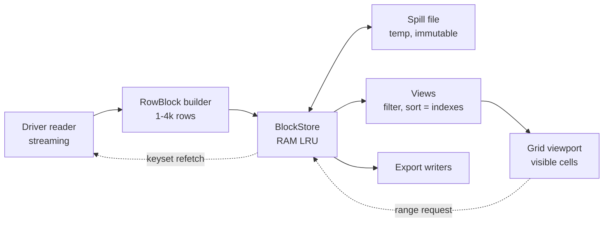
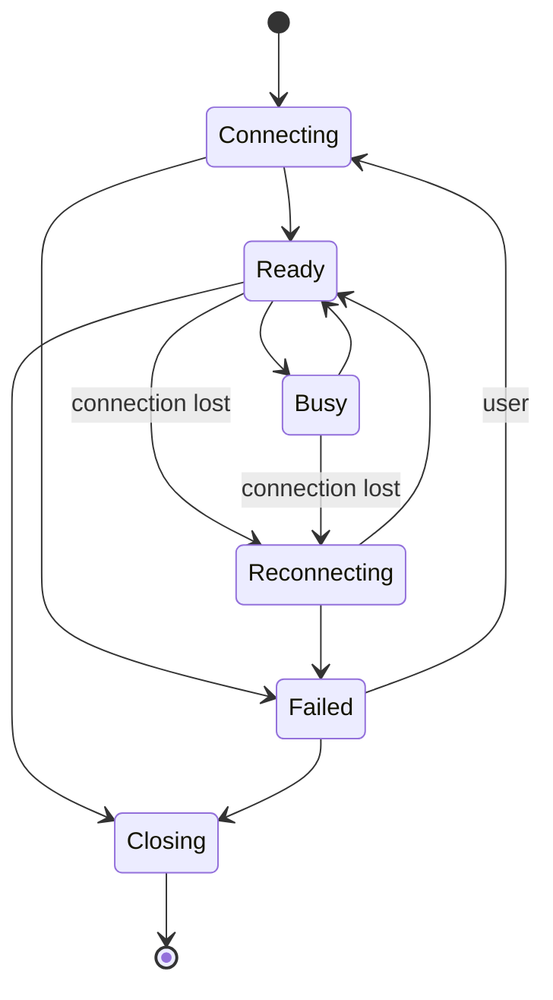
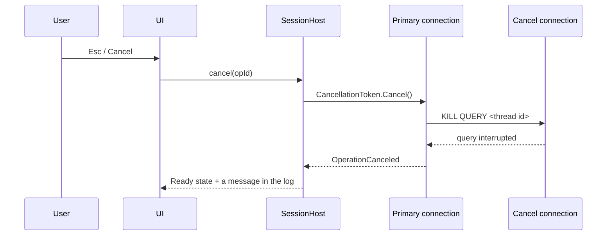
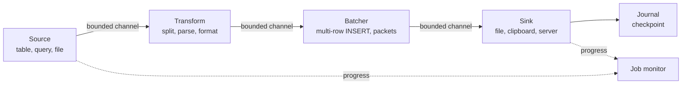
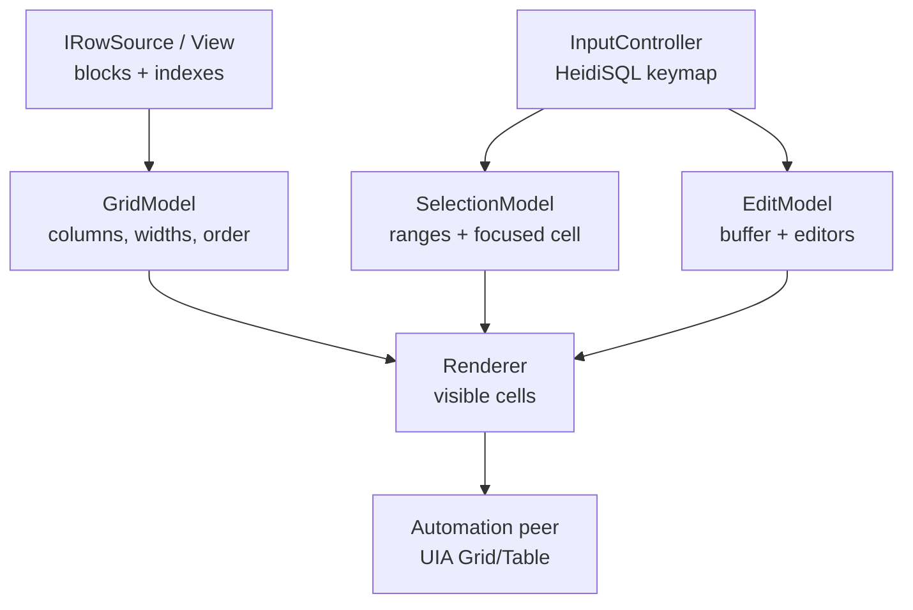
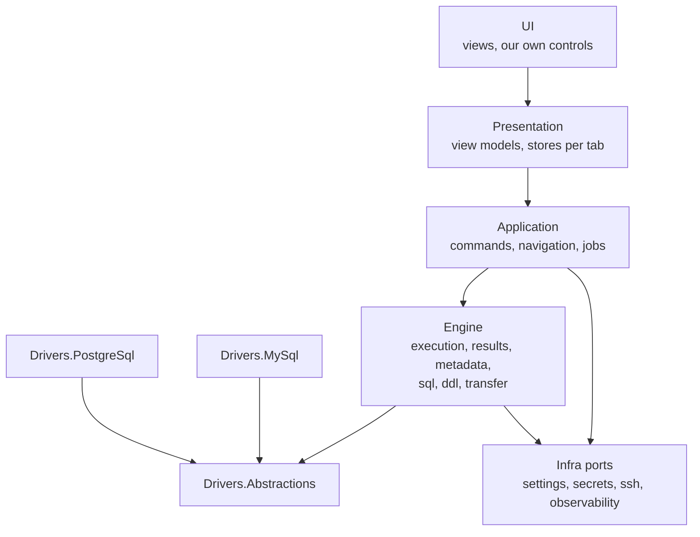
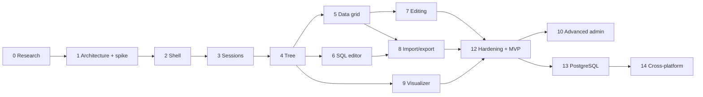

# HeidiSQL successor — Technical specification (phase 0)

25 Sep 2026

## 1. Executive Summary

HeidiSQL 12.21's performance and stability problems are architectural, not isolated: almost all I/O runs on the UI thread, each session has a single connection that blocks everything else, and results are materialised in full in memory. A successor can keep the UX practically the same and solve this with a new engine. The recommendation is C# on .NET 10 LTS with Avalonia 12, our own grid and tree, MySqlConnector and Npgsql, subject to a two-week spike.

### What the research confirmed

- **Tree filters.** They are case-insensitive regexes with partial matching. `;` is only a synonym of `|`, and `*` is a quantifier, not a wildcard (section 4.3, `main.pas#L13178`). The screenshot with `b2b;prd_products|ecm_*product` confirms this reading.
- **Data tab.** Runs on the UI thread, fetches 1,000 rows at a time and cuts TEXT/BLOB/JSON at 256 characters. "Show all" stops at 100,000 rows and only warns in the log.
- **Clipboard.** Ctrl+C copies one cell, and Copy as has 16 formats with documented escaping rules.
- **Crashes.** The maintainer has [#1694](https://github.com/HeidiSQL/HeidiSQL/issues/1694) open and accepted, closed [#547](https://github.com/HeidiSQL/HeidiSQL/issues/547) as wontfix and wrote in [#935](https://github.com/HeidiSQL/HeidiSQL/issues/935) that many crashes without a reproduction recipe will not be fixed.
- **Security.** Passwords use reversible obfuscation. plink.exe receives the SSH password on the command line, and `LOCAL INFILE` is always on.
- **Project state.** HeidiSQL is GPL-2.0 and maintained by practically one person. The Icons8 icons may only be used in HeidiSQL. v13 will build Windows from the Lazarus branch.

### What we propose

| Area | Proposal | Section |
| --- | --- | --- |
| Familiarity | 67 verifiable FAM requirements and 12 deliberate divergences, all justified | 6 |
| Concurrency | An actor per session with a primary, a metadata and job connections; targeted cancellation; no I/O on the UI thread | 12 |
| Large datasets | Columnar blocks with a memory budget, spill to disk and keyset paging | 11 |
| Import/export | Streaming pipelines with backpressure and a journal, with targets of at least 90% of `mysqldump` and the `mysql` CLI | 13 |
| Database | A provider contract with declarative capabilities; PostgreSQL in the design from day 1 | 14 |
| Schema Visualizer | Native, synchronised with the tree and with the same filter syntax | 17 |
| MVP | Phases 0 to 9 plus hardening, with a measurable exit criterion | 27, 28 |

### Main risks

- **Our own grid (R02).** It has to reach 60 fps with 1M rows × 60 columns.
- **Text and menu fidelity with Skia (R11).** There is a plan B in WinForms on the same core.
- **Scope (R17).** There are about 180 commands, and the MVP shows the missing ones as disabled.
- **Legal framework (R15).** Clean room with regard to the GPL, our own icons and our own name.

### Decisions for the product owner

1. **License.** Still to decide. The goal is to generate revenue (donations or a paid Enterprise edition); until the decision, the provisional rules of ADR-16 apply.
2. **Team.** Does it have experience in C# or in C++? With strong C++, the recommendation becomes Qt 6.
3. **Budget.** Is there money for code signing and crash reporting?

Divergences D9 and D10 were decided on 30 Sep 2026 (ADR-19).

### To investigate (phase 0)

Runtime validation of the behaviour read in the code (section 4.13), a HeidiSQL performance baseline (section 26), golden files for the formats, a forum search (not done), AvaloniaEdit's compatibility with Avalonia 12, Skia text quality vs ClearType, and a legal review.

## 2. Product Vision

The product is a database client for Windows that an experienced HeidiSQL user opens and uses without relearning anything, but with a new internal engine designed not to block, not to crash and not to load entire datasets into memory.

### What we keep and what we replace

| Layer | Definition | Policy |
| --- | --- | --- |
| A. User Experience | Layout, menus, shortcuts, context menus, icons, session colours, grid and tree behaviour | Keep with high fidelity. Change only with a clear, justified gain |
| B. Functional Behaviour | What each command does: generated SQL, copy formats, export options, filter syntax, persistence | Keep. Divergences documented as decisions |
| C. Internal Implementation | Threads, buffers, data fetching, drivers, settings format | Study to understand the bottlenecks. Never a requirement |

### Non-goals

- It is not a fork of HeidiSQL and does not reuse its code. The source code serves to understand behaviour; the implementation is new (see licensing in section 3 and in the Risk Register).
- It is not an "every database" client in the first release: MySQL and MariaDB first, PostgreSQL designed in from the start.
- It is not a modelling tool (ERD forward engineering). The Schema Visualizer reads and navigates the schema; it does not draw it.
- There is no UX redesign by taste. The target user has years of muscle memory in HeidiSQL.

### Product Principles

Proposed order of precedence for when two principles conflict (Recommendation, to be confirmed):

1. **Data safety.** No operation changes data the user did not explicitly ask for. An UPDATE without a unique key is never generated silently.
2. **Stability.** An error in a connection, query or export stays confined to that connection, query or export. The application does not crash.
3. **Non-blocking UI.** No I/O (network, disk, driver) runs on the UI thread. The UI responds to input in less than 100 ms in any state.
4. **HeidiSQL familiarity.** Where the user looks for a command in HeidiSQL, they find it in the same place, with the same shortcut and the same result.
5. **Large dataset support.** The memory and UI cost of an operation depends on what is visible or in transit, not on the size of the table or the file.
6. **Low memory pressure.** Every buffer has a limit. Streaming by default, materialisation only when the user asks for it.
7. **Performance.** Measured against HeidiSQL with reproducible benchmarks (section 26). Without a number there is no claim of improvement.
8. **Predictable behaviour.** The same command produces the same SQL and the same output. The generated SQL is always visible in the log.
9. **Fast interaction.** Shortcuts, keyboard navigation and an immediate response to scrolling and selection.
10. **Keyboard-first workflows.** Everything done with the mouse can be done with the keyboard.
11. **Database abstraction.** The core does not know MySQL. It knows capabilities, dialects and a type system.
12. **Extensibility and maintainability.** Stable module boundaries, tests at every boundary, plugins only once the internal API stabilises (section 21).

The precedence puts familiarity below stability and a non-blocking UI. A concrete example: if HeidiSQL shows a modal dialog while loading metadata, we keep the same end result but show non-modal progress with cancellation.

## 3. Research Methodology

The analysis rests on HeidiSQL's source code at commit [`c123ccdb`](https://github.com/HeidiSQL/HeidiSQL/tree/c123ccdb9e3f58d4390a05deb31f6e6effa33875) (master, 22 Sep 2026), which matches the version in the screenshots: the title "HeidiSQL 12.21.0.7344" is the official build of [v12.21](https://github.com/HeidiSQL/HeidiSQL/releases), released on 3 Aug 2026 (revision 7344 matches the version bump commit `effb8549` through `build.php`'s formula).

### Sources, in order of priority

| Priority | Source | Use | Coverage |
| --- | --- | --- | --- |
| 1 | Pascal code in `source/*.pas` (70k lines; `main.pas` 16k, `dbconnection.pas` 11.6k) | Exact functional behaviour: generated SQL, formats, filters, threading | High. About 1,100 permalinks in the appendices |
| 1 | Form definitions `source/*.dfm` (37k lines, text) | Layout, captions, shortcuts (decoded from `ShortCut`), defaults | High |
| 2 | [help.php](https://www.heidisql.com/help.php), [download.php](https://www.heidisql.com/download.php), README of the `master` and [`lazarus`](https://github.com/HeidiSQL/HeidiSQL/tree/lazarus) branches | Documented behaviour, project state | The official help is short. It does not document tree filters, snippets, autocomplete, session colours or export formats |
| 3 | [GitHub issues](https://github.com/HeidiSQL/HeidiSQL/issues) (54 through the API + 12 referenced in commits; 10 read in full) | Performance and stability problems, the maintainer's explanations | Medium |
| 4 | Git history (tags, fix commits, the `lazarus` branch) | Cadence, regressions, issue → fix links | High |
| 5 | 11 reference screenshots (10 distinct views; two images of the Indexes tab are the same) | Visual evidence of the UI, theme, session colours, SQL in the log | Complementary |
| 6 | Documentation of frameworks, drivers and libraries (official sites, repositories, NuGet, crates.io, npm) | Sections 14 to 25 | Medium to high |

### Evidence legend

| Tag | Meaning |
| --- | --- |
| **Confirmed** | Read in the code, a DFM, an official page or an open issue. Given with the file and line when relevant (e.g. `main.pas#L13178`) |
| **Observed** | Visible in the provided screenshots |
| **Inference** | Deduced from the code or from several sources, without direct confirmation |
| **Not verified** | Plausible but without a source. It stays on the list of pending research |
| **Recommendation** | Our proposal for the new product |

Behaviour "Confirmed" by reading the code was not tested at runtime: no Windows instance of HeidiSQL was available at this stage. Phase 0 of the roadmap includes runtime validation of the points marked as critical.

### Limitations of this research

- WebSearch was disabled for the organisation (HTTP 403). Web sources were read by direct URL, which limits the discovery of discussions outside GitHub.
- The [forum](https://www.heidisql.com/forum.php) was not searched. Only threads cited in commits show up.
- GitHub's search API rate-limited requests after about 12 calls. The issues table (section 9) is a sample focused on performance and stability, not a census.
- The `lazarus` branch (the future v13, Linux and macOS already released, a Windows preview) was only analysed at the level of history and README. The reference behaviour is the Delphi build for Windows.

### Contradictions found between sources

| Topic | Source A | Source B | More reliable |
| --- | --- | --- | --- |
| Database filter separator | The control's hint: "separated by semicolon" | Code: `;` is replaced with `\|` and the text is a regex; `;` and `\|` are equivalent | Code (`main.pas#L13178`) |
| `*` in the filters | The usual wildcard assumption | Regex: `ecm_*product` means "ecm" followed by zero or more `_` and "product" | Code, and the screenshot confirms it: `ecm_stores_products` does not show in the filtered tree |
| Data tab filter | help.php calls it a "simple client side filter" | Code: the filter panel sends a WHERE clause to the server; only the lower "Filter" box is local | Code |
| "Show all" | The caption suggests every row | A silent limit of 100,000 rows (`DatagridMaximumRows`) | Code |
| "Query timeout" | The label suggests a query timeout | MySQL: only a connection timeout. PostgreSQL: `statement_timeout`. MSSQL: `CommandTimeout` | Code |
| Supported Windows versions | help.php, "Requirements": 11, and 7/8/10 with minor problems | help.php, "Compatibility": 11 x64, and 10 x64 with minor problems | The Compatibility section, more recent |

### Legal framework (not legal advice; to be validated by a lawyer)

- HeidiSQL is GPL-2.0 ([LICENSE](https://github.com/HeidiSQL/HeidiSQL/blob/c123ccdb9e3f58d4390a05deb31f6e6effa33875/LICENSE)). If the new product is not GPL, HeidiSQL's code only serves to derive this behaviour specification. The implementation team works from the specification, not from the code (the clean-room model).
- HeidiSQL's Icons8 icons are licensed exclusively to the project ([readme](https://github.com/HeidiSQL/HeidiSQL/blob/c123ccdb9e3f58d4390a05deb31f6e6effa33875/readme.md)). They cannot be reused. Visual fidelity is achieved with our own icon set, or a licensed one, with the same semantics.
- The name "HeidiSQL" must not appear in the product's name or brand.

### Evidence appendices

The seven research reports (with permalinks to every cited line of code) accompany this document as files in `docs/spec/appendices/`: A. Connections and Session Manager; B. Import, export and administration; C. Main window, menus, shortcuts and editors; D. Tree and data grid; E. Issues, project state and documentation; F. UI frameworks and languages; G. Drivers, SQL parsing, graphs, crash reporting and visual testing.

## 4. HeidiSQL Feature Inventory

HeidiSQL 12.21 has about 180 commands (163 actions in `ActionList1` plus 16 "Copy as" created at runtime), 18 context menus and 5 modal table tools; almost everything the user does goes through the tree, the grid and the query editor. Column **Ev.**: C = Confirmed (code or DFM), O = Observed in the screenshots, I = Inference, N = Not verified. The `file#Lline` references point to commit `c123ccdb`; the full permalinks are in appendices A to D.

### 4.1 Connection Management and Session Manager

| Feature | Behaviour | Ev. | Ref. |
| --- | --- | --- | --- |
| Session Manager | Modal dialog (749×506, minimum 640×470). Session tree on the left (width 220, persisted), tabs on the right: Start, Settings, SSH tunnel, Advanced, SSL, Statistics. Shows on startup; Cancel on startup closes the application | C, O | `connections.dfm#L5`, `main.pas#L2352` |
| List columns | Session name, Host, Port, User (hidden), Version (hidden), Last connect, Counter (hidden; = number of successful connections), Comment. Resize, reorder, sort by click, show/hide through the header menu, widths and order persisted | C, O | `connections.dfm#L992` |
| Folders | Unlimited nesting (`Folder\Sub\Session`). "Folders at top" (on by default). No manual ordering (auto-sort) | C | `apphelpers.pas#L4578` |
| Drag & drop | Moving sessions between folders. Rejects a drop on its own parent, on itself or on descendants | C | `connections.pas#L952` |
| Rename | F2 or in-place editing. `\` becomes `-`. A rename that only changes case is refused | C | `connections.pas#L1150` |
| New (split button) | Session in root folder, Session in selected folder, Folder in root folder, Folder in selected folder. Name `Unnamed`, `Unnamed-1`; saved straight away and put into rename | C | `connections.pas#L609` |
| Save / Delete / Duplicate | Save (Ctrl+S) only enabled with changes. Delete (Del) with confirmation; deleting a folder deletes every session inside it. Duplicate / save as (F12) saves the form's values as a new session | C | `connections.pas#L488`, `#L664`, `#L561` |
| Open / Cancel / More | Open (Enter) connects with the values not yet saved. More: Preferences, Check for updates, Import settings file, Export settings file, General help, About | C, O | `connections.pas#L461`, `connections.dfm#L1153` |
| List filter | A "Filter" box at the top, Ctrl+F. Case-insensitive regex over every column (hidden ones included), 500 ms debounce, keeps parent folders visible. An invalid regex = an empty filter | C | `extra_controls.pas#L381` |
| "Dirty" state | A "Save modifications?" prompt when switching sessions. Exception: if only the password changed, it does not ask and the password is discarded after Open | C | `connections.pas#L1499` |
| Settings tab | Network type, Library, Hostname/IP, Prompt for credentials, Use Windows authentication, User, Password, Port, Compressed client/server protocol, Databases ("Separated by semicolon"), Comment. The labels change per network type (SQLite: "Database filename(s)", PostgreSQL: "Database") | C, O | `connections.dfm#L148` |
| Network types | 18 types persisted by ordinal: MySQL/MariaDB TCP, named pipe, SSH tunnel, MySQL on RDS, ProxySQL Admin; MSSQL (5 transports); PostgreSQL TCP and SSH; SQLite and encrypted SQLite; Interbase and Firebird TCP/local | C | `dbstructures.pas#L15` |
| Library | A list of DLLs in the application folder (`libmariadb.dll` by default, `libmysql*.dll`, `libpq.dll`, `sqlite3.dll`, `fbclient.dll`) | C, O | `dbconnection.pas#L2025` |
| Databases field | MySQL and MSSQL: a whitelist separated by `;`, no regex, that replaces `SHOW DATABASES`. PostgreSQL: the single database it connects to (the tree shows schemas). A dropdown button connects temporarily and shows the databases with check boxes | C | `dbconnection.pas#L2103`, `connections.pas#L1288` |
| SSH tunnel tab | SSH executable (plink.exe or ssh.exe), host and port (22), user, password, timeout (4 s), private key file, local port (the database port + 1 on creation) | C | `connections.dfm#L353` |
| SSL tab | Use SSL, private key, CA certificate, certificate, cipher, Certificate verification (0 none, 1 CA, 2 CA + hostname; default 2). Only MySQL and PostgreSQL | C | `connections.dfm#L738` |
| Advanced tab | Startup script, Query timeout (30 s), Ping every X seconds (20), Use own client time zone, Get full table status (on), Enable cleartext authentication, Force Unicode, Background color, Hide database pattern (regex), Log queries to file (DDL and/or DML) | C | `connections.dfm#L529` |
| Session colour | Paints the row in the session list, every node of that connection in the tree, the query editor's gutter, the results tabset and the grid's `#` column | C, O | `main.pas#L14124` |
| Statistics tab | Created, Last connect ("X ago" with an exact tooltip), Successful connects, Unsuccessful connects. Updates every 60 s | C | `connections.pas#L1100` |
| Settings import/export | Exports the whole registry tree (sessions included) to UTF-8 text. Import only adds: existing values are never replaced | C | `apphelpers.pas#L4644` |
| Multiple sessions | Each open session is a root node in the tree. The "active session" is the focused node's; query tabs run against the active session at the time of Run, with no tab–session link | C, I | `main.pas#L8562`, `#L3350` |
| Reconnect | Before each query it pings; if that fails, it disconnects and reconnects silently (login prompt, SSH tunnel and startup script included). A global option "Automatically reconnect to previously opened sessions on startup" (off) | C | `dbconnection.pas#L3598` |
| Credentials | Passwords kept in the registry with reversible obfuscation (adding 1 to 9 to each character code, the salt stored next to it). No DPAPI or Credential Manager | C | `apphelpers.pas#L626` |
| Persistence | `HKCU\Software\HeidiSQL`. Portable mode with `portable_settings.txt`, loaded into a temporary registry key and written back only on exit | C | `apphelpers.pas#L3831` |
| Command line | `-d` saved session; `-h -P -u -p -S -db -l -n -W -cte`; SSL and SSH options (`-sh -su -sp -sk -st`); `--psettings`; `.sql` files opened in tabs | C | `apphelpers.pas#L2678` |
| Others | Windows jump list with the sessions of the last 30 days; an optional single instance (forwards the command line) | C | `main.pas#L1759` |

### 4.2 Database Navigation and Database Tree

| Feature | Behaviour | Ev. | Ref. |
| --- | --- | --- | --- |
| Levels | Session → database (schema in PostgreSQL) → optional group (Tables, Views, Procedures, Functions, Triggers, Events) → object → optional column (base tables only) | C | `main.pas#L9913` |
| Columns | Name and Size (right-aligned, "192.0 KiB"). Hidden header | C, O | `main.dfm#L148` |
| Selection | Single selection only. Multi-selection of objects happens in the Database tab's list | C | `main.dfm#L169` |
| Lazy loading | Database names through `SHOW DATABASES` on connect. Each database's objects on the first expand or selection: `SHOW TABLE STATUS` (or a light query on `information_schema.TABLES` if "Get full table status" is off) + `SHOW FUNCTION STATUS`, `SHOW PROCEDURE STATUS`, `SHOW TRIGGERS`, events. Cached per connection | C | `dbconnection.pas#L7059`, `#L7165` |
| Size | Table: `Data_length + Index_length`. Database: the sum, only if the list is cached. Session: the sum of all, only if all are cached. A proportional bar in the cell. Format with 1 decimal, the locale's separator, KiB/MiB units | C, O | `main.pas#L9790` |
| Icons and states | An icon per type, engine overlays (MEMORY, CSV, FEDERATED…). A database is faded until cached. An object is faded until it has been selected in the session. An overlay on the database in `USE`. Nodes of inactive sessions in grey. The path to the focused node in **bold** | C, O | `main.pas#L9840`, `#L10372` |
| Favourites | Clicking the \~16 px to the left of an object toggles the star. Kept per session (`FavoriteObjects`, path `db\|schema\|name`). A hollow star on hover. A ★ "Show only favorites" button next to the filters, not persisted | C, O | `main.pas#L14079` |
| Tree style options | Group objects by type, Display size of objects, Auto expand on click, Doubleclick inserts node text, Show only favorites, Columns below tables in tree | C | `main.pas#L11505` |
| Ordering | The tree does not sort: databases in the server's order; objects sorted by name with natural comparison (numbers as numbers), types mixed when there are no groups | C | `apphelpers.pas#L2269` |
| Selection → tab | Session → Host tab. Database → Database tab (runs `USE`). Object → loads columns, keys and FKs and opens the Table tab if the current tab is Host or Database; otherwise keeps Data or Query. Before that it saves the grid's pending changes. No debounce: navigating with the arrow keys loads every table | C | `main.pas#L9992` |
| Refresh (F5) | In the tree: re-reads `SHOW DATABASES` and clears caches, keeps expanded databases and the focused object, reapplies filters. In the Database tab: only that database. Shift+F5: full status refresh | C | `main.pas#L10398` |
| Expand/collapse | Expand all loads every database (expensive). Collapse all only acts on the first session | C | `main.pas#L10595`, `#L10660` |
| Drag & drop | From the tree into the query editor: inserts the quoted name; with Shift, qualified with the database. Double click does the same if "Doubleclick inserts node text" is on | C | `main.pas#L7707` |
| Keyboard | Ctrl+D focuses the tree, Ctrl+E focuses the Table filter, Alt+Enter edits the object, Shift+Del empties table(s), F5/Shift+F5, case-insensitive incremental search while typing | C | `main.pas#L1653` |
| Tooltip | Only the node text when cut off. No comment, row count or metadata | C | `main.pas#L9106` |
| Context menu | See section 5.4 (`popupDB`) | C | `main.dfm#L3490` |
| Scale | Thousands of databases: names only. Thousands of tables: one `SHOW TABLE STATUS` per database on first access (slow on InnoDB); an O(n²) cache merge; list copies on every paint of column nodes | C | `dbconnection.pas#L7099` |

### 4.3 Database filter and Table filter (priority area)

Both tree filters are case-insensitive regular expressions, applied as a partial match to the node's name; `;` is only a synonym of `|`. The whole implementation is 60 lines ([`main.pas#L13165-L13228`](https://github.com/HeidiSQL/HeidiSQL/blob/c123ccdb9e3f58d4390a05deb31f6e6effa33875/source/main.pas#L13165-L13228)). Confirmed.

**Building the expression.** `Expression := '(' + StringReplace(Text, ';', '\|') + ')'`, with `ModifierI := True`, run with `Exec(node_name)`. The engine is `TRegExpr` in SynEdit's copy (`components/synedit/Source/SynRegExpr.pas`), with Perl-style syntax.

| Aspect | Behaviour | Ev. |
| --- | --- | --- |
| Controls | Two `TButtonedEdit`s in the toolbar above the tree, 50/50 of the width, with the placeholders "Database filter" and "Table filter". The left button opens the history, the right button (visible only with text) clears. On the right, the ★ button | C, O |
| Official hints | Database filter: "A list of databases, separated by semicolon. Can contain regular expressions, e.g. `mydb;test.*;project\d+`". Table filter: "Can contain regular expressions, e.g. `phpbb_\d`" | C (`main.dfm#L294`) |
| Database filter target | Database nodes only. Hiding a database hides its children | C |
| Table filter target | Table, view, procedure, function, trigger and event nodes. Groups and columns are never hidden. Databases without matching objects stay visible | C |
| Text compared | The text of the node's column 0: the object name (in MSSQL `schema.name`). It does not include the database name | C |
| Matching | Partial: the regex can match at any position. `^` is used for a prefix, `$` for a suffix | C |
| Case sensitivity | Always insensitive (`ModifierI`). The engine (TRegExpr 1.181) accepts inline `(?-i)` modifiers, so `(?-i)Prd` forces sensitivity; not tested at runtime | C |
| `;` and `\|` | Equivalent, both OR. `a;b\|c` = `(a\|b\|c)` | C |
| `*`, `?`, `+`, `.` | Regex quantifiers and metacharacters, not wildcards. `ecm_*product` = "ecm", zero or more `_`, "product" | C |
| Spaces | Significant (no trim). `b2b; prd` looks for " prd" with a space | C |
| Escaping | A normal regex: `\.`, `\d`, `\_`. A literal `;` is impossible: `\;` becomes `\\|` | C |
| AND | There is no operator. The engine supports lookahead (`OP_LOOKAHEAD` in `SynRegExpr.pas#L1706`), so `^(?=.*prd)(?=.*web)` works as AND; not tested at runtime | C |
| Negation | There is no operator. Negative lookahead is supported by the engine (`OP_LOOKAHEAD_NEG`): `^(?!tmp_)` hides tables starting with `tmp_`; not tested at runtime | C |
| Invalid regex | The exception is caught, the message goes once to the SQL log and the node stays visible. While `(` is being typed, the tree shows everything | C |
| When it applies | On every key (`OnChange`), without debounce. It only walks nodes already initialised; it reapplies on expand, after a refresh and after connecting. Databases never expanded are filtered when they expand | C |
| Favourites | With ★ on, an object only shows if it matches the Table filter **and** is a favourite | C |
| History | 20 entries per box, global (not per session), saved when the box loses focus. Menu: the entries (the current one checked), "Clear", "Empty recent filters" | C |
| Keyboard | Ctrl+E focuses the Table filter. Esc clears the box. There is no shortcut for the Database filter | C |
| Visibility | Display › Tree filters hides the toolbar (visible by default) | C |
| Scope | Every open session at the same time | C |

**Concrete examples**

| Filter | Matches | Does not match |
| --- | --- | --- |
| `b2b;prd_products\|ecm_*product` (screenshot) | `b2b_budgets`, `prd_products`, `prd_products_web_roles`, `ecm_products_discount` | `ecm_stores_products`, `ecm_orders` (confirmed in screenshots 1 and 11) |
| `^prd_` | `prd_products`, `prd_categories` | `std_prd_x` |
| `_log$` | `app_log` | `log_app` |
| `phpbb_\d` | `phpbb_1users` | `phpbb_users` |
| `test.*` | everything that contains "test" (equivalent to `test`) |  |
| `ecm_order` | `ecm_orders`, `ecm_orders_status` |  |
| `^(?!sys)` | `users`, `orders` (everything that does not start with "sys") | `sys_config`, `SYSLOG` (case-insensitive) |

**Related filters with different semantics**

| Filter | Where | Semantics | Ev. |
| --- | --- | --- | --- |
| The session's "Databases" field | Session Manager, Settings | A literal list separated by `;`, trimmed, no regex. Replaces the server's list | C |
| "Hide database pattern" | Session Manager, Advanced | Regex. Removes databases from the list before they reach the tree | C |
| Table tools dialog filters | Export, Maintenance, Find text | The same `;` → `\|` rule over the check box tree | C |
| Session Manager filter | Session list | Regex over every column, 500 ms debounce | C |
| Lower filter panel | Grid, Host lists, table editor columns | Local regex, see 4.4 | C |

### 4.4 Data tab and Table Data Grid

The grid is a `TVirtualStringTree` that shows a `mysql_store_result` already fully in memory; the Data tab fetches 1,000 rows at a time, on the UI thread, with long text cut at 256 characters.

| Feature | Behaviour | Ev. | Ref. |
| --- | --- | --- | --- |
| Layout | A top label (`elmwood.prd_products: 272 rows total (exact)`), a toolbar on the right: Next, Show all, Sorting (n), Columns (v/t), Filter. A filter panel (hidden until used). The grid. A global "Filter:" bar at the bottom | C, O | `main.dfm#L1031` |
| Generated SELECT | `SELECT <cols> FROM db.table [WHERE filter] [ORDER BY …] LIMIT off, n`. TEXT/BLOB/JSON/VARCHAR >256 columns become `LEFT(CAST(col AS CHAR), 256)`, but only if the table has a PK or a UNIQUE NOT NULL. Without a key, everything comes in full. With every column intact it uses `*` | C, O | `main.pas#L6072`, screenshot 3 |
| Truncation | A fixed limit `GRIDMAXDATA = 256`, not configurable. A `  [...] ` suffix when the text is exactly 256. Binary in hex of the first 256 bytes | C | `const.inc#L78` |
| Full value | Fetches the whole row (`SELECT … WHERE <key>`) when editing, copying a cell, opening the context menu (every selected row), in find, when saving a BLOB. Export and Copy as run the whole SELECT again without `LEFT()` | C | `main.pas#L11228`, `#L5823` |
| Paging | 1,000 rows per step (`DatagridRowsPerStep`). Next (Ctrl+Alt+PgDn, or PgDn on the last row) appends `LIMIT RecordCount, 1000`. Show all (Ctrl+Alt+End, or Ctrl+End) goes up to `DatagridMaximumRows` = 100,000, with no warning outside the SQL log | C | `main.pas#L5706`, `#L5799` |
| Count | Without a filter or a limit: exact. Otherwise, `SHOW TABLE STATUS LIKE` (approximate) on every load. "Query exact row count" in the label's menu runs `COUNT(*)`. "(exact)" or "(approximately)" suffixes only on InnoDB; ", limited to N" or ", N rows match to filter" | C, O | `main.pas#L6283` |
| Sorting | Clicking the header: server-side, accumulates columns in the ORDER BY (ASC → DESC → removed). Shift+click adds DESC. A ▲/▼ indicator with the position in superscript ¹²³. A "Sorting" dialog with column/direction rows. Reset sorting Alt+S. Persisted per table | C, O | `main.pas#L10987` |
| Columns | A "Columns (29/29)" pop-up: checklist, select all, filter, "Sort alphabetically", "Show static row id column". Hidden columns stay in the SELECT if they are a key or if there is no key. Reordering by dragging the header, not persisted. Persisted per table (`HiddenColumns`) | C, O | `column_selection.pas#L56` |
| Rendering | A fixed `#` column with the row number (background = session colour). Header with the column number in grey + the name ("1 id", "2 reference"), a key icon (PK/UNIQUE/INDEX), hint = the column comment. Text colour per type category. `(NULL)` in the category colour, lightened. PK in bold. Numbers right-aligned with a thousands separator | C, O | `main.pas#L5907`, `#L10945` |
| Column width | Automatic: the maximum between the header and up to 100 visible rows, capped at 300 px (`MaxColWidth`). Double click on the header edge adjusts it | C | `main.pas#L11512` |
| Selection | By rows (multi-select) plus one focused cell. There is no rectangular cell selection. Ctrl+A, Ctrl+I (invert). Status bar: `r12 : c3 (5 sel)` | C, O | `main.dfm#L1244` |
| Keyboard | Home/End = first/last column; Ctrl+Home/End = first/last row; Enter or F2 edits; ↓ on the last row **inserts a new row**; Tab/Shift+Tab move between cells while editing; Esc cancels; Alt+wheel changes row; Shift+wheel scrolls horizontally; incremental search while typing | C | `main.pas#L11204` |
| Editing | An editor per type: FK combobox (up to 10,000 values, "text (id)"), SQL function combobox (Ctrl+F2), ENUM dropdown, SET checklist, a modal hex editor for binary, date/time with a mask and arrows per segment, in-place text with a "…" button that opens a popup editor (automatic with ≥256 characters or line breaks) | C | `main.pas#L11275`, `grideditlinks.pas` |
| Popup text editor | A highlighter per column, wrap, line break style (Windows/UNIX/Mac), load a file, format JSON/SQL/XML, character and line counter. Ctrl+Enter applies | C | `texteditor.pas#L129` |
| Saving | Changes accumulated per row and saved on row change, on a click in empty space, on a node change in the tree, with Ctrl+Enter or when disconnecting. Changing column in the same row does not save | C | `main.pas#L11145` |
| The changes' WHERE | PK; else UNIQUE with NOT NULL columns; else **every column** + `LIMIT 1` (MySQL; nothing in PostgreSQL/SQLite). No transactions. An error only if it affects 0 rows; more than 1 is not detected. After saving it reads the row back | C | `dbconnection.pas#L10162`, `#L9781` |
| Insert / Duplicate / Delete | Ins inserts a virtual row after the focused one, with defaults. Ctrl+Ins duplicates without keys; "Duplicate row with keys" without a shortcut. Ctrl+Del deletes with the confirmation "Delete N row(s)?", one `DELETE` per row | C, O | `main.pas#L5481`, `#L4477` |
| Insert value ▸ | NULL (Ctrl+Shift+N), SQL function (Ctrl+F2), default, Edit value without foreign key lookup, the server's datetime/date/time/year (`SELECT NOW()`), unix timestamp, UTC versions, GUID (4 variants) | C, O | `main.pas#L8463` |
| BLOB | Insert files into TEXT/BLOB fields (a dialog with `%filecontent%` placeholders etc.), Save BLOB to file, Image preview (JPEG/GIF/BMP/PNG by magic bytes, a panel below the tree), "View binary data as text" | C, O | `main.pas#L3812` |
| UNIX timestamp columns | Marked per column ("This is a UNIX timestamp column"): shows the local date, edits with date/time, copies the integer | C | `main.pas#L10836` |
| Follow Foreign Key | Jumps to the referenced table with a `refcol = value` filter. Only uses the focused column in composite FKs. It shows as disabled in the screenshots (a column without an FK) | C, O | `main.pas#L12205` |
| Open URL | Enabled if the cell matches `^(https?://\S+\|www\.\w\S+)$` | C, O | `main.pas#L6693` |
| Same-text highlight | With ≤100 selected rows, cells with the same text as the focused column get a `clInfoBk` background | C | `main.pas#L11627` |
| Per-table persistence | Hidden columns, filter, sorting, timestamp columns, 20 recent filters. The focused row and column only in memory | C | `main.pas#L11783` |
| Query tab result grids | The same grid code. Execution in a `TQueryThread`. No paging or truncation. Local sorting on one column, with a warning above 10,000 rows. Editable if every column comes from one table with a key. At most 10 result sets per execution | C | `main.pas#L8974`, `apphelpers.pas#L3301` |

### 4.5 Grid filters

The Data tab has four filter mechanisms: three generate SQL run on the server and one is local.

| Mechanism | Where | Where it runs | Behaviour | Ev. |
| --- | --- | --- | --- | --- |
| WHERE editor | Filter panel (a SynMemo with highlighting and autocomplete) | Server | The text pasted after `WHERE` (a leading `WHERE` is removed). F9 or "Apply filter" applies; Ctrl+W clears. "Recent filters": 20 per table, a combobox and a submenu; choosing does not apply. An "Insert function" submenu | C, O |
| Create multi column filter | A box on the right of the panel (F7) | Server | Rewrites the WHERE on every key: `CAST(col) LIKE '%text%' OR …` for every column of the table, hidden ones included. PostgreSQL uses `ILIKE`; int/bool/uuid columns only go in with `=` if the text is valid. Enter applies. No REGEXP | C, O |
| Quick Filter ▸ | The grid's context menu, only in the Data tab | Server | Captions rewritten with the real SQL (screenshot 10). Shift when choosing ANDs with the current filter. Applies straight away | C, O |
| Filter: (Regular expression) | The global lower bar, Ctrl+Alt+F | Local | A case-insensitive regex over the visible text of every column of the **loaded** rows (includes the `#` column and hidden columns; cut values are compared cut). 500 ms debounce. The label "2 out of 3 matching. 1 hidden." Cleared on every reload. Text kept per tab. 20 history entries | C, O |

**Quick Filter, items and generated SQL** (`col` = the focused column; values = from the focused column in every selected row, deduplicated, up to 1 KB)

| Block | Item | Shortcut | SQL | Ev. |
| --- | --- | --- | --- | --- |
| Values | = focused | Ctrl+Shift+1 | `col IN ('v1', 'v2')` (+ `OR col IS NULL` if there is a NULL) | C, O |
| Values | != focused | Ctrl+Shift+2 | `col NOT IN (…)` (+ `AND col IS NOT NULL`) | C, O |
| Values | LIKE prefix / suffix / contains | — | `col LIKE 'v%'`, `col LIKE '%v'`, `col LIKE '%v%'` (OR between values) | C, O |
| Values | > / < | — | `col > 'v'`, `col < 'v'` | C |
| Values | More values ▸ | — | `SELECT col, COUNT(*) … GROUP BY col ORDER BY c DESC, col LIMIT 50`; refused on tables > 2 GB (10 GB with an index); items `col='v' (count)` | C, O |
| Prompt | = / != | Ctrl+Shift+3 / Ctrl+Shift+4 | `col = <typed value>` / `!=` (a pre-filled InputQuery) | C, O |
| Prompt | > / < / LIKE / IS NULL / IS NOT NULL | — | `col > …`, `col LIKE '%…%'`, `col IS NULL` | C, O |
| Clipboard | = / != | Ctrl+Shift+5 / Ctrl+Shift+6 | `col = <clipboard>` / `!=`; disabled with a clipboard ≥ 1 KB | C, O |
| Clipboard | > / < / LIKE / IN | — | `col IN (<clipboard without escaping>)` | C |
| — | Remove filter | — | Clears the filter and reloads | C, O |

Value escaping: numbers without quotes, BIT as `b'…'`, binary in hex, text with quotes and backslash. In MSSQL it adds `  ESCAPE '\' ` to the LIKEs. Confirmed (`main.pas#L8176`, `dbconnection.pas#L5257`).

### 4.6 Grid copy, paste and export

Ctrl+C copies **only the focused cell** and Ctrl+V pastes the whole clipboard **only into the focused cell**; copying several rows is done through "Copy as", which runs the export dialog in hidden mode with the selected rows. Confirmed (`main.pas#L12397`, `#L12513`).

| Operation | Behaviour | Ev. |
| --- | --- | --- |
| Ctrl+C | The focused cell, full value (fetches the row). NULL copies empty and internally marks "the clipboard is NULL". Integers without a thousands separator. Removes NUL characters | C |
| Ctrl+X | Copies and sets the cell to `''` | C |
| Ctrl+V | The whole text into the focused cell. No split on TAB, no pasting into several cells, no creating rows. If the last copy was NULL and the clipboard is empty, it saves NULL | C |
| Copy column names | Visible captions, one per line | C |
| Copy all lines … in CSV format | Any list or tree as TSV of the visible text, without quotes | C |
| Copy as ▸ | 16 formats. Always the clipboard in UTF-8, always the selected rows, its own `GridExportClp*` options (with column names, `;`, NULL `\N`), not the last ones used in the dialog. HTML and SQL (<100 KB) also go as an HTML fragment with highlighting | C, O |
| Export grid rows | A dialog with: Copy to clipboard / File (placeholders `%session %db %date…`, 10 recent), Encoding (ANSI, ASCII, UTF-16LE, UTF-16BE, UTF-8, UTF-7, UTF-8-BOM; default UTF-8), format, Selected rows / All loaded rows (with a size estimated from the first 1,000 rows), Include column names, Include auto increment column, Only focused column, Include SQL query (HTML, XML, Markdown, JSON), Remove linebreaks from contents, Open file after creation, separator/encloser/terminator/NULL (Delimited text only) | C |
| Data source | Only rows already loaded and visible (the local filter counts), in the grid's current order. Visible columns in their visual order. If there are truncated values, it runs the full query again first | C |
| Execution | UI thread, no cancellation. The whole output in an in-memory `TStringStream`, and only then saved | C |

**Formats** (table `t`: `id INT PK`, `name VARCHAR`, `note TEXT NULL`; row `(1, 'a"b', NULL)`)

| # | Format | Structure | NULL | Escaping and notes | Ev. |
| --- | --- | --- | --- | --- | --- |
| 0 | Excel CSV | `"id","name","note"` / `"1","a""b",\N`. A fixed separator: TAB in the clipboard, `;` if the locale's decimal separator is `,`, else `,` | literal NULL text (`\N`) | Every value in quotes, quotes doubled. BOM only with UTF-8-BOM in a file. Dates lose fractions of a second | C |
| 1 | Delimited text | `id;name;note` / `1;a"b;\N` | `\N` configurable | Separator, encloser (empty by default) and terminator configurable with `\t \n \r`. With an empty encloser there is no escaping: a value with `;` produces an ambiguous file | C |
| 2 | HTML table | XHTML 1.0 with `<style>`, `<table caption="t (1 rows)">`, `<thead>`, `<tbody>`, a "generated … by HeidiSQL" footer | empty cell | Escapes only `& < >`. The query included without escaping. `color-scheme: light dark`. An empty charset with UTF-8 without BOM (bug) | C |
| 3 | XML | `<table_data name="t"><row><field name="id">1</field>…` (mysqldump style) | `xsi:nil="true"` | Binary with `format="hex"`. The `xsi` namespace not declared in table mode | C |
| 4–8 | SQL INSERTs, INSERT IGNOREs, REPLACEs, DELETEs/INSERTs, UPDATEs | One statement per row. `INSERT INTO \`t\` (\`id\`, …) VALUES (1, 'a"b', NULL);`/`UPDATE \`t\` SET \`id\`=1, … WHERE \`id\`=1;\` | `NULL` | The table without the database. Generated columns omitted. WHERE by PK, UNIQUE NOT NULL or every column. UPDATE includes the key in the SET. Binary `0x…` without `_binary`. Fails on joins ("More than one table involved") | C |
| 9 | LaTeX | `\begin{tabular}{ c c c }` … `\\` | empty | Escapes only `_ $ % &`. Numbers in `$…$` | C |
| 10 | Textile | `\|_. id \|_. name \|` / `\| 1 \| a"b \|` | empty | No escaping of `\|` | C |
| 11 | Jira Textile | `\|\| id \|\| name \|\|` / `\| 1 \| a"b \|` | empty | No escaping of `\|` | C |
| 12 | PHP Array | `<?php $t = [ [ 'id' => 1, 'name' => 'a"b', 'note' => null, ], ];` | `null` | Single quotes, or double quotes with control characters. Backslash not escaped in single quotes (bug). `<?php` only in a file | C |
| 13 | Markdown Here | A setext title with the name, `\| id \| name \|`, `\| ---: \| --- \|` (numeric ones on the right) | `\N` | No escaping of `\|` | C |
| 14 | JSON | `{"table": "t", "rows": [ {"id": 1, "name": "a\"b", "note": null} ]}` (an object per row; an array without names) | `null` | Escapes only `\ CR LF TAB "`. Numbers without quotes. Invalid JSON with 0 rows or UTF-16 (bug) | C |
| 15 | JSON Lines | `{"id": 1, "name": "a\"b", "note": null}` per line, LF terminator | `null` | The same as JSON | C |

There is no "Wiki" format and no TSV format of its own (TSV = Excel CSV in the clipboard). No format streams. Confirmed (`exportgrid.pas#L11-L28`).

### 4.7 Query Editor

| Feature | Behaviour | Ev. | Ref. |
| --- | --- | --- | --- |
| Editor | SynEdit (`TSynMemo`). Consolas 9 pt (or Courier New), tab width 3, auto-indent, no margin line. A gutter with line numbers, in the session colour | C | `main.dfm#L1313` |
| Highlighting | One shared `TSynSQLSyn`; the dialect changes when entering another session (MySQL, MSSQL2K, Postgres, Standard, Interbase6). The connection's function list; table and routine names of the current database highlighted as TableName/ProcName | C | `main.pas#L10108` |
| Bracket matching and same word | The pair of brackets under the cursor in black on aqua. Selecting a word highlights the other visible occurrences | C | `main.pas#L7900`, `#L7938` |
| Error line | After an error, the line given in "near … at line N" turns pink (#FFB7D2) until the next edit | C | `main.pas#L3503` |
| Code folding | Only by `#region` / `#endregion` markers. Mutually exclusive with word wrap | C | `main.pas#L7167` |
| Auto-uppercase | Keywords, functions and types in upper case when the token ends; table names corrected to the catalogue's spelling | C | `main.pas#L7776` |
| Token hints | Hover: a function with its signature and description; a table with its type, rows, size and columns (from the cache); a procedure with its parameters and body; a type with its description | C | `main.pas#L7280` |
| Autocomplete | `TSynCompletionProposal`. Ctrl+Space or 500 ms after `.`. Resolves FROM/JOIN aliases, `db.table.`, `db.`, `@@SESSION.`/`@@GLOBAL.` (with values). Without a qualifier: the selected table's columns, databases, tables/views/routines, functions, keywords. "Find matches in the middle" on. Quotes identifiers when needed. Metadata requested on the UI thread | C | `main.pas#L6896` |
| Query tabs | A fixed "Query" tab (closing only clears it) + "Query #N". Ctrl+T new, Ctrl+F4 closes, a "+" button, a double click on empty space opens, a double click or middle click closes, rename, "Close query tabs to the right", tabs on several rows. `*` when modified | C | `main.pas#L12779` |
| Tab restore | `tabs.ini` + `Backups\query-tab-<uid>.sql` every 10 s and on exit (up to 10 MB). On startup it reopens files and unsaved content | C | `main.pas#L2381` |
| Files | Load (Ctrl+O, multi-selection, encoding choice), Save (Ctrl+S), Save as (F12), Save selection (Ctrl+Shift+S), 20 recent. A watched folder: an external change asks "Reload file?". Files > 5 MiB offer "Run directly" | C | `main.pas#L4002`, `#L15526` |
| Execution | Run (F9) everything, Run Selection (Ctrl+F9), Run current query (Ctrl+Shift+F9). "Send queries one by one" (default) or "Send batch in one go" (joins up to `max_allowed_packet`). Stop on errors (on). A "Run unsafe queries without a WHERE clause?" warning for UPDATE/DELETE without WHERE | C | `main.pas#L3253` |
| Statement split | Its own scanner: `'` `"` strings (+ backtick on MySQL, `$$` on PostgreSQL), `--`, `#`, `/* */` comments, `DELIMITER xyz` at the start of a line. Configurable delimiter | C | `apphelpers.pas#L3456` |
| Threading | Execution in a `TQueryThread`; grids built through `Synchronize` on the UI thread. Status bar: "\<time>: Executing query #n of m ..." every second | C | `apphelpers.pas#L3301` |
| Cancel | Esc or a button: opens an auxiliary connection and sends `KILL QUERY <id>` (RDS: `mysql.rds_kill_query`, PostgreSQL: `pg_cancel_backend`). The id comes from the **active** session, not from the tab's session | C | `main.pas#L14330` |
| Results | A tab per result set, up to 10 (`MaxQueryResults`). Caption "name (Nr × Mc)"; `-- name:` / `-- names:` comments name the tabs. Alt+←/→ navigates. Hover shows the SQL | C | `main.pas#L3366` |
| Messages | In the SQL log: "Affected rows: n Found rows: n Warnings: n Duration for k queries: x sec. (+ y sec. network)", `SHOW WARNINGS` and `mysql_info`. There is no "Messages" tab | C | `main.pas#L3520` |
| Explain | "Explain current query" (`EXPLAIN`, `EXPLAIN FORMAT=TRADITIONAL` on MySQL ≥ 8.4). There is no Explain analyzer in this version | C | `dbstructures.mysql.pas#L3358` |
| Query helpers (right panel) | Columns in \<table> (with Generate SELECT/INSERT/UPDATE/DELETE), SQL functions, SQL keywords, Snippets, Query history, Query profile, Bind parameters. A filter at the top. Double click or drag inserts | C, O | `main.pas#L14662` |
| History | Per session in the registry. Only successful batches of ≤ 5 statements and ≤ 1 MB, 30 days, 1 MB in total. Grouped by day with the duration | C | `main.pas#L3563` |
| Snippets | `.sql` files in `Documents\HeidiSQL\Snippets\`. Save as snippet, Load, Rename, Delete, Explore folder | C | `apphelpers.pas#L4763` |
| Bind parameters | A check box turns on detection of `:name`; values replaced in the text before sending; persisted per tab | C | `main.pas#L15795` |
| Query profile | A check box: wraps the batch in `SET profiling=1` … `SHOW PROFILE` (MySQL ≥ 5.0.37) | C | `main.pas#L3339` |
| Reformat SQL (Ctrl+F8) | Internal (a simple tokenizer), online at heidisql.com or sqlformat.org. The selection or everything, in a single undo | C | `reformatter.pas#L45` |
| Find/Replace | Ctrl+F, Ctrl+R, F3. Case, whole words, regex, prompt on replace, direction, origin, scope (global/selection). Only in the current editor or the current grid, never in every tab. Replace in the grid writes cells | C | `searchreplace.pas#L67` |
| Other commands | Un/comment (` --  `), Move line up/down (Alt+↑/↓), Ctrl+U/Ctrl+L upper/lower case, Ctrl+wheel zoom persisted, dragging files opens tabs, SynEdit bookmarks (Ctrl+Shift+0…9, some collide with global shortcuts) | C, I | `main.pas#L15265` |
| Redo | No default shortcut in the query editor (both Redo bindings removed in the DFM) | C | `main.dfm#L1364` |

### 4.8 Structure Editor and object editors

| Feature | Behaviour | Ev. | Ref. |
| --- | --- | --- | --- |
| Layout | A frame in the Table tab: tabs at the top (150 px), a splitter, a "Columns:" toolbar with Add/Remove/Up/Down, the column grid, Help, Discard and Save buttons | C, O | `table_editor.dfm#L1`, screenshots 5–6 |
| Tabs | Basic (name, comment), Options (auto increment, collation + "Convert data", avg row length, engine, max rows, union tables, checksum, row format, insert method), Indexes (n), Foreign keys (n), Check constraints (n), Partitions, CREATE code, ALTER code | C, O | `table_editor.pas#L285` |
| Column grid | #, Name, Datatype (a tree dropdown by category with a description), Length/Set, Unsigned, Allow NULL (locked on a PK), Zerofill, Default, Comment, Collation, Expression, Virtuality, SRID, Invisible, Compressed (the last three depending on capability) | C, O | `table_editor.pas#L226` |
| Default | A panel: No default, Custom text (ENUM/SET with a list), NULL, Expression (the server's list), On update, AUTO\_INCREMENT. The cell shows "No default", quoted text, NULL, an expression | C, O | `grideditlinks.pas#L1282` |
| Operations | Add column (Ctrl+Ins, after the focused one, copies the type), Remove (Ctrl+Del), Move up/down (Ctrl+U/Ctrl+D) and drag, Copy selected columns / Paste columns, Create new index ▸ (PRIMARY, KEY, UNIQUE, FULLTEXT, SPATIAL), Add to index ▸ | C | `table_editor.dfm#L1045` |
| Indexes | An index → columns tree. Name, Type/Length, Algorithm (BTREE/HASH/RTREE), Comment, Direction, Visibility, Size (12.21). Dragging columns onto the index (text/blob with subpart 100) | C, O | `table_editor.pas#L2544` |
| Foreign keys | Key name, Columns, Reference table, Foreign columns, On UPDATE, On DELETE. A "Reverse" button shows the FKs that point at this table, jumping on double click | C | `table_editor.pas#L3005` |
| Check constraints | Name, Check clause | C | `table_editor.dfm` |
| Partitions | A memo with the `PARTITION BY` read from the CREATE. Applying it on save: Not verified | C / N |  |
| Generated ALTER | Changed FKs dropped first; table options; on MySQL `CHANGE COLUMN … FIRST\|AFTER` for each touched column and `ADD COLUMN`; `DROP COLUMN`; an index diff (drop + add); FKs; checks; rename at the end. PostgreSQL generates separate statements per attribute | C | `table_editor.pas#L638` |
| View editor | Select statement, Name, Definer, SQL security, Algorithm (UNDEFINED/MERGE/TEMPTABLE), Check option, CREATE code | C | `view.dfm#L1` |
| Routine editor | Name, Type (procedure/function), Returns, Data access, SQL security, Comment, Definer, Deterministic, Parameters (Name, Datatype, Context IN/OUT/INOUT), body, CREATE code, "Run routine(s)" | C | `routine_editor.dfm#L135` |
| Trigger editor | Definer, Name, On table, Timing (BEFORE/AFTER), Event (INSERT/UPDATE/DELETE), a body with autocomplete, CREATE code | C | `trigger_editor.dfm#L30` |
| Event editor | Name, Definer, Comment, Drop after expiration, State (Enable/Disable/Disable on slave), Once at / Every N interval, Starts/Ends, CREATE and ALTER code | C | `event_editor.dfm#L101` |
| Database create/alter | Name, Collation, a preview of the CREATE. Rename emulated: `RENAME TABLE` of every table into the new database and `DROP DATABASE` of the old one; refused if there are routines | C | `createdatabase.pas#L50` |

### 4.9 Host tab and Database tab

| List | Contents | Ev. |
| --- | --- | --- |
| Databases | Database, Size, Items, Last modification, Tables, Views, Functions, Procedures, Triggers, Events, Default collation, with bars. "Fetch database items" computes the counts | C |
| Variables | Variable, Session, Global; Session different from Global with a highlighted background; Enter edits (if supported) | C |
| Status | Variable, Value, Avg per hour, Avg per second (MySQL) | C |
| Processes | id, User, Host, DB, Command, Time, State, Info + extra columns; a "Process SQL" panel with an EXPLAIN link; Del kills process(es), except its own | C |
| Command-Statistics | Command-type, Total count, averages, Percentage with bars (MySQL) | C |
| Database tab | Name, Rows, Size, Created, Updated, Engine, Comment, Type visible; 11 more hidden columns (Version, Row format, Avg row length, Index length, Data free, Auto increment, Collation, …). Multi-selection, in-place rename (F2), Enter opens the editor | C |
| Auto refresh | The Refresh dropdown: Auto refresh (Ctrl+F5) with a configurable interval | C |

### 4.10 Import and export

All these operations run on the UI thread; responsiveness comes from `Application.ProcessMessages` called per result row (SQL export) or from nothing at all (grid export, CSV import). Confirmed (appendix B, P1–P3).

| Operation | Options and behaviour | Performance and memory | Ev. |
| --- | --- | --- | --- |
| **SQL export** (Tools › Export database as SQL) | A check box tree with regex filters. Database(s): Drop / Create. Table(s): Drop / Create. Data: No data, Delete + insert, Insert, Insert ignore, Replace (there is no UPDATE). Max INSERT size in KB (1024; 0 = plain INSERTs). Output: Single .sql file, ZIP compressed .sql file, Directory (one file per object), Clipboard, another Database, another Server (a saved session). Options: Add comments (on), Wrap data DML in transactions, Remove AUTO\_INCREMENT clauses, Remove DEFINER clauses (on), Copy mysqldump command. No charset choice: UTF-8 without BOM | Pages with `LIMIT offset, n` and `ORDER BY PK`, n ≈ 100 MB / AvgRowLen (10,486 rows without statistics). Each page entirely in memory. A deep OFFSET degrades on large tables. Unbuffered writes, fragment by fragment. ZIP only compresses at the end, in a second pass | C |
| SQL export header | Host/Server version/OS/HeidiSQL version comments; `SET NAMES utf8mb4`, `TIME_ZONE='+00:00'` (TIMESTAMP exported in UTC), `FOREIGN_KEY_CHECKS=0`, `SQL_MODE='NO_AUTO_VALUE_ON_ZERO'`, `SQL_NOTES=0`; a footer that restores everything | — | C |
| Object order | Per database: tables, views as temporary tables, routines and events alphabetically mixed; then triggers; then the final views. `DELIMITER //` for routines, triggers and events | — | C |
| Multi-row INSERT | `INSERT INTO \`t\` (…) VALUES`+ tuples, closes on reaching 90% of the Max INSERT size or 10,000 rows (1,000 on MSSQL). Binary`\_binary 0x…\` | Built by string concatenation | C |
| Progress and cancel | A row per table (Rows "N / P%", Duration), updated on every INSERT. Cancel checked between pages and rows; the table is left partial; the footer is written anyway | — | C |
| **Export grid rows** | See 4.6 | The whole output in memory; no cancellation | C |
| **Import CSV** (Tools › Import CSV file) | File + encoding (includes "Auto detect (may fail)"), Ignore first N lines (1), Low priority, numbers in local format, Truncate first, separator `;`, encloser `"` (optionally), escape `"`, terminator `\r\n`. Duplicates: INSERT, INSERT IGNORE, REPLACE (default REPLACE). Method: server (`LOAD DATA LOCAL INFILE`) or client. **Positional** column mapping, no matching by header. "\<New table>" opens the CSV detector (infers types from the first 20 MiB and proposes a CREATE TABLE) | Server: a single synchronous query, without progress or cancellation. Client: reads the whole file into a UTF-16 string ("TODO: read chunks!"), a character-by-character parser with concatenation, INSERTs of 0.5 MiB or 10,000 rows, no transaction; the first error aborts with the previous batches already saved | C |
| Client CSV bugs | `""` is not de-duplicated; `\N` is not NULL (only the word `NULL`); reordering columns misaligns the types | — | C, I |
| **Run SQL file** | Load SQL file (Ctrl+O) or Run SQL file. Files > 5 MiB: a TaskDialog "Run file(s) directly" / "Load file(s) into the editor" / Cancel | Reads in 20 MB blocks; each statement is a round trip; progress in Windows' `IProgressDialog` (bytes, query number, errors). Configurable Stop on errors. No transaction. The `DELIMITER` state is lost at the 20 MB boundary (bug) | C |
| **Insert files into TEXT/BLOB** | A list of files (drag & drop, a binary flag by extension), column mapping with placeholders | One INSERT per file, the whole file in memory in hex | C |
| **Copy table** | Target database and name (`<name>_copy`), choice of columns, indexes, FKs and data, an optional WHERE with history | `CREATE TABLE` + `INSERT … SELECT` on the server, one statement | C |
| Export to another server | Connects to the target session; runs the statements there; minimal MySQL→MariaDB transpiling | A round trip per statement, UTF-16/UTF-8 re-encodings | C |
| Resume/recovery | No mechanism in any operation | — | C |

### 4.11 Administration and Table tools

| Feature | Behaviour | Ev. |
| --- | --- | --- |
| Table tools (a single dialog, 5 tabs) | Maintenance, Find text, SQL export, Bulk table editor, Generate data. A check box tree on the left, a results grid, the label "N selected objects, size: X" | C |
| Maintenance | Check, Analyze, Checksum, Optimize, Repair, with the options Quick, Fast, Medium, Extended, Changed, Use FRM file, For Upgrade depending on the operation. The server's results with colours (error red, note purple) | C |
| Find text on server (Ctrl+Shift+F) | Plain text or an SQL predicate; a filter by type category; match: wildcards left/right, exact, left only, right only, regex; case sensitive. One `SELECT COUNT(*) … WHERE c1 LIKE … OR c2 LIKE …` per table; "See results" opens a query tab with the SELECTs and runs it | C |
| Bulk table editor | Move to database, Change table engine, Change default collation, Convert to charset, Reset auto increment; one `ALTER TABLE` per table | C |
| Generate data | N rows (1,000), % of NULLs (10); random values per type; one INSERT per row | C |
| Drop | A database (with the warning "You will lose all objects") or objects (triggers, then views, then the rest) with `FOREIGN_KEY_CHECKS=0`. The first error aborts | C |
| Empty table(s) (Shift+Del) | `TRUNCATE` per table, a "Disable foreign key checks" check box | C |
| Rename | Table/view in place in the Database tab; other objects not | C |
| Duplicate | Only tables and views (Copy table). There is no duplicate for routines, triggers or events | C, N |
| User manager | A list of users and roles with a filter; Add User/Role, Clone, Delete. Tabs: Credentials (host with presets, a password generator, default role, authentication plugin), Limitations (4 per-hour/concurrent limits), SSL options (REQUIRE), Privileges (a Global → Database → Table → Column, Routine tree), Roles. Generates `CREATE USER`, `GRANT`/`REVOKE`, `ALTER USER … REQUIRE/WITH`, `SET PASSWORD`, `FLUSH PRIVILEGES`. Only MySQL/MariaDB | C |
| Flush | Hosts, Logs, Privileges, Tables, Tables with read lock (with a "Press OK to unlock" dialog), Status | C |
| Launch command line | Opens `mysql.exe` from the folder configured in Preferences › General › MySQL command line programs, with the session's parameters. Only MySQL/MariaDB (`main.pas#L3959`) | C |
| Kill process | Processes tab, Del | C |
| Edit variable | Variables tab, Enter (if supported) | C |
| Events, triggers, routines | Created and edited through the editors in section 4.8; Run routine(s) asks for parameters | C |
| Sync databases | `syncdb.pas` exists but is unreachable and its Apply is empty. It is not a feature | C |

### 4.12 Hidden or non-obvious features

These features are not in the official help and are not visible without knowing where to look. All confirmed in the code.

- Shift when choosing a Quick Filter item ANDs with the existing filter.
- Shift when dragging from the tree, or in "Select top N rows", qualifies with the database name.
- ↓ on the last row of any grid inserts a new row; PgDn on the last row of the Data grid loads the next block.
- Ctrl+End in the Data grid is the same as "Show all" (up to 100,000 rows).
- Clicking the left margin of an object in the tree marks a favourite.
- `-- name: X` or `-- names: A,B` comments in the SQL name the result tabs.
- `#region` / `#endregion` define folding.
- "Copy as" uses a set of options separate from the export dialog, changeable only through the "Save clipboard settings" button.
- Clicking panel 3 of the status bar opens the connection properties; hover shows the full server information.
- Ctrl+mouse wheel zooms editors and grids and is saved.
- "Hide database pattern" (a regex per session) and the "Databases" whitelist are server filters independent of the tree filters.
- The session colour in the editor gutter and in the grid's `#` column (a visual reminder of production).
- Double clicking a process cell opens the SQL with an EXPLAIN link.
- A DDL/DML query log to a file per session, with placeholders in the path.

### 4.13 To confirm at runtime (phase 0)

- Actual support for lookahead and `(?-i)` in the tree filters (the engine supports them; a test in the application is missing).
- The real time of `SHOW TABLE STATUS` and of opening tables with 1M+ rows, for a baseline.
- Whether the grid's selection survives the reload in "full row mode" before an export.
- Whether the Partitions tab is applied on save.
- The effective UI font on Windows 11 (the code uses the system font for icon titles, usually Segoe UI) and the VCL style in the screenshots.
- VirtualTreeView's default key bindings in the tree (+, −, \*, F2).

## 5. HeidiSQL UI/UX Reverse Engineering

The main window is a fixed three-area layout (tree on the left, tabs on the right, SQL log at the bottom) without free docking; familiarity depends more on this geometry and on the shortcuts than on the visual theme, which the user can change.

### 5.1 Main window layout

```text
+--------------------------------------------------------------------------------+
| Menu: File Edit Display Search Query Tools Go to Help                           |
| Toolbar (22 px): sessions | copy/paste/undo/print | refresh | tools | grid | SQL |
+----------------------+---------------------------------------------------------+
| [Database filter][Table filter][★]  | Tabs: Host | Database: x | Table: y | Data |
|                      |       Query | Query #2 ... [+]                          |
| DB tree              +---------------------------------------------------------+
|  Name        Size    |                                                         |
|  (session colour     |  Contents of the active tab                             |
|   as background)     |  (host lists, object list, table editor,                |
|                      |   data grid, editor + helpers + result tabs)            |
| [BLOB preview,       +---------------------------------------------------------+
|  optional]           | [x] Filter: [Regular expression        ]  n out of m    |
+----------------------+---------------------------------------------------------+
| SQL log (80 px, line numbers, SQL from the application and the user)           |
+--------------------------------------------------------------------------------+
| info | r:c | Connected | MySQL x.y | Uptime | Server time + progress | Idle.   |
+--------------------------------------------------------------------------------+
```

| Area | Default size | Resizable | Persisted | Ev. |
| --- | --- | --- | --- | --- |
| Tree panel | 270 px (14% at 1920 px). In the screenshots the user widened it to about 565 px | A 4 px vertical splitter | `dbtreewidth` | C, O |
| Filter toolbar | 22 px high; two boxes at 50/50 minus the ★ button | With the panel | `DisplayTreeFilters` | C, O |
| SQL log | 80 px (about 3 visible lines in the screenshots) | A 4 px horizontal splitter | `sqloutheight` | C, O |
| Status bar | 19 px, 7 panels | Widths recalculated on resize | — | C, O |
| Filter panel | 26 px, at the bottom of the right panel | Toggle Ctrl+Alt+F | `FilterPanel` | C, O |
| Editor in the Query tab | 100 px, results below | A horizontal splitter | `querymemoheight` | C |
| Query helpers | 200 px to the right of the editor | A vertical splitter | `queryhelperswidth` | C, O |
| Table editor | Tabs 150 px + an 8 px splitter + the column grid | Splitter | — | C, O |
| Window | 950×600 on the first run, position and monitor saved | — | `MainWin*` | C |

Display › Reset panel dimensions restores all these measures. Confirmed (`main.pas#L13066`).

### 5.2 Menus and toolbar

| Menu | Items (shortcut) |
| --- | --- |
| File | Session manager · Connect to ▸ (saved sessions, connected ones checked) · New window (Ctrl+N) · New query tab (Ctrl+T) · Close query tab (Ctrl+F4) · Close all query tabs · Load SQL file (Ctrl+O) · Run SQL file · Save (Ctrl+S) · Save as snippet · Export settings file · Import settings file · Exit (Alt+F4) |
| Edit | Undo (Alt+Backspace) · Copy (Ctrl+C) · Copy formatted text · Copy with tabs to spaces (Ctrl+Shift+C) · Copy column names · Copy all lines … in CSV format · Paste (Ctrl+V) · Cut (Ctrl+X) · Move line down/up (Alt+↓/↑) · Select all (Ctrl+A) · Invert selection (Ctrl+I) |
| Display | Display size of objects · Show only favorites · Filter panel (Ctrl+Alt+F) · Log panel · Tree filters · Columns below tables in tree · Reset panel dimensions |
| Search | Find text (Ctrl+F) · Find or replace again (F3) · Replace text (Ctrl+R) · Find text on server (Ctrl+Shift+F) |
| Query | New/Close/Rename query tab · Clear (Ctrl+W) · Run (F9) · Run Selection (Ctrl+F9) · Run current query (Ctrl+Shift+F9) · Send batch in one go / Send queries one by one · Next/Previous result tab (Alt+→/←) · Set delimiter · Reformat SQL (Ctrl+F8) · Wrap long lines · Un/comment · Editor commands ▸ (every SynEdit command) · Code folding ▸ · Explain current query |
| Tools | Flush ▸ (6) · User manager · Maintenance · Bulk table editor · Generate data · Launch command line · Export database as SQL · Export grid rows · Import CSV file · Insert files into TEXT/BLOB fields · Preferences |
| Go to | Previous/Next tab (Ctrl+Shift+Tab / Ctrl+Tab) · Previous/Next result tab · Table filter (Ctrl+E) · Database tree (Ctrl+D) · Switch to query/results (F6) · Multi column filter (F7) · Tab 1…5 (Ctrl+1…5) |
| Help | SQL help (F1) · General help · Check for updates · Download page · Support forum · Changelog · About |

Confirmed (`main.dfm#L1806`). The **Display** menu exists between Edit and Search and was not in the brief.

**Main toolbar, in order:** Session manager (a dropdown with sessions) · Disconnect · | · Copy · Paste · Undo · Print · | · Refresh (dropdown: Full status refresh, Auto refresh, Set interval) · User manager · Import CSV · Export database as SQL · | · SQL help · First · Last · Insert row · Delete row(s) · Post · Cancel editing · Run (dropdown) · Load SQL file (dropdown: snippets and recent files) · Save · Save as snippet · Find · Replace · Reformat SQL · Stop on errors (toggle) · BLOB as text (toggle) · Word wrap (toggle) · Code folding (toggle) · Set delimiter · Cancel running operation (the icon alternates every 250 ms during operations). 30 buttons, icons only, 16×16. A "Donate" button pushed to the right. Confirmed (`main.dfm#L1571`); observed in screenshots 3, 5 and 8.

### 5.3 Tabs, status bar and SQL log

| Element | Visual behaviour | Ev. |
| --- | --- | --- |
| Main tabs | Host (caption = the session name, e.g. "localhost"), "Database: elmwood", "Table: b2b\_budgets\_status" (the object type's icon), "Data", "Query" and "Query #N" with `*` when modified and a 16×16 close button on the tab itself. A "+" button after the last tab. Several rows of tabs if they do not fit. Inactive query tab icons in grey | C, O |
| Result tabs | A tabset with soft tabs above the grid, caption "ecm\_orders (1r × 79c)", in the session colour | C, O |
| Status bar | 0: info ("elmwood: 179 tables"); 1: `r1 : c52 (53 B)`; 2: icon + "Connected: 4 days, 00:10 h"; 3: the type's icon + "MySQL 8.0.44" (a click opens the properties, hover shows details); 4: "Uptime: 10 days, 06:52 h" (every 20 s); 5: "Server time: 11:48" with the progress bar drawn on top; 6: a green icon + "Idle." or an hourglass + message | C, O |
| SQL log | Read-only, a gutter with continuous line numbers (1234, 1235…), the last 300 lines, lines cut at 2,000 characters, non-SQL messages as `/* … */`, background per type: error #FFB7D2, Warning #FFCDB7, Note #FFF7D3, Info #ECFFC6 | C, O |
| Data tab label | `elmwood.prd_products: 272 rows total (exact), 3 rows match to filter` above the grid; right click "Query exact row count" | C, O |
| Data tab buttons | "Next", "Show all", "Sorting (1)", "Columns (29/29)", "Filter", text with an icon, 72 px wide, right-aligned. The icon changes when active | C, O |
| Filter panel | "Recent filters:" with a combobox, a memo with SQL highlighting (2 to 8 lines, auto-height), "Create multi column filter:" with a box, "Apply filter" (split button) and "Clear" | C, O |

### 5.4 Context menus

The 18 context menus and their states are in appendix C, section 3. The main ones:

| Menu | Where | Items (shortcut) and enable rules |
| --- | --- | --- |
| `popupDB` | The tree and the Database tab's list | Edit (Alt+Enter) · Drop · Attach/Detach (SQLite) · Empty table(s) (Shift+Del) · Select top 1000 rows · Run routine(s) · Create new ▸ (Database, Table, Table copy, View, Stored procedure, Stored function, Trigger, Event; gated by capability) · Clear data tab filter and sort order · Export database as SQL · Maintenance · Find text on server (Ctrl+Shift+F) · Bulk table editor · Generate data · Expand all · Collapse all · Tree style options ▸ (6 checks) · Print (Ctrl+P) · Refresh (F5) · Connection properties (session node only) · Disconnect |
| `popupDataGrid` | The data grid and result grids | Copy · Copy as ▸ (16) · Paste · Insert value ▸ · Insert files into TEXT/BLOB · Save BLOB to file · Grid view options ▸ · Open URL · Follow Foreign Key · Insert row (Ins) · Duplicate row without keys (Ctrl+Ins) · Duplicate row with keys · Post (Ctrl+Enter) · Cancel editing (Esc) · Delete selected row(s) (Ctrl+Del) · Reset sorting (Alt+S, Data only) · Quick Filter ▸ (Data only) · Find text (Ctrl+F) · Export grid rows · SQL help (F1, Data only) · Refresh (F5, Data only). Observed in screenshot 4 |
| `popupQuery` | Query editor | Run (F9) · Run Selection (Ctrl+F9) · Run current query (Ctrl+Shift+F9) · Explain current query · Cut · Copy · Paste · Select all · Clear (Ctrl+W) · Show SQL completion proposal (Ctrl+Space) · Reformat SQL (Ctrl+F8) · Un/comment · Find (Ctrl+F) · Replace (Ctrl+R) · Load SQL file (Ctrl+O) · Save (Ctrl+S) · Save as (F12) · Save selection to file (Ctrl+Shift+S) · Save as snippet · Save selection as snippet · SQL help (F1) · Insert function ▸ (by category). Run needs a connection, a non-empty memo and no query running |
| `popupHost` | Host tab lists | Copy · Fetch database items · Kill Process(es) (Del) · Edit (Enter, variables) · EXPLAIN query · Print · Refresh |
| `popupMainTabs` | Tab bar | New query tab (Ctrl+T) · Close query tab · Close query tabs to the right · Close all query tabs · Rename tab · Close tab on doubleclick · Close tab on middleclick · Tabs in multiple lines |
| `popupSqlLog` | SQL log | Copy · Copy line to new query tab · Clear (Ctrl+Q) · Horizontal scrollbar · Save as textfile (Ctrl+S) · Log to file · Open log folder · Logging preferences |
| `popupQueryHelpers` | Helpers panel | Insert at cursor · Load/Rename/Delete (Del)/Explore folder (snippets) · SQL help · Clear query history / Delete this query · Generate SELECT/INSERT/UPDATE/DELETE |
| `popupListHeader` | The headers of every list | Toggle visibility of all columns · Copy column names · a list of columns with check boxes |
| `popupColumns` / `popupProperties` | Table editor | Copy · Copy selected columns · Paste columns · Add (Ctrl+Ins) · Remove (Ctrl+Del) · Clear (Ctrl+Shift+Del) · Up/Down (Ctrl+U/Ctrl+D) · Create new index ▸ · Add to index ▸ |
| Filter history | The filter boxes' left button | Up to 20 entries (the current one checked) · Clear · Empty recent filters |

Disabled items stay visible and grey (screenshot 4: "Open URL", "Follow Foreign Key", "Post", "Cancel editing"). Dynamic captions: "Select top N rows" and every Quick Filter item show the value or the real SQL. Confirmed (`main.pas#L8176`).

### 5.5 Session Manager (screenshot 2)

| Element | Observed | Confirmed in the code |
| --- | --- | --- |
| Title | "HeidiSQL 12.21.0.7344 - Session manager: Amberline\\StagingAmberline", a "?" button | A caption with the version and the focused session's path |
| List | A "Filter" box with an icon; columns Session name ▲, Host, Version, Counter (the user turned on Version and Counter, hidden by default) | Configurable and persisted columns |
| Groups | Folders ALBANY, Amberline (expanded), Elmwood, Evergreen, Sycamore; the `localhost` session at the root | Folders at the top by default |
| Colours | ALLamberline and PROD\_Amberline in red (#F03333 / #DC143C), StagingAmberline in olive green (#76845C, the focused row), localhost in green (#006400) | The colour paints every cell of the row |
| Icons | A vendor icon (MySQL/MariaDB) on each session; a folder for groups | An icon per NetType + the vendor detected on the last connection |
| Counter | 55, 11, 23, 63, right-aligned | Number of successful connections |
| Tabs | Settings, SSH tunnel (with an indicator), Advanced, SSL, Statistics | Start only shows with a folder or nothing selected |
| Settings | Network type "MariaDB or MySQL (TCP/IP)" with an icon, Library "libmariadb.dll", Hostname/IP, 2 check boxes, User, Password (masked), Port with a spinner (3307), Compressed, Databases "Separated by semicolon" with a dropdown, Comment | A two-column label/control layout |
| Buttons | New (split), Save (disabled), Delete on the left; Open, Cancel, More (split) on the right | Save only with changes |

Product note: the user uses colours to tell production (red), staging and local apart. This operational safety pattern must survive intact, including the propagation of the colour to the tree, gutter and grid.

### 5.6 Conceptual Visual Design System

The "Observed" values come from pixel samples of the screenshots (1920 px, 100% scale, the user's dark theme). The "Confirmed" values come from the code and apply to the default light theme. Which of the 10 VCL styles is active in the screenshots: Not verified (the palette matches Material Blue Grey).

**Surfaces (observed dark theme)**

| Token | Value | Use |
| --- | --- | --- |
| `surface.chrome` | #263238 | Title bar |
| `surface.panel` | #37474F | Toolbars, tab strip, status bar, dialog background |
| `surface.content` | #4B5A62 | Grids, lists, editors, SQL log |
| `surface.header` | #2A353B | Grid column headers |
| `surface.input` | #1B282E | Text boxes (filters) |
| `selection.row` | #4B5A9A | Selected row in grids (bluish) |
| `selection.tree.onSession` | #00725C | The focused node over the green session colour |
| `session.*` | #006400, #DC143C, #F03333, #76845C, #9D850B | Colours chosen by the user (see 5.5) |

**Data colours (confirmed, `preferences.pas#L510`)**

| Category | Light | Dark |
| --- | --- | --- |
| Integer | #0000FF | #8597FF |
| Real | #4800FF | #7D7DD0 |
| Text | #008000 | #73D573 (observed in the grid) |
| Binary | #800080 | #7F76C9 |
| Temporal | #800000 | #C97373 |
| Spatial | #008080 | #73CECE |
| Other | #808000 | #C1C173 |
| NULL | The category colour lightened (+70 lightness) with the text `(NULL)` | same |
| Modified cell | A red triangle in the top left corner | same |
| Same text | `clInfoBk` background | same |

**SQL editor and log (confirmed)**: comment grey, datatype maroon, function navy, key blue, number purple, string green, table name fuchsia (light theme); Dark and Material presets for the dark theme; bracket matching black on aqua (dark: #FFEF28 on #3B514D); error line #FFB7D2; log: error #FFB7D2, warning #FFCDB7, note #FFF7D3, info #ECFFC6.

**Typography**

| Token | Value | Ev. |
| --- | --- | --- |
| `font.ui` | The system font for icon titles (Segoe UI 9 pt on Windows 10/11); designed in Tahoma 9 pt (-12 px). Configurable | C / N |
| `font.grid` | Tahoma 8 pt, configurable, zoom with Ctrl+wheel | C |
| `font.editor` | Consolas 9 pt (fallback Courier New), the same typeface in the gutter | C |
| `font.weight.emphasis` | Bold for PK columns in the grid and for the focused node's path in the tree | C |
| `font.color.muted` | Grey for column numbers in the header, the `#` column, the tree's Size column, inactive sessions | C, O |

**Dimensions (96 DPI)**

| Token | Value | Ev. |
| --- | --- | --- |
| `size.icon` | 16×16 | C |
| `size.toolbar` | 22 px (buttons), control bar ≈ 26 px | C |
| `size.row.grid` | Text height + 7 px (18 px in the screenshots) | C, O |
| `size.row.tree` | 21 px in the screenshots | O |
| `size.statusbar` | 19 px | C |
| `size.filterPanel` | 26 px | C |
| `size.splitter` | 4 px (table editor: 8 px) | C |
| `size.column.max` | 300 px | C |
| `size.tabClose` | 16×16, flat | C |
| `size.completion` | 12 lines × 350 px, 18 px items | C |

High DPI: per-monitor v2, forms designed at 96 PPI and scaled. Confirmed (`res/manifest.xml`).

### 5.7 Interaction states

| State | Treatment | Ev. |
| --- | --- | --- |
| Hover | Hot tracking in the tree and lists; a hollow star on objects; tooltips only for cut-off text | C |
| Focus | The focused cell with `clHighlight`; the focused node's path in bold; tree `toGhostedIfUnfocused` | C |
| Selected without focus | The grid colour ±29 brightness | C |
| Disabled | Menu items grey but visible; icons in a generated greyscale version | C, O |
| Ghosted | Databases not yet cached; objects not yet opened; inactive sessions in grey | C |
| Busy | An hourglass cursor; panel 6 with an hourglass and a message; a progress bar over panel 5; a blinking Cancel button; red taskbar progress on error | C |
| Error | A modal dialog; the editor line in pink; the log line in pink; modified cells stay marked until fixed or Esc | C |
| Empty | A disabled grid with "Sorry, no data" for routines; Host lists with "Not available on \<type>" | C |

## 6. HeidiSQL Familiarity Requirements

There are 67 compatibility requirements (IDs `FAM-*`), each verifiable by a manual or automated test; "Must" blocks the release in which the area arrives, "Should" can wait for the following release. The list ends with the proposed deliberate divergences.

### 6.1 Layout and navigation

| ID | Requirement | Acceptance criterion | Prio. |
| --- | --- | --- | --- |
| FAM-L01 | Three fixed areas: tree on the left, tabs on the right, SQL log at the bottom, a 7-panel status bar | A screenshot of the default window overlaps HeidiSQL's with differences only in theme and icons | Must |
| FAM-L02 | File, Edit, Display, Search, Query, Tools, Go to, Help menus with the same item order | The section 5.2 inventory 100% covered (items outside the MVP visible and disabled) | Must |
| FAM-L03 | A toolbar with the 30 buttons in the same order and grouping | Visual comparison | Should |
| FAM-L04 | Host / Database / Table / Data / Query tabs with the same dynamic captions and visibility rules | Selecting a session, database, table, view or routine produces the same visible tabs | Must |
| FAM-L05 | Query tabs with `*`, a close button on the tab, a "+" button, double click/middle click to close, tabs on several rows | UI test | Must |
| FAM-L06 | Status bar: info, r:c (sel), Connected, server version (clickable), Uptime, Server time with a progress bar, Idle/busy | UI test | Must |
| FAM-L07 | Splitters and dimensions persisted; Display › Reset panel dimensions | Restarting the application restores the measures | Should |
| FAM-L08 | Selection in the tree chooses the tab as in HeidiSQL (session → Host; database → Database; object → Table only when coming from Host/Database) | The case table in section 4.2 | Must |

### 6.2 Sessions

| ID | Requirement | Criterion | Prio. |
| --- | --- | --- | --- |
| FAM-S01 | A modal Session Manager on startup, with folders, a filter, configurable columns and the Settings, SSH tunnel, Advanced, SSL, Statistics tabs | A screenshot compared with screenshot 2 | Must |
| FAM-S02 | The session colour applied to the session list, every tree node, the editor gutter, the results tabset and the `#` column | A visual test with 3 colours | Must |
| FAM-S03 | New (4 variants), Save (Ctrl+S), Delete (Del), Duplicate (F12), Rename (F2), drag & drop between folders | UI test | Must |
| FAM-S04 | The Databases field as a whitelist separated by `;`; Hide database pattern as a regex | Integration test | Must |
| FAM-S05 | Import of HeidiSQL settings files (the `<\|\|\|>` format, NetType ordinals) | Importing a real export keeps sessions, folders, colours, SSH and SSL | Must |
| FAM-S06 | A compatible command line (`-d`, `-h`, `-u`, `-p`, `-P`, `-db`, `.sql` files) | CLI test | Should |
| FAM-S07 | Several open sessions as tree roots; active session = the focused node | UI test | Must |
| FAM-S08 | Statistics: created, last connect, successes, failures | UI test | Could |

### 6.3 Tree and filters

| ID | Requirement | Criterion | Prio. |
| --- | --- | --- | --- |
| FAM-T01 | The same node hierarchy, optional groups and optional columns | UI test | Must |
| FAM-T02 | The Size column with the same values, format and proportional bars | The same value as `SHOW TABLE STATUS` | Should |
| FAM-T03 | Favourites by clicking the left margin, the ★ button, per-session persistence in the same `db\|schema\|name` format | Importing HeidiSQL favourites | Must |
| FAM-T04 | Database filter and Table filter with the exact semantics of section 4.3 (case-insensitive regex, `;` = `\|`, partial, target per node type) | A suite of 40 test cases derived from section 4.3, including the screenshot's | Must |
| FAM-T05 | A history of 20 filters, Clear, Empty recent filters, Esc clears, Ctrl+E focuses | UI test | Must |
| FAM-T06 | Ctrl+D, Alt+Enter, Shift+Del, F5, Shift+F5 and incremental search | Keyboard test | Must |
| FAM-T07 | Dragging from the tree into the editor (Shift qualifies), double click inserts | UI test | Should |
| FAM-T08 | F5 keeps databases expanded and the object focused | Integration test | Must |
| FAM-T09 | Tree style options (6) with the same defaults | UI test | Should |

### 6.4 Data grid

| ID | Requirement | Criterion | Prio. |
| --- | --- | --- | --- |
| FAM-G01 | A `#` column, a "no. name" header with a key icon, colours per type, `(NULL)`, PK in bold, numbers on the right | Visual comparison with screenshot 11 | Must |
| FAM-G02 | The label "db.table: N rows total (exact\|approximately), …" with the same variants | Tests per case | Must |
| FAM-G03 | Next, Show all, Sorting (n), Columns (v/t), Filter with the same behaviour and per-table persistence | Integration test | Must |
| FAM-G04 | Clicking the header accumulates ORDER BY (ASC → DESC → removed), Shift = DESC, indicators with the position | UI test | Must |
| FAM-G05 | Row selection with a focused cell, Ctrl+A, Ctrl+I, status `r:c (n sel)` | UI test | Must |
| FAM-G06 | The keys of section 4.4 (Home/End, Ctrl+Home/End, Enter, F2, ↓ on the last row inserts, PgDn on the last row advances, Tab while editing, Esc) | Keyboard suite | Must |
| FAM-G07 | Editors per type (FK dropdown, function, ENUM, SET, hex, date/time with arrows per segment, text with a popup) | A test per type | Must |
| FAM-G08 | Saving on row change or Ctrl+Enter; Esc discards; a red triangle on modified cells | UI test | Must |
| FAM-G09 | Ins, Ctrl+Ins (duplicate without keys), Duplicate with keys, Ctrl+Del with "Delete N row(s)?" | UI test | Must |
| FAM-G10 | Insert value ▸ with the same items and shortcuts (Ctrl+Shift+N, Ctrl+F2) | UI test | Must |
| FAM-G11 | A WHERE editor with Recent filters (20 per table), F9, Ctrl+W, Insert function | UI test | Must |
| FAM-G12 | Create multi column filter (F7) generating `LIKE '%x%' OR …` (`ILIKE` on PostgreSQL) | Identical generated SQL | Must |
| FAM-G13 | Quick Filter with the 3 blocks, the Ctrl+Shift+1…6 shortcuts, Shift for AND, captions with the real SQL, More values | Identical generated SQL, case by case | Must |
| FAM-G14 | The lower filter panel: local regex, 500 ms, "x out of y matching. z hidden.", Ctrl+Alt+F | UI test | Must |
| FAM-G15 | Follow Foreign Key, Open URL, Save BLOB, Insert files, Image preview, UNIX timestamp columns | A test per function | Should |
| FAM-G16 | Automatic column width capped at 300 px, double click on the header adjusts | Visual test | Should |

### 6.5 Copy, paste and export

| ID | Requirement | Criterion | Prio. |
| --- | --- | --- | --- |
| FAM-C01 | Ctrl+C copies the focused cell with the full value; Ctrl+V pastes into the focused cell; NULL copied and pasted as NULL | Clipboard test | Must |
| FAM-C02 | Copy as ▸ with the 16 formats, in the same order and with the same names | Inventory | Must |
| FAM-C03 | Output byte for byte identical to HeidiSQL for the 16 formats with the default options, except the bugs listed in 6.9 | Golden files generated by HeidiSQL 12.21 | Must |
| FAM-C04 | Clipboard options separate from the dialog's, with "Save clipboard settings" | UI test | Should |
| FAM-C05 | The Export grid rows dialog with every option and the file name placeholders | UI test | Must |
| FAM-C06 | Copy column names, Copy all lines in CSV format, Copy with tabs to spaces | Test | Should |

### 6.6 Query editor

| ID | Requirement | Criterion | Prio. |
| --- | --- | --- | --- |
| FAM-Q01 | F9, Ctrl+F9, Ctrl+Shift+F9; one by one vs batch in one go; Stop on errors | Integration test | Must |
| FAM-Q02 | Statement split with the same rules (strings, comments, `DELIMITER`) | A suite of 100+ scripts, the same statement boundaries | Must |
| FAM-Q03 | One result tab per result set, captions "name (Nr × Mc)", `-- name:` / `-- names:`, Alt+←/→ | Test | Must |
| FAM-Q04 | Messages in the SQL log in the same format (Affected rows, Found rows, Warnings, Duration … network) | Text comparison | Must |
| FAM-Q05 | Autocomplete: Ctrl+Space and after `.`, alias resolution, `db.table.`, `@@SESSION.` | Test cases | Must |
| FAM-Q06 | Query helpers with the 7 sections and the same commands | UI test | Should |
| FAM-Q07 | Restoring tabs and unsaved content after a restart and after a crash | Kill the process and reopen | Must |
| FAM-Q08 | A warning for UPDATE/DELETE without WHERE | Test | Must |
| FAM-Q09 | Snippets, per-session history, bind parameters, query profile | Test | Should |
| FAM-Q10 | Find/Replace with the same options; Ctrl+F8 reformat; un/comment; Alt+↑/↓; Ctrl+U/L | Test | Should |
| FAM-Q11 | The error line highlighted and the cursor placed on the error | Test | Must |

### 6.7 Structure and administration

| ID | Requirement | Criterion | Prio. |
| --- | --- | --- | --- |
| FAM-E01 | A table editor with the 8 tabs and the 15-column grid | Comparison with screenshots 5 and 6 | Must |
| FAM-E02 | An equivalent generated ALTER (the same effect on the schema; the text may differ in clause order) | A `SHOW CREATE TABLE` diff after applying it | Must |
| FAM-E03 | Editors for defaults, indexes (dragging columns) and FKs with the same fields | Test | Must |
| FAM-E04 | View, routine, trigger and event editors | Test | Should |
| FAM-E05 | Table tools (Maintenance, Find text, SQL export, Bulk edit, Generate data) with the same options | Test | Should |
| FAM-E06 | SQL export with the same header, object order and options | A diff against a HeidiSQL export | Must |
| FAM-E07 | CSV import with the same options and defaults (REPLACE, `;`, `"`) | Test | Must |
| FAM-E08 | MySQL/MariaDB user manager | Test | Could |

### 6.8 Shortcuts (all Must)

`FAM-K01`: every default shortcut in the inventory (appendix C, section 2) and the ability to redefine them in Preferences › Shortcuts, with conflict detection. The most used: F9, Ctrl+F9, Ctrl+Shift+F9, F5, Shift+F5, Ctrl+T, Ctrl+F4, Ctrl+W, Ctrl+O, Ctrl+S, F12, Ctrl+F, Ctrl+R, F3, Ctrl+Shift+F, Ctrl+Space, Ctrl+F8, Ctrl+E, Ctrl+D, F6, F7, Ctrl+1…5, Ctrl+Tab, Alt+←/→, Ins, Ctrl+Ins, Ctrl+Del, Ctrl+Enter, Esc, Ctrl+Shift+N, Ctrl+F2, Alt+S, Ctrl+Alt+PgDn, Ctrl+Alt+End, Ctrl+Alt+F, Ctrl+Shift+1…6, Shift+Del, Alt+Enter, F1, Ctrl+P, Ctrl+N. Conflicts by context (F9 Run vs Apply filter; Esc cancel editing vs cancel operation) are resolved as in HeidiSQL: by the action active in the focus context.

### 6.9 Proposed deliberate divergences (Recommendation)

| # | HeidiSQL behaviour | Proposal | Justification | Impact on the UX |
| --- | --- | --- | --- | --- |
| D1 | Operations block the UI (Data tab, metadata, connect, export, import) | The same result, with non-modal progress and Cancel on all of them | Principles 2 and 3; issues #1694, #547, #10 | No flow changes |
| D2 | Cancel kills the active session's query, not the tab's | Cancel acts on the tab's own execution | A bug with risk across several servers | None |
| D3 | An UPDATE/DELETE on a table without a key can affect several rows without warning (PostgreSQL, SQLite) | Run in a transaction and roll back if it affects > 1 row; a "table without a key" banner | Data safety | A new banner |
| D4 | Passwords with reversible obfuscation | Windows Credential Manager/DPAPI; the import converts them | Security | None |
| D5 | "Show all" stops at 100,000 rows with a warning only in the log | Keep the limit configurable; a visible warning in the label; the default limit reviewed after benchmarks | Transparency; virtualisation allows more | Extra text in the label |
| D6 | Output bugs (JSON with 0 rows or UTF-16, backslash in PHP, empty HTML charset, `""` in client-side CSV, `DELIMITER` lost every 20 MB) | Fix them | Incorrect output | The output becomes valid |
| D7 | SSH through `plink.exe`/`ssh.exe` with the password on the command line and a fixed wait | An embedded SSH library; the "SSH executable" field only as a fallback | Stability and security (#2118, #2243) | The field becomes optional |
| D8 | "Query timeout" with different semantics per engine | The same semantics (an execution timeout on the client with cancellation) + a separate connection timeout | Predictability | A clarified label |
| D9 | A query tab runs on whichever session is focused in the tree | Keep by default; always show, on the tab and in the editor's bar, the name and colour of the session the query will run on; a "pin tab to session" option, kept in the tab restore. With the tab pinned and that session disconnected, Run asks to connect and never runs on another session | The risk of running on production by mistake | A new indicator; **decided** (ADR-19) |
| D10 | Ctrl+C with several rows selected copies only the focused cell; if it is NULL, it copies empty text (`main.pas`, `actCopyOrCutExecute`) | Keep the same as HeidiSQL, without a new preference; several rows are copied through Copy as | The product owner's decision: the HeidiSQL habit prevails | None; **decided** (ADR-19) |
| D11 | Implicit save on row change (#384) | Keep by default; a "confirm before saving" preference | Optional data safety | None by default |
| D12 | Icons8 icons | Our own icon set with the same semantics, size and dominant colour | License | An unavoidable visual difference |

## 7. Feature Matrix

Of the 49 features listed, 37 go into the MVP complete and 3 partially; the rest stay visible as disabled menu items to keep the UI's geography.

**Criteria** (our Inference, to be validated with users):

- **Importance.** High = used every day by most users (it has its own shortcut, it is on the main tree → grid → editor path, or it is a workflow named in the brief). Medium = weekly or per task. Low = occasional or administrative.
- **Complexity.** S up to 2 person-weeks, M 2 to 6, L 6 to 12, XL more than 12. Includes tests and parity with HeidiSQL.
- **HeidiSQL support.** Yes, Partial (exists with relevant limitations), No.

| Feature | Category | HeidiSQL | Evid. | Import. | Compl. | Depends on | MVP | Compat. | Potential improvement |
| --- | --- | --- | --- | --- | --- | --- | --- | --- | --- |
| Session Manager (CRUD, folders, colours) | Sessions | Yes | C, O (4.1) | High | M | Settings store | Yes | FAM-S01–S03 | Secure credentials |
| Import of HeidiSQL settings | Sessions | Yes (its own format) | C | High | S | Session Manager | Yes | FAM-S05 | One-click migration |
| MySQL/MariaDB TCP connection | Connection | Yes | C | High | M | Driver layer | Yes | — | Async, real cancellation |
| SSL/TLS | Connection | Yes | C | High | S | Driver | Yes | FAM-S01 | Consistent verification |
| SSH tunnel | Connection | Yes (plink/ssh.exe) | C, issues | High | M | SSH lib | Yes | FAM-S01 | Embedded, keep-alive, reconnect |
| Named pipe | Connection | Yes | C | Low | S | Driver | No | — | — |
| Several simultaneous sessions | Connection | Yes (they block each other) | C, #547 | High | L | Concurrency core | Yes | FAM-S07 | Isolation per session |
| Automatic reconnect | Connection | Partial (silent) | C, #458 | High | M | Session actor | Yes | — | Visible, with state replay |
| Database tree + lazy loading | Navigation | Yes | C | High | L | Metadata service | Yes | FAM-T01 | Virtualised, asynchronous metadata |
| Database/Table filter | Navigation | Yes | C (4.3) | High | S | Tree | Yes | FAM-T04 | Matching off the UI thread |
| Favourites | Navigation | Yes | C, O | Medium | S | Tree | Yes | FAM-T03 | — |
| Group objects / columns in tree | Navigation | Yes | C | Medium | S | Tree | Yes | FAM-T09 | — |
| Host tab (Databases, Variables, Status, Processes, Command-Statistics) | Navigation | Yes | C | Medium | M | Generic grid | Partial (Databases, Processes) | FAM-L04 | Non-blocking auto refresh |
| Database tab (object list) | Navigation | Yes | C | High | S | Generic grid | Yes | FAM-L04 | — |
| Data grid (rendering, selection, keyboard) | Grid | Yes | C, O | High | XL | Grid engine | Yes | FAM-G01, G05, G06 | Real virtualisation, millions of rows |
| Next / Show all paging | Grid | Partial (max. 100k) | C | High | M | Fetch pipeline | Yes | FAM-G03 | Streaming with bounded memory |
| Accumulated server-side sorting | Grid | Yes | C | High | S | Query builder | Yes | FAM-G04 | Cancellable |
| Column selection | Grid | Yes | C, O | Medium | S | Grid | Yes | FAM-G03 | — |
| Inline editing + editors per type | Grid | Yes | C | High | L | Grid, type system | Yes | FAM-G07, G08 | A transaction and checking the affected rows |
| Insert / Duplicate / Delete | Grid | Yes | C, O | High | M | Editing | Yes | FAM-G09 | Batch delete |
| Insert value ▸ | Grid | Yes | C, O | Medium | S | Editing | Yes | FAM-G10 | — |
| WHERE editor + recent filters | Filters | Yes | C, O | High | M | SQL editor component | Yes | FAM-G11 | Cancellable (#1694) |
| Multi column filter | Filters | Yes | C, O | High | S | Query builder | Yes | FAM-G12 | — |
| Quick Filter | Filters | Yes | C, O | High | M | Query builder | Yes | FAM-G13 | — |
| Local filter panel (regex) | Filters | Yes | C, O | High | S | Grid | Yes | FAM-G14 | Over columnar in-memory data |
| Cell Ctrl+C / Ctrl+V | Clipboard | Yes | C | High | S | Grid | Yes | FAM-C01 | The same as HeidiSQL (D10) |
| Copy as (16 formats) | Clipboard | Yes | C, O | High | M | Export writers | Yes (all) | FAM-C02, C03 | Streaming, fixed formats |
| Export grid rows | Export | Yes | C | Medium | M | Export writers | Yes | FAM-C05 | Background, cancel, export the whole table |
| Query editor + highlighting | Editor | Yes | C | High | L | Editor component | Yes | FAM-Q01 | — |
| Autocomplete | Editor | Yes (blocks the UI) | C, #10 | High | L | Metadata cache, parser | Yes (basic) | FAM-Q05 | Asynchronous with a cache |
| Multi-statement execution + result tabs | Editor | Yes | C | High | M | Execution service | Yes | FAM-Q01, Q03 | Streaming results |
| Tab restore | Editor | Yes | C | High | S | Persistence | Yes | FAM-Q07 | A crash-resistant journal |
| Query helpers, snippets, history | Editor | Yes | C, O | Medium | M | Metadata, persistence | Partial (history, snippets) | FAM-Q06, Q09 | Searching the history |
| Bind parameters, query profile | Editor | Yes | C | Low | S | Execution | No | FAM-Q09 | Real prepared statements |
| Reformat SQL | Editor | Yes (internal or online) | C | Medium | M | Formatter | No | FAM-Q10 | A local formatter per dialect |
| Find/Replace | Editor | Yes | C | High | S | Editor component | Yes | FAM-Q10 | Search across every tab |
| Table editor (columns, indexes, FKs, checks) | Structure | Yes | C, O | High | L | DDL generator, dialect | Yes (columns, indexes, FKs) | FAM-E01–E03 | ALTER preview before saving (the tab already exists) |
| Partitions, advanced options | Structure | Partial | C | Low | M | DDL generator | No | — | — |
| View / routine / trigger / event editors | Structure | Yes | C | Medium | M | Editor component | No | FAM-E04 | — |
| SQL export | Import/export | Yes (UI thread, OFFSET) | C, issues | High | L | Export pipeline | Yes | FAM-E06 | Streaming, keyset, parallel, inline compression |
| Run SQL file | Import/export | Yes (a round trip per statement) | C | High | M | Import pipeline | Yes | FAM-Q02 | Batching, optional transactions, resume |
| CSV import | Import/export | Yes (the whole file in memory) | C | Medium | M | Import pipeline | Yes | FAM-E07 | Streaming, mapping by header |
| Export to another database/server | Import/export | Yes | C | Medium | M | Export + sessions | No | — | A direct pipeline with backpressure |
| Table tools (maintenance, find, bulk, generate) | Admin | Yes | C | Medium | M | Execution | No | FAM-E05 | Background, parallel per table |
| User manager | Admin | Yes (MySQL/MariaDB) | C | Low | L | Dialect | No | FAM-E08 | PostgreSQL (#80) |
| Preferences + configurable shortcuts | General | Yes | C | High | M | Settings store | Partial (shortcuts, grid, editor) | FAM-K01 | — |
| Themes | General | Yes (10 VCL styles, marked deprecated) | C, O | Medium | M | Design tokens | Yes (light + dark) | FAM-L01 | Follow the Windows theme |
| Schema Visualizer | New | No | — | Medium | L | Metadata, graph layout | Yes (basic) | — | A new feature (section 17) |
| PostgreSQL | Connection | Yes (partial) | C | Medium | L | Driver + dialect | No (the architecture yes) | — | Full support |

## 8. Requirements Traceability

Each HeidiSQL behaviour links to a functional requirement (`REQ`), to the familiarity requirement (`FAM`, section 6), to a technical requirement (`TR`) and to the section 21 architecture component that implements it. This table is the basis for the GitHub issues: one row gives at least one issue.

**Components** (details in section 21): `UI.Shell`, `UI.Tree`, `UI.Grid`, `UI.SqlEditor`, `UI.Sessions`, `UI.TableEditor`, `UI.Transfer`, `UI.SchemaVisualizer`; `App` (commands and state); `Engine.Execution`, `Engine.Results`, `Engine.Metadata`, `Engine.Sql`, `Engine.Ddl`, `Engine.Transfer`; `Drivers.Abstractions`, `Drivers.MySql`, `Drivers.PostgreSql`; `Infra.Settings`, `Infra.Secrets`, `Infra.Ssh`, `Infra.Observability`.

| HeidiSQL behaviour (ref.) | REQ | FAM | Technical requirement | Component | Implementation area |
| --- | --- | --- | --- | --- | --- |
| Session Manager with folders, colours, 5 tabs (4.1) | REQ-SES-01 | S01, S03 | TR-01: versioned settings in an atomic JSON file, no registry | UI.Sessions, Infra.Settings | `src/UI.Features.Sessions`, `src/Infra.Settings` |
| Import of HeidiSQL settings (`<\|\|\|>`, NetType ordinals) | REQ-SES-02 | S05 | TR-02: a tolerant parser + ordinal mapping + converting passwords to the Credential Manager | Infra.Settings, Infra.Secrets | `src/Infra.Settings/HeidiImport` |
| Obfuscated passwords in the registry | REQ-SEC-01 | — | TR-03: secrets only in the Credential Manager/DPAPI | Infra.Secrets | `src/Infra.Secrets` |
| SSH through plink/ssh.exe | REQ-CON-02 | S01 | TR-04: an in-process tunnel, keep-alive, reconnect, host key pinning; external mode as a fallback | Infra.Ssh | `src/Infra.Ssh` |
| A ping before each query and a silent reconnect | REQ-CON-03 | — | TR-05: health check through an asynchronous keep-alive; a visible reconnect with replay of `USE`, session variables and the startup script | Engine.Execution | `src/Engine.Execution/Sessions` |
| One connection per session that blocks everything (#547) | REQ-CON-04 | S07 | TR-06: a primary connection (the user's state) + a metadata connection + job connections on demand | Engine.Execution | `src/Engine.Execution/Sessions` |
| Cancel through the active session's `KILL QUERY` | REQ-CON-05 | Q01 | TR-07: a `CancellationToken` per command, cancelling the command itself, escalating to closing the socket | Engine.Execution, Drivers.MySql | `src/Engine.Execution/Cancellation` |
| A lazy tree with `SHOW TABLE STATUS` on the UI thread | REQ-NAV-01 | T01, T02 | TR-08: asynchronous metadata with a per-session cache, explicit invalidation, "loading" placeholder nodes | UI.Tree, Engine.Metadata | `src/UI.Controls.Tree`, `src/Engine.Metadata` |
| Database/Table filter regex (4.3) | REQ-NAV-02 | T04, T05 | TR-09: the same semantic engine (.NET regex with compatible options), matching off the UI thread above 5,000 nodes, the result applied in < 50 ms | UI.Tree | `src/UI.Controls.Tree/Filtering` |
| Favourites `db\|schema\|name` | REQ-NAV-03 | T03 | TR-10: an identical format for importing | UI.Tree, Infra.Settings | `src/UI.Controls.Tree` |
| Selection in the tree → tab | REQ-NAV-04 | L08 | TR-11: a 150 ms debounce on metadata loading when navigating by keyboard; immediate tab switch | App, UI.Shell | `src/App/Navigation` |
| Data tab: SELECT with `LEFT(…,256)`, LIMIT 1,000 | REQ-GRID-01 | G02, G03 | TR-12: a block-based `IRowSource` with keyset (PK) or OFFSET; truncation with the same rule; asynchronous full value fetch | Engine.Results, UI.Grid | `src/Engine.Results/Sources` |
| Show all limited to 100,000 | REQ-GRID-02 | G03 | TR-13: a memory budget per result, blocks evicted and refetched (keyset) or spilled to disk | Engine.Results | `src/Engine.Results/BlockStore` |
| A grid with a node per row and expensive painting | REQ-GRID-03 | G01, G05 | TR-14: our own control with row and column virtualisation, frame < 16.7 ms, zero allocations per cell on the paint path | UI.Grid | `src/UI.Controls.Grid` |
| Accumulated server-side sorting | REQ-GRID-04 | G04 | TR-15: a query builder per dialect; a cancellable reload | Engine.Sql, Engine.Results | `src/Engine.Sql/QueryBuilder` |
| Editors per type | REQ-GRID-05 | G07 | TR-16: a logical type system with a lossless text representation (DECIMAL, BIT, zero dates, unsigned) | UI.Grid, Drivers.Abstractions | `src/UI.Controls.Grid/Editors` |
| Saving on leaving the row, WHERE by key | REQ-GRID-06 | G08 | TR-17: a per-row edit buffer; DML in a transaction with a check of the affected rows and rollback (D3) | Engine.Execution, Engine.Sql | `src/Engine.Execution/Editing` |
| Ins, duplicate, delete | REQ-GRID-07 | G09 | TR-18: batch delete in a transaction, with progress | Engine.Execution | `src/Engine.Execution/Editing` |
| WHERE editor, multi column filter, Quick Filter | REQ-FLT-01 | G11–G13 | TR-19: an SQL generator with the same texts; golden tests per case | Engine.Sql | `src/Engine.Sql/Filters` |
| Local filter panel | REQ-FLT-02 | G14 | TR-20: matching over in-memory blocks in the background, a visibility index | UI.Grid, Engine.Results | `src/Engine.Results/Views` |
| Cell Ctrl+C / Ctrl+V | REQ-CLP-01 | C01 | TR-21: an asynchronous fetch of the full value before copying, with an indication if it takes long | UI.Grid | `src/UI.Controls.Grid/Clipboard` |
| Copy as, 16 formats | REQ-CLP-02 | C02, C03 | TR-22: streaming writers shared with the export; HeidiSQL golden files | Engine.Transfer | `src/Engine.Transfer/Writers` |
| Export grid rows | REQ-EXP-01 | C05 | TR-23: a background job with progress and cancellation; an option to export the full result by streaming | Engine.Transfer, UI.Transfer | `src/Engine.Transfer/Jobs` |
| SQL export with OFFSET and unbuffered writes | REQ-EXP-02 | E06 | TR-24: streaming reads or keyset by PK, an optional consistent snapshot, tables in parallel, buffered writes, inline compression | Engine.Transfer | `src/Engine.Transfer/SqlDump` |
| Run SQL file with a round trip per statement | REQ-IMP-01 | Q02 | TR-25: a streaming splitter without block limits; multi-statement batching up to `max_allowed_packet`; optional transactions; resume by offset | Engine.Transfer, Engine.Sql | `src/Engine.Transfer/SqlImport` |
| CSV import with the whole file in memory | REQ-IMP-02 | E07 | TR-26: a streaming parser; `LOAD DATA LOCAL` through a client stream or batched INSERTs; mapping by header | Engine.Transfer | `src/Engine.Transfer/CsvImport` |
| SynEdit query editor | REQ-EDT-01 | Q01, Q10 | TR-27: an editor component with a rope document, incremental per-line highlighting | UI.SqlEditor | `src/UI.Controls.SqlEditor` |
| Statement split with `DELIMITER` | REQ-EDT-02 | Q02 | TR-28: a single state machine shared between the editor, execution and import; a compatibility suite | Engine.Sql | `src/Engine.Sql/Splitting` |
| Autocomplete that blocks the UI (#10) | REQ-EDT-03 | Q05 | TR-29: asynchronous completion over the metadata cache; an answer in < 100 ms with a warm cache | Engine.Sql, Engine.Metadata | `src/Engine.Sql/Completion` |
| Result tabs, messages in the log | REQ-EDT-04 | Q03, Q04 | TR-30: streaming result sets; the same message format | Engine.Execution, UI.Shell | `src/UI.Features.QueryTab` |
| Tab restore every 10 s | REQ-EDT-05 | Q07 | TR-31: an append-only journal per tab with periodic fsync; recovery after a crash | Infra.Settings | `src/Infra.Settings/Journal` |
| Table editor and ALTER composer | REQ-DDL-01 | E01–E03 | TR-32: a composer per dialect with a model diff; a mandatory preview in the ALTER code tab | Engine.Ddl, UI.TableEditor | `src/Engine.Ddl`, `src/UI.Features.TableEditor` |
| `frXXX` capabilities + templates + ifs | REQ-DB-01 | — | TR-33: a declarative capability matrix per (engine, vendor, version) | Drivers.Abstractions | `src/Drivers.Abstractions/Capabilities` |
| PostgreSQL with schemas as "databases" | REQ-DB-02 | — | TR-34: a Server → Catalog → Schema → Object model | Drivers.Abstractions, Engine.Metadata | `src/Drivers.PostgreSql` |
| Status bar and SQL log | REQ-UI-01 | L06 | TR-35: an SQL log with a circular buffer and virtualisation | UI.Shell, Infra.Observability | `src/UI.Shell/Log` |
| Configurable shortcuts | REQ-UI-02 | K01 | TR-36: a declarative keymap with contexts and conflict detection; import of `Shortcut1_*` | UI.Shell, Infra.Settings | `src/UI.Shell/Commands` |
| Themes and data colours | REQ-UI-03 | L01, G01 | TR-37: design tokens (section 5.6) with light and dark themes | UI.Shell | `assets/themes` |
| (new) Schema Visualizer | REQ-VIS-01 | — | TR-38: layout off the UI thread, LOD, positions persisted by schema hash | UI.SchemaVisualizer, Engine.Metadata | `src/UI.Features.SchemaVisualizer` |

## 9. Performance Problems

The common root cause is architectural: almost all I/O runs on the UI thread, each session has a single connection and results are fully materialised in memory. The maintainer keeps issue [#1694](https://github.com/HeidiSQL/HeidiSQL/issues/1694) ("Data tab SELECT query blocks main thread") open and accepted, and closed [#547](https://github.com/HeidiSQL/HeidiSQL/issues/547) as wontfix for session state reasons. The table separates a confirmed cause (code or maintainer) from a probable cause (inference).

| # | Area | Evidence | Behaviour | Known cause | Probable cause | Impact | Strategy |
| --- | --- | --- | --- | --- | --- | --- | --- |
| P1 | UI blocking (general) | #1694 (open), #547, #1852, #1748, #1306 | A white window / "Not responding" during a Data tab query, metadata, connection | Data tab, metadata, connect, SSH and keep-alive run on the UI thread (`main.pas#L6160`, `dbconnection.pas#L3738`) | — | One slow session freezes them all | No I/O on the UI thread; asynchronous commands with cancellation (section 12) |
| P2 | Per-session concurrency | #547 (wontfix), `dbconnection.pas#L3740` | With a long query running, clicking that session's tree blocks until the query finishes | One connection per session; waiting through the whole thread's `WaitFor` | — | UI stuck for minutes | A separate metadata connection; job connections on demand; state replay |
| P3 | Cancel | `main.pas#L14330` | Cancel can kill the wrong query or not stop Data tab operations | `KILL QUERY` with the active session's thread id; synchronous operations without a cancellation point | — | Operations impossible to stop, a risk across several servers | A `CancellationToken` per command; cancellation aimed at the right connection; escalating to closing the socket |
| P4 | Tree with many tables | #1638, #1699 (4,000 tables) | Minutes to open a database; freezes on every click | `SHOW TABLE STATUS` slow with large tables (the maintainer in #1638) | An O(n²) cache merge (`dbconnection.pas#L7099`) | The first opening is unusable on large schemas | A light query by default, statistics in the background, an O(n) merge by dictionary, virtual rendering |
| P5 | Keyboard navigation in the tree | `main.pas#L9992` | Arrow keys through the tree load columns, keys and FKs of every table | No debounce in `OnFocusChanged` | — | Latency per key on remote servers | 150 ms debounce + cancelling stale loads |
| P6 | Searching the tree filters | `main.pas#L13165` | The regex runs over every node on every key | No debounce, UI thread | — | Lag with tens of thousands of nodes | Incremental background matching above a threshold |
| P7 | Large tables / Show all | `main.pas#L5799`, `dbconnection.pas#L3796` | Show all blocks with an hourglass and stops at 100,000 rows | `mysql_store_result` on the UI thread; one VT node per row; the `DatagridMaximumRows` limit | — | No access to more than 100k rows in the grid; memory grows with the result | Streaming in blocks, a memory budget, spill to disk |
| P8 | Grid painting | `main.pas#L11568`, `dbconnection.pas#L9191` | High CPU when scrolling wide grids | About 4 calls per cell with UTF-8 decoding, linear scans of columns and of edited rows | — | Slow scrolling with many columns | Columnar blocks, text pre-formatted per block, zero allocations while painting |
| P9 | Large cells (BLOB, JSON, text) | #548, #2020, commits `bc9693c6`, `2ba8bcab` | 100% CPU for minutes; endless repaints | Multi-line and rendering of large content (partly fixed) | — | Freezes with real data | A limited preview per cell, the full value only on demand and off the UI thread |
| P10 | Edited rows | `dbconnection.pas#L9673` | Progressive degradation after editing, copying or opening menus on many rows | The `FUpdateData` list is never pruned and is walked linearly | — | The grid gets slower over the session | An edit buffer indexed by row key, pruned after commit |
| P11 | Grid export | #2024 (23 s for 235k rows in a regression), `exportgrid.pas#L750` | Freezes; no cancellation; memory doubles | The whole output in a `TStringStream`; UI thread; a regression from reading a combobox per row (fixed) | An O(n) seek per row when the grid's order differs from the result's | Large exports are risky | Streaming writers in the background, with cancellation |
| P12 | SQL export | #343, #1428, #1907, `tabletools.pas#L2113` | Time grows more than linearly with the number of rows | `LIMIT offset, n` paging; unbuffered writes; `ProcessMessages` per INSERT | A deep OFFSET forces the server to scan discarded rows | GB dumps are slow | Keyset or streaming with a consistent snapshot; a write buffer; parallel per table |
| P13 | SQL import | #1227, #1262, #1269, `main.pas#L4293` | 100 MB is slow; high memory when loading into the editor | One statement per round trip; no transaction by default | Network latency dominates | GB imports take hours on remote servers | Multi-statement batching, optional transactions, a pipeline with backpressure |
| P14 | CSV import (client) | `loaddata.pas#L605` ("TODO: read chunks!") | Memory ≈ 5× the file; slow | The whole file in memory; a parser by character concatenation | — | Large files fail or take long | A streaming parser with reused buffers |
| P15 | Autocomplete | #10 (open), #276 (open) | The GUI freezes while suggesting | Metadata requested synchronously and without a persistent cache | — | Writing SQL gets slow on remote servers | A metadata cache, asynchronous completion with partial results |
| P16 | Ping per query | `dbconnection.pas#L3738` | An extra round trip on every statement | `Ping(True)` before each query | — | Doubles the latency of short queries on slow connections | A periodic keep-alive; failure detection through the query itself |
| P17 | SSH | #1114, #711, #2118, #2243, `dbconnection.pas#L1183` | An SSH connection always waits for the timeout; breaks with PuTTY versions | An external process with stdout parsing; a fixed wait | — | At least 4 s per connection; failures after updates | In-process SSH |
| P18 | Reconnect, sleep/resume | #458, #935, #1400, #2123 | Crashes and CPU spikes after a network loss or suspension | Reconnect on the UI thread, state bugs (several fixes) | State shared between sessions and the UI | Instability with several sessions | Isolated sessions with an explicit state machine |
| P19 | Crashes with several sessions | #935, #1863, commits `b631bf1a`, `f4adbc7f` | Access violations when switching focus with a second session | Several state bugs fixed one by one; the maintainer admits not being able to reproduce many | Native code without isolation; shared global state | Lost work | Managed code, error boundaries per session and tab, a tab journal |
| P20 | Sorting results | #107, commit `0339a096` | Slow local sorting on large results, with a prompt above 10,000 rows | Sorting by display text with `CompareAnyNode` | — | Waiting without progress | Typed sorting in the background over indexes, cancellable |
| P21 | Row count | `main.pas#L6283` | `SHOW TABLE STATUS LIKE` on every filtered load | The approximate count always requested | — | An extra round trip | A count in the background and cached |
| P22 | Startup | #742, #774 | Slow startup; stuck at startup if the last session fails to connect | Synchronous auto-reconnect of sessions on startup | — | Waiting before being able to work | UI first, sessions in the background, cancellable |
| P23 | High DPI | #213, #1482, #2534, #2344 | Scaling glitches since 2018, fixed up to 2026 | Forms at 96 PPI scaled; VCL styles | — | A continuous maintenance cost | Layout in DIPs from the start; visual tests at 100/150/200% |

**To measure in phase 0** (no published data): cold startup time, base memory, time to the first row, memory with 100k rows, export and import throughput. These numbers are the section 26 baseline.

## 10. Performance Requirements

The targets use three references instead of invented numbers: human perception thresholds (100 ms feels instantaneous, 16.7 ms is one frame at 60 Hz), the HeidiSQL 12.21 baseline measured in phase 0, and the vendor's command line tools (`mysql`, `mysqldump`, `mariadb-dump`), which are close to the protocol's limit. Where the baseline does not exist yet, the target is relative and becomes a fixed number after phase 0.

**Reference machine** (to be fixed in phase 0): Windows 11 x64, 8 cores, 16 GB RAM, NVMe SSD, 1920×1080 at 100% and 150%; a MySQL 8.4 and MariaDB 11.4 server on the LAN (latency < 1 ms) and with a simulated latency of 30 ms.

| ID | Metric | Target | Justification | Measurement |
| --- | --- | --- | --- | --- |
| PR-01 | Cold start to an interactive Session Manager | ≤ the HeidiSQL baseline, and never above 1.0 s | An application opened several times a day; native HeidiSQL is the expectation | ETW: process start → first input accepted; 20 runs, median |
| PR-02 | Input latency (key or click → visual feedback) | p95 ≤ 50 ms, p99 ≤ 100 ms, in any state | 100 ms is the threshold of instantaneity; 50 ms leaves a margin | Dispatcher instrumentation; scenarios with heavy jobs in parallel |
| PR-03 | UI thread stalls | 0 stalls > 250 ms and < 1 per minute > 100 ms during any I/O | Principle 3; problem P1 | A heartbeat watchdog on the UI thread in every E2E test |
| PR-04 | Grid scrolling, resident data | Frame p95 ≤ 16.7 ms with 1M rows × 60 columns, at 100% and 150% DPI | 60 Hz is the normal monitor rate | Frame timing during a 10 s programmatic scroll |
| PR-05 | Grid scrolling, non-resident data | Placeholders in the same frame; data visible ≤ 200 ms after stopping (LAN) | Scrolling never waits for the network | The same test with a cold cache |
| PR-06 | TCP connection to a visible tree | ≤ the HeidiSQL baseline | No extra ping or synchronous queries | E2E stopwatch |
| PR-07 | SSH connection | Handshake + ≤ 200 ms, without a fixed wait (HeidiSQL: ≥ 4 s) | The current fixed wait (`dbconnection.pas#L1183`) | E2E stopwatch with a local SSH server |
| PR-08 | Opening a database with 5,000 tables | Names visible ≤ server time + 300 ms; UI responsive meanwhile; statistics in the background | #1699 | A large schema dataset (section 26) |
| PR-09 | Opening a table in the Data tab | The first 1,000 rows painted ≤ server time + 100 ms | The client's overhead should be invisible | Time from the first block's last byte to the paint |
| PR-10 | Execution overhead per statement | ≤ 1 ms beyond the round trip; zero extra round trips | HeidiSQL's ping per query (P16) | Packet count and stopwatch with 10,000 SELECT 1 |
| PR-11 | Local filters | Filter panel over 100k resident rows ≤ 200 ms; Table filter over 10k nodes ≤ 50 ms | Filtering at typing speed | Micro-benchmark + E2E |
| PR-12 | Local sorting | 1M typed rows ≤ 1 s in the background, cancellable | HeidiSQL's "wait longer" prompt (P20) goes away | Micro-benchmark |
| PR-13 | SQL export | Throughput ≥ 90% of `mysqldump --single-transaction --quick` with equivalent options; process memory grows ≤ 256 MB regardless of size | The vendor's tool is the practical ceiling | 1 GB and 10 GB dumps, 3 runs |
| PR-14 | SQL import | Throughput ≥ 90% of `mysql < file` with the same file; constant memory | Same | 1 GB and 10 GB files |
| PR-15 | CSV import | ≥ 90% of `LOAD DATA LOCAL INFILE` through the CLI (server mode); client mode ≥ the HeidiSQL baseline × N to be fixed | Same | A 1 GB CSV |
| PR-16 | Idle memory | 1 connected session ≤ 150 MB working set | The .NET runtime + Skia have a fixed cost; value to be validated in the spike | Working set after 60 s idle |
| PR-17 | Memory with results | A budget per result (256 MB by default) and a global one (1 GB by default), configurable; above that, spill to disk | 16 GB laptops with several sessions | Show all on 10M rows |
| PR-18 | Idle CPU | < 0.5% on average with 10 open sessions | Only keep-alives should wake the process | Perfmon 10 min |
| PR-19 | Concurrency | 10 sessions, 5 queries, 2 exports and 1 import at the same time, meeting PR-02 and PR-03 | Real multi-server use | An E2E stress scenario |
| PR-20 | Cancel latency | The UI shows "cancelling" ≤ 100 ms; the operation stopped ≤ 2 s, otherwise the socket is closed | MySqlConnector's `CancellationTimeout` is 2 s by default | Cancel halfway through `SELECT SLEEP(60)` and an export |
| PR-21 | Loss after a crash | ≤ 2 s of unsaved text in query tabs (HeidiSQL: up to 10 s) | A journal flushed every 2 s | Killing the process while typing |

Regression rule: no PR may get more than 5% worse between consecutive builds in the benchmark CI without explicit approval (HeidiSQL issue #2024 shows a regression from 1 s to 23 s that reached a release).

## 11. Large Dataset Architecture

No result lives as objects per row: data arrives in immutable columnar blocks, memory is accounted per block against a budget, and whatever exceeds the budget goes to a spill file or is requested from the server again by keyset. The grid only formats the visible cells. Recommendation.



The grid asks for row ranges; the BlockStore answers with resident blocks, reads them from the spill or asks the source to rebuild them.

### 11.1 In-memory data model

| Element | Design | Why |
| --- | --- | --- |
| `RowBlock` | 1,024 to 4,096 rows. Per column: a typed array (`long[]`, `double[]`, date ticks), a NULL bitmap, a "truncated" bitmap, and for variable-length types a UTF-8 arena with offsets. Immutable once built | No objects per cell; exact accounting; shared between threads without locks |
| `ResultSchema` | Column metadata (logical type, native type, key, origin `db.table.column`, editability) | Editing and export know where each value comes from |
| `RowCountState` | Unknown, Estimated(n), Exact(n), Final(n) | Reproduces HeidiSQL's "(exact)" / "(approximately)" / "limited to" |
| Large values | The same rule as HeidiSQL (`LEFT(…, 256)` on TEXT/BLOB/JSON when there is a key). The full value requested on demand for editing, copying or export, off the UI thread | Keeps FAM-G02 and avoids loading MB per cell |
| Lossless types | DECIMAL as canonical text or `MySqlDecimal`; BIGINT UNSIGNED as `ulong`; zero dates as their own value; BIT(n) as `ulong`; JSON as the server's text; geometry as WKB + SRID | Round-trip editing without corrupting data |

### 11.2 Sources

| Source | When | Fetch | Refetch of evicted blocks |
| --- | --- | --- | --- |
| `TableBrowseSource` with a key | Data tab, a table with a PK or UNIQUE NOT NULL | Keyset: `WHERE (sort…, pk) > (last values) ORDER BY sort…, pk LIMIT n`. Next = the next block; Show all = streaming up to the configured limit | Yes, by keyset from the previous block's boundary |
| `TableBrowseSource` without a key | A table without a key | `LIMIT off, n` like HeidiSQL, with a consistency warning | Spill to disk (there is no reliable refetch) |
| `QueryStreamSource` | Query tab | A streaming reader (MySqlConnector reads row by row; Npgsql with `SequentialAccess` for wide columns) | Spill to disk |
| `ExportSource` | Table export | A single stream or keyset by PK, inside an optional consistent snapshot | Not applicable (consumed once) |

Keyset instead of OFFSET solves P12's quadratic cost and the paging instability with concurrent inserts. Random jumps only happen within what has already been loaded, as in HeidiSQL, where one only moves forward with Next or Show all.

### 11.3 Bounded memory

- A budget per result (256 MB by default) and a global one (1 GB by default), configurable in Preferences › Data.
- An LRU per block with pinning of the visible blocks and the prefetch window (2 screens above and below).
- Spill: a temporary file per result in `%LOCALAPPDATA%\<app>\spill`, written sequentially, read by offset; deleted when the result closes and cleaned up on startup. A configurable disk quota (10 GB by default).
- "Show all" keeps the `DatagridMaximumRows` limit as a setting for familiarity, but the default value goes up after the benchmarks, and reaching the limit now shows in the label (D5).
- Reference arithmetic: 1M rows × 30 columns × \~20 bytes ≈ 600 MB. It exceeds the default budget, so ≈ 350 MB go to spill and the process memory stays stable.

### 11.4 Backpressure

- The driver's reader writes into a bounded `Channel<RowBlock>` (4 blocks). If the consumer (BlockStore, export writer) does not keep up, the reader stops reading from the socket and TCP applies backpressure to the server.
- For the grid, the BlockStore accepts blocks up to the budget and the spill; if the spill quota runs out, the fetch stops with the message "memory and disk limit reached" and the result is left partial but usable.

### 11.5 Local operations

| Operation | Implementation |
| --- | --- |
| Filter panel (local regex) | A background scan of the resident and spilled blocks, producing an index of visible rows (`int[]`); the grid switches views when it finishes; progressive above 100k rows |
| Local sort (query tab) | A typed sort over an array of indexes, in the background, cancellable; strings compared with HeidiSQL's natural rule (`CompareAnyNode`) to keep the expected order |
| Selection | A set of row ranges (not a list of objects); selecting 1M rows costs bytes |
| Editing | An edit buffer separate from the blocks (changed rows indexed by row key); the grid overlays edited values when rendering |
| Counts | Exact when the source has finished; approximate, requested in the background on the metadata connection |

## 12. Concurrency Architecture

Each session is an isolated actor with a primary connection for the user's work, a metadata connection and job connections on demand; each connection processes one command at a time in a bounded queue, and the UI thread only receives events. Recommendation.

### 12.1 Threads and execution

| Context | Does | Never does |
| --- | --- | --- |
| UI thread (dispatcher) | Input, layout, rendering, applying events to the presentation state | I/O, `Wait()`, `Result`, long locks, file parsing, formatting thousands of cells |
| Asynchronous I/O (thread pool) | The drivers' socket continuations (MySqlConnector and Npgsql are truly async), SSH, files | Long CPU work |
| A bounded CPU scheduler | SQL parsing, autocomplete, local filter and sort, building blocks, export formatting | Blocking while waiting for I/O |
| Dedicated threads | Future synchronous drivers (SQLite: "async ADO.NET methods will execute synchronously"), compression | — |

The CPU scheduler has a maximum concurrency of `cores - 1` and gives priority to interactive work (autocomplete, grid filter) over background work (export, sorting 1M rows).

### 12.2 Session model



The session state shows in the tree (icon and text) and in the status bar; "Reconnecting" and "Failed" never block other sessions.

| Connection | Use | Replicated state |
| --- | --- | --- |
| Primary | User queries, grid edits, table editor DDL. Keeps `@x` variables, temporary tables, transactions and roles | It is the source of the state |
| Metadata | Tree, columns/keys/FKs, counts, autocomplete, Quick Filter's More values | `USE`, `sql_mode`, `time_zone`, charset, default role, startup script (optional) |
| Job (0..N) | Export, import, maintenance, find text, copy table | The same as metadata; an optional consistent snapshot |

This answers the maintainer's argument in #547 (user variables and roles): whatever depends on that state stays on the primary connection, the rest leaves it. A 30-minute query on the primary connection no longer stops navigation in that session's tree. Default limits: 1 primary + 1 metadata + 2 jobs per session, configurable per session (servers with a tight `max_connections` can turn off the secondary ones and go back to HeidiSQL's single-connection mode).

### 12.3 Queues, priorities and backpressure

- Each connection has a bounded `Channel<Command>` queue; the MySQL protocol only accepts one command in progress per connection.
- Priorities in the metadata queue: a visible request (a node the user expanded) > prefetch > statistics.
- Stale requests are cancelled: navigating to another table cancels the previous one's column load.
- Heavy jobs go through a `JobScheduler` with per-server (2 by default) and global (4) limits, so as not to saturate the server, the network and the disk.
- Bounded channels are used between reader, transformation and writer (sections 11.4 and 13).
- Progress through `IProgress<T>` throttled to 10 updates per second per operation, so as not to flood the UI thread.

### 12.4 Cancellation



Cancellation is aimed at the operation of the tab that asked for it (fixes P3). If the server does not answer within 2 s, the socket is closed and the session goes through Reconnecting.

- A token hierarchy: application → session → tab/job → operation. Closing a tab cancels its operations; disconnecting cancels the session's; exiting cancels everything with a 3 s deadline.
- Every long operation can be cancelled: queries, Data tab, metadata, export, import, maintenance, local sort and filter, connecting and SSH.
- A unified query timeout (D8): the client cancels after N seconds, with the same mechanism, on any engine.

### 12.5 Error isolation

- Each operation runs inside an error boundary that turns exceptions into typed errors: `ConnectionLost`, `ServerError(code, sqlstate)`, `Timeout`, `Cancelled`, `InternalError`.
- An `InternalError` in a session only puts that session in Failed, with a "Reconnect" action; the other tabs and sessions carry on.
- Unobserved task exceptions are caught globally, logged and shown in the status bar; they never end the process.
- Each tab's UI state lives in its own store; an error while building a tab does not corrupt the others (section 21).

### 12.6 Resources

| Resource | Default limit | When reached |
| --- | --- | --- |
| Connections per session | 1 + 1 + 2 | Jobs wait in the queue |
| Heavy jobs | 2 per server, 4 global | A queue with a visible position |
| Result memory | 256 MB per result, 1 GB global | Spill to disk |
| Disk spill | 10 GB | The fetch stops, partial result |
| CPU threads | cores − 1 | A queue by priority |
| Open files per job | 1 write + 1 read | — |

## 13. Import/Export Architecture

Import and export are background jobs built as Source → Transform → Sink pipelines connected by bounded channels; constant memory regardless of size, progress by bytes and rows, cancellation in less than one block, and a journal to resume. Recommendation.



Any slow stage makes the earlier ones wait (backpressure); the Job monitor aggregates progress and errors and shows them in the UI without blocking.

### 13.1 Common rules

| Rule | Implementation |
| --- | --- |
| Never read the whole file or dataset | Reading in 1 MB buffers; row blocks of 1 to 4k; channels of 4 elements |
| Writing | A `FileStream` with a 1 MB buffer, a reused UTF-8 encoder, `FileOptions.SequentialScan`; the file written as `.partial` and renamed at the end |
| Compression | Inline (gzip in the MVP, zstd later). HeidiSQL's ZIP option becomes a streaming ZIP entry, without a temporary file |
| Encoding | UTF-8 output (optional BOM, as in HeidiSQL). Input: BOM, else the chosen encoding; "Auto detect" stays with the same warning |
| Progress | Bytes read/written, rows, statements, ETA, per table and in total; throttled to 10 Hz |
| Cancel | Checked per block and per statement; the query in progress cancelled on the server; `.partial` deleted or kept depending on an option |
| Errors | Typed, with a location (table and row, or offset, line and statement number in the file). Policy: stop (the default, like "Stop on errors") or carry on and record |
| Journal | A JSON file next to the job: the input's hash and size, the last confirmed checkpoint (table and key, or offset and statement). Allows "Resume" |
| Connections | Jobs use the session's job connections (section 12), never the primary one |

### 13.2 Pipelines

| Job | Source | Transform / batch | Sink | Difference from HeidiSQL |
| --- | --- | --- | --- | --- |
| **SQL export** | Per table: streaming `SELECT * … ORDER BY pk` on a connection with `START TRANSACTION WITH CONSISTENT SNAPSHOT` (the "consistent snapshot" option, like `mysqldump --single-transaction`), or keyset by PK in pages | The same DDL and multi-row INSERT generator (90% of the Max INSERT size, 10,000 rows), the same header and object order, `_binary 0x…` | File, directory (one file per object), clipboard (with a limit), another database, another server | No OFFSET; buffered writes; tables in parallel (N job connections) when the consistent snapshot is not requested, with per-table segments concatenated in a deterministic order; text output identical to HeidiSQL's |
| Export to a server | The same | Statements grouped up to `max_allowed_packet` | A job connection on the target | A direct pipeline with backpressure, without re-encoding |
| **Export grid / Copy as** | The result's rows (loaded, selected or the full result through the source) | Streaming writers for the 16 formats | File or clipboard | Background with cancellation; a new "full result" option besides "All loaded rows"; the clipboard with a configurable limit and a warning |
| **Run SQL file** | A streamed file | A splitter with state kept between buffers (`DELIMITER` is never lost); an optional batcher ("Send batch in one go") in multi-statement packets up to `max_allowed_packet` | A job connection with the session's current database | No round trip per statement in batch mode; optional transactions (none, every N DML statements, the whole file); resume by offset |
| **CSV import** | A streamed file | An RFC 4180 parser with HeidiSQL's options (separator, optional encloser, escape, terminator, ignore N lines, local numbers); positional mapping (the default) or by header | Server mode: `LOAD DATA LOCAL INFILE` fed by a client stream (`MySqlBulkLoader.SourceStream`), without giving the server access to files; client mode: prepared multi-row INSERTs, in batches; PostgreSQL: binary `COPY … FROM STDIN` | Constant memory; `""` and `\N` handled correctly; progress and cancellation also in server mode (by bytes sent) |
| **Insert files into BLOB** | Files | A stream into a binary parameter | A prepared statement | No hex in memory |
| **Copy table** | Server | `CREATE TABLE` + `INSERT … SELECT` | Server | The same (it is already server-side), with progress and cancellation |

### 13.3 Recovery and resume

- **Export**: the journal marks each finished table and, in keyset mode, the last key written. Resuming reopens the `.partial` file, truncates it to the last confirmed checkpoint and carries on. With a consistent snapshot, resuming does not guarantee consistency between the parts, and the UI says so.
- **SQL import**: a checkpoint after each confirmed batch (a commit, or a statement finished without a transaction). Resuming starts at the next offset. Without transactions, a statement may have been partly applied; the UI shows the statement in question before resuming.
- **CSV**: a checkpoint per batch with the file's line number.
- Jobs interrupted by a crash show on the next start with "Resume" or "Discard".

### 13.4 Parallelism

| Situation | Parallelism |
| --- | --- |
| SQL export without a consistent snapshot | Tables in parallel, up to the job connection limit (2 by default) |
| SQL export with a consistent snapshot | Sequential on one connection. Consistent parallelism with a brief `FLUSH TABLES WITH READ LOCK` only as an advanced option (it needs the RELOAD privilege) |
| SQL import | Sequential (the order of the statements matters) |
| CSV import | Parsing in parallel with sending (pipeline), sequential insertion |
| Maintenance, find text | Tables in parallel up to the job limit |

## 14. Database Architecture

The core talks to a provider contract (connection, streaming execution, metadata, dialect, types, capabilities, errors); MySQL/MariaDB and PostgreSQL are two providers from day one, even if PostgreSQL only becomes complete after the MVP. This way the core never knows `SHOW TABLE STATUS` or backticks. Recommendation.

### 14.1 Provider contract

| Interface | Responsibility | Note |
| --- | --- | --- |
| `IDbProvider` | Identity (engine, vendor, version), factory of the rest | Detected on connection (`VERSION()`, `@@version_comment`) |
| `IConnectionFactory` | Opening connections with parameters, TLS, SSH, auth | Returns an asynchronous `IDbConnectionHandle` |
| `IQueryExecutor` | `Execute(batch, options, ct)` → `IAsyncEnumerable<ResultEvent>`: `ResultSetStarted(schema)`, `RowBlock`, `ResultSetCompleted(affected, warnings)`, `Message`, `Error` | Streams several result sets; never materialises |
| `IMetadataProvider` | Catalogs, schemas, objects, columns, indexes, FKs, checks, routines, triggers, events, variables, processes, CREATE code | Batched queries per database (solves #1672); statistics separate and optional |
| `IDialect` | Quoting, literals, paging, keyset, kill, changing database, rename, truncate, explain, estimated count, LIKE/ILIKE filters | Typed, without loose string templates |
| `IDdlComposer` | CREATE/ALTER/DROP from a model diff | One implementation per family |
| `ITypeMapper` | Native type ↔ logical type, lossless parsing/formatting of values | Feeds editors and colours |
| `ICapabilities` | A declarative matrix (14.3) | Queried by the UI to enable/disable commands |
| `IErrorClassifier` | Server code → category (connection lost, deadlock, syntax, permission, timeout) and a hint | Decides on reconnecting and messages |

### 14.2 Object model

`Server → Catalog → Schema → Object`, with Table, View, MaterializedView, Procedure, Function, Trigger, Event, Sequence, Type (PG enum/domain) objects and Column, Index, ForeignKey, Check, Partition children.

| Engine | Catalog | Schema | Presentation in the tree (familiarity) |
| --- | --- | --- | --- |
| MySQL / MariaDB | = database | = database (implicit) | Session → database → objects |
| PostgreSQL | the connection's database | schemas | Session → schema → objects, as in HeidiSQL (the session's "Database" field = database) |
| SQL Server (future) | database | schema | Session → database → objects with `schema.name`, as in HeidiSQL |
| SQLite (future) | attached file | main/attach | Session → files |

### 14.3 Capabilities (examples)

| Capability | MySQL 8.0 | MySQL 8.4 / 9 | MariaDB 10.11 / 11.x | PostgreSQL 14+ |
| --- | --- | --- | --- | --- |
| `IdentifierQuote` | backtick | backtick | backtick | double quotes |
| `Paging` | `LIMIT off, n` | same | same | `LIMIT n OFFSET off` |
| `RowValueComparison` (keyset) | yes | yes | yes | yes |
| `KillQuery` | `KILL QUERY id` | same | same (`KILL QUERY ID` too) | protocol cancel |
| `ChangeDatabase` | `USE` | `USE` | `USE` | `SET search_path` |
| `TransactionalDdl` | no | no | no | yes |
| `InvisibleColumns` | 8.0.23+ | yes | 10.3.3+ | no |
| `CheckConstraintsEnforced` | 8.0.16+ | yes | 10.2+ | yes |
| `Returning` | no | no | 10.5+ (INSERT/DELETE) | yes |
| `Sequences` | no | no | 10.3+ | yes |
| `SystemVersionedTables` | no | no | 10.3+ | no |
| `Events` | yes | yes | yes | no |
| `IndexVisibility` | 8.0+ | yes | 10.6+ (IGNORED) | no |
| `ExplainFormats` | TRADITIONAL, JSON, TREE, ANALYZE (8.0.18+) | same | FORMAT=JSON, ANALYZE | `EXPLAIN (ANALYZE, BUFFERS, FORMAT JSON)` |
| `ProfileQuery` | `SHOW PROFILE` (deprecated) | same | same | no |

The exact values per version are validated against each engine's documentation in phase 1 (Not verified here line by line); HeidiSQL only has 12 flags, all MySQL (`dbconnection.pas#L6780`).

### 14.4 Type system

| Logical type | MySQL / MariaDB | PostgreSQL | Colour category | Editor |
| --- | --- | --- | --- | --- |
| Integer(bits, signed) | TINYINT…BIGINT \[UNSIGNED\], YEAR | smallint, integer, bigint | Integer | Numeric text |
| Decimal(p, s) | DECIMAL, NUMERIC | numeric | Real | Numeric text, lossless |
| Float | FLOAT, DOUBLE | real, double precision | Real | Numeric text |
| Boolean | TINYINT(1)/BOOL (option) | boolean | Integer / Other | Dropdown |
| Bit(n) | BIT(n) | bit, varbit | Integer | Text `b'…'` |
| Text(charset, collation) | CHAR, VARCHAR, TEXT…LONGTEXT | char, varchar, text, citext | Text | In-place + popup |
| Binary | BINARY, VARBINARY, BLOB… | bytea | Binary | Modal hex |
| Date / Time / DateTime(fraction, tz) | DATE, TIME, DATETIME, TIMESTAMP (zero dates) | date, time, timestamp\[tz\], interval | Temporal | Date/time with a mask |
| Json | JSON (MariaDB: LONGTEXT with a check) | json, jsonb | Text / Other | Popup with a JSON formatter |
| Enum / Set | ENUM, SET | enum types | Other | Dropdown / checklist |
| Uuid | UUID (MariaDB 10.7+), BINARY(16)/CHAR(36) by convention | uuid | Other | Validated text |
| Spatial | GEOMETRY, POINT… | geometry (PostGIS), point | Spatial | WKT / hex text |
| Array | — | `type[]` | Other | Popup |
| Unknown | the rest | the rest | Other | Text |

### 14.5 Execution and transactions

- Autocommit by default, as in HeidiSQL. The user's `BEGIN`/`COMMIT` go through the primary connection; the status bar shows "transaction open" when the server says so (`SERVER_STATUS_IN_TRANS`, `PQtransactionStatus`).
- Edits generated by the application (grid, batch delete) run in their own transaction with a check of the affected rows (D3), unless the user already has a transaction open, in which case they join it.
- DDL on MySQL commits implicitly: the table editor warns if a transaction is open.

### 14.6 Drivers

| Engine | Driver | License | Notes |
| --- | --- | --- | --- |
| MySQL, MariaDB | [MySqlConnector](https://www.nuget.org/packages/MySqlConnector) 2.6.x | MIT | Real async, cancellation through `KILL QUERY`, `MySqlDecimal`, zero dates, compression, named pipes, `MySqlBulkLoader` with a stream; ed25519 and PARSEC through an extra package. No Windows auth: the HeidiSQL option ("sends the Windows user with an empty password") is emulated by filling in the user |
| PostgreSQL | [Npgsql](https://www.nuget.org/packages/Npgsql) 10.x | PostgreSQL | Async-first (sync will be deprecated in 11), binary COPY, SSPI/Kerberos, cancel request |
| SQL Server (future) | Microsoft.Data.SqlClient 7.x | MIT | Integrated auth |
| SQLite (future) | Microsoft.Data.Sqlite | MIT | No async: a dedicated thread |
| Oracle (future) | ODP.NET Core | Oracle | License to be reviewed |

Do not use MySql.Data (Oracle): GPL-2.0 with a FOSS exception and a history of fake async. Source: appendix G.

## 15. Data Grid Architecture

The grid is our own control, drawn cell by cell on a single visual element, with row and column virtualisation and zero objects per row; it is the product's riskiest and most valuable piece and does not depend on paid components. Recommendation, for the reasons in appendix F: Avalonia 12.1's TableView is read-only and does not virtualise columns, the DataGrid is deprecated, and TreeDataGrid moved to the paid Pro tier (the MIT repository was archived in Oct 2025).



The renderer reads from the source, the selection model and the edit buffer, and never blocks: cells without data show as a placeholder until the block arrives.

### 15.1 Modules

| Module | Responsibility | Detail |
| --- | --- | --- |
| `IRowSource` / `IRowView` | Rows by index, count state, asynchronous range requests | Filter and sort views are index maps over the source (section 11) |
| `GridModel` | Visible and hidden columns, visual order, widths, sort indicators, the fixed `#` column | Per-table persistence in the same logical format as HeidiSQL (`HiddenColumns`, `Sort`) |
| `SelectionModel` | Row ranges, the focused cell, the anchor | HeidiSQL behaviour (rows + focused cell); no rectangular ranges (D10) |
| `EditModel` | A per-row buffer (old and new values, NULL, function), a "modified" state, asynchronous commit | Commit on leaving the row or Ctrl+Enter; errors keep the row marked |
| `CellEditors` | Overlays on the cell: text, FK dropdown (async, max. 10,000), functions, ENUM, SET, date/time per segment, modal hex, popup text editor | Chosen in the same priority order as HeidiSQL (`main.pas#L11275`) |
| `Renderer` | Background, grid lines, text, header icons, states (NULL, modified, selection, focus, same text) | A formatted text cache per (block, column); a glyph run cache; clipping with an ellipsis |
| `InputController` | The keymap from section 4.4 and FAM-G06, the mouse wheel (Alt, Shift, Ctrl zoom), incremental search | A declarative, reconfigurable keymap |
| `ClipboardService` | Ctrl+C/V/X and Copy as | An asynchronous fetch of the full value before copying |
| Automation peer | UIA Grid and Table patterns | Screen readers read the cell and the header |

### 15.2 Rendering

- A fixed row height per grid (text + 7 px, like HeidiSQL; optional multi-line like `GridRowLineCount`). Visible rows computed by division; visible columns by prefix sums of the widths with binary search.
- Budget: at 1920×1080 about 55 rows × 20 columns fit; on large screens up to 120 × 30 = 3,600 cells. With 16.7 ms per frame that gives about 4 µs per cell, which requires pre-formatted text and zero allocations while painting.
- Display formatting (thousands separator, decimal zeros, hex, UNIX timestamp, `(NULL)`, the `  [...] ` suffix) computed per block in the background and kept as ready strings.
- Automatic width: measuring the header and up to 100 rows around the focus, capped at 300 px, off the UI thread.
- A scrollbar with an unknown or estimated count grows as streaming moves on.
- DPI: coordinates in DIPs; crisp text and icons at 100/125/150/200%.

### 15.3 Reuse

The same engine serves the Data tab, the result tabs, the Host tab's 5 lists, the Database tab's list, the table editor's column grid and the session list, just as HeidiSQL uses VirtualTreeView for all of them. This gives the lower filter panel (FAM-G14) the same behaviour in every list without duplicated code.

The database tree is a sibling control: a flattened list of visible nodes, children requested asynchronously, a "loading…" placeholder node, the same rendering pipeline (session colour, bold path, stars, size bars).

### 15.4 Specific risks

| Risk | Mitigation |
| --- | --- |
| Skia text quality vs ClearType (Not verified) | A phase 1 spike with screenshot comparisons at 100/150/200%; plan B: a WinForms front end over the same core (section 20) |
| IME when editing cells | Editors are the framework's native text controls, not drawn text |
| Accessibility | An automation peer from the start, tested with Narrator and NVDA |
| Complexity (XL in the matrix) | A team dedicated to the grid from phase 2; benchmarks in CI from the first commit |

## 16. SQL Editor Architecture

The visual editor is AvaloniaEdit (MIT, a rope document, undo, folding, a completion window), and all the SQL intelligence lives in a language service without UI in `Engine.Sql`, shared with execution and import. No library does everything: appendix G recommends layers. Recommendation; AvaloniaEdit's compatibility with Avalonia 12 is Not verified and is a spike criterion.

### 16.1 Layers

| Layer | Technology | Phase | Why |
| --- | --- | --- | --- |
| Lexer per dialect | Hand-written, incremental per line (string/comment state at the end of each line) | MVP | Exact on `/*! */`, backticks, `#`, ` --  ` with a space, `\` escapes (and `NO_BACKSLASH_ESCAPES`), `$tag$` and `E''` in PostgreSQL; microseconds per line |
| Statement splitter | Our own state machine with `DELIMITER` (a client command, not SQL), shared by Run, Run current and file import | MVP | No library handles `DELIMITER`; it has to be the same on every path (FAM-Q02) |
| Highlighting | An AvaloniaEdit colorizer fed by the lexer; table and routine names of the current database highlighted, as in HeidiSQL | MVP | Visual parity |
| Autocomplete A | A heuristic with HeidiSQL parity: the current statement through the splitter, FROM/JOIN aliases, `db.table.`, `@@SESSION.`, the same suggestion order, over the metadata cache | MVP | Known and fast behaviour |
| Autocomplete B | Oracle's MySQL grammar in grammars-v4 (BSD-3, selectable server version) + antlr4-c3 (C# port); PostgreSQL with the grammars-v4 grammar or a heuristic over libpg\_query's scanner | Post-MVP | Context-sensitive suggestions (only valid keywords, only columns in the right place) |
| Diagnostics | MVP: only server errors, with the line highlighted (like HeidiSQL). Later: an ANTLR parse and optional validation through `PREPARE`/`EXPLAIN` | Phased | No false positives in the MVP |
| Formatter | MVP: an "Internal" formatter with the same rules as `reformatter.pas`. Later: our own formatter over the token stream, per dialect, that keeps comments | Phased | HeidiSQL's online formatters send the SQL to heidisql.com or sqlformat.org; they stay out by default (section 23) |
| Statement classification | Tokens + rules (UPDATE/DELETE without WHERE, DDL, USE); SqlParserCS optional for "editable result?" | MVP / later | The unsafe query warning and detecting a database change |
| Help and function catalogue | The server's own `mysql.help_topic` tables (the `HELP` command); a function list per version generated from them | MVP | Hints and SQL help without copying HeidiSQL's lists (GPL) or protected documentation |

### 16.2 Performance and limits

- Incremental lexing of the changed lines only; highlighting of the visible lines.
- Completion cancelled on every new key; a target answer < 100 ms with a warm cache (TR-29); partial results first (the selected table's columns) and then the rest.
- Files above 5 MiB keep HeidiSQL's "Run directly / Load into editor" dialog. The comfortable editing limit is measured in the spike (goal: 50 MB without losing fluidity).
- Bind parameters, profile and EXPLAIN are commands of the execution service, not of the editor.

### 16.3 Dialects

`IDialect` gives the language service: the lexer rules, reserved keywords per version, functions, quoting, and the splitter rules. MySQL and MariaDB share a lexer with differences by flag (for example `RETURNING` and sequences on MariaDB). PostgreSQL has its own lexer. SQL Server comes later with ScriptDom for T-SQL parsing (license to be confirmed).

## 17. Schema Visualizer Requirements

The Schema Visualizer is a new feature, outside the scope of reproducing HeidiSQL, that opens as a kind of tab next to the query tabs ("Diagram: elmwood") and uses the same design system, the same metadata cache and the same filter semantics as the tree. Recommendation.

### 17.1 Reference: how Supabase does it (Confirmed, Supabase Studio code)

[React Flow](https://github.com/xyflow/xyflow) (`@xyflow/react`, MIT) for rendering and interaction, [dagre](https://github.com/dagrejs/dagre) (MIT) with a left-to-right layout, the node height proportional to the number of columns, positions kept in localStorage, a minimap, table search and PNG/SVG export. Source: appendix G, section 5.

### 17.2 Functional requirements

| ID | Requirement | MVP |
| --- | --- | --- |
| SV-01 | Tables as nodes with columns (name, type, PK/UNIQUE/FK icon, NULL), the design system's type colours | Yes |
| SV-02 | Relations by FK with an arrow to the referenced table, attached to the column's row | Yes |
| SV-03 | Cardinality: 1:N by default; 1:1 when the FK columns are UNIQUE; crow's foot notation | Partial (1:N and 1:1) |
| SV-04 | Zoom (wheel, Ctrl+wheel, +/−), pan (dragging the background, space+drag, arrow keys), fit to screen (the F key), zoom 100% (0) | Yes |
| SV-05 | Minimap | No |
| SV-06 | Searching tables and columns with the Table filter syntax (regex, `;` = `\|`); results highlighted, the rest faded | Yes |
| SV-07 | Single and multiple selection; highlighting the selection's incoming and outgoing relations | Yes |
| SV-08 | Drag & drop of nodes; manual rearranging; optional snap to a grid | Yes |
| SV-09 | Automatic layered layout (left → right), per connected component, without overlaps | Yes |
| SV-10 | Hiding tables; showing only the selected ones; a table's neighbourhood up to depth N | Partial (hide, only selected) |
| SV-11 | Groups: by name prefix (`b2b_`, `ecm_`, `prd_`), by schema, or manual; collapsible groups | No |
| SV-12 | Layout persistence per (session, database, schema hash); new tables placed without moving the existing ones | Yes |
| SV-13 | PNG and SVG export (later PDF), of the view or the whole diagram | PNG yes |
| SV-14 | Open table (Data tab), open structure (Table editor), Select top 1000 rows, copy name, from the node | Yes |
| SV-15 | Navigating by FK: clicking the relation or the FK column centres the target table | Yes |
| SV-16 | Schema refresh (F5 on the tab): re-reads metadata, keeps positions, marks new and removed tables | Yes |
| SV-17 | Relations inferred by convention (`customer_id` → `customer`) for tables without FKs (MyISAM, legacy), dashed and marked "inferred" | No |
| SV-18 | Read-only mode: the visualizer does not change the schema | Yes |

### 17.3 Integration with the tree

| Direction | Behaviour |
| --- | --- |
| Tree → Visualizer | With the diagram tab open, selecting a table in the tree highlights and centres the node, without stealing keyboard focus. The tree's context menu (database or table): "Show in schema visualizer" |
| Visualizer → Tree | Selecting a node selects the table in the tree (the "Sync with tree" option, on by default). Double click opens the Data tab in the normal flow; Alt+Enter opens the Table editor, as in the tree |
| Filters | A "Follow tree filter" option: the tree's Table filter and "Show only favorites" apply to the diagram |
| Session colour | The tab header's background and the canvas frame in the session colour |

### 17.4 Technology

| Option | Rendering | Layout | Pros | Cons |
| --- | --- | --- | --- | --- |
| **A. Native** (recommended) | Our own Avalonia canvas, the same pipeline as the grid | MSAGL (MIT; last NuGet 2021, to vendor) behind an `IGraphLayout` interface | A consistent design system, keyboard, themes and accessibility; no WebView2 | Maintaining vendored layout code |
| B. WebView2 + React Flow | React Flow (MIT) | ELK Layered (`EPL-2.0 OR GPL-3.0`, ports and orthogonal routing) or dagre (MIT) | Supabase's pattern, quick to build | A second UI stack, extra memory, theme and shortcuts to keep in sync |
| C. Native + ELK | Our own canvas | elkjs in an embedded JS engine | The best layout quality for ERDs | A JS engine inside .NET, the EPL license to review |

The `IGraphLayout` interface allows swapping MSAGL for ELK if the quality is not good enough; the swap criterion is a benchmark with 300 and 1,000 real tables (overlaps, crossings, time).

### 17.5 Scale

- Never lay out 2,000 tables by default: open by the connected component or group of the selected table, or by the filtered list.
- Layout off the UI thread, with cancellation, and cached positions.
- Level of detail: at low zoom only names; columns above a threshold; by default only PK/FK columns in large diagrams.
- Targets: a 300-table layout ≤ 2 s; pan and zoom at 60 fps with 1,000 visible nodes in LOD. No published benchmarks for these libraries at this scale (appendix G); to be fixed in phase 9.

## 18. Language Comparison

C# (.NET 10 LTS) is the recommended language: it is the only one that combines mature, permissively licensed asynchronous drivers for every engine on the roadmap, memory safety (a bug in a driver produces an exception, not an access violation like those in #935), NativeAOT for fast startup and a short learning curve for someone coming from PHP 8. C++ wins on control and comes second; Rust wins on safety and performance but loses on the UI ecosystem for this kind of application.

**Scale**: ++ very strong, + strong, 0 adequate, − weak, −− blocking for this product. Each cell summarises facts from appendices F and G; where the fact is general knowledge not reconfirmed in this research, it is marked "N" in the notes.

| Criterion | C# / .NET 10 | C++ | Rust | Go | Kotlin / Java | TS + Electron | TS + Tauri 2 |
| --- | --- | --- | --- | --- | --- | --- | --- |
| CPU performance | + | ++ | ++ | + | + | 0 | + (backend) |
| Base memory | 0 (runtime + GC) | ++ | ++ | + | − (JVM) | −− (150–300 MB, N) | − (WebView2 processes, N) |
| Startup | + (NativeAOT with Avalonia) | ++ | ++ | + | − | − | 0 |
| Memory safety / crash isolation | ++ (managed) | −− | ++ | + | ++ | + | + |
| Concurrency and async I/O | ++ (async/await, Channels) | 0 (manual) | ++ (tokio) | ++ | + | + | ++ |
| MySQL/MariaDB drivers | ++ MySqlConnector (MIT, real async) | + MariaDB Connector/C (LGPL, non-blocking) | + mysql\_async | + go-sql-driver | + Connector/J (LGPL) | + mysql2 (N) | + (Rust) |
| PostgreSQL driver | ++ Npgsql | ++ libpq | + tokio-postgres | ++ pgx | + pgjdbc | + (N) | + |
| Future drivers (MSSQL, SQLite, Oracle) | ++ all first-party or mature | + | − (sqlx without MSSQL; weak Oracle) | 0 | ++ (JDBC) | 0 | − |
| Desktop GUI ecosystem | + (Avalonia, WPF, WinForms) | ++ (Qt Widgets) | − (gpui pre-1.0, egui, iced, Slint) | −− | 0 (Swing, Compose) | + (web) | + (web) |
| Data grid for millions of rows | 0 (our own grid needed) | + (QTableView) | 0 (gpui-component) | −− | + (JTable) | 0 (AG Grid paid, Glide idle) | 0 (same) |
| Win32 / HeidiSQL fidelity | + (WinForms ++, Avalonia +) | + | − | −− | 0 | − | − |
| Windows integration (Credential Manager, DPAPI, jump lists, shell) | ++ (CsWin32) | ++ | + (windows-rs) | 0 | 0 | 0 | + |
| Future cross-platform | + (Avalonia) | ++ (Qt) | + | + | ++ | ++ | ++ |
| Debugging and profiling | ++ (VS, Rider, dotnet-trace, dotMemory) | + | + | + | ++ | + | 0 |
| Development speed | ++ | − | 0 | + | + | ++ | + |
| Closeness to PHP 8 / Symfony | ++ (classes, interfaces, DI, attributes) | − | − | 0 | + | + | 0 |
| Hiring | ++ | + | 0 | + | ++ | ++ | 0 |
| Windows distribution | + (single-file, AOT, MSIX or installer) | ++ | ++ | ++ | 0 (runtime included) | 0 (≈100 MB+, N) | + |

### Reading

- **C#** has a single point that is only "adequate" on critical criteria: the grid has to be our own. That is true for almost every stack, and HeidiSQL also uses its own grid (VirtualTreeView).
- **C++ + Qt** has the best stock grid and tree and the lowest consumption, but it brings back the class of crashes we want to eliminate (P19) and is slower to develop. It makes sense if the team already masters C++ and Qt.
- **Rust** would be excellent for the engine, but no current Rust UI toolkit gives the requested density and Win32 look without a complete restyling, and GPUI is not 1.0 yet. A Rust core with a .NET or Qt UI adds an FFI boundary without a clear gain over managed C#.
- **Go** has no adequate desktop GUI.
- **JVM** only if the team is a JVM team; DataGrip proves that Swing is enough, but at the cost of years of its own components and a JetBrains runtime.
- **Electron and Tauri** give the fastest cross-platform MVP (Beekeeper, DbGate and the late Azure Data Studio are Electron) but fail on fidelity, memory and a native keyboard feel, and the best web grids are paid or idle.

When this recommendation flips: a team with strong C++/Qt experience and no C# (→ C++ + Qt); a cross-platform requirement in the first release (→ still C#, but Avalonia no longer has a WinForms alternative).

## 19. UI Framework Comparison

No free framework brings a grid of HeidiSQL's class (selection, inline editing, clipboard, millions of rows, many columns) ready to use; Qt's `QTableView` is the closest. The choice is decided by Win32 fidelity, maturity on Windows, the licensing of the surrounding components and the cost of building our own grid. Version and license facts checked on 28 Sep 2026 (appendix F).

| Framework | Version | Relevant license | Stock grid | Virtual tree | SQL editor | Docking / tabs / splitters | Rendering and text | AOT / startup | Cross-platform |
| --- | --- | --- | --- | --- | --- | --- | --- | --- | --- |
| **Avalonia 12** (.NET) | 12.1.2 | MIT core. [TreeDataGrid in the Pro tier, €899/year/seat](https://avaloniaui.net/pricing); OSS repository archived on 13 Oct 2025 | [TableView](https://docs.avaloniaui.net/controls/data-display/structured-data/tableview) read-only, without column virtualisation; [DataGrid deprecated](https://github.com/AvaloniaUI/Avalonia.Controls.DataGrid) | A virtualised TreeView (N) | AvaloniaEdit (MIT, compat. with 12 N) | [Dock](https://github.com/wieslawsoltes/Dock) MIT v12 | Skia; greyscale text vs ClearType (N, to measure) | [NativeAOT supported](https://docs.avaloniaui.net/docs/deployment/native-aot) | Yes |
| **WinForms** (.NET 10) | .NET 10 LTS (until Nov 2028) | MIT | DataGridView VirtualMode, slow with styles (N) | Native TreeView | Scintilla.NET (N) | DockPanel Suite (N); native splitters | Real Win32 controls, GDI/ClearType | No official NativeAOT (N) | No |
| **WPF** (.NET 10) | .NET 10 | MIT | DataGrid with virtualisation, slow with many columns (N) | TreeView with virtualisation (N) | AvalonEdit (N) | AvalonDock (N) | DirectX, non-GDI text | [No NativeAOT and no supported trimming](https://github.com/dotnet/wpf/issues/3811) | No |
| **WinUI 3** | Windows App SDK 2.5.1 | MIT | [No first-party DataGrid](https://learn.microsoft.com/en-us/windows/communitytoolkit/controls/datagrid); WinUI.TableView (community) | TreeView | — | Fluent, low density | DirectX / Fluent | AOT (N) | No |
| **Qt 6 Widgets** (C++) | [6.11.2](https://wiki.qt.io/Qt_6.11_Release) | [LGPLv3 for Core/Gui/Widgets](https://doc.qt.io/qt-6/licensing.html); [QScintilla GPL/commercial](https://www.riverbankcomputing.com/software/qscintilla/intro); [KDDockWidgets GPL/commercial](https://github.com/KDAB/KDDockWidgets) | QTableView + model: virtual rows and columns, selection, delegates (N) | QTreeView with `fetchMore` (N) | Scintilla directly or KSyntaxHighlighting | [Qt ADS](https://github.com/githubuser0xFFFF/Qt-Advanced-Docking-System) LGPL-2.1 | windowsvista/windows11 styles, DirectWrite | Native | Yes |
| **gpui + gpui-component** (Rust) | pre-1.0 | [Apache-2.0](https://github.com/longbridge/gpui-component) | A virtual table, "millions of rows" | Yes | A tree-sitter editor, 200k lines | Its own dock | DirectX 11, Zed's look | Native | Yes |
| **Slint** (Rust) | 1.17.0 | [GPLv3 / royalty-free / paid](https://slint.dev/pricing) | A basic StandardTableView (N) | — | — | — | Its own | Native | Yes |
| **egui / iced** (Rust) | 0.36.2 / 0.14.0 | MIT/Apache (N) | TableBuilder rows only (N) / a new `table` | Manual | — | — | Immediate mode / its own, not native | Native | Yes |
| **Tauri 2** | 2.x | MIT/Apache | Web grids (see below) | Web | CodeMirror 6 / Monaco | Web | WebView2; [JSON IPC slow for large payloads](https://v2.tauri.app/develop/calling-rust/) | Medium | Yes |
| **Electron** | [44.4.5](https://releases.electronjs.org/) | MIT | Web grids | Web | Monaco / CodeMirror 6 | Web | Chromium | Slow, 150–300 MB (N) | Yes |
| **Flutter** | 3.47 | BSD | [TableView without selection or editing](https://pub.dev/packages/two_dimensional_scrollables) | Manual | — | — | Material, far from Win32 | AOT | Yes |
| **Compose / Swing** (JVM) | Compose MP 1.12.1 | Apache / GPL+CE | JTable (N); Compose without a grid | JTree | RSyntaxTextArea (N) | Their own | Skia / Java2D | Slow | Yes |
| **GTK4** | — | LGPL | ColumnView (rows) (N) | Yes | GtkSourceView | Paned | Not native on Windows | Medium | Yes |
| Delphi VCL / Lazarus | Delphi 12.1 | Commercial / modified LGPL (N) | VirtualTreeView | VirtualTreeView | SynEdit | Their own | 100% faithful by construction | Native | Lazarus |

**Web grids** (if the choice were Tauri or Electron): [AG Grid](https://www.ag-grid.com/license-pricing/) needs Enterprise ($999/dev) for cell range selection and the context menu; [Handsontable](https://handsontable.com/pricing) is commercial; [Glide Data Grid](https://github.com/glideapps/glide-data-grid/releases) (MIT, canvas) has had no release since 6.0.3.

### Critical criteria for the DataGrid

| Criterion | Avalonia + our own grid | WinForms + our own grid | Qt + QTableView | Web + grid |
| --- | --- | --- | --- | --- |
| Row and column virtualisation | Our own (full control) | Our own | Stock | Canvas (Glide) or paid |
| Rows + focused cell selection | Our own | Our own | Stock | Paid (AG) or Glide |
| Inline editing with editors per type | Our own over the framework's text controls | Same | Delegates | Varies |
| Copy/paste and HeidiSQL keymap | Our own | Our own | \~50 lines + keymap | Our own |
| Performance at 1M × 60 | To be proven in the spike | To be proven | Proven in practice (N) | Proven on canvas (N) |
| Light/dark themes with tokens | ++ | − (experimental dark mode, N) | + (QSS / palettes) | ++ |
| Headless visual tests | ++ ([Avalonia headless with Skia](https://docs.avaloniaui.net/docs/concepts/headless/)) | − (E2E only) | + (QTest + grab) | ++ |

### Conclusion

1. **Avalonia 12 with our own grid and tree** (recommended): an MIT core, NativeAOT, themes through tokens (the user works in a dark theme), headless visual tests in CI, cross-platform later without a rewrite. Main risk: text and menu fidelity against ClearType, to be measured in the spike.
2. **WinForms with our own grid** (plan B, Windows-only): maximum Win32 fidelity from using real controls; loses AOT, mature dark themes and the path to Linux/macOS. The C# core is the same, so switching only costs the UI layer.
3. **Qt 6.11 Widgets** (if C++ is acceptable): the best stock grid; comply with the LGPL, avoid QScintilla and KDDockWidgets.

Excluded: WPF (no AOT, Windows-only, no advantage over Avalonia), WinUI 3 (no grid, Fluent density), Flutter, egui, iced, Slint, GTK4 (grid and fidelity), Electron and Tauri (memory, fidelity, paid or idle grids).

## 20. Recommended Tech Stack

The recommendation is C# on .NET 10 LTS with Avalonia 12, our own grid and tree, MySqlConnector and Npgsql, and a core without UI dependencies; the front-end choice is only closed after a two-week spike with objective approval criteria. The decision depends on three inputs from the product owner listed at the end.

### 20.1 Stack per layer

| Layer | Choice | License | Why | Alternative |
| --- | --- | --- | --- | --- |
| Language and runtime | C# on .NET 10 LTS (supported until Nov 2028), upgrading to the next LTS | MIT | Section 18 | C++ 20 |
| UI framework | Avalonia 12.1.x, pinned version, compiled bindings | MIT (core only) | Section 19 | WinForms (plan B), Qt 6.11 |
| Presentation pattern | MVVM with CommunityToolkit.Mvvm (source generators, AOT-compatible) | MIT (N) | No runtime reflection | ReactiveUI |
| Data grid and tree | Our own controls (`UI.Controls.Grid`, `UI.Controls.Tree`) | Ours | Section 15; no free grid fits | TreeDataGrid Pro (paid), a fork of the archived MIT one |
| SQL editor | AvaloniaEdit + our own language service | MIT (N) | Section 16 | Our own editor over the same document |
| Docking | None in the MVP (a fixed layout like HeidiSQL); Dock (MIT) later to detach tabs | MIT | Fidelity; less complexity | — |
| MySQL / MariaDB | MySqlConnector 2.6.x + `MySqlConnector.Authentication.Ed25519` | MIT | Real async, cancellation, lossless types | MariaDB Connector/C through P/Invoke (LGPL) |
| PostgreSQL | Npgsql 10.x | PostgreSQL | Async-first, COPY, SSPI | — |
| SSH | SSH.NET 2026.0.0 + our own agent client (the OpenSSH named pipe and Pageant); `ssh.exe`/`plink.exe` as a fallback | MIT | In-process, modern algorithms, PuTTY PPK | — |
| Secrets | Windows Credential Manager (CsWin32) + DPAPI user scope | MIT (CsWin32, N) | Section 23 | — |
| Settings | JSON with System.Text.Json source generation, atomic writes; a HeidiSQL importer | MIT | Portable, diffable, no registry | — |
| SQL parsing | Our own lexer and splitter; ANTLR4 C# + grammars-v4 MySQL (BSD-3) + antlr4-c3 C# (post-MVP) | BSD / MIT | Section 16 | SqlParserCS for classification |
| Graph layout | Vendored MSAGL behind `IGraphLayout` | MIT | Section 17 | ELK through a JS engine |
| Compression | `System.IO.Compression` (gzip, streaming zip); zstd later | MIT | Section 13 | — |
| Logging and tracing | `Microsoft.Extensions.Logging` with a file sink and redaction; a local `ActivitySource` (OpenTelemetry) | MIT | The drivers already emit OTel signals | Serilog |
| Crash reporting | A watchdog process that writes a minidump (`MiniDumpWriteDump` out of process) + opt-in sending to Sentry (SaaS or self-hosted) | MIT | Microsoft's recommendation to produce dumps in another process | WER LocalDumps (needs admin) |
| Tests | xUnit, Testcontainers for .NET, Avalonia.Headless, FlaUI (E2E), odiff, BenchmarkDotNet | MIT / several (N) | Sections 24–26 | — |
| Build and distribution | GitHub Actions (Windows for E2E, Linux for headless), NativeAOT single-file, installer + portable ZIP, code signing | — | Startup (PR-01) | ReadyToRun if AOT fails on some component |
| Supported Windows | Windows 10 22H2 and Windows 11, x64; native ARM64 later | — | HeidiSQL already says Windows 10 has "minor issues" | — |

### 20.2 Decision spike (phase 1, 2 weeks)

The same three views in Avalonia 12 and in WinForms, over the same minimal core (and in Qt only if C++ is acceptable):

1. A lazy tree with 10,000 nodes, session colours, a regex filter.
2. Our own grid with 1M rows × 60 columns: selection, inline editing, Ctrl+C, HeidiSQL keymap.
3. A SQL editor with highlighting and a completion popup.

| Criterion | Approval |
| --- | --- |
| Scroll | PR-04 met at 100% and 150% |
| Startup | PR-01 with NativeAOT |
| Memory | PR-16 idle |
| Text and menus | Three HeidiSQL users, in a blind side-by-side comparison at 100/150/200%, rate it "the same or better" in at least 2 of 3 |
| Accessibility | Narrator and NVDA read the cell and the header |
| IME | Japanese input in a cell and in the editor without errors |
| AvaloniaEdit | Works on Avalonia 12 without a fork |

If Avalonia fails only on text and menus: WinForms now, Avalonia once there is cross-platform work. If it fails on the grid or the scroll: review the grid's design before switching frameworks, because the problem would be in our code.

### 20.3 Inputs needed to close the decision

| # | Question | Why it changes the decision |
| --- | --- | --- |
| 1 | Is the product proprietary or open source (and under which license)? | Proprietary requires a clean room with regard to HeidiSQL (GPL-2.0), excludes GPL dependencies and imposes LGPL compliance if Qt or Connector/C are used. GPL would allow reusing HeidiSQL's code (except Icons8) |
| 2 | What experience does the team have: C#, C++, neither? | Strong C++ with Qt changes the recommendation to Qt 6 |
| 3 | Is there a budget for code signing, crash reporting (Sentry SaaS) and any paid components? | Code signing is needed to distribute without SmartScreen warnings; the rest has free alternatives |

State on 30 Sep 2026: question 1 is still open, with provisional rules in ADR-16; questions 2 and 3 have no answer yet.

## 21. Application Architecture

A layered architecture with a downward-only dependency rule, an engine (`Engine`) without references to UI, and every user action modelled as a declarative command that mirrors HeidiSQL's action inventory. A single process with per-session isolation, plus a watchdog process for crash dumps. Recommendation.



Nothing below Presentation references Avalonia; the drivers implement contracts and are not referenced directly by the engine. The rule is checked by architecture tests in CI.

### 21.1 Modules and boundaries

| Module | Contains | Depends on | Main public interface |
| --- | --- | --- | --- |
| `UI.Shell` | Main window, menus, toolbar, status bar, SQL log, keymap | Presentation | — |
| `UI.Controls.*` | Grid, Tree, SqlEditor (an AvaloniaEdit wrapper), Graph canvas | Avalonia | Reusable controls |
| `UI.Features.*` | Sessions, DataTab, QueryTab, TableEditor, HostTab, Transfer, SchemaVisualizer, Preferences | Presentation, UI.Controls | Views |
| `Presentation` | View models, stores per tab and per session, event adapters | Application | `ITabStore`, `ISessionViewModel` |
| `App` | Command registry, navigation (selection → tab), job orchestration, policies (confirmations, unsafe queries) | Engine, Infra ports | `ICommandBus`, `INavigation`, `IJobService` |
| `Engine.Execution` | SessionHost (actor), connections, queues, cancellation, editing/commit | Drivers.Abstractions | `ISessionHost`, `IEditSession` |
| `Engine.Results` | RowBlock, BlockStore, spill, sources, views | — | `IRowSource`, `IRowView` |
| `Engine.Metadata` | Per-session cache, invalidation, prefetch | Drivers.Abstractions | `IMetadataCache` |
| `Engine.Sql` | Lexer, splitter, completion, formatter, filter and query generators | Drivers.Abstractions (dialects) | `ISqlLanguageService` |
| `Engine.Ddl` | Table model, diff, composers | Drivers.Abstractions | `IDdlService` |
| `Engine.Transfer` | Pipelines, writers for the 16 formats, readers, journal | Engine.Results, Engine.Sql | `ITransferJobFactory` |
| `Drivers.*` | MySQL/MariaDB and PostgreSQL providers | MySqlConnector, Npgsql | `IDbProvider` and section 14.1 |
| `Infra.*` | Settings, Secrets (Windows), Ssh, Observability, Shell (jump list, associations) | Windows APIs isolated here | Ports defined in App/Engine |

### 21.2 Commands

- Each user action is a `CommandDescriptor` with a stable id, caption, icon, default shortcut, category, the contexts where it is active and a `CanExecute` predicate.
- The ids map 1:1 to HeidiSQL's actions (`actExecuteQuery` → `query.run`), which allows importing `Shortcut1_<action>` from HeidiSQL's settings and testing automatically that the inventory is complete.
- Menus, toolbar, context menus and keymap are generated from the registry; shortcut conflicts are resolved by focus context, as in HeidiSQL (F9 = Run in the editor, Apply filter in the filter panel).
- Items not yet implemented exist in the registry as disabled, with an "available in version X" tooltip, to keep the menus' geography.

### 21.3 State and events

- Presentation state in immutable stores per tab and per session; changes through events, never through direct mutation from background threads.
- Engine events: `SessionStateChanged`, `MetadataChanged(scope)`, `QueryStarted/Progress/Completed`, `ResultBlocksAvailable`, `JobProgress`, `LogEntry`. Published on channels; Presentation aggregates and applies them on the UI thread with coalescing (at most one update per frame per store).
- An error while updating a store stays confined to that tab (error boundary) and shows an error state with "Reload tab".

### 21.4 Persistence and configuration

| Data | Storage | Notes |
| --- | --- | --- |
| Global settings, sessions, keymap, themes | Versioned JSON in `%APPDATA%\<app>\`, atomic writes (temporary file + rename) | Readable, exportable, no registry |
| Secrets | Credential Manager / DPAPI (section 23) | Never in the JSON |
| Per-table state (hidden columns, filter, sort, recent filters), query history, favourites | A local SQLite `app.db` | Queries per session and table; transactions; without HeidiSQL's 1 MB history limit |
| Open tabs and unsaved content | A journal per tab (section 12, PR-21) | Flushed every 2 s |
| Job journals, visualizer layouts, spill | `%LOCALAPPDATA%\<app>\` | Cleaned up on startup |
| Portable mode | Everything next to the executable; secrets encrypted with a passphrase (Argon2id + AES-GCM) because DPAPI does not travel between machines | The equivalent of `portable_settings.txt` |

Precedence: defaults → global settings → session → table → command line.

### 21.5 Logging, telemetry and errors

- Two logs: the visible **SQL log** (the same content and format as HeidiSQL, FAM-Q04) and the **diagnostic log** in a file (JSON lines, rotation, levels, redaction of passwords, connection strings and values).
- Errors in operations started by the user open a dialog, as in HeidiSQL; background errors go to the SQL log and the status bar.
- Tracing: an ActivitySource per operation (connection, query, block fetch, job), including the OTel signals that MySqlConnector 2.6 and Npgsql 10 already emit; a "Diagnostics" panel shows the local timeline of the latest operations (network, server, client and UI time). Local metrics: UI thread stalls, memory per result, queues per connection. Debug mode (a command line flag) turns on the Debug level, the frame timing overlay and the dump of the sessions' state. Nothing leaves the machine without opt-in; crash reports and exported diagnostics exclude by default SQL, values, hostnames, users and connection strings, and show a preview before sending.

### 21.6 Processes and isolation

- A main process with per-session isolation (section 12.5). Since the MVP's drivers are managed code, a driver bug produces an exception and does not end the process.
- A light watchdog process: detects a crash or hang of the main one, writes a minidump, offers to restart and restore the tabs.
- Future native drivers (ODBC, OCI) run in a separate "driver host" process with binary IPC, so that a native crash does not bring the application down.

### 21.7 Plugins

| Kind | When | Form |
| --- | --- | --- |
| Database providers | Internal in the MVP; public after v1 | Out of process for native drivers; signed in-process for managed ones |
| Exporters, importers, formatters | Internal in the MVP (the interfaces already exist); public after v1 | In-process, a signed package |
| Themes | Token files from the MVP | Data, no code |
| Arbitrary scripts or extensions | No | A security and support surface without a clear benefit for the target audience |

Reason: a public API freezes interfaces that will still change; the extension points exist as internal interfaces from the start and open up once they stabilise.

### 21.8 Cross-platform

Windows-only in the first release, without sacrificing Windows. Rules that keep the door open at a low cost:

- Windows APIs only in `Infra.*.Windows` (Credential Manager, DPAPI, jump lists, shell); the rest of the code does no P/Invoke.
- Paths and line endings through the .NET APIs; no literal `\` in paths.
- Avalonia's headless tests already run on Linux in CI.
- Future equivalents: libsecret (Linux) and Keychain (macOS) for secrets; SSH and the drivers are already cross-platform.

## 22. Repository Structure

A monorepo with a single .NET solution, one project per section 21 module, and the dependency rule enforced through project references and architecture tests. Recommendation.

```text
/
├─ src/
│  ├─ App.Desktop/                 # entry point, composition root, NativeAOT
│  ├─ App.Watchdog/                # crash dump and restart process
│  ├─ UI.Shell/                    # window, menus, toolbar, status bar, SQL log, keymap
│  ├─ UI.Controls.Grid/            # our own data grid
│  ├─ UI.Controls.Tree/            # virtual tree + filters
│  ├─ UI.Controls.SqlEditor/       # AvaloniaEdit wrapper, colorizer, completion UI
│  ├─ UI.Controls.Graph/           # schema visualizer canvas
│  ├─ UI.Features.Sessions/        # Session Manager
│  ├─ UI.Features.HostTab/
│  ├─ UI.Features.DatabaseTab/
│  ├─ UI.Features.DataTab/
│  ├─ UI.Features.QueryTab/
│  ├─ UI.Features.TableEditor/     # + view, routine, trigger, event editors
│  ├─ UI.Features.Transfer/        # export, import, table tools
│  ├─ UI.Features.SchemaVisualizer/
│  ├─ UI.Features.Preferences/
│  ├─ Presentation/                # view models, stores, event adapters
│  ├─ App/                         # commands, navigation, jobs, policies
│  ├─ Engine.Execution/
│  ├─ Engine.Results/
│  ├─ Engine.Metadata/
│  ├─ Engine.Sql/                  # lexer, splitter, completion, formatter, filters
│  ├─ Engine.Ddl/
│  ├─ Engine.Transfer/             # pipelines, 16 writers, readers, journal
│  ├─ Drivers.Abstractions/        # contracts, capabilities, type system
│  ├─ Drivers.MySql/
│  ├─ Drivers.PostgreSql/
│  ├─ Infra.Settings/              # JSON, app.db, journal, HeidiSQL importer
│  ├─ Infra.Secrets.Windows/
│  ├─ Infra.Ssh/
│  ├─ Infra.Observability/
│  └─ Infra.Shell.Windows/         # jump lists, associations, taskbar progress
├─ tests/
│  ├─ Unit/<Module>.Tests/
│  ├─ Integration/                 # Testcontainers: MySQL, MariaDB, PostgreSQL
│  ├─ Compatibility/               # HeidiSQL golden files (formats, splitter, generated SQL)
│  ├─ UI.Headless/                 # Avalonia headless + visual snapshots
│  ├─ E2E/                         # FlaUI on real Windows
│  └─ Architecture/                # dependency rules
├─ bench/
│  ├─ Micro/                       # BenchmarkDotNet (lexer, blocks, writers, filters)
│  ├─ Scenarios/                   # E2E harness (section 26)
│  └─ Datasets/                    # deterministic generators
├─ tools/
│  ├─ heidisql-capture/            # captures golden files from HeidiSQL 12.21
│  └─ dataset-gen/
├─ assets/
│  ├─ icons/                       # our own icon set (not Icons8)
│  └─ themes/                      # light and dark tokens
├─ docs/
│  ├─ spec/                        # this document and appendices A–G
│  ├─ adr/                         # one ADR per section 29 decision
│  ├─ design-system/
│  └─ compatibility/               # the FAM-* matrix with its state
├─ build/                         # packaging, signing and installer scripts
├─ .github/workflows/             # ci.yml, bench.yml, visual.yml, release.yml
├─ Directory.Build.props          # nullable, warnings as errors, AOT and trimming analyzers
└─ Directory.Packages.props       # centralised, pinned versions
```

Conventions: `Nullable` and `TreatWarningsAsErrors` on; AOT and trimming analyzers on every project; no project in `src/Engine.*` or `src/Drivers.*` references Avalonia; centralised package versions; each ADR references the REQ/FAM/TR IDs it affects.

## 23. Security Architecture

Secrets only in the Windows Credential Manager or in DPAPI, TLS verified by default, in-process SSH with pinned host keys, and no user data leaving the machine without explicit opt-in. HeidiSQL has several weak points confirmed in the code that the new product must not inherit. Recommendation.

### 23.1 HeidiSQL's weak points (Confirmed)

| # | Problem | Ref. |
| --- | --- | --- |
| S1 | Passwords (database and SSH) with reversible obfuscation (a Caesar cipher with a 1–9 key stored next to it), in the registry, in the settings export and in `portable_settings.txt` | `apphelpers.pas#L626` |
| S2 | The SSH password passed on `plink.exe`'s command line (`-pw`), visible in the process list | `dbconnection.pas#L1122` |
| S3 | With `ssh.exe`, `StrictHostKeyChecking=no`: host keys not verified | `dbconnection.pas#L1147` |
| S4 | `CLIENT_LOCAL_FILES` and `MYSQL_OPT_LOCAL_INFILE=1` always on: a malicious server can ask for the client's files (Inference about the risk) | `dbconnection.pas#L2539` |
| S5 | Online formatters send the SQL to heidisql.com or sqlformat.org | `reformatter.pas#L243` |
| S6 | Opt-in usage statistics send the network type and server version of recent sessions | `main.pas#L2273` |
| S7 | A query log to a file without redaction, opened and closed per statement | `dbconnection.pas#L5096` |

### 23.2 Strategy

| Area | Decision |
| --- | --- |
| Database and SSH passwords | Windows Credential Manager, `CRED_TYPE_GENERIC`, `CRED_PERSIST_LOCAL_MACHINE`, target `<Vendor>.<App>/conn/<session uuid>` (visible and removable by the user in Windows). A 2,560-byte blob limit |
| Larger secrets (SSH private keys, certificate bundles) | DPAPI in user scope with the application's entropy, a file in `%APPDATA%`; never `CRYPTPROTECT_LOCAL_MACHINE` |
| "Do not save the password" | Supported; a prompt on connect. Keeps HeidiSQL's semantics in which changing only the password does not mark the session as modified |
| HeidiSQL import | Deobfuscates the passwords of the imported file, saves them in the Credential Manager and recommends deleting the source file |
| Settings export | No secrets by default; with secrets only encrypted with a passphrase (Argon2id + AES-GCM) |
| Portable mode | Secrets encrypted with a passphrase asked for on startup (DPAPI is not portable between machines) |
| Connection strings | Built in memory at connect time; never saved or logged |
| TLS | CA and hostname verification by default (like HeidiSQL's level 2); lower levels need explicit confirmation and stay visible on the session icon. Client certificates through a file or the Windows store. The "SSL requested but not used" warning is kept |
| SSH | In-process (SSH.NET), our own known\_hosts with confirmation on first contact and blocking on a key change, agent authentication (OpenSSH and Pageant), the password never on a command line. External mode only by explicit choice |
| LOAD DATA LOCAL | Off by default; the CSV import uses the client's stream (`SourceStream`), which does not let the server choose the file |
| External services | None by default: a local formatter; an opt-in update check; opt-in crash reports with a preview |
| Logs | The (visible) SQL log keeps SQL because that is its job, but the literals in `IDENTIFIED BY` / `SET PASSWORD` are masked. The diagnostic log never keeps data values or secrets |
| Export files | Created with the user's ACL (inherited from the profile); `.partial` files deleted on cancel; exports with data from sessions marked as production record the target and the volume (no data) in the diagnostic log |
| Dangerous queries | The UPDATE/DELETE without WHERE warning kept (FAM-Q08); an optional per-session "read-only" mode (blocks DML/DDL on the client), useful for production sessions marked in red |
| Updates | Signed binaries; the updater checks the signature before installing |
| Supply chain | Pinned package versions, an SBOM in the release, a vulnerability check in CI |

The per-session read-only mode is a new feature. It fits the colour pattern the user already uses for production and does not change any existing flow.

## 24. Testing Strategy

Three kinds of test carry the project: compatibility tests against golden files captured from HeidiSQL 12.21 (they guarantee FAM-\*), integration tests against real servers in containers, and headless UI tests with visual snapshots; the UI thread watchdog runs inside every E2E test. Recommendation.

| Kind | Subject | Tool | When it runs | Gate |
| --- | --- | --- | --- | --- |
| Unit | Lexer, splitter, SQL generators (filters, DML, DDL), writers, type mapping, regex filters, keymap | xUnit + property-based (CsCheck, N) | Every push | 100% green |
| Compatibility | Output of the 16 Copy as formats; SQL export; splitter; the SQL of Quick Filter and the multi column filter; the semantics of the tree filters (the 40 cases of section 4.3) | Golden files captured from HeidiSQL 12.21 (`tools/heidisql-capture`) | Every push | Byte for byte, except the bugs listed in D6 |
| Database integration | Drivers, metadata, editing with and without a key, transactions, cancellation, reconnect | Testcontainers: MySQL 5.7, 8.0, 8.4, 9.x; MariaDB 10.6, 10.11, 11.4, 11.8; PostgreSQL 14–18 (list to be confirmed against the current support policies, N) | Every PR | Green on every version |
| Network and failures | Latency, packet loss, a cut connection, a restarted server, a paused container (simulates sleep/resume), SSH dropping | Toxiproxy (N) + Testcontainers | Nightly | No crash; the affected session in Reconnecting/Failed; the others intact |
| Concurrency | Per-connection queues, cancellation in a race, several sessions and jobs in parallel, closing a tab during a query | Tests with a deterministic scheduler + random stress with a seed | Every PR (short), nightly (long) | No deadlock, no unobserved exception |
| Headless UI | ViewModels, controls, navigation, keyboard, generated menus | Avalonia.Headless (xUnit) | Every PR | Green |
| Visual regression | Section 25 | Avalonia headless + odiff | Every PR | Diff within tolerance |
| E2E | Real flows: connect, filter, open a table, edit, copy, export, import, cancel | FlaUI (UIA3) on real Windows + containers | Nightly and before a release | Green + a watchdog without stalls > 250 ms |
| Performance | Section 26 | BenchmarkDotNet + a scenario harness | Nightly | No regression > 5% |
| Stress and soak | 10 sessions, 50 tabs, 24 h of synthetic use; a 10 GB export/import | Scenario harness | Weekly | Stable memory, no leaks |
| Import/export round trip | Export → import into another database → `CHECKSUM TABLE` / row-by-row comparison; fuzzing of the CSV parser and the splitter | xUnit + fuzzing (SharpFuzz, N) | Nightly | Equal checksums |
| Security | Secrets never in logs or crash dumps (a log scanner), TLS rejects invalid certificates, known\_hosts blocks a key change | Dedicated tests | Every PR | Green |
| Accessibility | Grid, tree, dialogs with Narrator/NVDA; keyboard-only navigation | A manual checklist + automated UIA | Before a release | No blockers |
| Architecture | Dependency rules between projects | NetArchTest or ArchUnitNET (N) | Every push | Green |

### 24.1 HeidiSQL golden files

In phase 0, on a Windows machine with HeidiSQL 12.21: an edge-case dataset (NULL, empty string, quotes, backslash, `;`, `|`, line breaks, Unicode outside the BMP, binary, dates with fractions, zero dates, DECIMAL(65,30), the maximum BIGINT UNSIGNED, BIT, JSON, geometry) is copied in each of the 16 formats and exported as SQL with the most used option combinations. The files go into `tests/Compatibility/golden/heidisql-12.21/` with a manifest of the options. The splitter is captured by running test scripts with "Send queries one by one" and reading the SQL log.

### 24.2 Test data strategy

Deterministic generators (a fixed seed) in `bench/Datasets` produce the same data for tests and benchmarks, including the large schemas (5,000 tables) and the 100k to 10M row tables of section 26.

## 25. Visual Regression Strategy

There are two different visual tests: regression (our application against its own baselines, pixel by pixel, on every PR) and fidelity (our application against HeidiSQL reference screenshots, by geometry and tokens, because pixel-perfect is impossible with icons that differ for license reasons and different text rendering). Recommendation.

### 25.1 Regression (on every PR)

| Aspect | Decision |
| --- | --- |
| Capture | [Avalonia headless](https://docs.avaloniaui.net/docs/concepts/headless/) with Skia on (`UseHeadlessDrawing=false`, `CaptureRenderedFrame`), fonts packaged with the test, animations off |
| Matrix | Light and dark themes × 100% and 150% (200% nightly) |
| Data | A server in a container with a deterministic dataset; clocks and durations replaced with fixed values |
| Diff | odiff (MIT, SIMD) with a per-test tolerance and anti-aliasing ignored; masks for variable regions |
| Baselines | Git LFS in `tests/UI.Headless/baselines/`; updated only through a PR with the diff image attached and approval |
| Complement | A snapshot on real Windows (FlaUI + window capture) of 10 screens nightly, to catch OS rendering differences |

### 25.2 Fidelity to HeidiSQL

| Metric | How | Tolerance |
| --- | --- | --- |
| Layout geometry | Bounding boxes of the regions (menu, toolbar, filters, tree, tabs, grid, filter panel, log, status bar and panels) extracted through UIA in HeidiSQL and through the layout tree in our application | ±2 px at 96 DPI per edge |
| Heights and density | Grid and tree row height, tab height, toolbar, status bar | ±1 px |
| Colour tokens | Pixel sampling at anchor points (grid background, header, selection, type colours, NULL, session colour) against the section 5.6 table | ΔE ≤ 2 |
| Text | Size and baseline of the UI, grid and editor fonts | Equal in pt; baseline ±1 px |
| Perceptual similarity | SSIM per component, with icons masked | A threshold fixed in phase 1 with the first pairs |
| Human review | A checklist per screen with three HeidiSQL users, before each milestone | "The same or better" in 2 of 3 |

### 25.3 Reference screens and states

Captured from HeidiSQL 12.21 with the "Windows" theme (the default) and with the dark theme used in the reference screenshots, at 100% and 150%, against the same dataset:

| Screen | States |
| --- | --- |
| Session Manager | Empty (Start), a session selected on each tab, a folder, a modified session, an active filter, colours |
| Tree | Collapsed, expanded, with groups, with columns, active filters, favourites, an inactive session, a focused node |
| Data grid | Loaded, multiple selection, a cell being edited per type, a modified cell, NULL, sorting on 3 columns, a WHERE filter, an active filter panel, Show all reached |
| Query editor | Highlighting, a highlighted error, the completion popup, several result tabs, helpers expanded |
| Table editor | Each of the 8 tabs, the default editor open, the type dropdown |
| Dialogs | Export grid rows, SQL export, Import CSV, Preferences (7 tabs), Find/Replace, Table tools |
| Context menus | The 10 in section 5.4, with enabled and disabled items |
| Toolbars and status bar | Idle, busy with progress, cancelling |

The states are driven by FlaUI in both applications (HeidiSQL's VirtualTreeView exposes partial accessibility; where that is not enough, a manual capture guided by a script). The HeidiSQL captures are versioned per HeidiSQL version, to be reassessed when v13 (the Lazarus build) comes out.

## 26. Benchmark Strategy

The comparison with HeidiSQL is done with an external harness that drives both applications the same way (FlaUI), measures times by what the user sees, and measures UI responsiveness with a neutral probe: `SendMessageTimeout(WM_NULL, 50 ms)` to the main window every 50 ms. Any block of the message loop shows the same way in both applications. Recommendation.

### 26.1 Environment

| Item | Specification |
| --- | --- |
| Client | The section 10 reference machine, a clean Windows 11 x64, antivirus with the test folder excluded, a fixed power plan, 1920×1080 at 100% (and 150% in the rendering tests) |
| Server | A separate machine on the same LAN (< 1 ms), MySQL 8.4 LTS and MariaDB 11.4 LTS in containers with a fixed configuration (buffer pool, `max_allowed_packet`); a WAN profile with 30 ms of latency through netem |
| Versions | HeidiSQL 12.21.0.7344 (baseline); our build with its commit recorded; `mysql` and `mysqldump` of the same version as the server |
| Cache | Server warmed up (one run discarded). Client cold start measured after clearing the standby list; warm start separately |
| Repetition | 5 runs per scenario (3 for the 10 GB ones), report the median and p95; a coefficient of variation > 5% requires repeating |

### 26.2 Datasets (deterministic, `bench/Datasets`)

| ID | Contents |
| --- | --- |
| DS-W | A "wide" table with 60 columns of mixed types and a PK, in 100k, 1M and 10M rows |
| DS-T | TEXT averaging 2 KB with a tail up to 1 MB; 5 KB JSON; BLOBs from 50 KB to 5 MB (real images) |
| DS-S | A large schema: 5,000 tables in one database; and 1,000 databases with 20 tables each |
| DS-E | 1 GB and 10 GB databases (dump size) with 50 tables, FKs, views, routines, triggers |
| DS-I | 1 GB and 10 GB SQL dumps in two styles (mysqldump's multi-row INSERT and an INSERT per row); a 1 GB CSV |
| DS-K | A table without a key with 1M rows (editing and paging) |

### 26.3 Scenarios

| ID | Scenario | Dataset | Metrics | Baseline | Target |
| --- | --- | --- | --- | --- | --- |
| B01 | Cold and warm start to the Session Manager | — | Time, working set | HeidiSQL | PR-01, PR-16 |
| B02 | Connecting (TCP and SSH) to a visible tree | — | Time | HeidiSQL | PR-06, PR-07 |
| B03 | Opening a database with 5,000 tables; expanding 1,000 databases | DS-S | Time to visible names, stalls | HeidiSQL | PR-08, PR-03 |
| B04 | Filtering the tree with 10k nodes (5 expressions) | DS-S | Time per key, stalls | HeidiSQL | PR-11 |
| B05 | Opening a 100k, 1M, 10M table; Next × 10; Show all | DS-W | Time to the first rows, Show all time, peak memory, stalls | HeidiSQL | PR-09, PR-17 |
| B06 | A 10 s scroll in the grid (top → bottom and random) | DS-W, DS-T | Frame time p95, CPU | HeidiSQL (probe) | PR-04, PR-05 |
| B07 | Opening and editing a 1 MB TEXT cell, JSON, a 5 MB BLOB | DS-T | Time to the editor, stalls | HeidiSQL | PR-02 |
| B08 | Sorting by a non-indexed column (server) and locally on 1M | DS-W | Time, cancellation | HeidiSQL | PR-12 |
| B09 | A regex filter panel over 100k loaded rows | DS-W | Time | HeidiSQL | PR-11 |
| B10 | Copy as JSON/CSV/SQL of 100k rows | DS-W | Time, peak memory | HeidiSQL | No stall; bounded memory |
| B11 | SQL export of 1 GB and 10 GB (equivalent options) | DS-E | Time, throughput, memory, stalls | HeidiSQL, `mysqldump --single-transaction --quick` | PR-13 |
| B12 | SQL import of 1 GB and 10 GB (two styles) | DS-I | Time, memory, stalls | HeidiSQL, `mysql < file` | PR-14 |
| B13 | CSV import of 1 GB (server and client) | DS-I | Time, memory | HeidiSQL, `LOAD DATA LOCAL` through the CLI | PR-15 |
| B14 | 10 sessions + 5 long queries + 2 exports + 1 import at the same time, with the user navigating | DS-E, DS-W | Input latency p95/p99, stalls, errors | HeidiSQL (where possible) | PR-19, PR-02, PR-03 |
| B15 | 10,000 short queries in a batch and one by one | — | Overhead per statement, packets | HeidiSQL | PR-10 |
| B16 | Cancel during `SLEEP(60)`, a 10M Show all and a 10 GB export | DS-W, DS-E | Time to stop | HeidiSQL | PR-20 |
| B17 | 10 min idle with 10 sessions | — | Average CPU, wakeups | HeidiSQL | PR-18 |
| B18 | Editing a table without a key and with a key (100 updates) | DS-K, DS-W | Time, correct affected rows | HeidiSQL | 100% correct |

### 26.4 Publication and regressions

Each run produces a report (JSON + HTML) with the machine, versions, commit and the distributions; the nightly CI compares with the last baseline and fails above a 5% regression (section 10). The first run against HeidiSQL in phase 0 fixes the numbers that today read "baseline" in the PRs.

## 27. MVP

The MVP is the complete daily flow on MySQL and MariaDB (session → tree → grid → editor → import/export) with the "Must" familiarity requirements of those areas and the performance targets met; everything else shows in the menus as disabled. Recommendation.

### 27.1 Included

| # (brief) | Capability | Scope in the MVP | Requirements |
| --- | --- | --- | --- |
| 1 | Create a connection | The complete Session Manager (folders, colours, filter, New/Save/Delete/Duplicate/Rename, drag & drop, Statistics); import of HeidiSQL settings | FAM-S01–S05, S08 |
| 2 | Connect to MySQL/MariaDB | TCP, TLS, in-process SSH (password, key, agent), named pipe out; startup script; keep-alive; a visible reconnect | REQ-CON-\*, PR-06, PR-07 |
| 3, 4 | Tree and navigation | The complete tree with groups, columns, favourites, Size, Database/Table filter, F5; the Host tab with Databases and Processes; the Database tab | FAM-T01–T09, L04, L08 |
| 5, 6 | Open a table and see the data | The Data tab with the label, Next, Show all (a configurable and visible limit), truncation at 256, type colours | FAM-G01–G03 |
| 7 | Select rows and cells | The HeidiSQL model (rows + focused cell), the full keymap | FAM-G05, G06 |
| 8, 9 | Copy and Copy as | Cell Ctrl+C/V/X; 16 formats with byte-for-byte parity; Export grid rows | FAM-C01–C06 |
| 10, 11, 12 | Filter, search, regex | A WHERE editor with recent filters, the multi column filter, the complete Quick Filter, the regex filter panel, Find/Replace in the grid and in the editor | FAM-G11–G14, Q10 |
| 13 | Sort | Accumulated server-side, the Sorting dialog, local in result tabs | FAM-G04 |
| 14–17 | Edit, insert, delete, duplicate | Editors per type (FK, functions, ENUM, SET, date/time, hex, popup text), Insert value, saving with a transaction and a check (D3) | FAM-G07–G10 |
| 18, 19 | Run SQL and see results | Query tabs with restore, F9/Ctrl+F9/Ctrl+Shift+F9, one by one and batch, `DELIMITER`, result tabs, messages in the log, cancellation, autocomplete A, history, snippets, the unsafe query warning, the target session indicator on the tab and the "pin tab to session" option (D9) | FAM-Q01–Q05, Q07, Q08, Q11 |
| 20 | Edit basic structure | Table editor: Basic, Options, columns, Indexes, Foreign keys, Check constraints, CREATE code, ALTER code; create/drop/empty/rename of tables; create/drop of databases | FAM-E01–E03 |
| 21 | Import | Run SQL file (streaming, optional batch, resume), Import CSV (server and client) | FAM-E07, PR-14, PR-15 |
| 22 | Export | SQL export to a file, ZIP, directory and clipboard, with a consistent snapshot and in parallel | FAM-E06, PR-13 |
| 23 | Multiple connections | Several sessions at the same time with isolation; metadata and job connections | FAM-S07, PR-19 |
| 24 | Multiple tabs | Query tabs, result tabs, a diagram tab | FAM-L05 |
| 25 | Basic Schema Visualizer | SV-01 to SV-04, SV-06 to SV-09, SV-10 partial, SV-12 to SV-16, SV-18 | Section 17 |
| — | Cross-cutting | Complete menus and toolbar (future items disabled), configurable shortcuts with the HeidiSQL import, light and dark themes, SQL log, status bar, Preferences for the included areas, Credential Manager, crash recovery | FAM-L01–L07, K01 |

### 27.2 Out of the MVP

| Left out | Why | When |
| --- | --- | --- |
| Working PostgreSQL | The provider contract exists from the start and is tested with a minimal PG provider (connection, tree, SELECT); full support is phase 13 | Phase 13 |
| SQL Server, SQLite, Interbase/Firebird, ProxySQL, others | Outside the initial audience | After phase 13 |
| View, routine, trigger and event editors | Less frequent; CREATE code visible in read-only mode | Phase 10 |
| User manager, Flush, Launch command line | Occasional administration | Phase 10 |
| Table tools: Maintenance, Find text on server, Bulk table editor, Generate data | Occasional | Phase 10 |
| Export to another database or server, Copy table, Insert files into BLOB, Save BLOB, image preview | Occasional | Phase 10 |
| Host tab: Variables, Status, Command-Statistics; auto refresh | Occasional | Phase 10 |
| Partitions, bind parameters, query profile, Explain, Reformat SQL | Low frequency | Phase 10 / 11 |
| Autocomplete B (grammar), diagnostics, our own formatter | High cost; autocomplete A already covers parity | Phase 11 |
| Visualizer: minimap, groups, inferred relations, SVG/PDF, neighbourhood N | Extensions | Phase 9+ |
| Plugins, tab docking, cross-platform | Section 21 | After v1 |

### 27.3 MVP exit criterion

1. Every FAM "Must" of the included areas green (automatic and human review).
2. PR-01 to PR-14 and PR-16 to PR-21 met on the reference machine; PR-15 in server mode.
3. Golden files of the 16 formats and of the SQL export identical to HeidiSQL (except D6).
4. A 24 h soak without a crash or memory leak; 0 stalls > 250 ms in the E2E suite.
5. Three daily HeidiSQL users use the MVP for a week in real work and report zero blocked workflows.

## 28. Roadmap

The MVP matches phases 0 to 9 plus a hardening pass (phase 12) before the release; performance is not a late phase, because the benchmarks go into CI in phase 1 and phase 11 is only the dedicated pass. The durations are estimates (Inference) for a team of 3 to 4 people, derived from the complexity in the section 7 matrix, and should be reviewed at the end of phase 1.



Phases 5, 6 and 9 can run in parallel after the tree; phase 11 (performance) runs across all of them from phase 1.

| Phase | Goal and deliverables | Depends on | Risks | Tests and benchmarks | Definition of done | Indicative duration |
| --- | --- | --- | --- | --- | --- | --- |
| **0. Research** | Validate at runtime the points in section 4.13; capture HeidiSQL 12.21 golden files (formats, SQL export, splitter); visual reference captures; a B01–B18 baseline against HeidiSQL and the CLI; a legal opinion (clean room, licenses); answers to the questions in section 20.3 | — | Automating HeidiSQL is harder than it looks (VirtualTreeView's partial accessibility) | Versioned golden files; a baseline report | Every "To confirm" resolved or accepted as a risk; baseline published | 2–3 weeks |
| **1. Architecture** | The section 29 ADRs; the Avalonia vs WinForms spike (section 20.2); the repository skeleton and CI (AOT build, tests, benchmarks, headless visual); the `Drivers.Abstractions`, `IRowSource` and command contracts | 0 | An inconclusive spike; AvaloniaEdit incompatible with Avalonia 12 | The spike criteria; architecture tests | Framework chosen with data; CI green with one test of each kind | 3–4 weeks |
| **2. Application Shell** | The main window with the 5.1 layout; a command registry and keymap (generated menus and toolbar, future items disabled); light and dark theme tokens; status bar; SQL log; JSON settings and `app.db`; a Preferences skeleton | 1 | Menu and toolbar fidelity | Visual snapshots; input latency | FAM-L01–L03, L06, L07, K01 (structure) green | 4–6 weeks |
| **3. Connection Manager** | The complete Session Manager; Credential Manager and DPAPI; in-process SSH with an agent and known\_hosts; TLS; a SessionHost with primary/metadata/job connections, keep-alive, reconnect, cancellation; import of HeidiSQL settings | 2 | Less common authentications (PAM, ed25519), Pageant's agent | Integration with MySQL and MariaDB on 8 versions; network failures with Toxiproxy; B02 | FAM-S01–S08; PR-06, PR-07; importing a real file without losses | 5–7 weeks |
| **4. Database Tree** | A metadata engine with a cache and invalidation; a virtual tree control; Database/Table filter with the 4.3 semantics; favourites; groups and columns; the Host tab (Databases, Processes) and the Database tab; navigation selection → tab | 3 | Slow metadata queries on old versions | 40 filter cases; B03, B04 | FAM-T01–T09, L04, L08; PR-08, PR-11 | 5–7 weeks |
| **5. Data Grid** | The grid control (section 15); RowBlock, BlockStore, spill, keyset/offset sources; the complete Data tab (label, Next, Show all, Sorting, Columns, WHERE filters, multi column, Quick Filter, filter panel); Ctrl+C/V; Copy as in the 16 formats; Export grid rows | 4 | Rendering performance; selection and keyboard complexity | Golden files for the 16 formats; B05, B06, B09, B10; snapshots | FAM-G01–G06, G11–G16, C01–C06; PR-04, PR-05, PR-09, PR-17 | 10–14 weeks |
| **6. SQL Editor** | AvaloniaEdit integrated; lexer and splitter; streaming execution with result tabs; messages in the log; cancellation; autocomplete A; history and snippets; tab restore with a journal; Find/Replace; the unsafe query warning | 4 | The splitter's compatibility with real scripts | 100+ compatibility scripts; B15, B16 | FAM-Q01–Q11 (Must); PR-10, PR-20, PR-21 | 7–9 weeks |
| **7. Data Editing** | An edit buffer and editors per type; DML with a transaction and a row check (D3); Insert/Duplicate/Delete; Insert value; the table editor (columns, indexes, FKs, checks, options, CREATE/ALTER code); create/drop/empty/rename | 5 | Lossless types (DECIMAL, zero dates, BIT, geometry) | An editing round trip per type on every version; B18; a `SHOW CREATE TABLE` diff | FAM-G07–G10, E01–E03 | 7–9 weeks |
| **8. Import/Export** | The section 13 pipelines; SQL export (file, ZIP, directory, clipboard, snapshot, parallel); Run SQL file with batch and resume; CSV import, server and client; journal and resume | 5, 6 | Byte-for-byte parity of the SQL export; encoding cases | A round trip with checksums; fuzzing; B11–B13 | FAM-E06, E07; PR-13–PR-15 | 7–9 weeks |
| **9. Schema Visualizer** | The MVP requirements of section 17; canvas, MSAGL behind `IGraphLayout`, sync with the tree, persistence, PNG export | 4 | Layout quality on large schemas | A layout benchmark with 300 and 1,000 tables; snapshots | The MVP SVs green; a 300-table layout ≤ 2 s | 5–7 weeks |
| **12. Hardening (MVP)** | A 24 h soak, B14 stress, accessibility, security (secrets in logs), crash recovery, installer, signing, user documentation, a beta with HeidiSQL users | 7, 8, 9 | Concurrency bugs only visible in real use | The whole suite; a beta week | The section 27.3 exit criterion | 4–6 weeks |
| **10. Advanced Management** | View, routine, trigger and event editors; user manager; table tools; export to a server; copy table; the complete Host tab; partitions; bind params; profile; Explain | MVP | Growing scope | Integration per feature | The remaining "Should" FAMs | 8–12 weeks |
| **11. Performance** | A dedicated pass on whatever the CI benchmarks show as worst; autocomplete B; our own formatter | Continuous from 1 | Premature optimisation | B01–B18 | Every PR with a ≥ 10% margin | Continuous + 3–4 weeks |
| **13. PostgreSQL** | A complete provider: metadata, dialect, DDL composer, type system (arrays, enums, intervals), COPY, cancellation, schemas; filters with ILIKE | MVP | Model differences (schemas, transactional DDL) | PG 14–18 integration; B05, B11, B13 on PG | The MVP daily flow on PostgreSQL | 8–10 weeks |
| **14. Cross-platform** | Linux and macOS with Avalonia; secrets through libsecret and Keychain; packaging | 13 | Input, font and DPI differences | Headless and E2E per platform | The same MVP exit criterion per platform | To be estimated |

GitHub milestones: M0 (phase 0), M1 (1), M2 "Shell" (2), M3 "Connected" (3–4), M4 "Browse" (5), M5 "Query" (6), M6 "Edit" (7), M7 "Transfer" (8), M8 "Visualize" (9), **M9 MVP** (12), M10+ post-MVP. Each row of section 8 gives at least one issue in its phase's milestone.

## 29. Decision Log

Twenty decisions, each becoming an ADR in `docs/adr/`; two stay open: ADR-02 is subject to the spike and ADR-16 depends on question 1 of section 20.3. ADR-19 closed on 30 Sep 2026.

| ID | Decision | Options | Choice | Reason | Trade-offs | Risk | Review when |
| --- | --- | --- | --- | --- | --- | --- | --- |
| ADR-01 | Language | C#, C++, Rust, Go, JVM, TypeScript | C# / .NET 10 LTS | Drivers, memory safety, AOT, development speed (section 18) | Higher base memory than C++ | GC on large results | The team becomes strong in C++ |
| ADR-02 | UI framework | Avalonia, WinForms, Qt, WPF, WinUI, web | Avalonia 12, **subject to the spike**; plan B WinForms | Themes, AOT, headless, future cross-platform | Skia text vs ClearType | Fidelity below what is required | The spike's result (phase 1) |
| ADR-03 | Data grid | Stock grid, paid grid, our own | Our own | No free grid meets the requirements; control over performance | XL cost | Delay in phase 5 | A free grid appears that passes B05/B06 |
| ADR-04 | Process model | One process, one process per session | One process with per-session isolation + watchdog | Managed code avoids native crashes; simplicity | An OOM brings everything down | A memory leak in one component | Native drivers (ODBC, OCI) |
| ADR-05 | Connections per session | One (HeidiSQL), primary + metadata + jobs | Primary + metadata + jobs, configurable to one | Solves P1/P2 while keeping the session state (#547) | More connections on the server | Low `max_connections` | Feedback from DBAs |
| ADR-06 | Result storage | Materialise everything, columnar blocks + spill | Blocks + budget + spill | Bounded memory (PR-17) | Complexity | Cache bugs | — |
| ADR-07 | Data tab paging | OFFSET, keyset | Keyset when there is a key, OFFSET without a key | Linear cost, stability | Random jumps only within what is loaded (same as HeidiSQL) | Sort orders without a tie-breaker | — |
| ADR-08 | MySQL/MariaDB driver | MySqlConnector, MySql.Data, Connector/C | MySqlConnector | MIT, real async, cancellation, types | No native Windows auth | PAM not confirmed | A request for an unsupported auth method |
| ADR-09 | SSH | External process, SSH.NET, russh | SSH.NET + our own agent; an external process as fallback | No fixed wait and no password on the command line | The agent has to be implemented | Exotic configurations (ProxyJump, smart cards) | Requests for ProxyJump |
| ADR-10 | Secrets | Obfuscated registry, Credential Manager, DPAPI, our own vault | Credential Manager + DPAPI; a passphrase in portable mode | The Windows standard | Portable mode asks for a passphrase | Roaming profiles | Linux/macOS support |
| ADR-11 | Settings | Registry, JSON, SQLite | JSON for settings, SQLite for history and per-table state | Readable, atomic, no registry | Two formats | Schema migrations | — |
| ADR-12 | SQL editor | AvaloniaEdit, our own editor, embedded Scintilla | AvaloniaEdit + our own language service | Maturity, MIT | Compatibility with Avalonia 12 to be confirmed | A fork may be needed | Spike |
| ADR-13 | Autocomplete | Heuristic, ANTLR + c3, LSP | Heuristic (parity) in the MVP; ANTLR + c3 later | Parity first, precision later | Less contextual suggestions in the MVP | Ambiguous grammar (\~3,000 ambiguities) | Phase 11 |
| ADR-14 | Schema Visualizer | Native + MSAGL, WebView2 + React Flow, native + ELK | Native + MSAGL behind `IGraphLayout` | Consistent UI and keyboard | MSAGL has been idle since 2021 | Layout quality | Benchmark with 1,000 tables |
| ADR-15 | Plugins | None, internal, public | Internal interfaces; a public API only after v1 | Avoid freezing APIs early | No third-party extensions at first | Community requests | After v1 |
| ADR-16 | License and clean room | Proprietary clean room, GPL with reuse, open core | **Open** (question 1 of 20.3). Until it is decided: clean room (no code copied from HeidiSQL), all copyright held by the author (contributions only with a CLA). Recommendation: open core, with a GPL-3.0 core and a closed-source Enterprise edition | Keeps every option open | A clean room costs process | Contamination by copying | The author's answer |
| ADR-17 | Output compatibility | Our own format, byte for byte | Byte for byte with HeidiSQL, except the D6 bugs | Scripts and people depend on the format | Inheriting quirks (e.g. a literal `\N` NULL in Excel CSV) | Incomplete golden files | — |
| ADR-18 | Regex filter engine | .NET backtracking regex, NonBacktracking, a port of TRegExpr | .NET regex (IgnoreCase, CultureInvariant) with a 50 ms timeout | Supports lookahead like TRegExpr; NonBacktracking mode does not | Small syntax differences (e.g. Unicode `\d` in .NET) | Divergence in rare cases | The 40-case suite fails |
| ADR-19 | UX divergences D9 and D10 | Keep, change, preference | **Decided** (30 Sep 2026). D9: the query runs on the focused session, as in HeidiSQL, with an indicator of the target session and a "pin tab to session" option. D10: the same as HeidiSQL, without a preference | Familiarity | A new indicator on the tab | Running on production by mistake (D9), mitigated by the indicator | User feedback |
| ADR-20 | Supported Windows versions | 10 + 11, only 11 | Windows 10 22H2 and 11, x64 | The current installed base | Testing two operating systems | End of support for Windows 10 | Opt-in telemetry of versions |

## 30. Risk Register

The three biggest risks are the cost and performance of our own grid (R02), visual fidelity with Skia (R11) and the scope: HeidiSQL has about 180 commands and each one missing breaks familiarity (R17). **Probability** and **impact**: H (high), M (medium), L (low); impact H means delaying the MVP by more than a month or failing a product principle. Rated by inference, to be reviewed at the end of phase 1.

| ID | Risk | Prob. | Impact | Warning sign | Mitigation | Phase |
| --- | --- | --- | --- | --- | --- | --- |
| R01 | UI framework limitations (menus, IME, accessibility, DPI) | M | H | Failures in the spike criteria | A spike with objective criteria; plan B WinForms on the same core | 1 |
| R02 | Our own grid does not reach 60 fps or stays incomplete in editing and selection | M | H | Frame p95 > 16.7 ms in B06; a growing grid backlog | Benchmarks in CI from the first commit; a dedicated team; a selection scope equal to HeidiSQL's (no rectangular ranges in the MVP) | 5 |
| R03 | Driver limitations (PAM, Windows auth for MySQL, cursors, old versions) | M | M | Integration tests fail on old versions | A version matrix in CI; emulating HeidiSQL's "Windows auth"; an upstream issue when something is missing | 3 |
| R04 | Dialect differences (MySQL vs MariaDB vs forks such as Aurora, Percona, TiDB) | H | M | Bugs per vendor | Capabilities per (engine, vendor, version); the vendor detected on connection; explicit support only for tested vendors | 3–4 |
| R05 | Windows integration (Credential Manager, DPAPI, jump lists, AOT with interop) | L | M | AOT failures in bindings | Generated CsWin32; tests on real Windows in CI | 2–3 |
| R06 | Rendering: text, icons and scaling with mixed DPI | M | M | Unstable visual diffs | Coordinates in DIPs; tests at 100/150/200%; moving the window between monitors in E2E | 2, 5 |
| R07 | Large datasets: spill to disk slow or filling the disk | M | M | B05 with 10M rows above the target | A spill quota; block compression; keyset for refetch whenever there is a key | 5 |
| R08 | Import/export: byte-for-byte parity and encodings | M | H | Golden files failing | Exhaustive capture in phase 0; round trip tests; D6 documented | 0, 8 |
| R09 | Concurrency: deadlocks, races in cancellation, shared state | M | H | Intermittent stress tests | An actor per session, immutable state, a deterministic scheduler in tests, no locks on the UI thread | 3–8 |
| R10 | Memory use of the .NET runtime + Skia above what is expected | M | M | PR-16 fails in the spike | Measure in the spike; AOT and trimming; configurable budgets | 1 |
| R11 | Insufficient visual fidelity (Skia text, drawn menus, our own icons) | M | H | Blind review below 2 in 3 | Geometry and token metrics (section 25); an icon set commissioned early; plan B WinForms | 1–2 |
| R12 | PostgreSQL more expensive than expected (schemas, arrays, transactional DDL) | M | M | A minimal PG provider does not fit the contract in phase 1 | A minimal PG provider from phase 1 to validate the contract | 1, 13 |
| R13 | A plugin architecture frozen early or never opened | L | L | Requests for extensions | Internal interfaces now, a public API after v1 (ADR-15) | post-v1 |
| R14 | Maintenance: dependencies going idle or changing license (MSAGL 2021, AvaloniaEdit, TreeDataGrid already paid) | M | M | Stalled releases, license changes | Vendor what is critical and small; nothing paid in the core; pinned versions | Continuous |
| R15 | Legal: HeidiSQL's GPL, the Icons8 icons, the "HeidiSQL" brand, trade dress | M | H | Legal doubts in phase 0 | Clean room (ADR-16), our own icons, our own name, a legal opinion | 0 |
| R16 | HeidiSQL is a moving target: v13 in Lazarus may change behaviour on Windows | M | M | v13 releases with differences | A baseline fixed on 12.21; golden files versioned per version; reassess on every HeidiSQL release | Continuous |
| R17 | Scope: about 180 commands, 18 context menus, 5 tools | H | H | Velocity below plan after phase 3 | An MVP with visible disabled items; a command registry with a completeness test; prioritisation by the section 7 matrix | All |
| R18 | Extra connections (metadata, jobs) refused by servers with a low `max_connections` or DBA policies | M | M | "Too many connections" errors | A single-connection mode per session; configurable limits | 3 |
| R19 | Security: secrets leaking into logs, dumps or exports | L | H | The log scanner failing | Central redaction; dedicated tests; opt-in crash reports without data | 2+ |
| R20 | Adoption: HeidiSQL users reject small differences | M | H | Beta feedback | An early beta with daily users; the FAM list as a contract; divergences only with a preference | 12 |

## Sources

Pages and files opened in this research (a complete list, with permalinks per line of code, in appendices A to G that accompany this document).

- HeidiSQL: [code at commit c123ccdb](https://github.com/HeidiSQL/HeidiSQL/tree/c123ccdb9e3f58d4390a05deb31f6e6effa33875), [lazarus branch](https://github.com/HeidiSQL/HeidiSQL/tree/lazarus), [releases](https://github.com/HeidiSQL/HeidiSQL/releases), [help.php](https://www.heidisql.com/help.php), [download.php](https://www.heidisql.com/download.php)
- Issues: [#1694](https://github.com/HeidiSQL/HeidiSQL/issues/1694), [#547](https://github.com/HeidiSQL/HeidiSQL/issues/547), [#935](https://github.com/HeidiSQL/HeidiSQL/issues/935), [#1638](https://github.com/HeidiSQL/HeidiSQL/issues/1638), [#1699](https://github.com/HeidiSQL/HeidiSQL/issues/1699), [#2024](https://github.com/HeidiSQL/HeidiSQL/issues/2024), [#548](https://github.com/HeidiSQL/HeidiSQL/issues/548), [#1400](https://github.com/HeidiSQL/HeidiSQL/issues/1400), [#155](https://github.com/HeidiSQL/HeidiSQL/issues/155), [#2344](https://github.com/HeidiSQL/HeidiSQL/issues/2344)
- UI: [Avalonia pricing](https://avaloniaui.net/pricing), [TreeDataGrid (archived)](https://github.com/AvaloniaUI/Avalonia.Controls.TreeDataGrid), [DataGrid (deprecated)](https://github.com/AvaloniaUI/Avalonia.Controls.DataGrid), [TableView](https://docs.avaloniaui.net/controls/data-display/structured-data/tableview), [NativeAOT in Avalonia](https://docs.avaloniaui.net/docs/deployment/native-aot), [Avalonia headless](https://docs.avaloniaui.net/docs/concepts/headless/), [Dock](https://github.com/wieslawsoltes/Dock), [WPF without NativeAOT](https://github.com/dotnet/wpf/issues/3811), [WinUI without a DataGrid](https://learn.microsoft.com/en-us/windows/communitytoolkit/controls/datagrid), [Qt 6.11](https://wiki.qt.io/Qt_6.11_Release), [Qt licensing](https://doc.qt.io/qt-6/licensing.html), [QScintilla](https://www.riverbankcomputing.com/software/qscintilla/intro), [KDDockWidgets](https://github.com/KDAB/KDDockWidgets), [Qt ADS](https://github.com/githubuser0xFFFF/Qt-Advanced-Docking-System), [gpui-component](https://github.com/longbridge/gpui-component), [Tauri IPC](https://v2.tauri.app/develop/calling-rust/), [Electron releases](https://releases.electronjs.org/), [AG Grid pricing](https://www.ag-grid.com/license-pricing/), [.NET support policy](https://dotnet.microsoft.com/en-us/platform/support/policy/dotnet-core)
- Drivers and libraries: [MySqlConnector](https://www.nuget.org/packages/MySqlConnector), [MySql.Data](https://www.nuget.org/packages/MySql.Data), [Npgsql](https://www.nuget.org/packages/Npgsql), [SSH.NET](https://www.nuget.org/packages/SSH.NET), [MSAGL](https://www.nuget.org/packages/AutomaticGraphLayout), [Graphviz license](https://graphviz.org/license/), [ELK Layered](https://eclipse.dev/elk/reference/algorithms/org-eclipse-elk-layered.html), [React Flow performance](https://reactflow.dev/learn/advanced-use/performance), [Windows OpenSSH key management](https://learn.microsoft.com/en-us/windows-server/administration/openssh/openssh_keymanagement)
